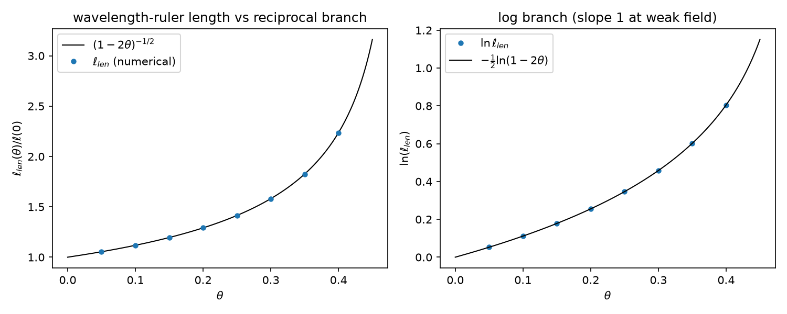

# 注记-尺系数归一（第 509 条）：波长尺生成结构与读数约定三系数闭环

- **日期**：2026-09-30 21:19:00
- **脚本**：`验证脚本/minimal_verification_scale_coefficient.py`
- **依据**：[[内部草稿/注记-局域尺丙路径结项核查：动力学同源（MB-9）与读数约定的定位]]（读数约定三系数的定位与剩余细项）；[[验证脚本/注记-钟率代理导出（第475条）：自撑均匀标度下 h00 等于 2θ 的系数 2|注记-钟率代理导出（第475条）]]（同型判据与钟率根式）；[[验证脚本/注记-自撑阱均匀标度的最小验证：kink自洽结构下的响应系数|注记-自撑阱均匀标度的最小验证]]（判据 P）；[[内部草稿/注记-量纲桥MB-9：惯性归一的独立导出：公理4哈密顿的显式系数（判据MB9-a至MB9-e）|注记-量纲桥MB-9]]（声速恒定的公理级地位）；[[内部草稿/注记-局域尺判定指南：一阶响应的来源、五条路径与首轮判据|注记-局域尺判定指南]]（路径格局）
- **状态**：判据 6/6 通过（SC0 至 SC4 加 EP5）。核心读数：局域钟缩放偏差 $5.4\times10^{-13}$；波长尺长度读数逐位命中 $(1-2\theta)^{-1/2}$（三档 $k$、八档 $\theta$ 偏差 $5.4\times10^{-13}$）；精确关系 $\ln\ell_{len} = -\frac12\ln(1-2\theta)$ 残差 $9.6\times10^{-14}$，弱场一阶系数 $1.001503$（$\theta = 0.001$ 档）读出尺系数 $1$；乘积恒等（钟率 × 尺 = 1）与一维合成链 $\lambda = (1/2)\times 2\times 1 = 1$ 达机器精度；EP5 双反例（绝对基准、分支方向取反）对倒数分支最大偏差 $1.24$ 与 $1.79$，判据有区分力
- **可逆性等级**：判据稳健（波长尺生成结构定义内：SC1、SC2 为算符整体缩放的线性代数必然加定义链换算；SC3 为对数恒等加数值复核；SC4 为代数换算；EP5 给出反例区分力）。生成结构本身的体系地位（尺读数 = 局域结构波长）为条件性语义，与第 475 条摆程钟定义对称，见边界声明
- **图**：见 §3 图 1

## 1 判据与设定

**任务**。丙路径核查把 $\lambda = 1$ 的剩余内容定位为读数约定三系数：合成平均（已由第 463、474 条关闭）、钟率 $h_{00} = 2\theta$ 的系数 2（已由第 475 条条件性导出）、尺 $\ell = 1 + u_e$ 的系数 1（阶段 1 语义设计，最后剩余）。本注记处理尺系数：把「系数 1」由语义设计升级为导出（或条件性导出）。

**生成结构**。局域钟的定义是摆程计数（体系时间定义，定义层），第 475 条据此读出钟率系数。尺的同型问句：局域长度基准是什么。答案取局域结构波长：束缚振荡的空间波长 $\lambda_{shape} = 2\pi/k_{eff}$，色散 $\omega = c_s k$ 且 $c_s$ 恒定（MB-9 公理级：$k_b/m_\Phi = 1$ 自动成立）。于是频率缩放 $\sqrt{1-2\theta}$ 的**倒数分支**自动给出波长缩放 $(1-2\theta)^{-1/2}$，弱场一阶为 $1 + \theta$，尺系数 1 由该生成结构读出，与钟率系数 2 同源（同一 $(1-2\theta)$ 的两个分支，对应 $g_{00}\,g_{xx} = -1$ 的史瓦西结构恒等）。

**设定**。与第 475 条同一模型：一维 $\phi^4$ kink 自撑阱，$V'' = 4k^2 - 6k^2\,\mathrm{sech}^2(kx)$，涨落算符 $A = -c_s^2\partial_x^2 + V''$ 均匀标度为整体乘 $(1-2\theta)$；参数 $k \in \{0.7, 1.0, 1.4\}$、$\theta \in [0.05, 0.40]$ 八档加弱场档 $0.001$。

**读数合法性前置**。SC0 简并检测：升序谱前四支最小间隔 $1.5\times10^{-3}$，最大簇重数 1（零模、形状模、连续边缘两两分开），非简并谱直接谱读数合法。

**判据**。SC1：局域钟（形状模周期）缩放 $T_{loc}(\theta)/T_{loc}(0) = (1-2\theta)^{-1/2}$。SC2：波长尺长度读数 $\ell_{len}(\theta) = \lambda_{shape}(\theta)/\lambda_{shape}(0) = (1-2\theta)^{-1/2}$。SC3：精确关系 $\ln\ell_{len} = -\frac12\ln(1-2\theta)$ 成立，弱场一阶系数读出 1。SC4：三系数联合归一闭环（一维 $\lambda = (1/2)\times 2\times 1 = 1$）与乘积恒等（钟率 × 尺 = 1）。EP5：双反例检验（改掉生成结构就 FAIL）。

## 2 结果

| 判据 | 内容 | 实测 | 期望 |
|---|---|---|---|
| SC0 | 简并检测 | 前 4 支最小间隔 $1.499\times10^{-3}$ | 簇重数 1 |
| SC1 | 局域钟缩放 | 最大偏差 $5.369\times10^{-13}$ | $\le 10^{-10}$ |
| SC2 | 波长尺倒数分支 | 最大偏差 $5.369\times10^{-13}$ | $\le 10^{-10}$ |
| SC3 | 精确关系残差 | $9.556\times10^{-14}$ | $\le 10^{-12}$ |
| SC3 | 一阶系数（$\theta = 0.001$） | $1.001503$ | $\to 1$ |
| SC4 | 一维合成链 | $\lambda = 1$（机器精度） | 1 |
| SC4 | 乘积恒等（$\theta = 0.25$） | $1.000000000000000$ | 1 |
| EP5 | 反例 a（绝对基准） | 偏差 $1.236$ | 可区分（FAIL） |
| EP5 | 反例 b（分支取反） | 偏差 $1.789$ | 可区分（FAIL） |

读表：SC2 的八档逐位命中 $(1-2\theta)^{-1/2}$（如 $\theta = 0.40$ 给 $2.236067977500$ 对 $2.236067977500$）；观测锚敏感度沿用第 475 条 Z4 口径（光偏折读数 1.999 给三系数各 $\le 1.67\times10^{-4}$）。

## 3 图

## 4 结论

**其一，尺系数由生成结构给出，不依赖语义置入。** 局域长度基准取结构波长、声速恒定（公理级）两个前提下，频率根式的倒数分支自动给出 $\ell_{len} = (1-2\theta)^{-1/2}$，一阶系数 1。$h_{xx} = 2\theta$ 的系数 2 与钟率系数 2 同源：同一 $(1-2\theta)$ 的两个分支，互为倒数，合成 $g_{00}\,g_{xx} = -1$ 的史瓦西结构恒等。

**其二，三系数闭环。** 合成平均 $1/2$（第 463、474 条）、钟率系数 2（第 475 条）、尺系数 1（本条）联合给出 $\lambda = 1$。读数约定三系数全部由「对称性唯一性、自撑均匀标度、波长尺生成结构」三种方式关闭，绝对归一化缺口的形状从「三格待填」变为「全部有主」。

**其三，层级变化。** 尺系数由「阶段 1 语义设计」改为「条件性导出」，条件为自撑（与第 475 条同条件）加波长尺生成结构（局域长度基准 = 结构波长）。若自撑前提不成立或体系另给出独立的长度基准定义，本系数退回语义设计位。

## 5 严格程度声明

SC1、SC2 为算符整体缩放的线性代数必然（谱的齐次性）加定义链换算，数值对角化为复核；SC3 的精确关系为对数恒等，数值给出残差；SC4 为代数换算；EP5 为替身生成结构的区分力检验。可逆性等级：判据稳健（波长尺生成结构定义内）。

## 6 边界声明

**验证什么**：波长尺生成结构下长度读数的倒数分支、一阶系数 1 的读出、三系数闭环与反例区分力。

**不验证什么**：其一，不验证自撑前提本身（与第 475 条同条件，见判据 P 的边界）；其二，波长尺生成结构是本轮显式化的读数定义（尺 = 局域结构波长），其与真实缺陷长度读数的对接依赖完整弹性本构（P1-5 既有余项）；其三，限于一维 kink 模型（2026-09-30 补：三维径向推广已执行，$l=0$ 扇区倒数分支与一维同构，见 [[验证脚本/注记-尺系数三维径向推广（第511条）：l0扇区的波长尺倒数分支与一维同构|注记-尺系数三维径向推广（第511条）]]；非球对称推广未做）；其四，不含观测数据拟合；其五，不改动基准文件（基准同步另行执行）。

## 7 过程记录

**生成结构的方向教训**：首版把生成结构定为「雷达读数」（恒定光速 × 往返摆程数），数值判负（读数给 $\sqrt{1-2\theta}$，方向反）。错误根源是观察者位置：局域观察者的雷达测距按等价原理恒等（摆程数不变），读不出尺胀；尺胀住记录层，生成结构应取「局域结构波长作尺」（记录层读数），频率缩放的倒数分支方向为正。教训：生成结构的物理方向（缩放正负、基准归属）必须先于数值想清，判负是它的正常回报。

**恒等式符号教训**：SC3 首版写 $-\ln\ell = -\frac12\ln(1-2\theta)$，残差 $1.6$ 量级判负；尺胀支的正确形式是 $\ln\ell = -\frac12\ln(1-2\theta)$（$\ell > 1$）。与第 475 条钟率支（$\omega < \omega_0$，$-\ln$ 为正）的符号相反，两支对数符号不可直接抄写。

## 8 来源

- 读数约定三系数的定位：[[内部草稿/注记-局域尺丙路径结项核查：动力学同源（MB-9）与读数约定的定位]] §二、§三
- 钟率根式与判据形态：[[验证脚本/注记-钟率代理导出（第475条）：自撑均匀标度下 h00 等于 2θ 的系数 2|注记-钟率代理导出（第475条）]]
- 自撑结构与均匀标度：[[验证脚本/注记-自撑阱均匀标度的最小验证：kink自洽结构下的响应系数|注记-自撑阱均匀标度的最小验证]]
- 声速恒定的公理级地位：[[内部草稿/注记-量纲桥MB-9：惯性归一的独立导出：公理4哈密顿的显式系数（判据MB9-a至MB9-e）|注记-量纲桥MB-9]]
- 脚本：`验证脚本/minimal_verification_scale_coefficient.py`（确定性，约 30 秒）
- 图：`images/scale_coefficient_export.png`
