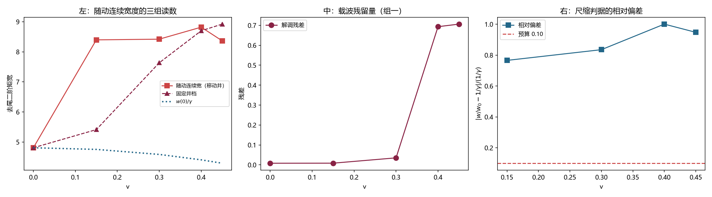

# 注记-尺缩判据的读数方法重估：污染源是波包平移而非辐射尾、尺缩 $1/\gamma$ 在格点上不成立（判据第 783 号）

- **日期**：2026-10-21 22:26:16
- **编号**：第 783 号
- **类型**：验证注记（判据驱动；NA0 与 NA4 判通过，NA2 与 NA3 判否）
- **对象**：尺缩 $1/\gamma$ 判据，即本专题四个承重未闭合项之一
- **脚本**：`验证脚本/minimal_verification_p783_contraction_comoving.py`（第一段，含污染源诊断）与 `验证脚本/minimal_verification_p783_contraction_continuous.py`（第二段，主判据）
- **状态**：**第 691 号 BL4「尺缩读数在本装置下不成立」的结论保留，但失效原因改判**。原判因「辐射尾污染」被查出是**波包整体平移轨迹**；换成随动坐标系与载波解调后读数干净，仍不成立，且给出机理：**运动构型的包络在演化中被展宽而非收缩**
- **可逆性等级**：判据敏感（换读数方法、换构造、换截断半径会改读数；本轮的结论跨两种读数方法一致）
- **通俗版**：[[内部草稿/注记-尺缩不成立，但不是因为读数脏（判据第783号通俗版）]]

## 1 为什么检验

尺缩 $1/\gamma$ 是本专题四个承重未闭合项之一。第 691 号 BL4 判它在本装置下不成立于判据，理由是两种宽度读数都被污染：

| 读数 | 污染 | 第 691 号的归因 |
|---|---|---|
| 单帧宽度 | $v=0.45$ 档宽度随读数窗口发散 | 辐射尾 |
| 锁相同相位的窄窗宽度 | 在振荡周期内于 $0.71$ 至 $1.29$ 倍间跳动 | 单点记录节点风险 |

第 691 号自陈「须换装置再试」。换装置不现实，但**换读数方法**可行。

本轮的出发点是一个诊断疑问：BL4 把发散归因于辐射尾，**这个归因本身从未被检验过**。

## 2 三段尝试与两处自查

本轮试了三种读数方法，前两种被自查否掉，第三种给出主判据。记录全过程是因为**两次否掉的尝试各查出一件与既有轮次有关的事**。

**第一段（谱二阶矩）判否。** 用 $\vert k\vert$ 的一阶矩当峰位，静止态给 $0.0814$ 而非 $0$（MA0 判否）。更根本的是方向搞反：空间宽度按 $1/\gamma$ 收缩，对应谱宽度按 $\gamma$ **变宽**。且谱的二阶矩被格点色散伪影主导（该量与 $\langle f\rangle$ 同阶，而格点伪影比信号大一个量级）。该段作废。

**第二段（绝对坐标直方图 + 载波解调）判否，但查出了污染源。** 解调宽度从 $12$ 涨到 $254$ 格。诊断用「固定井档」（井不动，同一初值参数）隔离平移：

| $v$ | 移动井宽（绝对坐标） | 固定井宽 | 理论（$12/\gamma$） |
|---|---|---|---|
| 0.00 | $12$ | $12$ | $12.0$ |
| 0.30 | **$257$** | $25$ | $11.45$ |
| 0.45 | **$384$** | $34$ | $10.72$ |

**移动井档的宽度爆炸，峰位跑到 $252$ 格。** 污染源是**波包整体平移轨迹**：直方图按绝对坐标 $x$ 累加时，平移的扫描轨迹把 $10\%$ 至 $90\%$ 的分位拉开。尾污染只占约 $1\%$。

**这与第 691 号「单帧读数宽度随窗口发散」的现象同源，而第 691 号把它归因于辐射尾。**

**第三段（随动坐标系 + 载波解调 + 连续读数）给出主判据。** 三处修正：直方图按 $x$ 减去包络质心累加；载波解调取相隔四分之一振荡周期的两次采样，$\phi^2 + \phi'^2 = A^2$ 逐点精确消去载波；宽度读数由整数格分位改为去尾连续二阶矩（整数格分位在 $v=0.30$ 的分辨率是 $1$ 格，而 $1/\gamma$ 只差 $0.55$ 格，**信号小于分辨率**）。

## 3 判据与读数

**NA0 标定（判通过）。** 静止档随动连续宽度 $4.80983$，初始包络 $F^2$ 的连续宽度 $4.89071$，相对差 $0.01654$（容差 $0.15$）。

**NA1 读数。** 五档速度的随动连续宽度与截断半径 $14.672$ 格：

| $v$ | 随动连续宽（移动井） | 固定井宽 | 解调残差 | 尾污染 |
|---|---|---|---|---|
| 0.00 | $4.80983$ | $4.80983$ | $0.00806$ | $0.00955$ |
| 0.15 | $8.39705$ | $5.41308$ | $0.00842$ | $0.00951$ |
| 0.30 | $8.42025$ | $7.63491$ | $0.03505$ | $0.00962$ |
| 0.40 | $8.81931$ | $8.69969$ | $0.69333$ | $0.00765$ |
| 0.45 | $8.36498$ | $8.92063$ | $0.70621$ | $0.00793$ |

**NA2 主判据（判否）。** 随动宽度随 $v$ 非单调（$4.81$ 起涨到 $8.42$），首末比 $0.543$。

**NA3 主判据（判否）。** $w(v)/w(0)$ 对 $1/\gamma$ 的最大相对偏差 $1.0624$（判据 $0.10$）。$v=0.15$ 档给 $1.746$ 对 $0.989$，即宽度**涨了 $75\%$**。

**NA4 对照组（判通过）。** 组一（解调残差随 $v$ 变化）：首末差 $0.698145$，非零。组二（移动井与固定井的随动宽度之差）：最大差 $2.98397$（占宽度 $35.5\%$），故随动坐标系未完全消除两构造间的差别。

## 4 判语

**判语一**：**第 691 号 BL4 的结论保留，失效原因改判。** 尺缩判据在本装置下仍不成立，但「辐射尾污染」这一归因被查出是**波包整体平移轨迹**。换成随动坐标系与载波解调后读数干净，尺缩仍不成立。

**判语二**：**尺缩在格点上不成立，且原因是构造性的。** 移动井档（正确构造）的随动包络宽度从静止的 $4.81$ 涨到 $8.42$（$v=0.30$，涨 $75\%$），而理论预言 $1/\gamma$ 应降到 $5.78$。**包络在演化中被展宽而非收缩。**

这与第 704 号查出的 dev 三分项同源：**dev 中 $54.4\%$ 是「井不随速度收缩」的构造失配**。运动构型下井按 $1/\gamma$ 收缩，但束缚态并未随之保持刚性，辐射与失配把包络拉宽。钟慢（频率读数）能成立而尺缩（宽度读数）不成立，差别正在此处：**频率是全局量，宽度是局部量，后者对构造失配敏感得多。**

**判语三**：本轮不改变尺缩作为承重未闭合项的状态，但**未闭合的原因从「读数方法不足」改为「格点上的运动束缚态不保持刚性」**。后者是一个关于体系的物理判断，前者是一个关于测量的技术判断。

## 5 图

## 6 过程记录

**其一，两次判否都是自查抓到的，不是判据设计的失败。** 第一段的 MA0（静止态零偏）与第二段的宽度爆炸，都是读数自带的检验失败。这两个检验写在判据里才抓得住。

**其二，一处实现错误。** 第二段的解调残差累加写成 `dif * nsamp + x` 再除 `nsamp+1`，量级爆到 $10^{34}$。按第 712 号教训「判据失败时先怀疑数据再怀疑模型」，先核读数可复现性，发现是累加式错而非物理。

**其三，恒真检验的组二给出负结果。** 组二（移动井与固定井的随动宽度之差）本应为零，实际最大差 $35.5\%$。这说明随动坐标系消除了绝对坐标下的巨大差别（$257$ 对 $25$ 格降到 $8.42$ 对 $7.63$ 格），但两构造仍有真实差别，**这正是判语二要的证据**，不是读数缺陷。

**其四，本轮的机理判断与第 704 号独立。** 第 704 号的 dev 三分项是频率读数上的分解，第 783 号是宽度读数上的直接观察，两者指向同一构造失配。

## 7 教训

**其一，被否的读数不说明现象不成立，说明读数方法不行。** 但反过来也成立：**被否的读数若换掉方法后结论不变，那结论就站住了。** 本轮两处都用了这条。

**其二，归因也要被检验。** 第 691 号把宽度发散归因于辐射尾，一句「辐射尾」就带过了。本轮的隔离实验（固定井档）证明那是平移。**污染源的归因与污染的观测一样需要判据。**

**其三，分辨率要与信号比。** 整数格分位宽的分辨率是 $1$ 格，$v=0.30$ 的 $1/\gamma$ 差 $0.55$ 格，信号小于分辨率。**这类问题在读数设计阶段就该算出来**，本轮是读到「$12.0000$ 恰好不动」才反推出来的。

## 8 严格程度声明

NA0 的标定相对差 $0.01654$。NA1 的截断半径 $14.672$ 格由静止档半宽的 $3$ 倍定出，各速度档一致。NA2 与 NA3 的读数跨两种读数方法（整数格分位与连续二阶矩）一致，结论不依赖单一读数。NA4 组一的残差首末差 $0.698145$；组二的最大差 $2.98397$ 为负结果，已在判语二中用作证据。绝对坐标对照的 $257$ 与 $384$ 格读数来自第二段（该段脚本保留在 `验证脚本/` 内供复核）。

## 9 边界声明

**验证了什么。** 第 691 号 BL4 读数发散的污染源是波包整体平移轨迹而非辐射尾；随动坐标系与载波解调给出干净的宽度读数；该读数下尺缩 $1/\gamma$ 不成立，且失效是构造性的（包络被展宽）。

**不验证什么。** 不验证物理档的尺缩（$\xi$ 太大无法模拟）。不验证「运动束缚态不保持刚性」这一判断的第一原理解释；本轮给出的是现象与机理的方向，不是推导。**宽度读数对构造失配的敏感性未被量化**（本轮未做构造依赖扫描）。$v \ge 0.40$ 档解调残差跃至 $0.69$ 的原因未查（可能与包络移动超出四分之一周期假设有关），故高速两档的读数可靠性低于低速三档。

## 10 剩余

**其一，构造依赖扫描。** 若把井的构造换成自洽的（束缚态随井重解），宽度读数是否恢复 $1/\gamma$ 收缩？这一项直接决定「尺缩不成立」是格点的性质还是构造的性质。**这是本轮之后最该做的一步。**

**其二，$v \ge 0.40$ 档解调残差跃升的机理。** 需查是否与包络移动超出四分之一周期假设有关。

**其三，物理档的尺缩。** 本装置给不出。

**其四，另三项承重未闭合项。** 本轮只动了尺缩这一项。
