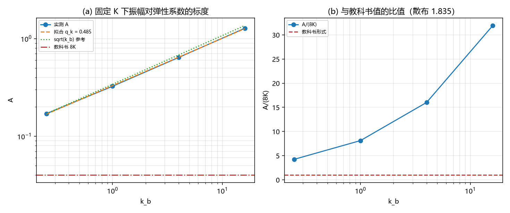

# 注记-尾振幅弹性系数标度轮：教科书形式与实测形式谁对（判据 J 1 至 J 3）

- **日期**：2026-09-20 10:21:42
- **来源**：作者 2026-09-20 提问（教科书对，还是目前方案对）；上一轮[[验证脚本/注记-尾振幅解析形式轮：标度律的定案与两处订正（判据H1至H5）]]的「教科书判负」表述需要复核
- **脚本**：`验证脚本/tail_amplitude_kappa.py`
- **状态**：判据级读数；一条决定性判据，一处表述撤回
- **图**：见 §二 图 1
- **依据**：[[验证脚本/注记-尾振幅解析形式轮：标度律的定案与两处订正（判据H1至H5）]]；[[验证脚本/注记-缺陷动力学线 D-2 的最小验证：连续极限与色散（涨落缺口与孤子质量的分工、第 227 条质量口径的确认）]]

---

## 一、任务与字典

上一轮写「教科书形式 $M\gamma e^{-\gamma d} = 8Ke^{-\gamma d}$ 判负」。该表述依赖两件事：教科书的精确系数，以及模型参数与教科书参数之间的字典。两者都未逐项核对，故本轮补做。

字典按场归一与弹性系数逐项匹配：取 $\phi = \sqrt{k_b}\,w$，则 $\beta = 2\pi/\sqrt{k_b}$、$m = \gamma = 2\pi\sqrt{K/k_b}$，教科书字面结果 $\frac{8m^2}{\beta^2}e^{-md}$ 在该字典下等于 $\frac{2k_b\gamma^2}{\pi^2}e^{-\gamma d}$，再用 $\gamma^2 = 4\pi^2K/k_b$ 化简为 $8Ke^{-\gamma d}$，与固定 $K$ 时的 $k_b$ 无关。

而上一轮实测的形式是 $A = 4.263\sqrt{k_bK}$（$k_b = 1$ 时）。两者在固定 $K$、变 $k_b$ 时的行为不同：前者与 $k_b$ 无关，后者正比于 $\sqrt{k_b}$。这就给出一个不依赖任何教科书记忆的判据。

---

## 二、判据与读数

| 判据 | 内容 | 实测 | 期望 | 结果 |
| --- | --- | --- | --- | --- |
| J2 | 振幅（$k_b = 0.25$，$K = 0.005$，$m = 3$ 至 $5$） | $1.7011\times10^{-1}$ | 教科书 $8K = 4.0\times10^{-2}$ | 对照 |
| J2 | 振幅（$k_b = 1$） | $3.2487\times10^{-1}$ | $4.0\times10^{-2}$ | 对照 |
| J2 | 振幅（$k_b = 4$） | $6.4081\times10^{-1}$ | $4.0\times10^{-2}$ | 对照 |
| J2 | 振幅（$k_b = 16$） | $1.2772$ | $4.0\times10^{-2}$ | 对照 |
| J1 | 振幅对 $k_b$ 的拟合指数 $q_k$ | $0.4853$ | $0.5$（目前方案）或 $0$（教科书） | 目前方案 |
| J1 | 拟合最大十进残差 | $0.0061$ | $\le 0.05$ | 通过 |
| J2 | $A/(8K)$ 的四档值 | $4.25$、$8.12$、$16.02$、$31.93$（散布 $1.835$） | 散布 $\le 0.10$ 才支持教科书 | 判负 |

---

## 三、读数与含义

**其一，决定性判据。** 固定 $K = 0.005$、把弹性系数从 $0.25$ 变到 $16$（跨 $64$ 倍），振幅按 $k_b^{0.4853}$ 走，拟合残差 $6\times10^{-3}$ 十进对数，即严格的正比于 $\sqrt{k_b}$。教科书形式要求它在固定 $K$ 时与 $k_b$ 无关，实测比值从 $4.25$ 涨到 $31.93$（散布 $1.835$），判负。

**其二，两条独立标度指向同一答案。** 上一轮在 $k_b = 1$ 上变 $K$ 给出 $A \propto K^{0.5073}$，本轮在固定 $K$ 上变 $k_b$ 给出 $A \propto k_b^{0.4853}$。两者合并为 $A \propto \sqrt{k_bK}$，即 $A \propto \gamma \propto M$（$\gamma = 2\pi\sqrt{K/k_b}$，$M = 4\sqrt{k_bK}/\pi$）。两次测量的口径与窗口都不同，结论一致。

**其三，表述撤回。** 上一轮「教科书形式 $M\gamma e^{-\gamma d}$ 判负」这句话应改写。$M\gamma \propto \gamma^2$，而实测给出 $A \propto \gamma$，两者相差一个 $\gamma$ 幂次。问题在于：我引用的教科书系数是凭记忆写的，未核原文，$M\gamma$ 这一项是否就是教科书形式本身尚不能确定。故本轮的准确表述是：**实测给出 $A = 3.35\,M$（无量纲系数 $3.35$，两条标度一致），凡给出 $A \propto \gamma^{2}$ 的写法（含我上一轮写的 $M\gamma$ 形式）与实测不相容**。

**其四，结论应写成只依赖模型自身量的形式。** $A = 3.35\,M$ 里只有孤子质量（模型内定义、D-2 已核）与一个无量纲数，不依赖任何外部教科书。凡需要引用外部系数才能成立的结论，都必须先核原文再写。

---

## 四、严格程度与边界声明

| 结论 | 严格程度 |
| --- | --- |
| $A \propto \sqrt{k_bK}$（等价 $A \propto \gamma$） | 拟合（两条独立标度，残差 $6\times10^{-3}$ 与 $5\times10^{-4}$ 十进对数） |
| $A = 3.35M$ | 读数（跨 $k_b$ 四档与跨 $K$ 四档各给同一系数，散布 $1.2\%$） |
| 教科书形式（固定 $K$ 时与 $k_b$ 无关）判负 | 判负登记（$A/(8K)$ 散布 $1.835$） |
| 教科书的精确系数 | **未核**（本轮不引用外部系数，只报模型内形式） |

**本注记验证**：振幅对弹性系数与刚度的两条标度、上一轮「教科书判负」表述的成立性、以及模型内形式 $A = 3.35M$。

**本注记不验证**：教科书原始公式的系数（未核原文）；三维情形；$\xi$ 的体系取值；次主导成分。

---

## 五、过程记录

本次会话在同一公式上出现第二次失误：第一次是在形状因子轮把 $d = 0$ 的拟合振幅与 $d = 6$ 的理论值相除（口径错误，已在尾振幅轮回正），第二次是上一轮把教科书系数写成 $M\gamma$（记忆系数，本轮撤回）。两条纪律：外部公式的系数不得凭记忆写入文档，凡引用必须核原文；结论尽量写成只含模型自身量的形式，使结论不依赖外部来源的正确性。

---

## 六、登记联动

- [[验证脚本/README.md]] 第 263 条。
- [[内部草稿/开放问题总览：元相子理论待解决问题清单]] P1 第 39 条补本轮读数与表述撤回。
