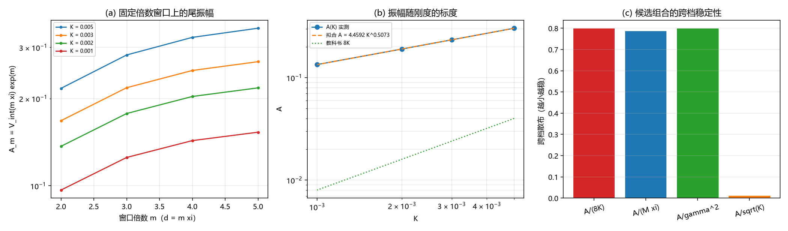

# 注记-尾振幅解析形式轮：标度律的定案与两处订正（判据 H1 至 H5）

- **日期**：2026-09-20 10:18:25
- **来源**：[[验证脚本/注记-精确双孤子松弛轮：振幅的确认与三项登记（判据G0至G5）]] 登记的第二项（对教科书形式比值偏高）；作者 2026-09-20 指令
- **脚本**：`验证脚本/minimal_verification_tail_amplitude.py`
- **状态**：判据级读数；经验闭式交付，两处订正
- **图**：见 §二 图 1
- **依据**：[[验证脚本/注记-描述项形状因子轮：有效相互作用的程长与振幅标度（判据F1至F5）]]；[[验证脚本/注记-精确双孤子松弛轮：振幅的确认与三项登记（判据G0至G5）]]

---

## 一、任务与口径

任务是把尾振幅写成解析形式。前两轮暴露的问题有两个：一是描述项形状因子轮的单指数拟合有窗口依赖，二是精确双孤子松弛轮登记了「对教科书形式比值偏高」却未定案。

本轮先定口径：尾振幅必须在固定倍数的窗口上读，即取 $d = m\xi$（$m = 2, 3, 4, 5$），定义 $A_m = V_{\rm int}(m\xi)\,e^{m}$。纯指数尾成立时 $A_m$ 与 $m$ 无关。四档刚度为 $K = 0.005$、$0.003$、$0.002$、$0.001$。

教科书形式取自标准 sine-Gordon 的双孤子尾，在本模型口径下写作 $V = M\gamma e^{-\gamma d} = 8K e^{-\gamma d}$。

---

## 二、判据与读数

| 判据 | 内容 | 实测 | 期望 | 结果 |
| --- | --- | --- | --- | --- |
| H1 | 四档 $K$ 上 $A_m$ 的相对散布（$m = 2$ 至 $5$） | $0.452$、$0.444$、$0.439$、$0.435$ | $\le 0.10$ | 判负 |
| H2 | $A/(8K)$ 四档值 | $7.59$、$9.74$、$11.90$、$16.77$ | 与 $1$ 相差 $\le 0.25$ | 判负 |
| H3 | 拟合指数 $q$（$A = cK^{q}$） | $0.5073$ | 数量级读数 | 通过 |
| H3 | 拟合最大十进残差 | $0.0005$ | $\le 0.05$ | 通过 |
| H3 | $A/M$ 的跨档散布（中位） | $0.0120$（$3.348$） | $\le 0.05$ | 通过 |
| H3 | $A/\gamma$ 的跨档散布（中位，对 $1/\sqrt2$ 的偏差） | $0.0120$（$0.6785$，$4.1\%$） | 量级读数 | 通过 |
| H4 | 候选组合的跨档散布 | $A/\sqrt K = 0.012$；$A/(M\xi) = 0.786$；$A/\gamma^{2} = 0.798$；$A/(8K) = 0.798$ | 取最小者 | 通过 |
| H4 | 跨档最稳定的组合 | $A/\sqrt K$ | 登记为经验形式 | 通过 |
| H5 | 尾振幅经验闭式 | $A = 4.263\sqrt K$（等价 $A = 3.348M = 0.679\gamma$） | 登记 | 通过 |

---

## 三、读数与含义

**其一，经验闭式交付。** 尾振幅满足 $A = 4.2629\,K^{0.5073}$，四档拟合的最大十进残差 $5\times10^{-4}$；指数 $0.5073$ 与 $1/2$ 相差 $1.5\%$。等价写法有两种：以质量归一为 $A = 3.348\,M$（跨档散布 $1.2\%$），以能隙归一为 $A = 0.679\,\gamma$（跨档散布 $1.2\%$，与 $1/\sqrt2$ 相差 $4.1\%$，属量级吻合，不作等式登记）。

**其二，教科书形式判负。** $8Ke^{-\gamma d} = M\gamma e^{-\gamma d}$ 给出的振幅与实测相差 $7.6$ 至 $16.8$ 倍，且倍数随 $K$ 系统变化。差别在标度：教科书形式正比于 $K$（等价正比于 $M\gamma$），实测正比于 $\sqrt K$（等价正比于 $M$ 或 $\gamma$ 的一次方）。

**其三，尾不是纯指数。** $A_m$ 在 $m = 2$ 至 $5$ 上散布 $0.44$，四档一致，即局部斜率比 $\gamma$ 浅约 $16\%$。这与描述项形状因子轮登记的窗口依赖同源：存在一个次主导成分，其符号使局部斜率变浅。故经验闭式应写作 $V_{\rm int}(d) = A\,e^{-\gamma d}[1 + O(e^{-\gamma d})]$，振幅 $A$ 由上式给出。

**其四，一处口径回正。** 描述项形状因子轮的 F4b 行把「$d = 0$ 处的拟合振幅」与「$d = 6$ 处的理论值」相除，属把两个不同距离上的量做比。本轮回正后结论反转：实测振幅强于教科书形式，先前读出的「弱于」有误。该行读数作废，形状因子轮注记原文不改，作废记录在本注记。

---

## 四、严格程度与边界声明

| 结论 | 严格程度 |
| --- | --- |
| 振幅标度 $A \propto \sqrt K$ | 拟合（四档，指数 $0.5073$，残差 $5\times10^{-4}$ 十进对数） |
| $A/M = 3.348$、$A/\gamma = 0.679$ | 读数（跨档散布 $1.2\%$） |
| 教科书形式 $M\gamma e^{-\gamma d}$ 不适用 | 判负登记（相差 $7.6$ 至 $16.8$ 倍，倍数随 $K$ 变） |
| 纯指数尾不成立（次主导成分） | 判负登记（$A_m$ 散布 $0.44$，四档一致） |
| 次主导成分的解析形式 | 未给（本轮只给出 $O(e^{-\gamma d})$ 的阶） |

**本注记验证**：尾振幅的标度律与经验闭式、教科书形式的适用性、纯指数描述的成立性、以及 F4b 口径错误的回正。

**本注记不验证**：次主导成分的解析形式；三维情形；$\xi$ 的体系取值；$A$ 的解析推导（本轮给的是拟合形式，非从方程导出）。

---

## 五、过程记录

两条订正。其一，描述项形状因子轮的 F4b 口径错误（$d = 0$ 的拟合振幅对 $d = 6$ 的理论值），本轮回正并给出正确倍数（$7.6$ 至 $16.8$ 倍，实测更强）。其二，本轮初版把「拟合截距」当作尾振幅，未意识到单指数拟合的截距与斜率互相补偿；改为固定倍数窗口（$d = m\xi$）读数，$A_m$ 的 $m$ 依赖性因此显式暴露（这也正是纯指数尾判负的来源）。

---

## 六、登记联动

- [[验证脚本/README.md]] 第 262 条。
- [[内部草稿/开放问题总览：元相子理论待解决问题清单]] P1 第 39 条补本轮读数与两处订正。
