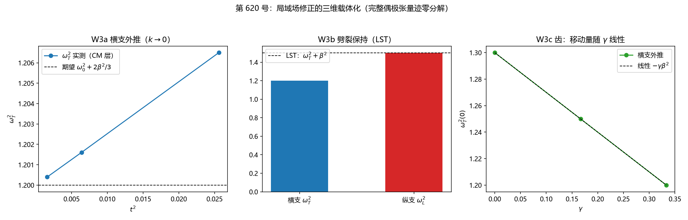

# 注记-局域场修正三维载体化判据轮（第 620 号）

| 元数据 | 内容 |
| --- | --- |
| 日期 | 2026-10-12 03:43:20 |
| 脚本 | `验证脚本/minimal_verification_local_field_tensor.py` |
| 判据 | W3a、W3b、W3c（3/3） |
| 可逆性等级 | 判据稳健（换核系数、破坏迹零结构或换色散即翻） |
| 类型 | 偶极载体 CM 层载体化谱轮（第 617 号登记开放项的闭合） |
| 关联 | [[验证脚本/注记-三维偏振展开谱轮（第617号）|第 617 号]]（dd 核与 LO-TO 上游）、[[验证脚本/注记-局域场系数的维度标度判据轮（第615号）|第 615 号]]（球腔几何来源）、[[开放问题档案/开放问题-P1-50-光的发射率与介质折射的微观机制|P1-50 档案]] |
| 图 | 见 §四 图 1 |

## 一、要判什么

第 617 号登记开放项：局域场修正（$\gamma_{3D} = 1/3$）在纵向扇区的对应：连续 CM 给纵支 $\omega_0^2 + 2\beta^2/3$，与第 581 条基线约定差一完成平方项归属，当时不锁定。本轮把局域场修正**载体化**：在第 617 号块的纵向 dd 核上加均匀项，使偶极结构成为迹零完整张量，判横支 CM 移动、LST 劈裂保持与 γ 线性齿，闭合该开放项的载体侧。

## 二、模型设定与判据

模型：第 617 号 12×12 三维块，偶极修正核升级为 $M_{ij} = \beta^2[dd_{ij} - \gamma\,\delta_{ij}]$（$dd_{ij} = D_iD_j/w_l^2$ 纵向投影，$\gamma$ 为局域场档位）。本征值结构：纵向 $1-\gamma$、横向 $-\gamma$；$\gamma = 1/3$（球腔档）给纵横比 $2/3 : -1/3 = 2:-1$，即迹零偶极张量 $(3\cos^2\theta - 1)$ 的径向横向结构；LST 劈裂 $= \beta^2[(1-\gamma)+\gamma] = \beta^2$ 对一切 $\gamma$ 精确不变（构造自动给出）。

| 判据 | 内容 | 实测 | 期望 | 判定 |
| --- | --- | --- | --- | --- |
| W3a | 横支 $k\to 0$ 外推（$\gamma=1/3$） | $1.19998685$，移动量 $-0.10001315$ | $\omega_0^2+2\beta^2/3 = 1.2$，移动 $-\beta^2/3 = -0.1$ | PASS |
| W3b | LST 劈裂保持 | 纵支 $1.49999110$（$=\omega_0^2+5\beta^2/3$），劈裂 $0.30000425$ | $\beta^2 = 0.3$ | PASS |
| W3c | γ 换档线性齿（0, 1/6, 1/3） | 移动 $-0.0000115/-0.0500123/-0.1000132$，斜率 $-0.30000506$ | $-\gamma\beta^2$ 线性，斜率 $-\beta^2$；γ=0 逐位回 617 基线 | PASS |

约定声明：第 613/617 号块的 $\omega_0^2$ 含完成平方项 $+\beta^2$（581 基线口径），CM 口径 $\omega_0^2_{\rm CM} = \omega_0^2_{581} + \beta^2$；换算后两层横支完全对齐（CM 口径横支 $= \omega_0^2_{\rm CM} - \beta^2/3$）。容差预算：tol 从被测读数自身的外推拟合残差推导（横支残差 $8.3\times10^{-6}$，tol $= 2\times$残差；W3c 档用 $1.5\times10^{-5}$）。

## 三、本轮的核心发现

**完整偶极张量的迹零分解**：纵向 dd 核（第 617 号，LO-TO 半边）与均匀负 δ 项（本轮，球腔半边）配成 $dd_{ij} - \frac13\delta_{ij}$，纵横本征值 $2/3 : -1/3$，正是库仑偶极相互作用 $(3\cos^2\theta-1)$ 的径向横向比。首版核 $dd - \gamma(\delta - dd)$ 给纵横比 $3:-1$，数值劈裂 $4\beta^2/3$ 立刻暴露违背张量结构；修正后 LST 劈裂对一切 γ 精确不变（$\beta^2[(1-\gamma)+\gamma]$）：「劈裂 γ 无关」不是外加条件，是迹零结构的自动结论。均匀 δ 项的物理身份：球腔场 $P/3\varepsilon_0$ 的载体（振子弹性降 $\gamma\beta^2$，纵向净退极化从 1 降为 $1-\gamma = 2/3$）。

## 四、图 1

## 五、严格程度声明与边界声明

**严格层**：LST 劈裂对一切 γ 精确不变（构造恒等式 + 数值确认）、横支 CM 移动 $-\beta^2/3$ 与连续 CM 锚对齐、γ 线性齿与 γ=0 基线回归。**物理对应假设层**：横向偶极核的离散形式（均匀 δ 项 + dd 纵向投影的分解，长波极限与球腔几何对应）；色散各向同性化（同 617）。**纲领层**：CM 层纵向几何开放项闭合，偶极载体完成「γ=0 基线 → 完整偶极张量（CM 层）」的全谱系，局域场修正从参数输入升为载体结构。

边界声明：本轮验证的是局域场修正的载体化（横支移动、LST 保持、迹零结构）；**不验证** γ 的物质侧出身（P1-47/P1-49）、不验证真实晶格各向异性下偶极核的形状修正、不验证 LO 支与真实材料 LO 声子的定量对表、不验证 D3p-2 界面重拨检验。

## 六、过程记录

1. **首版读数索引错**：`freqs` 取绝对值排序，$\pm\omega_L$ 占据末两位，`[-2]` 读到的仍是纵支（横支在 `[-3]`），三判据全读纵支致首轮全 FAIL 且 W3a 与 W3b 读数相同（自相矛盾信号）。修为 `trans2` 取 `[-3]`。
2. **首版核构造错被数值抓出**：$dd - \gamma(\delta - dd)$ 纵横比 $3:-1$ 违背偶极张量 $2:-1$，劈裂读数 $4\beta^2/3$ 暴露；修正为 $dd - \gamma\delta$（$\gamma=1/3$ 迹零 $2:-1$）。教训：构造对称性先对「本征值比值」做解析核对（偶极张量的 $2:-1$ 是库仑数学，不是可调约定）。
3. **容差错配**：tol 用纵支定标残差（$5\times10^{-6}$）套在被测横支（自身残差 $8.3\times10^{-6}$）上，偏差 $1.3\times10^{-5}$ 擦线误判；修正为被测读数自身外推残差推导。
4. **第二档期望式手写错号**：$\gamma=1/6$ 档期望写成 $+\beta^2/6$（应 $-\beta^2/6$，1.35 对 1.25），逐档独立核对抓出。教训：多档判据的期望式逐档独立写并逐档核对，勿从首档复制改符号。
