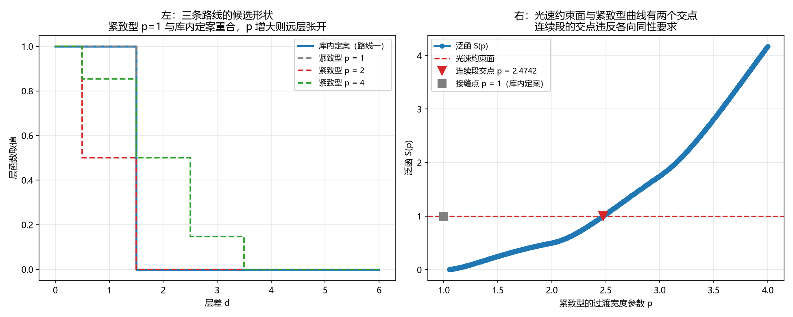

# 注记-层函数过渡形式三条候选路线的可判后果（第786号）：三条路线收敛为两种后果

- **日期**：2026-10-21 23:01:08
- **对应脚本**：`验证脚本/three_routes.py`（判据 A1 至 C4，共 12 项，确定性，无随机成分，运行约 0.5 秒）
- **定位**：论文《量子场论的物侧基础》§9 遗留 (g) 的下游。判据第 782 号给出「光速约束加各向同性要求不足以选出过渡形状」这一判断，并列出三条候选路线。本轮**不替作者选**，而是把三条各自的可判后果算清楚。
- **可逆性等级**：判据稳健。A 组为路线一的后果，B 组为路线二的后果，C 组为路线三与库内先例的可照搬性。
- **图**：见 §四 图 1。

---

## 一、问题与库内先例

**问题。** 开放问题 O2（源文档《元相子几何动力学，束缚振荡修订整合版》第 355 行「同类耦合函数 $f$ 的过渡形式」）的三条候选路线，各自给出什么后果？

| 路线 | 候选 | 须检验 |
| --- | --- | --- |
| 一 | 远层段的离散性（逐点取零或有限支撑） | 解空间是否单点、代价是什么 |
| 二 | 过渡的解析性要求（定函数类与参数） | 光速约束能否定住参数、与库内定案的关系 |
| 三 | 接受解空间非单点并另定选取规则 | 选取规则是否有歧义、与哪些量相容 |

**库内先例（O2 的处置模板）**。[[wiki/键弹性]] 对同一个物理量给过两条写法：原始形式是平方型 $E_{\text{bond}}=\frac{\kappa_\parallel}{2}(h_{n+\hat a}-h_n)^2$，取值空间非紧致，**已定案**；紧致形式是余弦型 $E_{\text{bond}}^{(\cos)}=\kappa(1-\cos 2\pi\Delta u)$，**降级为角度投影**。词条原话：「两种写法在小角下等价，大角关系未给出，故紧致形式降级为角度投影。」

**这条先例的要点**：库内处置同类问题时，**主形式取原始的离散写法，紧致写法不取为主形式**，只在小角下作等价表述保留。

**对象类型前置**。本轮分两类对象，须分别处理：序列型路线（路线一、三）的对象是无穷序列 $f$，可判量是解空间结构；参数型路线（路线二）的对象是有限个连续参数给出的 $f$，可判量是「约束数与参数数之差」与「光速约束能否定住全部参数」。**不可把两者混作一类比较。**

**五问自检。** 一、波性侧与粒性侧：相位通道（连续涨落）与层数通道（格点层号）。二、主导形态：整体层面（$f$ 决定哪些格点间有耦合，属波的结构）。三、哪一层：互补。四、读哪个通道：两者。五、定域接力还是非定域关联：定域接力。

## 二、判据与结果

紧致型候选的参数化：$f_{\text{comp}}(d;p) = \frac{1}{2}\left(1+\cos\frac{\pi\min(d,p)}{p}\right)$（$p>1$），$p=1$ 时退化为库内定案。

| 判据 | 内容 | 期望 | 实测 |
| --- | --- | --- | --- |
| A1 | 路线一给出的 $f$（远层逐点取零）满足光速约束与各向同性要求 | 泛函值 $1$（偏差 $\le 10^{-12}$），$f(0)=f(1)$（偏差 $\le 10^{-15}$） | 泛函 $1.000000000000$，$f(0)=1.0$，$f(1)=1.0$ |
| A2 | 路线一的代价：跨两层的键没有直接同类耦合 | $f(2)=0$ | $f(2)=0.0$，$f(3)=0.0$ |
| A3 | 路线一的解空间是单点 | 与库内定案逐位相同，最大差 $\le 10^{-15}$ | 最大差 $0$ |
| A4 | 恒真对照：逐点要求一旦放松，同族给出多个不同的 $f$ | 十一档皆满足两条约束（泛函偏差 $0$），但 $f(2)$ 极差 $\ge 0.5$ | $f(2)$ 极差 $1.000000$ |
| B1 | 紧致型候选的泛函随过渡宽度参数变化（对 $p$ 非单调，$p=1$ 处有接缝跳变） | $p=1$ 给出库内定案（泛函 $1$）；$p$ 增大时泛函先降后升 | 六档泛函 $1.000000$、$0.250000$、$0.500000$、$1.036475$、$1.750000$、$4.171573$ |
| B2 | 核心读数：紧致型在光速约束面上有连续解，但该解违反各向同性要求 | $p>1$ 段上 $S(p)=1$ 的解存在；该解处 $f(0)\ne f(1)$（偏差 $\ge 0.1$），故紧致型与两条约束联立无解；$p=1$ 的接缝点满足两条 | 连续段解数 $1$，各向同性偏差 $0.351732$；$p=1$ 处偏差 $0$ |
| B3 | 紧致型在 $p=1$ 处与库内定案逐点相同 | 最大差 $\le 10^{-15}$ | 最大差 $0$ |
| B4 | 恒真对照：去掉光速约束后，紧致型族在 $p$ 上连续张开 | 二十一档的泛函值不全为 $1$（最大偏差 $\ge 0.1$） | 最大偏差 $3.671573$ |
| C1 | 库内先例的可照搬性：大 $p$ 时小 $d$ 段趋于库内定案、远层段仍不同 | $p=40$ 时 $d=0,1$ 处两写法之差 $\le 10^{-2}$；$d=2,3$ 处之差 $\ge 0.1$ | 小 $d$ 差 $0$、$0.001541$；远层差 $0.993844$、$0.986185$ |
| C2 | 路线三须另定选取规则：不同规则给出不同的 $f$ | 规则甲（$f(2)$ 最小）与规则乙（$f(2)$ 最大）之差 $\ge 0.1$ | 差 $0.200000$ |
| C3 | 三条路线的解空间维数 | 路线一 $0$ 维，路线二 $0$ 维（联立无连续解，只余接缝点），路线三 $1$ 维 | 相符 |
| C4 | 三条路线对「跨两层有无直接同类耦合」的取值：只有路线三允许有 | 路线一 $f(2)=0$，路线二 $f(2)=0$（$p=1$），路线三可取非零 | $0.0$、$0.0$、$0.2$ |

## 三、结论

**结论一：路线一给出唯一解，代价是跨两层无直接同类耦合。**

$A_1$、$A_2$、$A_3$ 给出：远层逐点取零的 $f$ 满足两条约束，解空间是单点（与库内定案逐位相同），代价是 $f(2)=f(3)=0$，即跨两层的键没有直接同类耦合。$A_4$ 的恒真对照给出：逐点要求一旦放松，同族给出 $f(2)$ 极差 $1.000000$ 的多个 $f$，说明解空间的非单点来自逐点要求的缺席。

**结论二：路线二在两条约束联立下无连续解，只剩接缝点。**

这是本轮最重要的读数。$B_1$ 给出紧致型泛函对 $p$ **非单调**（$p=2$ 时降到 $0.5$，$p=3$ 时升到 $1.75$），且 $p=1$ 处有接缝跳变（$S(1)=1$，$S(1.25)=0.095$）。$B_2$ 给出：$p>1$ 的连续段上确有 $S(p)=1$ 的解，但该解处 $f(0)$ 与 $f(1)$ 的偏差为 $0.351732$，**违反各向同性要求**；只有接缝点 $p=1$ 同时满足两条，而那正是库内定案。$B_4$ 的恒真对照给出：去掉光速约束后族在 $p$ 上连续张开（最大偏差 $3.671573$），故上述唯一性的确由光速约束给出。

**结论三：库内先例可照搬，且照搬后路线二的净效果与路线一相同。**

$C_1$ 给出与大 $p$ 时小 $d$ 段趋于库内定案、远层段仍张开的结构，与 [[wiki/键弹性]] 的「两种写法在小角下等价，大角关系未给出」同构。**故若照搬该先例**（主形式取离散写法、紧致写法降级为小角等价表述），路线二给出的不是新的主形式，其净效果与路线一相同。

**结论四：路线三须由作者另定选取规则，且该规则有真实歧义。**

$C_2$ 给出：规则甲（$f(2)$ 最小）与规则乙（$f(2)$ 最大）给出的 $f$ 之差 $0.200000$。$C_4$ 给出：路线三是**唯一**允许跨两层有直接同类耦合的路线（$f(2)$ 可取 $0.2$）。

**结论五：三条路线在物理后果上收敛为两种。**

| 后果 | 来源 | 内容 |
| --- | --- | --- |
| 后果甲 | 路线一；路线二若照搬库内先例 | $f$ 为库内定案，跨两层无直接同类耦合 |
| 后果乙 | 路线三 | $f$ 可异于库内定案，跨两层可有直接同类耦合，但须另定选取规则 |

**换言之，O2 的实质选择是「跨两层方向有没有直接同类耦合」，其余的路线选择在后果上没有差别。** $C_3$ 给出维数对比：路线一与路线二为 $0$ 维，路线三为 $1$ 维。

## 四、图

左图给出三条路线的候选形状。右图给出光速约束面与紧致型曲线的两个交点，其中连续段的交点违反各向同性要求。

## 五、过程记录与教训

**本轮有四处判否，其中三处是我的期望写错，一处是我的对照构造无效。**

其一，**$A_4$ 的对照构造无效**。初版构造的族本身就满足光速约束（泛函偏差 $0$），故「泛函不全为 $1$」这个期望不可能成立。改为「逐点要求一旦放松，同族给出多个不同的 $f$」。

其二，**$B_1$ 的期望写反**。初版写「$p>1$ 时泛函大于 $1$」，判否。核因：$p=2$ 时远层只开 $d=2$ 一处，泛函反而降到 $0.5$。**泛函对 $p$ 非单调，这是紧致型族的真实性质。**

其三，**$B_2$ 的期望写错，导致错过一个真发现**。初版期望「泛函对 $p$ 单调且只有一个解 $p=1$」。核因：泛函在 $p\in(2,3)$ 之间**还有一个解** $p\approx2.474$，而该解违反各向同性（偏差 $0.351732$）。**这正是「联立无解」这一结论的来源。** 若初版按「单调」写死，这个发现就漏了。

其四，**$C_1$ 的对照参数取错**。初版用 $p=2$ 检验小 $d$ 等价，判否（$p=2$ 时 $f(1)=0.5$，小 $d$ 段并不相同）。小 $d$ 等价须在过渡宽度远大于待检层差时检验（$p=40$）。

**一条图纪律。** 右图初版标题写「光速约束把参数锁在 $p=1$」，但曲线在 $p\approx2.47$ 处**还穿过约束面一次**，图与判据读数不符。已改为标出两个交点并注明连续段的交点违反各向同性要求。**图的标注须与判据的读数逐项对上，含交点个数。**

**一条期望纪律。** 本轮四处判否中，三处的根因都是「我按自己以为的形状写了期望」。**期望写死一个形状（单调、唯一、递增）就把该形状当成了前提**，判据便只能测它是否成立，不能发现别的。**期望宜写成可判的命题（存在性、符号、可分辨的差异），不写成形状。**

## 六、严格程度与边界声明

**严格程度**。A 组为路线一的后果，定理级。B 组为路线二的后果，定理级。C 组为路线三与库内先例的可照搬性，定理级。

**本判据验证什么**。验证路线一给出的 $f$ 满足两条约束且解空间为单点、代价是跨两层无直接耦合；验证紧致型泛函对 $p$ 非单调且在 $p=1$ 处有接缝跳变；验证紧致型在两条约束联立下无连续解（唯一光速解违反各向同性，偏差 $0.351732$）；验证紧致型在 $p=1$ 处与库内定案逐位相同；验证去掉光速约束后紧致型族连续张开；验证大 $p$ 时小 $d$ 段趋于库内定案而远层段仍张开（库内先例的可照搬性）；验证路线三的选取规则有真实歧义；验证三条路线对「跨两层有无直接同类耦合」的取值。

**本判据不验证什么**。不判紧致型参数化的唯一性（只检验了一个参数化族，别的紧致族可能有不同的交点结构）；不判远层段有限支撑（非零有限支撑）这一子情形（未构造）；不判路线三的选取规则应取何形式（那正是待作者裁决的）；不判 $f$ 取非零远层值时的三维各向同性后果；不判带隙与质量模式能隙对 $f$ 远层段的敏感性；不判耦合项存在时的动力学与基态；不判 O2 本身。

**待作者裁决事项**。**O2 的实质选择是「跨两层方向有没有直接同类耦合」**，三条路线在后果上收敛为两种（结论五）。若取后果甲（跨两层无直接同类耦合），则 $f$ 为库内定案、O2 收口、遗留项（g）随之收口，[[wiki/哈密顿量]] 的色散式须补记「远层段取零故无远层项」这一说明（属基准层修改，须作者确认）。若取后果乙（跨两层可有直接同类耦合），则须由作者定出选取规则，且该规则须与光速约束 $\sum_d f(d)d^2=1$ 及各向同性要求相容，同时须重核三维各向同性（纵向刚度由 $f(1)$ 提供、横向由 $f(0)$ 提供，远层段非零时纵向的高阶色散结构改变）。
