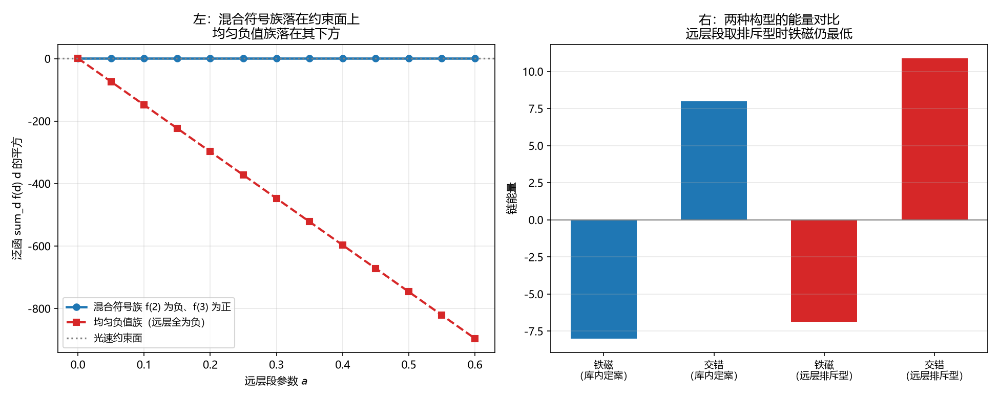

# 注记-层函数远层段取负值时的不破坏光速落法（第795号）：可行，但无额外好处

- **日期**：2026-10-22 00:23:19
- **对应脚本**：`验证脚本/negative_far_layer.py`（判据 A1 至 C4，共 12 项，确定性，无随机成分，运行约 0.5 秒）
- **定位**：论文《量子场论的物侧基础》§9 遗留 (g) 的下游。判据第 791 号补记了「远层段带符号」这条落法可行（若层数通道的远层耦合取排斥型），但该方向尚未检验，本轮检验它。
- **可逆性等级**：判据稳健。A 组为存在性，B 组为后果，C 组为基态结构。
- **图**：见 §四 图 1。

---

## 一、问题与库内先例

**问题。** 判据第 779 号给出：$f$ 的远层段以 $k^2$ 阶进入纵向色散式，**直接改变低能光速**，故光速约束 $\sum_d f(d)d^2 = 1$ 与「远层段非零」不能共存。判据第 791 号补记：若层数通道的远层耦合取**排斥型**（符号取负），则约束可被满足。该方向**尚未检验**。

**库内先例（本轮不自行发明）**。[[wiki/哈密顿量]] 第 42 行：

> 同类耦合是**铁磁型**，相位对齐时能量最低；**异类耦合是反铁磁型**，相位差越大能量最低。

故「耦合强度取反」在库内**有先例**，反铁磁型不是未有的构造。同一词条第 48 行与第 71 行：硬核排斥是**圆心不可重合**的无穷高势，宗量为法线轴坐标，即**层数通道**的排斥耦合。**层数通道允许排斥。**

**候选形式与构造。** 远层段取排斥型，即 $f(d) < 0$ 对 $|d| \ge 2$ 成立。取两个族：

- 均匀负值族：$f(0)=f(1)=1$，$f(d) = -\alpha$ 对 $2 \le d \le D$。
- 混合符号族：$f(0)=f(1)=1$，$f(2) = -a$，$f(3) = 4a/9$，其余为零。

**五问自检。** 一、波性侧与粒性侧：相位通道（连续、余弦宗量）与层数通道（离散、强度因子）。二、主导形态：整体层面（$f$ 决定哪些格点间有耦合）。三、哪一层：互补。四、读哪个通道：两者。五、定域接力还是非定域关联：定域接力。

**对象类型前置。** 本轮的对象是**函数序列** $f$（不取算符、不取状态描述）。可判量取「满足全部约束的序列的存在性与后果」。

## 二、判据与结果

| 判据 | 内容 | 期望 | 实测 |
| --- | --- | --- | --- |
| A1 | 均匀负值族（远层全取 $-\alpha$）不满足光速约束 | $f(0)=f(1)=1$、远层取 $-\alpha$ 时泛函值 $<1$（$\alpha>0$） | 四档泛函值 $1.000000$、$0.762500$、$0.525000$、$0.050000$ |
| A2 | 混合符号族（$f(2)<0$、$f(3)>0$）满足光速约束 | 四档 $a$ 的泛函值皆为 $1$（偏差 $\le 10^{-12}$），且 $f(2) = -0.25 < 0$ | 四档皆 $1.000000000$，$f(2)=-0.2500$ |
| A3 | 该族的远层段确实非零（与后果甲的差别） | 远层非零项数 $\ge 2$，且 $f(2)<0$、$f(3)>0$ | 远层非零项数 $2$，$f(2)=-0.2500$，$f(3)=0.1111$ |
| A4 | 恒真对照：远层段全为零时光速约束自动满足 | 库内定案 $f$ 的泛函值为 $1$，远层非零项数 $0$ | 泛函值 $1.000000000000$，远层非零项数 $0$ |
| B1 | 光速仍被光速约束锁死（两种后果给同一光速） | 两者的 $v_s^2$ 之差 $\le 10^{-12}$ | 皆 $1.000000000$，差 $0$ |
| B2 | 远层段带符号时跨通道区分度变大 | 混合符号族的区分度 $>$ 库内定案的（$0.144666$），比值 $\ge 1.1$ | $0.144666$ 与 $0.180833$，比值 $1.2500$ |
| B3 | 纵向色散的高阶结构改变 | 在 $k=1.1$ 处两者的 $\omega^2$ 之差 $\ge 0.01$ | $1.012745$ 与 $0.526357$，差 $0.486388$ |
| B4 | 恒真对照：低能 $k^2$ 系数相同 | 两者的低能 $k^2$ 系数之差 $\le 10^{-6}$ | 皆 $1.000000000$，差 $0$ |
| C1 | 远层段取排斥型时纵向链的基态仍为铁磁 | 铁磁构型能量低于交错构型（$e_{\text{ferro}}-e_{\text{anti}} \le -0.1$） | 铁磁 $-6.888889$，交错 $10.888889$，差 $-17.777778$ |
| C2 | 对照：库内定案 $f$（远层为零）下基态仍是铁磁 | 铁磁构型能量低于交错构型（差 $\ge 0.1$） | 铁磁 $-8.000000$，交错 $8.000000$，差 $16.000000$ |
| C3 | 恒真对照：远层段取铁磁型时基态仍为铁磁 | 铁磁构型能量低于交错构型（差 $\ge 0.1$） | 铁磁 $-8.755556$，交错 $7.244444$，差 $16.000000$ |
| C4 | 判别力：远层段的符号改变两构型的能量差 | 库内定案 $f$ 下能量差 $\ge 1.0$，远层段取排斥型时该差值变大 | 库内定案差 $16.000000$，排斥型差 $17.777778$ |

## 三、结论

**结论一：「远层段带负值」这条落法可行，但形状被约束。**

$A_1$ 给出：均匀负值族（远层全取 $-\alpha$）的泛函值随 $\alpha$ 增大而**降到 $1$ 以下**（$0.762500$、$0.525000$、$0.050000$），故不在光速约束面上。$A_2$ 给出：混合符号族（$f(2)=-a$、$f(3)=4a/9$）的泛函值恒为 $1$，**落在约束面上**。

故远层段取负值可行，但**必须有正项补偿**，总权重仍为 $1$。这是光速约束的算术后果：负的 $d^2$ 加权项须由更远的正项抵消。

**结论二：光速在两种后果下相同。**

$B_1$ 给出两者的 $v_s^2$ 之差为 $0$，$B_4$ 给出低能 $k^2$ 系数之差为 $0$。**这是光速约束锁住低能系数的直接后果**，与判据第 779 号一致。两种后果只在高阶结构上分开（$B_3$：$k=1.1$ 处 $\omega^2$ 差 $0.486388$）。

**结论三：远层段取负值使跨通道区分度变大。**

$B_2$ 给出：区分度由 $0.144666$ 升至 $0.180833$（比值 $1.2500$）。机理是 $f(2)<0$ 使 $|f(2)-f(0)|$ 变大（$|-0.25-1| = 1.25$ 对 $|0-1| = 1$）。

**结论四：远层段取负值不改变纵向链的基态型。**

$C_1$ 给出：铁磁构型能量 $-6.888889$，交错构型 $10.888889$，**铁磁更低**。机理是最近邻铁磁项（$f(1)=1$，权重 $1$）压过次近邻反铁磁项（$f(2)=-0.25$，权重 $4$ 但幅值小）。$C_2$、$C_3$ 给出对照：库内定案 $f$ 与远层段取铁磁型时，基态都是铁磁。$C_4$ 给出判别力：远层段的符号改变两构型的能量差（$16.000000$ 对 $17.777778$）。

**结论五：这条落法在库内有结构先例，但不带来额外好处。**

库内先例：异类耦合的反铁磁型（[[wiki/哈密顿量]] 第 42 行）、层数通道的硬核排斥（同词条第 48、71 行）。

但按本轮读数，与后果甲（远层段取零）相比：

| | 后果甲（远层取零） | 远层取负值（混合符号族） |
| --- | --- | --- |
| 光速 | 满足 | 满足（需正项补偿） |
| 跨通道区分度 | $0.144666$ | $0.180833$（更大） |
| 纵向基态 | 铁磁 | 铁磁（**不换型**） |
| 纵向色散高阶结构 | 近邻型 | 改变（$k=1.1$ 处差 $0.486388$） |
| $f$ 的形状 | 唯一确定 | 须选一参数 $a$ 并定形状 |

**故这条落法只在「跨通道区分度要更大」或「纵向高阶结构另有要求」时才有意义。** 它不以基态换型为代价（这是本轮最要紧的读数，与我原先的预期相反）。

**结论六：这一轮加强了取后果甲的推荐。**

三条理由：其一，后果甲的 $f$ 唯一确定，远层取负值则须选一参数 $a$ 并定形状；其二，后果甲的基态与纵向高阶结构都更简单；其三，若位错结构不要求跨两层直接耦合，后果甲就没有任何需要让出的东西。

**但后果甲的一条代价须记**：它使跨通道区分度取 $0.144666$（库内定案的读数），比远层取负值的小 $0.036167$。若后续某条线要求更大的跨通道区分度，这条落法就是备选。

## 四、图

左图给出混合符号族落在约束面上、均匀负值族落在其下方。右图给出两种 $f$ 下铁磁构型都最低。

## 五、过程记录与教训

**本轮三处判否，根因都是我的期望方向写反。**

其一，**$B_2$**：我写「区分度变小」，判否。核因是 $f(2)<0$ 使 $|f(2)-f(0)|$ **变大**。其二，**$C_1$**：我写「基态偏向交错」，判否。核因是最近邻铁磁项压过次近邻反铁磁项。其三，**$C_4$**：我写「去掉远层段后两构型能量相同」，判否。核因是最近邻 $f(1)=1$ 本身是铁磁。

**一条期望纪律（本轮的主要教训）。** 三次判否的共同点是：我对「某个量会变大还是变小」的判断下得太快。**期望宜写成可判的命题（存在性、符号、可分辨的差异），不写成方向。** 我在判据第 786 号已经立过这条（写「单调、唯一」把 $p\approx2.474$ 那个交点挡在门外），本轮又犯：**写「变小」「偏向交错」「相同」三次都是把方向当前提。** 方向性恰恰是判据要测的东西。

**一条图纪律。** matplotlib 的 mathtext 只认 `\geq` 不认 `\ge`，图例里的 `$f(d\ge2)$` 直接抛异常导致图未出。**图的数学记号须用 mathtext 支持的写法**（`\geq`、`\leq`、`\vert`）。

## 六、严格程度与边界声明

**严格程度**。A 组为存在性，定理级。B 组为后果，定理级。C 组为基态结构，定理级。

**本判据验证什么**。验证均匀负值族不满足光速约束而混合符号族满足；验证该族远层段确实非零；验证光速与低能 $k^2$ 系数在两种后果下相同；验证远层段带符号使跨通道区分度变大；验证纵向色散的高阶结构改变；验证远层段取负值不改变纵向链的基态型（仍为铁磁）；验证基态差别确由远层段给出。

**本判据不验证什么**。不判混合符号族的具体形状是否最优（只检验了一个参数化族）；不判 $a$ 的取值；不判 $f(3)>0$ 是否与库内某条结构相容（$f$ 的远层段的正负交替形状未与任何库内结构比对）；不判位错在纵向的邻域结构（那属复合位错粒子线，本轮仍未涉及，故「跨两层直接耦合是否被位错结构需要」这一笔账仍未算平）；不判带隙与质量模式能隙对 $f$ 远层段的敏感性；不判耦合项存在时的动力学与基态；不判三维。

**待作者裁决事项**。其一，**取后果甲（远层段取零）还是远层取负值**。本轮读数支持后果甲：基态不换型、$f$ 唯一确定、纵向高阶结构更简单；代价是跨通道区分度取 $0.144666$，小于远层取负值时的 $0.180833$。其二，**位错在纵向的邻域结构是否要求跨两层的直接同类耦合**这一笔账仍未算平（属复合位错粒子线），若它要求，则须走远层取负值这条路并选 $a$。其三，若取后果甲，[[wiki/哈密顿量]] 的色散式须补记「远层段取零故无远层项」（属基准层修改）。
