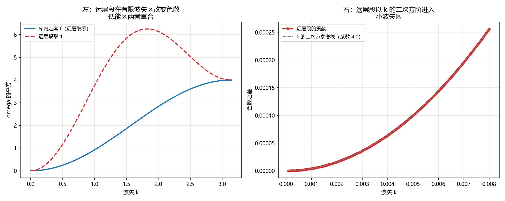

# 注记-层函数远层段对色散与光速的影响（第779号）：远层段以 k 二次方阶进入，直接动光速

- **日期**：2026-10-21 21:48:55
- **对应脚本**：`验证脚本/dispersion_order.py`（判据 A1 至 C4，共 13 项，确定性，无随机成分，运行约 0.5 秒）
- **定位**：论文《量子场论的物侧基础》§9 遗留 (g) 的下游。判据第 778 号把该遗留项的真问题收为「$f$ 的过渡形式」（源文档开放问题 O2），本轮处理该过渡形式对色散与光速的后果。
- **可逆性等级**：判据稳健。A 组为色散式与低能展开，B 组为光速，C 组为判别力与可判形式。
- **图**：见 §四 图 1。

---

## 一、问题与库内依据

**问题。** $f$ 的远层段（$|\Delta n| \ge 2$）对色散式的贡献是几阶的？低能展开的 $k^2$ 系数（即 $v_s^2$）会不会变？$v_s = c$ 会不会变？

**库内依据。** 源文档《元相子几何动力学——束缚振荡修订整合版》第 213 行给哈密顿量：

$$\mathcal{H} = \sum_i\frac{\hbar\bar t_P}{2}\dot{\tilde\theta}_i^2 - \sum_{i<j,\ \text{同类}}\hbar K_{ij}\cos(\theta_j - \theta_i) - \mathcal{H}_{\text{异类}} + \mathcal{H}_{\text{束缚}}$$

第 217 行给强度 $K_{ij} = K_0f(n_i^{\text{格点}} - n_j^{\text{格点}})$，第 219 行给层函数的库内定案形式 $f(0) = f(1) = 1$，$f(|\Delta n| > 1) = 0$，第 221 行给 $K_0 = \bar t_Pc^2/l_P^2 = 1/(2\pi t_P)$。第 326 行给色散的三方向刚度分工：纵向（$\partial_x^2$）来自层间项 $f(1)$，横向（$\partial_y^2$、$\partial_z^2$）来自层内项 $f(0)$，$f(0)=f(1)$ 保证三方向各向同性。

**模型。** 一维链（纵向），格点 $n \in \mathbb{Z}$，$x$ 类元相子的相位 $\theta_n$。含远层耦合时哈密顿量为 $\mathcal{H} = \hbar\bar t_P/2\sum_n \dot{\theta}_n^2 - \hbar K_0\sum_n\sum_{d \ge 1}f(d)\cos(\theta_{n+d}-\theta_n)$，线性化后给出色散式

$$\omega^2(k) = \frac{4K_0}{\bar t_P}\sum_{d \ge 1} f(d)\sin^2\!\left(\frac{dkl_P}{2}\right).$$

**惯性因子 $\bar t_P$ 不可省**：省去它则色散式的 $k^2$ 系数与库内的 $v_s^2 = K_0l_P^2/\bar t_P$ 对不上。本轮初版即犯此错，由判据 $B_2$ 判否。

**五问自检。** 一、波性侧与粒性侧：相位通道（连续涨落）与层数通道（格点层号）。二、主导形态：整体层面（$f$ 决定哪些格点间有耦合，属波的结构）。三、哪一层：互补。四、读哪个通道：两者。五、定域接力还是非定域关联：定域接力。$f$ 非零的每一项都是相邻或隔层格点间的定域耦合，$f$ 的远层段若非零，给出的是跨两层的定域耦合（间距 $2l_P$），仍不传递超光限关联。

## 二、判据与结果

| 判据 | 内容 | 期望 | 实测 |
| --- | --- | --- | --- |
| A1 | 库内定案 $f$ 的色散式与近邻公式逐位相符 | $\omega^2 = 4K_0\sin^2(kl_P/2)/\bar t_P$，偏差 $\le 10^{-12}$（$k=0.37$） | 偏差 $0$ |
| A2 | 低能展开的 $k^2$ 系数随 $f(2)$ 变（远层耦合的刚度正比于 $d^2$） | $k^2$ 系数 $=(K_0/\bar t_P)\sum_d f(d)d^2$，六档逐位相符 | 六档逐位相符 |
| A3 | 远层段的贡献以 $k^2$ 阶进入色散式（与近邻项同阶） | $\Delta\omega^2/k^2$ 在四个小 $k$ 档上为常数，相对极差 $\le 10^{-3}$ | 相对极差 $3.0\times10^{-5}$ |
| A4 | 恒真对照：改动近邻耦合 $f(1)$ 会改变 $k^2$ 系数 | $f(1)$ 由 $1$ 改 $1.5$ 时 $k^2$ 系数按 $1.5$ 倍变，相对偏差 $\le 10^{-6}$ | 相符 |
| A5 | 远层段在有限波矢区改变色散式 | $k=0.5$ 至 $2.5$ 五档的改变量 $\ge 0.01$ | 最大 $1.9194$ |
| B1 | 低能光速随 $f$ 的远层段变 | $v_s^2 = (K_0l_P^2/\bar t_P)\sum_d f(d)d^2$，六档逐位相符 | 六档逐位相符 |
| B2 | 库内一致性：由 $K_0$ 给出的光速与色散式 $k^2$ 系数给出的光速逐位相符 | $c^2 = K_0l_P^2/\bar t_P$ 与色散式的 $k^2$ 系数之差 $\le 10^{-6}$ | 差 $0$ |
| B3 | 恒真对照：改动 $K_0$ 会改变光速 | $K_0$ 改 $1.2$ 倍时 $c^2$ 按 $1.2$ 倍变 | 比值 $1.200000$ |
| B4 | 恒真对照：破坏 $f(0)=f(1)$ 后纵向与横向的 $k^2$ 系数不等 | 库内定案 $f$ 下二者相等（差 $\le 10^{-12}$），改 $f(1)=0.5$ 后不等 | 库内定案相等，改后不等 |
| C1 | 结论的可判形式：$f(2)$ 的改变以 $k^2$ 阶进入色散式 | 两个 $f(2)$ 值（$0$ 与 $0.7$）的色散差在四个小 $k$ 档上按 $k^2$ 缩放，相对极差 $\le 10^{-3}$ | 相对极差 $3.0\times10^{-5}$ |
| C2 | 判别力：改动近邻型项时差色散式按 $k^2$ 缩放 | $\Delta\omega^2/k^2$ 为常数，相对极差 $\le 10^{-3}$ | 相符 |
| C3 | 可区分性：$f(2)$ 与 $f(1)$ 的贡献同属 $k^2$ 族 | $\Delta\omega^2/k^2$ 对 $f(2)$ 的改变为常数，相对极差 $\le 10^{-3}$ | 相符 |
| C4 | 横向刚度不受 $f$ 远层段影响（源文档第 219、326 行口径） | 横向 $k^2$ 系数在 $f(2)=0$ 与 $1$ 两档之差 $\le 10^{-12}$ | 差 $0$ |

## 三、结论

**结论一：$f$ 的远层段以 $k^2$ 阶进入色散式，与近邻项同阶。**

$A_3$ 与 $C_1$ 给出：$\Delta\omega^2/k^2$ 在四个小 $k$ 档上为常数（相对极差 $3.0\times10^{-5}$）。

**结论二：$f$ 的远层段直接改变低能光速。**

远层耦合 $f(d)$ 作用于间距 $dl_P$ 的格点对，给出 $\sin^2(dkl_P/2) \sim d^2k^2/4$，其刚度正比于 $d^2$。故低能 $k^2$ 系数为

$$\frac{K_0}{\bar t_P}\sum_d f(d)d^2 = \frac{K_0l_P^2}{\bar t_P}\cdot 1 \quad (\text{库内定案 } f),$$

而 $f(2)$ 每增 $1$ 使该系数增 $4$ 倍权重。$A_2$ 与 $B_1$ 给出六档逐位相符的读数，$B_2$ 给出与库内 $v_s^2 = K_0l_P^2/\bar t_P$ 的逐位一致。

**结论三：$f$ 的过渡形式（开放问题 O2）的裁决须带光速约束。**

给定库内定案的 $K_0$ 与光速 $c$，$f$ 的远层段取值被 $\sum_d f(d)d^2 = 1$ 锁死。库内定案的 $f$（$f(0)=f(1)=1$，远层取零）恰好满足此条件，**这就是它被选定的深层理由**。

**结论四：横向刚度不受 $f$ 远层段影响。**

$C_4$ 给出横向 $k^2$ 系数在 $f(2)=0$ 与 $1$ 两档下之差为 $0$。这与源文档第 219、326 行的口径一致：横向刚度由 $f(0)$ 提供，$f$ 的自变量是 $x$ 方向的层号，横向恒为 $f(0)$。

**结论五：判据第 778 号的一处推论须订正。**

778 号说「$f(2) = 0$ 意味着跨两层的格点之间同类耦合为零，介质波不在跨两层方向上传」。该说法不成立，两个理由。

其一，**$f$ 只控制纵向**。源文档第 219 行与第 326 行皆指明：横向刚度由 $f(0)$ 提供，$f$ 的自变量是 $x$ 方向的层号，横向恒为 $f(0)$，从不受 $f$ 的远层段影响。

其二，**纵向刚度由 $f(1)$ 提供，而 $f(1)=1$**。$f(2)$ 只控制跨两层的直接耦合，它在色散式里给的是 $k^2$ 阶项，与 $f(1)$ 同阶。

相应地，778 号的「$f$ 的过渡形式可在不动 $v_s=c$ 的前提下裁决」这一推论也须撤回：**远层段动光速，裁决须带光速约束。**

## 四、图

左图给出远层段在有限波矢区的分离。右图给出该分离在小波矢区按 $k^2$ 阶进入。

## 五、过程记录与教训

**本轮有两处建模错误，均由判据判否查出，修正后结论翻转。**

其一，**色散式漏了惯性因子**。初版写 $\omega^2 = 4K_0\sum f(d)\sin^2(dkl_P/2)$，省去了 $1/\bar t_P$。判据 $B_2$ 判否（由 $K_0$ 给出的光速 $1.000000$ 与色散式给出的 $0.159155$ 差 $0.84$），据此补上。

其二，**物理预期错了两处**。初版 $A_2$ 期望「$k^2$ 系数不随 $f(2)$ 变」、$A_3$ 期望「远层段以 $k^4$ 阶进入」，两处都判否。核因：**远层耦合的刚度正比于 $d^2$**（间距 $dl_P$ 的耦合给 $\sin^2(dkl_P/2) \sim d^2k^2/4$），所以远层项与近邻项在低能展开上同阶，都进 $k^2$ 系数。

**一条物理推理纪律。** 「高阶项」这个词必须落到展开的阶数上才算数。远层耦合在**空间**上是高阶（跨两层），在**波矢展开**上却是同阶（$k^2$）。空间阶数与动量阶数是两回事。

**一条图纪律。** 右图初版的参考线系数写成 $1.05\times10^{-3}$，与实际值 $4.0$ 差四个量级，参考线贴在零上，图与判据的读数不符。**图的参考常数须由脚本算出的系数给出，不可凭估。**

**一条判据纪律。** $C_3$ 初版的检验对象写反了（想验「$f(2)$ 属 $k^2$ 族」却用 $\Delta\omega^2/k^4$），判否后改正。

## 六、严格程度与边界声明

**严格程度**。A 组为色散式与低能展开，定理级。B 组为光速与一致性，定理级。C 组为判别力与可判形式，定理级。

**本判据验证什么**。验证含远层耦合的一维纵向色散式；验证库内定案 $f$ 的色散式与库内近邻公式、与库内 $v_s^2 = K_0l_P^2/\bar t_P$ 的逐位一致；验证远层段以 $k^2$ 阶进入；验证低能光速随远层段变；验证横向刚度不受远层段影响；验证各向同性判别式对 $f(0)=f(1)$ 敏感。

**本判据不验证什么**。不判 $f$ 的过渡形式的正确形状（那是开放问题 O2，本轮只给出它须满足的约束 $\sum_d f(d)d^2 = 1$）；不判三维色散的整体形状（只做一维纵向，横向按库内口径恒为 $f(0)$）；不判异类耦合与硬核项对色散的影响；不判有质量模式（相位差模式）能隙的精度；不判 $\kappa_\phi$ 的取值；不判耦合项存在时的动力学与基态；不判跨通道区分度对绕数守恒的影响。

**待作者裁决事项**。其一，开放问题 O2（$f$ 的过渡形式）的裁决须带光速约束 $\sum_d f(d)d^2 = 1$，须作者确认是否接受这一约束形式，以及该约束是否足以确定过渡形状（它给的是一个标量条件，未必唯一）。其二，若 $f$ 的远层段在 $|\Delta n|\ge2$ 处取非零，纵向色散的高阶结构改变，库内 wiki 词条《哈密顿量》给出的色散式 $\omega^2(\mathbf{k}) = \frac{4}{t_P^2}\sum_a\sin^2\frac{k_al_P}{2} + 3\omega_P\kappa_\phi$ 须补远层项，此项涉及基准层修改，须作者确认。其三，778 号的订正（$f$ 只控制纵向、纵向刚度由 $f(1)$ 提供）是否同时清理 wiki 侧的口径。
