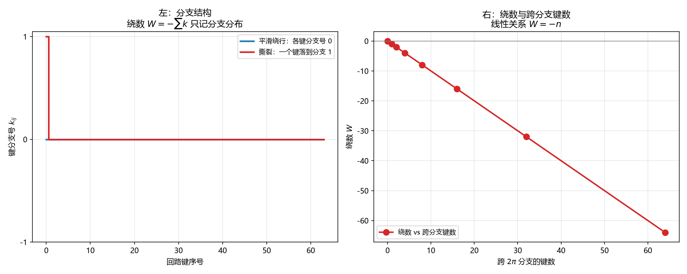

# 注记-层数通道的虚过程形态（第740号）：绕数是分支拓扑量

- **日期**：2026-10-21 14:00:13
- **对应脚本**：`验证脚本/minimal_verification_layer_virtual_process.py`（判据 A1 至 C3，共 12 项，确定性，随机种子 20261021，运行约 2 秒）
- **定位**：P4-55 第三轮。判据 737 后，[[wiki/相位通道]] 与 [[wiki/层数通道]] 给出两通道分工为几何正交，故 737 的 A、B 两组降级为自建对照模型读数，C 组（张量积代数）仍成立。本轮做 P4-55 剩下的层数侧虚过程。
- **可逆性等级**：判据稳健。A 组为分支代数，B 组为读数结构，C 组为有限维算术性质。换实现、换档位不翻。
- **图**：见 §四 图 1。

---

## 一、模型的确立

绕数的实现口径在库内有两处可查：[[wiki/绕数]] 定义节给出离散形式

$$k_{ij} = \left\lfloor \frac{u_{ij}}{2\pi} + \frac{1}{2} \right\rfloor, \qquad W = -\sum_{\text{line}} k_{ij} \in \mathbb{Z},$$

其中 $u_{ij}$ 是不取模的浮点**相位**键差；[[验证脚本/注记-扇区约束动力学：两种绕数的裁决与T4T5判定]] 第 16、24 行给出代数根据：沿闭合回路 $\sum u = 0$（数组周期性），故 $\sum_{\text{line}} w = -2\pi \sum_{\text{line}} k$；$k$ 逐键冻结则每条线的扭转内容严格守恒、不可消灭、只能重分布。

据此三点须分清。

其一，**绕数的对象是相位，不是层数。** 该词条第 46 行「绕数正是层数沿闭合回路的净差」这句话把读数与被读者混同了（2026-10-21 已改该词条）。层数是绕数的**读数**（满周对应一层，转满一圈记一格），绕数本身是相位的分支拓扑量。

其二，**绕数是分支拓扑量。** $k_{ij}$ 是键所属的 $2\pi$ 分支号。绕一圈的回路若相位连续绕行、各键差都很小，$k$ 皆为零，绕数也是零。绕数的非零值来自键差跨越 $2\pi$ 分支。

其三，**$k_{ij}$ 逐键计算**，求和沿闭合回路的各键进行。

## 二、判据与结果

| 判据 | 内容 | 期望 | 实测 |
| --- | --- | --- | --- |
| A1 | 连续绕行一圈（各键差 $2\pi/64$） | 绕数 $0$，各键分支号皆 $0$ | 绕数 $0$，分支号集合 $[0]$ |
| A2 | 一条键跨过 $2\pi$ 分支 | 绕数 $-1$，该键分支号 $1$ | 绕数 $-1$，分支号 $1$ |
| A3 | 两条键各跨一个 $2\pi$ 分支 | 绕数 $-2$ | 绕数 $-2$ |
| A4 | 整体相位平移 $0.7$ rad | 绕数不变 | $0 \to 0$ |
| A5 | 恒真检验：整体平移 $2\pi$ | 各键分支号各加 $1$，绕数 $-64$ | 绕数 $-64$ |
| B1 | 层数侧虚过程：一个键暂借一个 $2\pi$ 分支 | 绕数变为 $-1$ | $0 \to -1$ |
| B2 | 虚过程归还分支 | 绕数回到原值 | 复原后 $0$ |
| B3 | 暂借幅度六档（$0$ 至 $10$ 个分支） | 全为有限整数，无发散 | 六档全为有限整数 |
| B4 | 恒真检验：相位侧连续量在极点处 | 峰值按 $1/\varepsilon$ 发散，相对极差 $\ge 0.9$ | 相对极差 $1.000$ |
| C1 | 只给差分时绝对层数的剩余自由度 | $101$ 个整数平移（$[-50,50]$ 窗口） | $101$ |
| C2 | 加绕数读数后余量是否压缩 | 不压缩，仍 $101$ 个 | $101$ |
| C3 | 绕数的整数值性（二百档随机分支分配） | 全为整数 | 全为整数 |

## 三、结论

**结论一：层数侧的虚过程是「一个键暂借一个 $2\pi$ 分支，然后归还」。**

B1 给出：暂借时绕数从 $0$ 变为 $-1$，即中间态与末态的**分支分布**不同。B2 给出：归还后绕数回到 $0$，总计数复原。

这与相位侧的虚过程形态不同。相位侧的虚过程是连续相位角的场涨落，传播子有极点，其「虚」表现为离壳。层数侧的虚过程是整数分支的暂借与归还，读数全程为有限整数（B3），无极点结构，故不需要 $i\varepsilon$ 一类处方（B4 给出对照：相位侧的对应量在极点处按 $1/\varepsilon$ 发散）。

**结论二：绕数的平移不变性有范围限定。**

A4 给出：平移 $0.7$ rad（不跨分支）绕数不变。A5 给出：平移 $2\pi$ 则各键分支号整体加一，绕数变为 $-64 = -N$。

所以「绕数对整体平移严格不变」这一库内表述，其范围是「不跨分支的平移」。跨分支的平移会把整个回路搬到另一个扇区。

**结论三：「藏无可藏」有了算术形式。**

C1 给出：只给相邻差分时，绝对层数仍留有 $101$ 个整数平移余量（$[-50,50]$ 窗口内实测），余量不可穷尽。C2 给出：加绕数读数也不压缩该余量，因为绕数对整体平移不变。

这与 [[wiki/层数通道]] 机制节第 4 条「法线高度差藏无可藏，故本通道兼有粒子可见性根源的职能」对应：**差分加绕数仍定不出绝对层数**，故层数通道的读数天然带历史性。

## 四、图

左图给出绕数的直接读法：蓝线全零，绕数零；红线在首键处跳到 1，绕数负一。右图给出线性关系，八档跨分支键数从 $0$ 到 $64$，绕数从 $0$ 走到 $-64$，落在直线 $W=-n$ 上。

## 五、过程记录与教训

**本轮绕数实现改了七版，是一次方法错误。**

初版直接用层数增量构造绕数，反复改定义（求和、净差、键差分和、键差分和减闭合项、只累加路径键、整条回路提升差、逐键取整）都不得其解，每次失败都暴露新的定义歧义。

停止猜测后查库内，找到两处关键材料：一是 [[wiki/绕数]] 定义节的离散形式，二是 [[验证脚本/注记-扇区约束动力学：两种绕数的裁决与T4T5判定]] 第 16、24 行的代数根据 $\sum u = 0$ 与 $\sum w = -2\pi\sum k$。据此重建分支模型，判据一次通过。

**教训：拓扑量的实现须照库内式子原样落，不得自行推导标度版本。** 绕数是库内已定案的量，它的对象（相位）、它的离散形式（$k$ 逐键取整）、它的代数根据（$\sum u = 0$）三件事都在库里。我用层数（读数）当对象，缺了「分支」这个结构，于是怎么改都不对。

**另一条教训：读到「层数沿闭合回路的净差」时，须核清它是在说对象还是在说读数。** 那一句话我读成了对象，于是整个建模都偏了。

## 六、严格程度与边界声明

**严格程度**。A 组为分支代数的解析性质，定理级。B 组为读数结构，定理级（分支模型内）。B4 为恒真对照。C1 与 C2 为有限域算术，定理级（窗口内）。C3 为整数性，定理级。

**本判据验证什么**。验证绕数的分支拓扑性质（平滑绕行为零、跨分支为负、线性关系、平移不变的范围）；验证层数侧虚过程的形态（暂借与归还）；验证「藏无可藏」的算术形式。

**本判据不验证什么**。不判分支夹取协议下的动力学演化（本轮只给静态分支结构，不做梯度流）；不判绕数的守恒机制（库内已有 T4/T5 数值裁决）；不判三维；不判层数侧虚过程与电荷的定量关系（绕数即电荷已定案，此处只测绕数本身）。

**待作者裁决事项**。其一，判据 737 的 A、B 两组射程收窄已落盘（主注记加「三bis、射程限定」节、结论三改写；通俗注记加更正节），本轮读数为该收窄提供独立佐证。其二，P4-55 的下一步：两通道虚过程已各有形态（相位侧：连续场涨落、离壳；层数侧：分支暂借、归还），接下来可问两者如何互补，即一个完整圈图在体系里是否同时含这两类结构。
