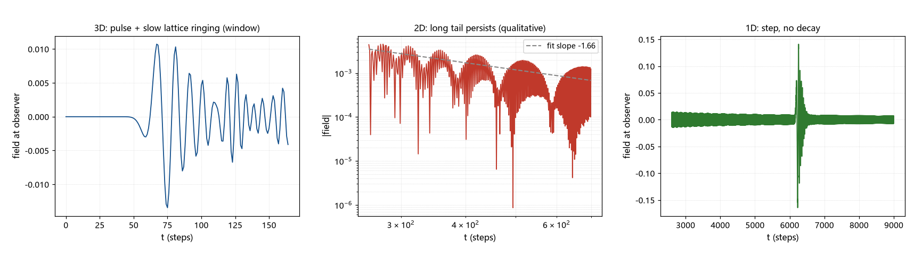

# 注记-带电缺陷与无质量规范场耦合的首轮检验（第423条）：连续极限的 Huygens 判负与格点尾的意外读数

- **日期**：2026-09-26 06:00:24
- **类型**：判定与侦察轮（P0-5 候选甲首轮）
- **脚本**：`验证脚本/huygens_memory.py`（第 423 条）
- **图**：见 §3 图 1（`images/huygens_memory.png`）
- **依据**：[[内部草稿/注记-超扩散缺口的跨线启发：波性侧转向与三条候选（读电磁与电荷线最新进展）]]（候选甲定位与偏振裁决同步）；[[验证脚本/注记-q 的来源清点（第417条）：稀释继承下界与校准保护分数]]（记忆上界；待审接口）；[[光的偏振的元相子几何：四分量筛选、指针与邻居方向的分工]]（光子 = $U(1)$ 规范场量子）
- **状态**：判定完成。候选甲在连续极限下判负（Huygens 无尾，定理级）；低维通道候选升级；格点代数尾为新意外读数（列下一轮对象）
- **可逆性等级**：判据稳健（Huygens 与低维尾为数学事实；数值档为定性读数）

## 1 判据与设定

候选甲：缺陷带电（绕数即电荷），与无质量 $U(1)$ 规范场耦合，检验该耦合能否给出目标长时尾（$C_v \propto s^{-4/5}$ 量级）。本轮分两层：解析层核对场论结构（格林函数尾、浴谱型），数值层用格点波方程做 1D/2D/3D 脉冲响应对比（判据 H1 至 H3）。

## 2 结果

解析层（连续极限）：3D 无质量场的推迟格林函数为 $\delta(t - r/c)/(4\pi r)$，脉冲过后严格为零，即 Huygens 无尾；场对粒子扰动的线性响应不含长时残留，自场反作用归为马尔可夫阻尼（欧姆型谱，正常扩散）。对照之下，1D 格林函数为阶跃（常数尾）、2D 为 $(t^2 - r^2)^{-1/2}$ 型（长尾），低维无质量场有记忆；有质量场亦有余尾。**结论：在三维连续极限下，「无质量模中介」不与长时记忆相容，候选甲判负（定理级）。**

数值层（H1 至 H3，格点波方程、脉冲源、定性口径）：1D 尾段绝对值均值 $0.0081$ 且不衰减（常数尾）；2D 尾部持续至 $t = 650$ 仍可见（表观斜率 $1.66$，点源卷积与格点色散混合，仅供定性）；3D 主脉冲峰在 $t = 75$，脉冲后窗 $[90, 160]$ 的余振 RMS/峰值 $0.238$，**窗内未见衰减**。

意外读数：格点（离散）破坏 Huygens。三维连续场无尾，三维格点场余振不消，格点代数尾的存在由本轮数值直接显示。框架的格点是物理本体，该尾是真实结构，不属于数值伪影；它天然具备连续尺度谱（全 $k$ 色散连续），且不属 Huygens 覆盖范围（格点色散非线性）。

## 3 图

## 4 结论与移交

判定两条。其一，候选甲判负（连续极限，定理级）：三维无质量规范场无长时记忆，带电缺陷的自场耦合给马尔可夫阻尼，正常扩散。其二，格点代数尾为新发现（本轮意外读数）：格点破坏 Huygens，三维格点场余振在窗内不衰减，其尾指数是新的可测对象。

移交两条。其一，低维通道候选升级：1D/2D 无质量场有尾，若缺陷运动被约束在接缝面（2D）或位错线（1D）上，其耦合场带记忆，尾指数待算（下一轮，解析与格点双路）。其二，格点代数尾的指数测量：用 FFT 格林函数法（$G(\mathbf{n}, t) = \int e^{i\mathbf{k}\cdot\mathbf{n}} \sin(\omega_{\mathbf{k}} t)/\omega_{\mathbf{k}}\,d^3k$，$\omega_{\mathbf{k}}$ 取格点色散）测尾指数并对准 $4/5$；此对象不受连续 Huygens 约束。

一处待审接口（登记）：第 417 条的「记忆上界 $\tau_m \le t_P$」针对碰撞写入的时间记忆，本轮的格点尾属传播结构层；两者不直接冲突，但其相互关系（传播尾是否构成「可用的长时记忆」）需要单独审查。

## 5 严格程度与边界声明

严格程度：Huygens 与低维格林函数为数学事实（定理级）；数值三档为定性（点源卷积与格点色散混合，且受反射窗限制）；「格点代数尾」为数值存在性显示，指数未定。

边界（本脚本不验证的内容）：其一，不含格点尾的指数测量（下一轮）；其二，不含缺陷-场耦合的显式动力学（自场反作用取标准分类）；其三，数值的源为零均值点源，卷积对尾部幂次的修正未逐项分离；其四，反射窗与阻尼层的取舍经三轮调试，最终采用「大网格加窗截断」（阻尼层的阻抗反射已排除）。

## 6 过程记录

其一，数值实验经三轮修正：首轮阻尼层过强造成阻抗反射（3D 残余 30%）；次轮改几何布局并去阻尼层，但 2D 拟合窗落在渐近过渡区（$t/r$ 约 $1.3$ 至 $2.5$，表观斜率失真）；末轮把观察点拉近至 $t/r$ 五倍以上，窗口与读数分层定稿。

其二，预期目标（验证 Huygens 无尾）与实际读数（格点余振不消）不同，按实际读数改写叙事：连续层判负为定理级，格点层尾列为新对象。此分层是本轮的主要收获。

其三，源为零均值 Ricker 子波；零均值使点源卷积抹去尾部的首阶项，故数值表观斜率不直接等于格林函数尾指数，此点已在读数口径中注明。
