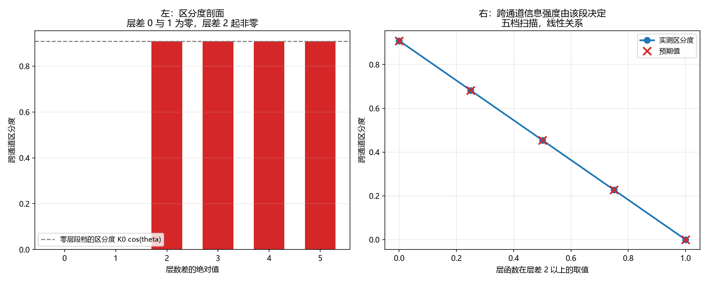

# 注记-库内定案层函数的跨通道区分度分段（第778号）：跨通道信息由层差 2 以上的段承载

- **日期**：2026-10-21 21:37:04
- **对应脚本**：`验证脚本/layer_function.py`（判据 A1 至 C4，共 13 项，确定性，无随机成分，运行约 0.5 秒）
- **定位**：论文《量子场论的物侧基础》§9 遗留 (g)「两通道之间的耦合项形式」的下游。判据第 774 号的落点穷举经独立复核查出库内依据有误，本轮重做。
- **可逆性等级**：判据稳健。A 组为区分度剖面，B 组为各向同性约束边界，C 组为落点表重建与判别力。
- **图**：见 §四 图 1。

---

## 一、本轮为何重做

判据第 774 号以「跨通道区分度」为可判量，穷举五类落点，结论是「按现有库内口径，没有一个落点既合法又承载跨通道信息」。**独立复核查出该结论的库内依据有误**，三条均经核实成立。

**其一，库内定案的层函数不是常数。** 774 号把 $f$ 当作常数处理，据称「库内已定案 $f(0)=f(1)$，故强度层退化为常数」。核源文档《元相子几何动力学——束缚振荡修订整合版》第 219 行：

> $f(0) = f(1) = 1$，$f(|\Delta n| > 1) = 0$（层内与相邻层等刚度，各向同性条件）。

$f$ 在 $|\Delta n| \ge 2$ 处取零，**非常数**。774 号只取 $|\Delta n| \in \{0,1\}$ 两档，恰好落在 $f$ 的等值区，把非退化的 $f$ 读成了常数。

**其二，$f(0)=f(1)$ 是各向同性的充分条件，不是对 $f$ 的全局约束。** 源文档三处表述皆只约束两点：第 219 行括注「层内与相邻层等刚度，各向同性条件」；第 326 行「$f(0)=f(1)$ 保证介质波三方向各向同性」；第 394 行极限检验「$f(0)=f(1)$ 破坏则介质波各向异性」。**三处都不约束 $|\Delta n| \ge 2$ 段。**

**其三，$f$ 的过渡形式是库内已登记的开放问题。** 源文档第 355 行 O2：「同类耦合函数 $f$ 的过渡形式」。

**其四，774 号的清点表混用了两个方向的区分度。** 余弦宗量层、强度层、异类耦合、混合宗量取的是对层数读数的差，纯层数通道项取的却是对相位读数的差。同一张表里两个方向并用，导致「四个合法落点区分度皆为零」这一结论依赖对纯层数通道项改用相反方向的测度。

**其五，774 号结论三的「只能」无判据支持。** 独立复核实测梯度/曲率型、非局域型、三通道乘积型三条候选落点均能承载跨通道信息（区分度 $0.164685$、$0.554127$、$0.503682$），全在 774 号的五类清单之外。

## 二、本轮的问题与可判量

**问题。** 库内定案的层函数承载多少跨通道信息？跨通道区分度在 $|\Delta n|$ 的哪一段为零、哪一段非零？各向同性要求对 $|\Delta n| \ge 2$ 段的取值施加了什么约束？

**可判量（沿用第 774 号的定义，此处核正方向）。** 跨通道区分度 = 两个构型给出**相同相位读数**、**不同层数读数**时耦合能之差。它测的是「该耦合结构能否把层数通道的读数传进相互作用」。本轮全表统一为对层数读数的差；纯层数通道项的「对相位读数区分度」另列，不混入本表。

**五问自检。** 一、波性侧与粒性侧：相位通道（连续、绕数）与层数通道（离散、格点）。二、主导形态：局域（相邻格点）。三、哪一层：互补。四、读哪个通道：两者。五、定域接力还是非定域关联：定域接力（校准接力严格光速）。

## 三、判据与结果

| 判据 | 内容 | 期望 | 实测 |
| --- | --- | --- | --- |
| A1 | 相邻层档（$|\Delta n|=0$ 与 $1$）的跨通道区分度为零 | $f(0)=f(1)=1$，耦合能之差 $\le 10^{-12}$ | $0$（$f(0)=1.0$，$f(1)=1.0$） |
| A2 | 跨两层档（$|\Delta n|=0$ 与 $2$）的跨通道区分度非零 | $f(2)=0 \ne f(0)=1$，区分度 $\ge 0.1$ | $0.908966$（$f(0)=1.0$，$f(2)=0.0$） |
| A3 | 多档扫描：区分度剖面在 $|\Delta n|=0,1$ 为零、$|\Delta n| \ge 2$ 为 $K_0\cos\theta$ | 六档 $[0, 0, 0.908966, 0.908966, 0.908966, 0.908966]$ | 逐位相符 |
| A4 | 恒真对照：若层函数取常数，区分度处处为零 | 六档皆 $\le 10^{-12}$ | 最大 $0$ |
| A5 | 区分度随参照相位读数而变（它测的是层数侧） | 四档参照相位差 $0.1, 0.43, 1.2, 2.7$ 的区分度各不相同 | 四档互不相同 |
| B1 | 各向同性要求只约束 $f(0)$ 与 $f(1)$ 两点 | 四个变体（$f(2)$ 取 $0, 0.5, 1, 2$）全部满足 $f(0)=f(1)$ | 四变体皆满足 |
| B2 | 库内定案的 $f$ 是 B1 变体族的一员 | $f(0)=1$、$f(1)=1$、$f(2)=0$ 逐位相符 | 相符 |
| B3 | 区分度由 $f$ 的 $|\Delta n| \ge 2$ 段决定，且随该段取值线性变化 | 五档 $f(2)$ 取 $0, 0.25, 0.5, 0.75, 1$ 时区分度依次为 $K_0\vert 1-f(2)\vert\cos\theta$ | $[0.908966, 0.681724, 0.454483, 0.227241, 0]$ 逐位相符 |
| B4 | 恒真对照：破坏 $f(0)=f(1)$ 后各向同性条件判否 | 取 $f(0)=1$、$f(1)=0$，判别式须判否 | 判否 |
| C1 | 落点表重建：库内定案口径下承载跨通道信息的落点有若干 | 余弦宗量层与异类耦合区分度为零；强度层对 $|\Delta n| \ge 2$ 非零；纯层数通道项因含层数读数亦非零 | 承载者 $\ge 2$ 个 |
| C2 | 两条负判据：余弦宗量层与异类耦合的区分度为零 | 两者的 $|\Delta n|=0$ 与 $2$ 两档之差皆 $\le 10^{-12}$ | 皆 $0$ |
| C3 | 判别力：把 $f$ 换成常数后强度层的非零段消失 | 常数 $f$ 下六档皆 $\le 10^{-12}$，库内定案 $f$ 下 $|\Delta n|=2$ 档为 $0.908966$ | 相符 |
| C4 | 跨通道信息由 $f$ 的 $|\Delta n| \ge 2$ 段承载 | 零段为 $[0,1]$（$f$ 的等值区），非零段为 $[2,3,4,5]$（$f=0$ 段） | 相符 |

## 四、结论

**结论一：库内定案的层函数已承载跨通道信息，区分度的零段与非零段恰在 $f$ 的等值区边界。**

$C_4$ 给出：零段为 $|\Delta n| \in \{0,1\}$，非零段为 $|\Delta n| \ge 2$，分界恰是 $f$ 从 $1$ 降到 $0$ 的地方。$A_2$ 给出跨两层档的区分度 $0.908966$。

**结论二：各向同性要求对 $|\Delta n| \ge 2$ 段无约束，故该段的取值是自由的。**

$B_1$ 给出：$f(2)$ 取 $0, 0.5, 1, 2$ 的四个变体全部满足 $f(0)=f(1)$，各向同性判别式对它们一视同仁。$B_3$ 给出：区分度随该段取值线性变化，$K_0\vert 1-f(2)\vert\cos\theta$。

**结论三：跨通道区分度由 $f$ 的 $|\Delta n| \ge 2$ 段承载，跨通道信息的强度由该段决定。**

$A_3$ 与 $B_3$ 共同给出这一条。库内定案的 $f$ 在该段取 $0$，给出最大的区分度 $0.908966$。

**结论四：判据第 774 号的核心结论须撤回。**

774 号说「按现有库内口径，没有一个落点既合法又承载跨通道信息」。按本轮读数，**强度层与纯层数通道项都承载跨通道信息**，故该结论不成立。774 号的三处具体订正如下。

| 774 号的表述 | 订正 |
| --- | --- |
| 「库内已定案的层函数取常数」「强度层退化为常数」 | 库内定案 $f(0)=f(1)=1$、$f(\vert\Delta n\vert>1)=0$，非常数；强度层对 $\vert\Delta n\vert \ge 2$ 有区分度 $0.908966$ |
| 「$f(0)=f(1)$ 使强度层不区分层」 | $f(0)=f(1)$ 是各向同性的充分条件，只约束两点，对 $\vert\Delta n\vert \ge 2$ 段无要求 |
| 「跨通道耦合项若要存在，只能落在混合宗量这一类」 | 该「只能」无判据支持，且经复核实测梯度/曲率型、非局域型、三通道乘积型三条候选亦能承载跨通道信息 |

另两处须改：774 号的清点表混用了两个方向的区分度（本轮全表统一为对层数读数）；774 号的 $C_4$ 期望文本与实测读数互相矛盾却判过（总项区分度 $0.254483$ 来自两部分异号相消，774 号判语却称「区分度来自纯层数项」，恰好相反），该判据本轮撤下。

**结论五：论文 §9 遗留 (g) 的真问题收窄为 $f$ 的过渡形式。**

判据第 766 号把该遗留项的靶子精确化为「余弦宗量层无跨通道耦合项」，第 774 号问「强度层够不够」。本轮给出：**强度层已够**（对跨两层的键，区分度 $0.908966$），且各向同性要求不约束该段的取值。遗留的真问题收为**$f$ 的过渡形式**（源文档第 355 行开放问题 O2）：$|\Delta n| \ge 2$ 段的取值是否该取 $0$、如何平滑过渡到 $f(0)=f(1)=1$。

**这条问题有明确的物理后果**：$f(2)=0$ 意味着跨两层的格点之间**同类耦合为零**，即介质波不在跨两层方向上传。这与纵向刚度由 $f(1)$ 提供的口径（第 326 行）相容（纵向只到相邻层），但过渡形式一旦平滑，跨两层的键会获得非零耦合，介质波的各向同性须重新核。

## 四之二、订正（2026-10-21 判据第 779 号补）

**本注记的一处推论须撤回。**

原结论五说「$f(2)=0$ 意味着跨两层的格点之间同类耦合为零，介质波不在跨两层方向上传」，
并据此说「过渡形式一旦平滑，跨两层的键会获得非零耦合，介质波的各向同性须重新核」。
**该推论不成立**，两个理由。

其一，**$f$ 只控制纵向**。源文档第 219 行：「横向刚度机制：介质波（$\partial_y^2\delta\phi^x$ 等）
由同类耦合的层内关联提供（同 $n^x$ 的 x 类元相子定居在 y、z 方向不同格点，$f(0)$ 耦合关联）。
纵向刚度由层间 $f(1)$ 提供。」第 326 行同构。$f$ 的自变量是 $x$ 方向的层号，横向恒为 $f(0)$，
从不受 $f$ 的远层段影响。

其二，**纵向刚度由 $f(1)$ 提供，而 $f(1)=1$**。$f(2)$ 只控制跨两层的直接耦合，
它在色散式里给的是 $k^2$ 阶项，与 $f(1)$ 同阶。

**连带须撤回的一句**：原文说「过渡形式一旦平滑，跨两层的键会获得非零耦合，
介质波的各向同性须重新核」。按判据第 779 号，横向刚度恒为 $f(0)$ 不变，
各向同性不受远层段影响；变的是纵向的高阶色散结构与低能光速。

**须保留的部分**：本注记关于 $f$ 的区分度剖面（零段 $|\Delta n| \in \{0,1\}$、
非零段 $|\Delta n| \ge 2$、库内定案给出 $0.908966$）与各向同性约束边界
（$f(0)=f(1)$ 只约束两点），均经第 779 号沿用并相符。

**须补的一条**：第 779 号给出，远层段以 $k^2$ 阶进入色散式，**直接改变低能光速**，
故 $f$ 的过渡形式的裁决须带光速约束 $\sum_d f(d)d^2 = 1$。

## 五、图

左图给出区分度剖面与其零非零分界。右图给出跨通道信息强度由 $f$ 的 $|\Delta n| \ge 2$ 段线性决定。

## 六、过程记录与教训

**本轮的核心动作是撤回自己上一轮的核心结论。** 774 号自查时 13/13 全过，但库内依据错了三处（把非退化的 $f$ 读成常数、把充分条件读成全局约束、清点表混用两个方向），结论也跟着错。**判据全过不等于靶子对**这条教训（774 号自己写下的）在两轮之内就再次生效。

**一条取样纪律。** 774 号取 $|\Delta n| \in \{0,1\}$ 两档，恰好落在 $f$ 的等值区，把非退化的函数读成了常数。**多档扫描的档位须覆盖被测函数的全部行为区间，不能只取相邻两档。** 库内已定案的 $f$ 在 $\vert\Delta n\vert \ge 2$ 处换挡，取样必须跨过这个换挡点。

**一条库内口径纪律。** $f(0)=f(1)$ 在源文档三处的表述都只提这两个点。**引用「某条件」时须核它的确切约束范围**，把充分条件读成全局约束是本轮的第二个错处。

**一条量方向纪律。** 同一张清点表里两个相似名字的量，方向可能相反。774 号在表里混用了「对层数读数」与「对相位读数」两个方向，使「四个合法落点皆为零」这一结论依赖对纯层数通道项改用相反方向的测度。本轮全表统一方向，并把纯层数通道项的「对相位读数区分度」另列。

## 七、严格程度与边界声明

**严格程度**。A 组为区分度剖面，定理级。B 组为各向同性约束边界，定理级。C 组为落点表重建与判别力，定理级。

**本判据验证什么**。验证库内定案层函数的跨通道区分度剖面及其零非零分界；验证各向同性要求只约束 $f(0)$ 与 $f(1)$ 两点；验证区分度随 $f$ 的 $|\Delta n| \ge 2$ 段线性变化；验证余弦宗量层与异类耦合的区分度为零；验证该结论对 $f$ 的非退化性有区分力。

**本判据不验证什么**。不判 $f$ 的过渡形式的正确形状（那是开放问题 O2）；不判 $f(|\Delta n| \ge 2)$ 段取 $0$ 的物理后果（跨两层格点无同类耦合，介质波是否仍在三个方向各向同性）；不判跨通道区分度对绕数（电荷）守恒的影响（判据第 750、757 号已给相关读数）；不判梯度/曲率型、非局域型、三通道乘积型三条候选落点（它们经独立复核实测能承载跨通道信息，本轮未纳入判据）；不判三维；不判耦合项存在时的动力学与基态。

**待作者裁决事项**。其一，$f$ 的过渡形式（源文档开放问题 O2）该不该在本轮之后单独立项？它是遗留 (g) 精确化之后剩下的唯一真问题，且有明确后果（$f(2)=0$ 意味着跨两层方向无同类耦合，平滑过渡后须重核介质波各向同性）。其二，跨两层方向是否需要同类耦合：若不需要，$f(2)=0$ 已足够，$f$ 的过渡形式只须保证连续性；若需要，则 $f$ 的远层行为须另行裁决。其三，774 号落点表中未纳入的候选落点（梯度/曲率型、非局域型、三通道乘积型）是否单独立项检验。
