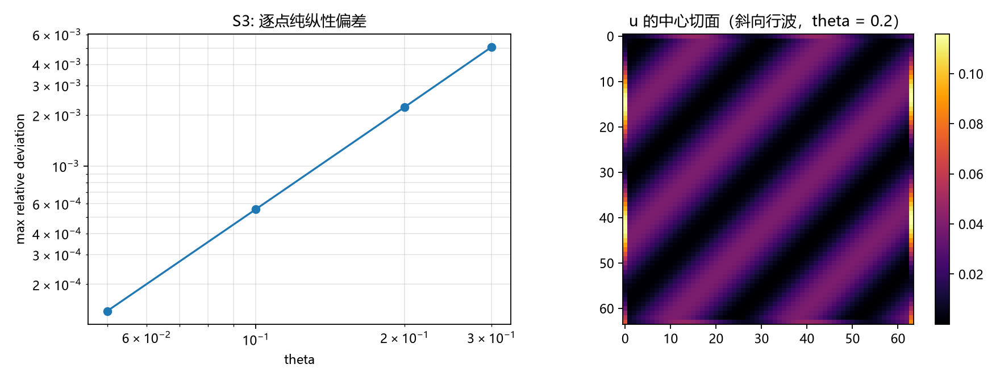

# 注记-应力口径统一（第439条）：光与缺陷应力的纯纵结构、格点修正与桥的同幅口径

- **日期**：2026-09-26 11:00:59
- **类型**：口径统一轮（P1-24 第四轮；张量桥分段 (d) 应力侧）
- **脚本**：`验证脚本/minimal_verification_stress_unification.py`（原拟 438，与并行线撞号顺延为 439）
- **图**：见 §3 图 1（`images/stress_unification.png`）
- **依据**：[[验证脚本/注记-光子源的进源装配（第437条）：四分量对接、等效源对照与三个出口的现状]]（装配与出口现状）；[[验证脚本/注记-光子源项的四分量构造与离散守恒（第436条）：沿轴精确、斜向三次残差与源装配接口]]（格点场构造）；[[内部草稿/总结报告-引力线进展盘点：任务终态、四项核心交付与剩余缺口（2026-09-24）]]（E1 至 E4 的缺陷应力两类）；[[理论攻坚/本体层重建攻坚计划：写入作用于链接与空间度量的同源导出]]（空间度量侧与 $\lambda = 1$）
- **状态**：口径统一完成（形式加数值）。光与缺陷的应力均为"纯纵型"：横向分量为零、沿方向分量分别等于 $- \rho$（缺陷，张力）与 $+ u$（光，辐射压强），方向取各自定向；光的本征结构 $\{0, 0, u\}$ 与逐点纯纵性成立（偏差 $O(\theta^2)$ 级，格点修正）；桥的显式输出对照留作下一轮
- **可逆性等级**：判据稳健（本征结构为代数加数值；波包容差为代数恒等；斜率跨四档拟合）

## 1 判据与设定

**统一的目标**。E1 至 E4 把缺陷应力按"沿梯度"与"横向"两类报数并接入源项；第 436、437 条把光子应力（麦克斯韦应力）接入同一座桥。本轮把两套报数统一到同一分解口径，并核验光的应力的"纯纵"结构。

**口径**。格点 $N = 64^3$，周期，低幅线性层；场构造沿用第 436 条（斜向 $(1,1,1)$ 行波，$\mathbb{E}\perp\mathbb{B}\perp\hat k$，差分用周期卷绕）。应力的"纯纵型"定义：$\sigma_{ij} = \sigma_\parallel \hat k_i \hat k_j$，横向本征值为零、沿方向的本征值为 $\sigma_\parallel$。

**判据**：S1 分解表（缺陷与光的应力分解并排）；S2 平面波本征结构（期望 $\{0, 0, u\}$，且逐点 $\lambda_3/u = 1$）；S3 逐点纯纵性偏差（期望 $O(\theta^2)$ 的格点修正，给出标度）；S4 波包整体量（积分应力与方向张量的关系）。

## 2 结果

**S1（分解表）**

| 源 | 沿方向分量 | 横向分量 | 类型 |
|---|---|---|---|
| 缺陷（BPS 墙） | $T_\parallel = -\rho$（张力） | $0$ | 纯纵、压性 |
| 光（行波） | $T_\parallel = +u$（辐射压强） | $0$ | 纯纵、压性（正号） |
| 统一口径 | 两者均为"纯纵型"：横向为零、迹等于沿方向分量；方向取源自身定向（梯度或传播方向） | | |

**S2（本征结构）**：$\theta = 0.05$ 至 $0.3$ 四档，$|\lambda_2|/|\lambda_3|$ 的最大值从 $2.1\times10^{-4}$ 到 $7.6\times10^{-3}$；逐点比值 $\lambda_3/u$ 的均值四档均为 $1.00000$。即：麦克斯韦应力对行波的两个横向本征值为零、沿传播方向的本征值等于局部能量密度。

**S3（逐点纯纵性）**：$\sigma_{ij}$ 与 $u\,\hat k_i\hat k_j$ 的最大相对偏差 $1.4\times10^{-4}$ 至 $5.1\times10^{-3}$（$\theta = 0.05$ 至 $0.3$），log-log 斜率 $2.01$，即偏差为 $O(\theta^2)$ 的格点修正。

**S4（波包整体量）**：光包的积分应力与"$\hat k_i\hat k_j \times$ 总能量"的最大偏差 $1.7\times10^{-16}$（机器零）。该零有代数来源：对"$\mathbf E$ 沿 $\hat e$、$\mathbf B$ 沿 $\hat b$、两者共用一个标量轮廓"的场，$\sigma_{ij} = \delta_{ij}f^2 - f^2(\hat e_i\hat e_j + \hat b_i\hat b_j) = f^2\hat k_i\hat k_j$，同时 $u = f^2$，两者逐点相等属恒等式。

## 3 图

## 4 结论与移交

**结论**。应力口径统一完成：光与缺陷的应力在同一分解下都是"纯纵型"，横向分量为零，沿方向分量分别取 $- \rho$ 与 $+ u$，方向取源的定向。光的纯纵性有代数来源（正交等幅场的恒等式）与格点级验证（偏差 $O(\theta^2)$）。与桥对接的要素由此齐备：谱系（分量的身份与分解）、符号（张力与压强的区别）、方向（定向的取法）。

**移交两条**。其一，"桥"（空间度量侧）的显式输出对照：把"纯纵应力"按同幅口径（$\lambda = 1$）送入空间度量通道的形式核对，依赖本体层重建线的既有工具。其二，与第 437 条的出口现状合并时，应力一路的"通"自此具备统一口径，动量流一路仍按矢量扇区现状挂起。

## 5 严格程度与边界声明

严格程度：S1 为结构判定；S2 为代数（本征结构）加数值（四档统计，逐点比值 $1.00000$）；S3 为四档拟合（斜率 $2.01$）；S4 为代数恒等（机器零验证）。

边界（本脚本不做的事）：其一，不构造桥本身（空间度量侧的显式形式属本体层重建线）；其二，只做单色行波与低幅线性层；其三，缺陷侧的应力两类沿用 E1 至 E4 的登记读数，不重算；其四，动量流的现状不重裁。

## 6 过程记录

其一，让号说明：本条原拟 438，与并行线同日占用撞号，按占位规范顺延为 439，脚本与注记同步改号。

其二，S2 的统计口径修正：首版把最大本征值与"全场 u 的最大值"相比，得 0.5 一档（$u$ 随相位振荡，样本点的均值恰为峰值的一半）；改为对每个样本点与该点 u 相比后，四档均为 $1.00000$。教训：**振荡量的比值要逐点对照，避免用场的最值作分母**。

其三，S4 的解释修正：首版把机器零记作"近似构造的巧合"，实为代数恒等；已改注说明并作为纯纵性的独立证据。
