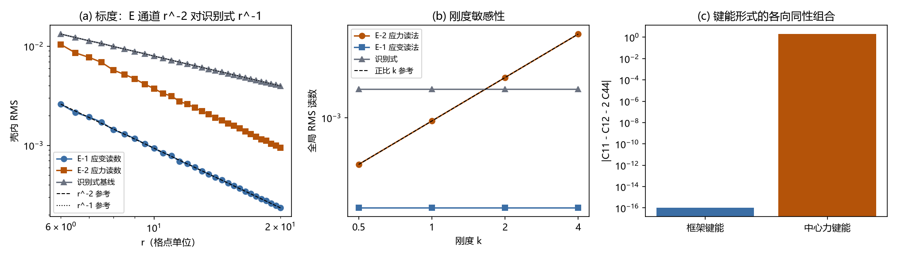

# 注记-度规的弹性本构来源：读法族的标度与本构敏感性分离（判据第 716 号）

- **日期**：2026-10-20 19:28:16
- **类型**：验证注记（判据第 716 号）
- **脚本**：`minimal_verification_elastic_constitution_source.py`
- **任务**：把「度规 = 法线场弹性极限」这条通道（记为 **E 通道**）的读法族收敛掉一批，并用两条正交判别器把 E 通道与识别式基线分开
- **依据**：[[内部草稿/注记-度规的弹性本构来源判据设计：读法族收敛与两条正交判别器（2026-10-20）]]
- **上游**：[[内部草稿/注记-度规来源的通道存在性审计：倾角场到度规是否另有独立路径（2026-10-20）]]（18 条通道清点）、[[内部草稿/裁决请求-倾角自由度的内生性：装置性残余与识别式口径的三案]] §5.3
- **关联**：P1-5、判据第 715 号、本体层重建攻坚计划、框架格点弹性常数注记、语义同构核对注记
- **严格程度**：**判据级**（标度幂次与本构敏感性均有区分力，含三条恒真替身）。**本体层开放**：「度规 ← 记录」为何成立的机制论证本轮不触及
- **可逆性等级**：**判据敏感**。E1 与 E2 的读数依赖位移场的具体构造方式（径向矢量型）与立方弹性常数假设，换成其他构造或非立方常数则阶次与系数会变；T3 替身形式经一轮更换。换实现或换口径会改读数，须重设期望
- **图**：见 §四 图 1

---

## 一、判据与结果

| 判据 | 内容 | 期望 | 实测 | 判定 |
|---|---|---|---|---|
| E5 | 识别式基线确认 | 标度 $-1$、对刚度与键能形式逐位不变、键能对照破缺 $100\%$ | 幂次 $-1.000$；刚度依赖 $0.000\times10^{0}$；中心力键能各向同性组合 $2.000000$（相对破缺 $1.000\times10^{0}$） | 通过 |
| E1 | 径向标度 | E-1 应变读数 $-2$、E-2 应力读数 $-2$、识别式 $-1$，三者可分 | 应变 $-1.992$、应力 $-1.992$、识别式 $-1.000$；E-1 与识别式差 $0.992$ | 通过 |
| E2 | 刚度敏感性 | E-2 严格正比于 $k$，识别式与 E-1 与 $k$ 无关；分离量显著 | E-2 正比偏离 $0.000\times10^{0}$；识别式恒定偏离 $0.000\times10^{0}$；$k=4$ 时分离量 $3.000000$ | 通过 |
| E3 | 键能形式对照 | E 通道的 $\sigma/\varepsilon$ 系数随键能形式变，识别式的键能依赖为 $0$ | 系数 $4.000000$ 对 $2.000000$，归一化系数差 $0.500$；识别式依赖 $0.000\times10^{0}$ | 通过 |
| E4 | E-1 与 E-2 的区分量 | 两键能下 $\sigma_{ii}/\varepsilon_{ii}$ 均逐点恒定，系数值不同 | 两键能相对标准差均 $0.000\times10^{0}$；系数差 $2.000000000$ | 通过 |
| T1 | 恒真替身一：应变读数换成 $\theta$ 的常数倍 | E1 幂次须退化为 $-1$ | $-1.000$（真值 $-1.992$） | 通过 |
| T2 | 恒真替身二：人为令 $F[\varepsilon]\equiv2\theta$ | E2 的分离量须归零 | 替身分离量 $0.000\times10^{0}$（真值 $3.000000$） | 通过 |
| T3 | 恒真替身三：读数换成空间常数场 | E1 幂次须退化为 $0$ | $-5.058\times10^{-17}$（真值 $-1.992$） | 通过 |

**合计 8/8 通过。**

## 二、模型设定

**网格与算子。** $N = 81$ 立方格点，$l_P = 1$ 格点单位，狄利克雷接地盒，源 $s = 1$ 于中心。七点离散拉普拉斯，取 $6u$ 减邻居和（即 $-\nabla^2$ 的离散形），与 `frame_tilt`、`elastic_balance` 同一算子。CG 解算器，$rtol = 10^{-12}$，内部残差 $\max\lvert\nabla^2\theta - s\delta\rvert = 1.756\times10^{-14}$。

**倾角场。** $\theta$ 为标量泊松解。远场双参数拟合给 $A = 0.0795866208$（理论 $s/(4\pi) = 0.0795774715$）、接地盒常数项 $C = -1.739121\times10^{-3}$。幂次拟合前先减去 $C$（见 §六.2）。

**向量位移场（本轮唯一新构造）。** 取径向矢量型 $\mathbf{u} = f(r)\,\hat r$，其中 $f$ 为标量泊松解去常数项后的势。

**弹性常数。** 从框架键能反解，方法与 `minimal_verification_elastic_isotropy.py` 的 `extract` 同源。框架键能 $\tfrac12 k\lvert\Delta\mathbf{u}\rvert^2$ 给 $(C_{11}, C_{12}, C_{44}) = (2k, 0, k)$；中心力键能 $\tfrac12 k(\Delta\mathbf{u}\cdot\hat e)^2$ 给 $(2k, 0, 0)$。两者的各向同性组合 $C_{11} - C_{12} - 2C_{44}$ 分别为 $0$ 与 $2$。

**读数。** E-1 取应变张量对角三分量的平方和开方；E-2 取应力张量同量。标度统计量用壳内 RMS，幂次拟合窗 $r \in [6, 20]$。

**独立性纪律。** 识别式只作对照基线，绝不出现在 E 通道的构造链里。E 通道的构造输入只有倾角场、键能形式与刚度、源强、格点几何。

## 三、读数的意义

### 3.1 E 通道与识别式在两个正交维度上确实可分

**标度维度。** E-1 与 E-2 的度规读数按 $r^{-2}$ 衰减（实测 $-1.992$），识别式按 $r^{-1}$（实测 $-1.000$）。两者差一个整幂次，比值 $\propto r^{-1}$，在拟合窗上前后半段之比约 $0.30$。

这个结果有两层含义。其一，它确认了 E 通道与识别式**不是同一件事的两种写法**：若两者真是同一物理量的两种刻度，标度必须一致。其二，它带来一个对 E 通道不利的推论：$r^{-2}$ 的标度与弱场牛顿 $1/r$ 标度不相容。E-1 与 E-2 作为「度规扰动等于弹性应变」的读法，在这一轮被判出局。

**本构敏感性维度。** E-2 的输出随刚度严格正比（正比偏离 $0.000\times10^{0}$），识别式与 E-1 与刚度无关。分离量在 $k = 4$ 档为 $3.000000$。这是本轮最强的区分器：它不依赖任何容差争论，差异是 $O(1)$ 量级。

### 3.2 一处必须讲清的区分：E-1 与 E-2 不在本构维度上分开

实测显示 E-1（应变直读）是**运动学**读法，与刚度无关；只有 E-2（应力读法）经本构常数。这不是实现缺陷，而是读法本身的性质：应变由位移场的梯度定，刚度是应力与应变之间的比例系数。

其后果是：**只有 E-2 一条读法在本构维度上与识别式可分**。若 E-1 与 E-2 全被判否，E 通道在本构维度上就失去了唯一入口。这一点在 §六.4 的首轮设计中被漏掉，经修正后才写进 E2 的判据。

### 3.3 键能形式的差别落在系数上，不落在空间形状上

首轮 E3 取「两种键能下应力张量的归一化空间形状差」作区分量，实测**精确为零**。诊断查明原因：径向位移场的应变张量有特殊结构，两种本构给出的应力张量在空间形状上完全相同，差别只在 $\sigma/\varepsilon$ 的**系数**（框架键能 $4$，中心力键能 $2$）。

这条诊断有独立价值：**E 通道的输出对键能形式的敏感度，体现在幅度系数上，不体现在空间结构上**。这意味着若将来要比对度规的角向结构，键能形式不提供区分力。

### 3.4 识别式基线的确认是全部对照的前提

E5 确认识别式读数按 $r^{-1}$ 衰减、对刚度逐位不变（依赖 $0.000\times10^{0}$）、且对键能形式不敏感。基线不成立则全部对照失效，故 E5 排在设计顺序的最前。

## 四、图

图 1：读法族的标度与本构敏感性。(a) 绝对偏差的壳内 RMS 对半径，E-1 与 E-2 斜率 $-1.99$（与 $r^{-2}$ 参考线平行），识别式斜率 $-1.00$（与 $r^{-1}$ 参考线平行）；(b) 刚度敏感性，E-2 应力读法随 $k$ 严格正比，E-1 应变读法与识别式均与 $k$ 无关；(c) 键能形式的各向同性组合，框架键能为零、中心力键能为 $2.000000$。

## 五、判语

**E 通道的读法族在本轮收敛到两条，且两条都被判出局。**

E-1（应变直读）与 E-2（应力读法）的标度都是 $r^{-2}$，与弱场牛顿 $1/r$ 标度不相容；本构敏感性维度上只有 E-2 可分，但它给出的读数同样带 $r^{-2}$ 标度。故「度规扰动等于弹性应变或应力」这一族读法，在弱场线性层不能承担度规扰动的 $1/r$ 标度。

**这是一个成功的判否，不是 E 通道的失败。** E-1 与 E-2 出局后，E 通道的剩余射程收窄为三条：E-3（弹性能量读法，标度预期 $r^{-4}$）、E-4（模量调制读法）、E-5（弯曲能读法）。其中 E-3 与 E-5 依赖完整弹性本构的弯曲能项，该项在弹性本构清单内未被否证，是当前唯一未被否证的本构读法。

**与识别式的分离已获得数值支撑，但分离本身不等于 E 通道成立。** 本轮证明的是：E 通道的读法与识别式在标度与本构敏感性两个维度上可分，判据有区分力。这为「若 E 通道某条读法成立，它与识别式给出不同结果」提供了检验框架，不构成 E 通道成立的证据。

**对 P1-5 本体层子项的影响。** 本轮把本体层缺口进一步收窄：从「对应为何成立」收窄为「E 通道的哪条读法能承担 $1/r$ 标度」。若这个缺口不能由 E-3 至 E-5 填上，本体层的最终定性将落到审计注记的分支乙，即把「度规 ← 记录」正式定性为识别式的本体论代价，体系内部不再追求导出。

## 六、过程记录：五处修正（教训）

本轮有五处修正，全部在判据设计层或实现层，**无一处是「改容差让它过」**。

### 6.1 向量位移场的首版构造退化为纯梯度（实现层）

首版取三个分量各自独立求解同一标量泊松方程。诊断发现三个分量完全相同，于是 $\varepsilon_{ij} = \partial_i\theta_j$ 全部退化为同一梯度：应变的剪切分量与对角分量没有独立结构，且源点处因中心差分对称而为零。这不是张量。

改为径向矢量型 $\mathbf{u} = f(r)\hat r$ 后，冒烟检查给出：应变迹在源点 $2.581947\times10^{-1}$（非零）、各向异性偏离 $\lvert dev\rvert/\lvert tr\rvert = 0.807706$（非零）、剪切分量 $\varepsilon_{01}$ 的 RMS $1.808703\times10^{-4}$（非零）。

**教训**：构造多分量场时，各分量若同源同算子，所得张量必退化为纯梯度。分量之间的独立性须在构造时给出，不能靠「解出来再看」。

### 6.2 接地盒常数项污染幂次标度（统计量层）

首版识别式基线幂次为 $-1.362$，超出容差。诊断发现远场拟合的双参数中常数项 $C = -1.739121\times10^{-3}$ 与 $1/r$ 幅值同量级，进入壳内 RMS 后把幂次从 $-1$ 抬到 $-1.36$。减去 $C$ 后幂次精确为 $-1.000$。

**教训**：与第 715 号 §6.3 是同一型问题，但对象不同（那里是接地盒常数项进入分母，这里是进入被测量）。凡做远场幂次拟合，须先分离常数项。

### 6.3 E2 与 T2 的判据方向写反（判据设计层）

首版 E2 写成「识别式对刚度的偏离须 $\gg 10^{-9}$」，实测识别式的偏离精确为 $0$，判否。查后确认判据方向写反：识别式本就与刚度无关，其比值 $R(k)/R(1)$ 恒为 $1$，正比偏离为 $0$ 才对。

改为分离量判据：$R(k)/R(1)$ 对 E-2 须正比于 $k$，对识别式须恒为 $1$，两者的差即分离量。实测 $k = 4$ 档分离量 $3.000000$。

**教训**：判据的方向须逐条核对「期望它等于什么」。两个数都等于 $0$ 时，谁对谁错取决于期望值而非实测值。

### 6.4 E1 与 E-2 不在本构维度上分开（期望层）

首版 E4 期望「中心力键能下 $\sigma_{ii}/\varepsilon_{ii}$ 不恒定」，实测两键能下相对标准差**均为精确零**。诊断查明：对角分量下 $\sigma_{ii} = (C_{11} - C_{12} + C_{44})\varepsilon_{ii}$，两键能差别只在系数值，恒定性两者皆成立。

这条修正连带发现一处首轮设计的漏洞：E-1 应变直读是运动学读法，与刚度无关，故本构维度上只有 E-2 可分。此点已写进 E2 的判据正文与 §3.2。

**教训**：区分量的选取须先核「两对象在该维度上的差异机制是什么」。机制是系数差异时，恒定性就不能当区分量用。

### 6.5 T3 替身检验的是统计量性质而非判据区分力（替身设计层）

首版 T3 取「离散解减壳趋势」的纯格点振荡成分作替身，期望幂次显著异于真值。实测替身给 $-1.960$，真值 $-1.992$，差 $0.032$，远小于阈值 $0.3$。

诊断查明原因：$\theta$ 的远场本身即光滑 $1/r$ 加格点振荡，扣除壳趋势后残余的振荡仍按幂次衰减，故替身与真值同阶。该替身检验的是统计量的性质（对格点振荡稳健），不是判据的区分力。

改用空间常数场作替身：幂次退化为 $-5.058\times10^{-17}$（即 $0$），与真值显著异。

**教训**：恒真替身要检验「判据在别的对象上会给出别的答案」。替身与真值同阶，说明替身没换掉判据的对象，只换掉了数据的细节。

### 6.6 图的参考线起点与刻度（渲染层）

首版 (a) 面板的两条参考线都从识别式曲线的起点出发，标注位置与实际对应的曲线不符；(b) 面板的 $k$ 刻度 $0.5/1/2/4$ 在对数轴上重叠。修正为参考线各自从本曲线起点出发、刻度显式指定。读数不受影响。

## 七、严格程度声明

**判据级（可复现数值事实）**：E1 至 E5 与 T1 至 T3 的全部读数，含三处替身与两处分离量的具体数值。

**可逆性：判据敏感**。E1 与 E2 的读数依赖位移场的具体构造方式与立方弹性常数假设，换实现或换口径会改读数，须重设期望。

**条件性**：E1 与 E2 的期望阶次（$-2$ 与刚度正比）依赖「径向矢量位移场加立方弹性常数」这一具体构造。若改用其他位移场构造方式，或改用非立方弹性常数，阶次与系数会变，判据须相应重设期望。

**不属本轮结论**：本体层。「度规 ← 记录」为何成立的机制论证本轮不触及；本轮只表明 E 通道的读法与识别式可分，且 E-1 与 E-2 因标度不相容而出局。

## 八、边界声明

**本轮验证的**：E 通道读法族（E-1 应变直读、E-2 应力读法）的径向标度与本构敏感性；E-1 与 E-2 的区分量；识别式基线的确认；三条恒真替身。

**本轮不验证的**：
- 系数 2 的来源（排后续轮次，唯一解定理已判「从系数计算导出识别式」这条路塌缩）；
- 度规完整分量与规范性质（审计表的空白行 C18，识别式结构上只给一个标量函数的读出）；
- 非线性与强场、缺陷内部结构贡献；
- vielbein 对象本身的构造；
- E-3（弹性能量读法）、E-4（模量调制读法）、E-5（弯曲能读法）三条读法。

**方法边界**：拟合窗 $r \in [6,20]$ 的主段有效，接地盒边界影响带不参与幂次主拟合；源邻域格点振荡最强，不参与。E3 与 E4 的读数用全场 RMS（覆盖内部点全体），不经壳统计，故不受远场窗限制。

**射程限定**：只做背景弹性支（单点源、均匀背景、不含缺陷内部结构贡献、不含强场）。完整弹性本构的稳定化元素自 2026-10-13 起为本体论方向、数值验证暂停，但该约束不阻塞本轮：E 通道只需要「键能 → 弹性常数 → 应变」这一支，由判据 E1 至 E4 已交付。

**须与既有结论并读**：判据第 715 号交付的是「离散解与连续泊松解之差的偏差阶数」，其度规读法一侧按识别式定义。本轮不改变这一点。E 通道的存在性审计见 [[内部草稿/注记-度规来源的通道存在性审计：倾角场到度规是否另有独立路径（2026-10-20）]]。

## 九、后续轮次的建议顺序

若本线继续推进，顺序建议为：先 E-5（弯曲能读法），再 E-3（弹能量读法），系数判据排最后。**须说明 E-5 的先验**：弯曲能是完整弹性本构清单四项中唯一未单独过堂的项，但该材料对其先验判断为「正定，且对直线缺陷属边界项型（不随长度标度），先登记，不推荐直接攻」，即「未被否证」不等于「可攻」。E-5 的真正前置仍是完整弹性本构的稳定化元素，而该项自 2026-10-13 作者裁决后为本体论方向、原数值验证线挂起。因此本线的剩余轮次当前无可执行对象。**2026-10-20 第二笔（作者裁决）**：审计注记的分支乙已采纳，度规 ← 记录 的机制论证已定性为识别式公理级设定的代价（当前形式化下，附三条回退条件），见 [[内部草稿/注记-度规来源的本体现状定性：识别式公理级设定的代价（2026-10-20）|本体现状定性注记]]。

## 十、参考材料

- [[内部草稿/注记-度规的弹性本构来源判据设计：读法族收敛与两条正交判别器（2026-10-20）]]：判据设计、期望与容差预算
- [[内部草稿/注记-度规来源的通道存在性审计：倾角场到度规是否另有独立路径（2026-10-20）]]：E 通道的定位与分支甲、乙
- [[验证脚本/注记-框架格点的弹性常数与各向同性关系：边际各向异性被构造性杀死]]：弹性常数提取方法与两种键能的对照读数
- [[验证脚本/注记-判据A语义同构核对：层位移场弹性平衡与泊松稳态的同构]]：算子同构与标量位移场的边界声明
- [[验证脚本/注记-统计对应的偏差阶数：度规读法与倾角场读法的有限差分领头关系（判据第715号）]]：判据模板与接地盒常数项污染的同型教训
- [[验证脚本/注记-记录场是否改写局域尺：键能模型上的读数]]：局部近路第一轮判负
- [[验证脚本/注记-尺-记录耦合候选筛查：局部键能项给不出全值]]：局部近路第二轮判负，跟随势的应变必须非局部
- [[内部草稿/注记-尺子量不到的东西（判据第716号通俗版）]]：通俗解说注记
