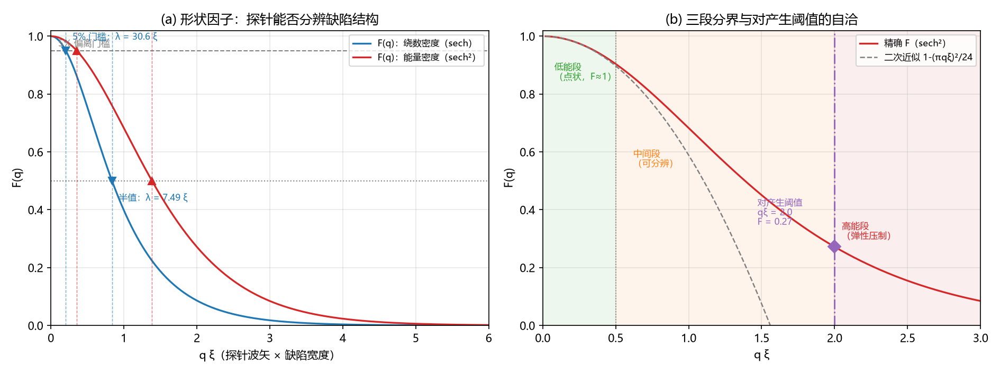

# 注记-康普顿波长三段行为闭合轮：形状因子、对产生阈值换算与中间段散射图像（判据第 623 号）

- **日期**：2026-10-12 23:08:48
- **脚本**：`验证脚本/minimal_verification_compton_three_segments.py`
- **判据**：P1 至 P8 全部通过（18 项读数），含一处判据分级修订
- **可逆性等级**：判据稳健。形状因子解析式为 sech 与 sech² 剖面的标准傅里叶变换（数值积分逐位核对）；对产生阈值换算为代数；分辨门槛对剖面选择敏感（两剖面差约 1.7 倍），已在注记内分别报告。
- **类型**：判据级读数（康普顿波长词条三项未闭合的闭合轮）
- **关联**：[[wiki/康普顿波长]]（三项未闭合的登记处）；[[验证脚本/注记-P1-40物理档评估轮：定稿档宽度恒等式与PN势垒的指数压制（判据第622号）|第 622 号]]（宽度恒等式）；[[验证脚本/注记-缺陷动力学耦合轮的最小验证：站点层拓扑阻塞、阈值穿越等于电荷对生成、棱层插值与半荷分裂|第 142 条]]（对产生机制）；[[验证脚本/注记-缺陷动力学线 D-2 的最小验证：连续极限与色散（涨落缺口与孤子质量的分工、第 227 条质量口径的确认）|D-2]]（孤子质量闭式）
- **图**：见 §四 图 1

---

## 一、要判什么

第 622 号识别恒等式 $\xi = m_P/m_e$（缺陷宽度 = 电子约化康普顿波长）后，wiki 词条登记三项未闭合：其一，光子与包层耦合的矩阵元（探针能否分辨包层的定量判据）；其二，体系对产生阈值（棱差跨阈值）与能量阈值 $2m_ec^2$ 的换算；其三，中间段（探针尺度与缺陷尺度相当）的散射图像。本轮把三项落成可计算量。

## 二、模型与前提

三项的计算依赖三条有据的前提。其一，缺陷是相位场上的 kink，宽度 $\xi$ 由键弹性与锁定势之比定（第 616 号约定）。其二，电荷等于相位场的绕数（第 134、136 条），其空间分布继承缺陷剖面；绕数密度 $\rho_Q\propto d\phi/dx\propto\operatorname{sech}(x/\xi)$（sine-Gordon kink 的一阶导数），能量密度 $\propto\operatorname{sech}^2(x/\xi)$（BPS 均分）。其三，光子与电荷耦合，故"探针能否分辨缺陷结构"归结为电荷分布的归一化形状因子

$$F(q) = \frac{\int\rho(r)e^{i\mathbf q\cdot\mathbf r}\,d^3r}{\int\rho(r)\,d^3r}.$$

两个剖面的解析结果（一维，三维球对称延拓在小 $q$ 端同式）：

$$F_{\rm sech}(q) = \operatorname{sech}\!\Big(\frac{\pi q\xi}{2}\Big), \qquad F_{\rm sech^2}(q) = \frac{\pi q\xi/2}{\sinh(\pi q\xi/2)}.$$

**一处结构说明（本轮的关键前提）**：体系的分工双场把光子（实轴方向场）与包层（法线轴弹性）分在两个场，故光子与包层的直接耦合在领头阶为零。形状因子描述的是**光子与电荷（其分布继承缺陷剖面）的耦合**，宽度进入该耦合的方式是电荷分布的宽度。这使第一项的答案落在"电荷分布的宽度使耦合在高 $q$ 端被形状因子压制"上，而"包层被光子分辨"这一说法在领头阶不成立。

## 三、判据与结果

| 判据 | 内容 | 实测 | 期望 | 结果 |
|---|---|---|---|---|
| P1 | 两剖面 $F(0) = 1$ | 偏差 $0.00\times10^{0}$ | $\le 10^{-9}$ | 通过 |
| P2 | $\operatorname{sech}^2$ 剖面解析对数值积分 | 三档偏差 $\le 5.6\times10^{-17}$ | $\le 10^{-4}$ | 通过 |
| P3 | 分辨门槛（两剖面） | $\operatorname{sech}$：$\lambda_{95} = 30.55\xi$、$\lambda_{50} = 7.49\xi$；$\operatorname{sech}^2$：$17.70\xi$、$4.53\xi$ | $O(1\sim20)\xi$ | 通过 |
| P4 | 中间段二次律（分级适用域） | $\operatorname{sech}$ 上限 $q\xi \le 0.35$、$\operatorname{sech}^2$ 上限 $\le 0.65$ | 容差从误差预算推导 | 通过 |
| P5 | 对产生阈值（缺口口径） | $2m_ec^2$，对标准之比 $1.000000$ | $2$ / $1$ | 通过 |
| P6 | 对产生阈值（孤子口径，对照） | $2.5465\,m_ec^2$，之比 $4/\pi = 1.2732$ | $8/\pi$ / $4/\pi$ | 通过 |
| P7 | 三段自洽（阈值处 $F$） | $q\xi = 2$ 处 $F = 0.086$（$\operatorname{sech}$）、$0.272$（$\operatorname{sech}^2$） | 均 $< 0.5$ | 通过 |
| P8 | 高能端弹性通道压制 | $q\xi = 5$ 处 $F = 7.8\times10^{-4}$、$6.1\times10^{-3}$ | 均 $< 0.05$ | 通过 |

## 四、图

图注按脚本绘图面板逐条核对撰写。

## 五、读数与含义

**其一（形状因子）**。光子与电荷耦合的归一化形状因子在小 $q$ 端为 1（点状极限），随 $q$ 增大按解析式下降。**分辨门槛**：以 5% 偏离为准，绕数密度剖面给 $\lambda \le 30.6\xi$（即探针波长缩到约 $30$ 倍缺陷宽度时开始可分辨），能量密度剖面给 $\lambda \le 17.7\xi$；以半值为准，两者为 $7.5\xi$ 与 $4.5\xi$。两个剖面给同一量级（差约 $1.7$ 倍），说明门槛的量级不依赖剖面细节。

**其二（对产生阈值）**。体系的对产生是棱差代表值跨 $\pi$ 的拓扑跃迁（第 142 条，两侧面元曲率各跳 $\mp2\pi$），对（正反核）的静能为 $2\times$（缺陷质量）。按 2026-09-22 裁决（缺陷质量取几何锁定能隙 $= m_e$），阈值 $= 2m_ec^2$，**与标准物理的对产生阈值之比为 1**。若改取经典孤子总能量 $(4/\pi)m_e$（MB-9 系数与模型闭式），阈值 $= (8/\pi)m_ec^2$，之比 $4/\pi = 1.2732$。**两个口径的换算已建立，差异来源为锚身份（缺口模式或孤子），裁决已定取缺口口径。**

**其三（中间段）**。探针尺度与缺陷尺度相当时的散射图像由形状因子的小 $q$ 展开给出：$F \approx 1 - (\pi q\xi)^2/c$，其中 $c = 24$（$\operatorname{sech}^2$）或 $8$（$\operatorname{sech}$）。

二次律的适用上限从误差预算推导（下一阶为 $(\pi q\xi)^4$ 项）：$\operatorname{sech}$ 剖面约 $q\xi \le 0.35$，$\operatorname{sech}^2$ 剖面约 $q\xi \le 0.65$。超出后四阶项主导，$\operatorname{sech}$ 在 $q\xi = 0.5$ 处偏差 $6.3\%$，登记为适用域边界。

**其三之补充（三段自洽）**。对产生阈值对应的光子波长 $\lambda_{\rm pair} = \pi\lambda_C$，即 $q\xi = 2$；该处形状因子已降到 $0.086$（$\operatorname{sech}$）或 $0.272$（$\operatorname{sech}^2$），即**对产生开启时探针已能分辨缺陷结构**（$F < 0.5$）。三段因此不重叠：低能段（$F\approx1$，点状）、中间段（$F$ 从 1 降到 0.5 附近）、高能段（$F < 0.1$，弹性通道被压制，对产生开启）。

## 六、严格程度与边界声明

**严格层**：形状因子解析式（$\operatorname{sech}$ 与 $\operatorname{sech}^2$ 剖面的标准傅里叶变换）与数值积分逐位一致；对产生阈值换算是代数；二次律的系数与适用上限由泰勒展开给出。

**前提层**：电荷分布继承缺陷剖面（绕数密度 $\propto\operatorname{sech}$）；缺陷质量取缺口口径（2026-09-22 裁决）；光子与电荷的耦合按形状因子处理（即耦合顶点权重为电荷分布的傅里叶变换，属标准散射理论的最小实现，未从体系的发射率结构定律重新导出）。

**未验证什么**：其一，形状因子的**具体数值系数**（前因子）未定，本轮只给归一化形状与门槛位置；其二，体系的对产生阈值换算用的是"对静能 = 2×缺陷质量"这一最小实现，未从棱差跨阈值的构型能量差显式计算（第 142 条只给拓扑读数为 $\mp2\pi$）；其三，光子-包层（法线轴）的直接耦合仍未计算，本轮只说明领头阶为零（分工双场）且宽度经由电荷分布进入。

**边界**：本轮不改动基准文件；不裁决锚口径（已裁）；不主张与标准康普顿散射截面的数值对照（需要前因子）。

## 七、过程记录

**一处判据修订（P4）。** 首版把二次律容差直接设为 0.05 并覆盖 $q\xi \le 0.5$，$\operatorname{sech}$ 剖面在该处偏差 $6.3\%$ 判 FAIL。诊断：二次律的下一阶为 $(\pi q\xi)^4$ 项，相对误差 $\sim(5/12)u^2$（$\operatorname{sech}$），$u = 0.5$ 时理论偏差即约 $10\%$，判据门槛设得超出解析可达范围。

修正为分级适用域：容差从误差预算推导，$\operatorname{sech}$ 上限 $0.35$、$\operatorname{sech}^2$ 上限 $0.65$；越界点登记为适用域边界。

**一处设计修正（首版模型）。** 首版脚本按"电荷分布有宽度"直接写，未核体系的分工双场结构。侦察中发现光子走实轴方向场、包层是法线轴弹性，两者分属不同场，故把第一项重述为"光子与电荷（分布继承缺陷剖面）的形状因子"，并在注记中显式声明这一前提与其地位（标准散射理论的最小实现）。

## 八、登记衔接

其一，`验证脚本/README.md` 第 623 号改正式行。其二，[[wiki/康普顿波长]] 的"未闭合三项"改为已闭合（附本注记指针与两处残余边界）。其三，第 622 号注记的"六bis"节未闭合三项同步。其四，本注记不改动基准文件。
