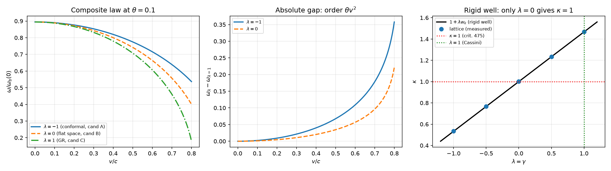

# 注记-引力钟率复合律：候选即 lambda 轴、自撑条件的承重性与交叉项的归属（判据第 813 号）

- **日期**：2026-10-23 01:14:37
- **脚本**：`验证脚本/minimal_verification_p813_composite_clock_law.py`（确定性，约 25 秒）
- **依据**：[[验证脚本/注记-钟率代理导出（第475条）：自撑均匀标度下 h00 等于 2θ 的系数 2|判据第 475 号]]（引力侧 $\omega_b(\theta)=\omega_b(0)\sqrt{1-2\theta}$）；[[验证脚本/注记-正确 boost 构型下的长度收缩与钟慢：格点在动量变量上复现两者（判据第 809 号）|判据第 809 号]]（运动侧 $\omega_b/\gamma$）；[[验证脚本/注记-GV1潮汐项与里奇对应：真空条件把lambda逼到1|判据 GV1]]（$\lambda=1$ 的真空方程锚）；[[内部草稿/注记-识别式乘数验证：κ的线性响应公式与唯一解定理|M4 唯一解]]（均匀标度 $a_1=a_2=a_4=-2$）；[[理论攻坚/引力钟率复合律攻坚计划：两因子对接、二阶交叉项与自场边界|攻坚计划 P1-63]]（三阶段与四裁决点）
- **状态**：判据 35/35 通过（S1 至 S11、T1 至 T3）。阶段一（形式构造）交付：复合律定为丙（完整度规），交叉项归属为 PPN $\gamma$ 通道，自撑条件升为承重项
- **可逆性等级**：判据稳健（S1 至 S8、S10、S11 为代数恒等式；S9 为格点本征值读数，闭式对表偏差 $\le 1.1\times10^{-3}$）
- **图**：见 §4 图 1

## 1 判据与设定

**任务**。P1-63 的缺口是：引力侧钟率（第 475 号）与运动侧钟慢（第 691、809 号）各自成立，复合律从未写出。攻坚计划列出两个候选（甲因子相乘、乙根式内合并），并判定两者二阶差 $\theta v^2/c^2$ 是一条候选的新破坏通道。本轮执行阶段一，任务是定出复合律的形式，并判定该交叉项的性质。

**母式**。钟率是固有时流逝率，写成度规读数

$$\frac{d\tau}{dt} = \sqrt{-g_{00} - g_{ij}v^iv^j}.$$

静态弱场取 $g_{00} = -(1-2\theta)$、$g_{ij} = (1+2\lambda\theta)\delta_{ij}$（$\theta = GM/(c^2r) > 0$），则

$$\omega = \omega_b(0)\sqrt{1 - 2\theta - (1+2\lambda\theta)\,v^2}.$$

这里 $\lambda$ 就是 PPN 参数 $\gamma$：标准 PPN 形式 $g_{ij} = (1-2\gamma\Phi)\delta_{ij}$ 取 $\Phi = -\theta$ 即 $g_{ij} = (1+2\gamma\theta)\delta_{ij}$，故 $\lambda = \gamma$。

**判据**。S1 至 S3 为极限与一阶；S4 至 S7 为候选结构与二阶系数；S8 为 $v=0$ 处的 $\lambda$ 盲性；S9 为刚性阱格点读数；S10 为 Cassini 封口；S11 为自撑读法下 $\lambda$ 的消失。T1 至 T3 为恒真检验替身，须判否。

## 2 结果

| 判据 | 内容 | 实测 | 期望 |
|---|---|---|---|
| S1 | $v=0$ 极限（三候选） | 差 $0$ | $0$ |
| S2 | $\theta=0$ 极限（三候选） | 差 $0$ | $0$ |
| S3 | 一阶系数（三候选） | $\theta$ 系数 $-2$、$v^2$ 系数 $-1$ | 全同 |
| S4 | 候选即 $\lambda$ 轴三点 | 甲 $=-1$、乙 $=0$、丙 $=+1$，差 $0$ | 逐点命中 |
| S5 | 开方后 $\theta v^2$ 系数 | $+1/2$、$-1/2$、$-3/2$ | 两两不同 |
| S6 | 丙与 GR 弱场对表 | 差 $0$；$d g_{ij}/d\theta = 2$ | 形式一致 |
| S7 | 一般 $\lambda$ 的系数 | $-(\lambda+\tfrac12)$ | $\lambda=1$ 给 $-3/2$ |
| S8 | $v=0$ 时母式与 $\lambda$ 无关 | 差 $0$ | $0$ |
| S9 | 刚性阱格点 $\kappa(\lambda)$ | 五档相对差 $6.8\times10^{-11}$ 至 $1.1\times10^{-3}$ | $\le 2\times10^{-3}$ |
| S9 | $\lambda=1$ 处的 $\kappa$ | $1.4674$ | 显著偏离 $1$（$46.7\%$） |
| S10 | GPS 档 Cassini 封口 | $7.76\times10^{-24}$ | $<10^{-20}$ |
| S11 | 自撑读法下 $d\omega^2/d\lambda$ | $0$ | $0$ |
| S11 | 刚性阱下 $d\omega^2/d\lambda$ | 非零 | 非零 |
| T1 至 T3 | 三个替身 | 均判否 | 须判否 |

读表：S5 的三系数两两不同，故复合律在二阶可判；S9 的 $\kappa$ 随 $\lambda$ 单调上升，$\kappa=1$ 只在 $\lambda=0$ 处成立，而 S11 说明自撑读法把 $\lambda$ 从钟率里整个消掉。

## 3 三条实质发现

**其一，候选集不是两点而是一条轴。** 原计划的甲、乙不是两个独立的候选，它们是同一条 $\lambda$ 轴上的两个点：甲（因子相乘 $\omega_b\sqrt{1-2\theta}/\gamma$）恰是 $\lambda=-1$，即共形空间 $g_{ij} = (1-2\theta)\delta_{ij}$；乙（根式内合并）恰是 $\lambda=0$，即空间不弯 $g_{ij}=\delta_{ij}$。计划要判的是「甲还是乙」，实际要判的是「$\lambda$ 取多少」。这一改写使问题从二选一变为一维参数判定，而 $\lambda$ 已有独立锚。

**其二，计划对甲的刻画有误。** 计划称甲「无 $\theta v^2$ 交叉项」，实测甲的二阶系数是 $+1/2$，乙是 $-1/2$，丙是 $-3/2$。三者都含交叉项，只是系数不同。计划对「甲与乙之差为 $\theta v^2/c^2$」的估计是对的（S5 给出两者差 $1$ 倍），但把它归给甲「缺失」是错的：甲不缺失，它的符号相反。这个区分影响后续判据的设计：判据量不能写成「有无」，须写成「系数取哪个值」。

**其三，自撑条件是承重项，且它的作用是让 $\lambda$ 消失。** 第 475 号的 $\kappa = 1$ 不是 $\lambda=1$ 的证据。若把势阱当成坐标空间里刚性不动的（整体系数随 $\theta$ 缩放而内部结构不变），格点给出 $\kappa = 1+\lambda w_k$（$w_k = 0.4667$ 为本装置读数），$\lambda=1$ 时 $\kappa = 1.467$，与第 475 号的 $\kappa=1$ 相差 $47\%$。

第 475 号之所以成立，靠的是自撑：内部结构用固有单位定义，此时固有波矢 $k_p = k/\sqrt{1+2\lambda\theta}$，代入后

$$\omega^2 = (1-2\theta)\left[\frac{k^2}{1+2\lambda\theta} + m^2\right] \;\longrightarrow\; (1-2\theta)(k_p^2+m^2),$$

$\lambda$ 完全消失（S11 的导数严格为零）。故自撑读法下第 475 号对 $\lambda$ 是盲的：它既不证实也不否证 $\lambda=1$，只与 $\lambda=1$ 相容。反过来说，若自撑失效，第 475 号将迫使 $\lambda=0$，与 Cassini 的 $\lambda=1$ 直接冲突。自撑因此不是修饰性的前提，它是第 475 号与 $\lambda=1$ 的相容条件。

## 4 图

## 5 结论

**复合律取丙。** $\lambda$ 即 PPN $\gamma$，已由三条独立路线钉在 $1$：光偏折锚（Cassini 给 $|\gamma-1| \le 6.7\times10^{-5}$）、真空场方程的空间部分（GV1 的 T4）、本体层重建的链接型写入（判据 L1 至 L5 给 $\lambda = 1$）。取 $\lambda=1$ 即

$$\omega = \omega_b(0)\sqrt{1 - 2\theta - (1+2\theta)v^2},$$

这正是 GR 弱场标准形式 $d\tau/dt = \sqrt{-g_{00} - g_{ij}v^iv^j}$ 在 $g_{00}=-(1+2\Phi)$、$g_{ij}=(1-2\Phi)\delta_{ij}$（$\Phi=-\theta$）下的读数。

**交叉项不是新破坏通道。** 偏离丙的量为 $(1-\lambda)\theta v^2$，其系数恰是 PPN $\gamma$ 偏离的度量。GPS 档（$\theta = 6.95\times10^{-10}$、$v = 3.87$ km/s）在 Cassini 封口后为 $7.76\times10^{-24}$，比原子钟分辨率低两个量级以上。故 $\theta v^2$ 型不构成独立的第三条通道，它是 $\gamma$ 通道在同一二阶层的表现，而 $\gamma$ 通道早已被光偏折封住。

**原计划的量级估计过强。** 计划取 $v^2/c^2 \sim 10^{-6}$ 得 $10^{-15}$，但 $v^2/c^2 = 10^{-6}$ 对应 $v = 300$ km/s，比实验室与卫星速度高两到三个量级；实际装置的 $v^2/c^2$ 在 $10^{-12}$ 至 $10^{-9}$ 之间，原始交叉项本身就只有 $10^{-22}$ 至 $10^{-19}$。

## 6 严格程度声明

S1 至 S8、S10、S11 为代数恒等式（sympy 符号运算，差严格为零）。S9 为格点本征值读数：$N = 4001$、$L = 60$、$\theta = 10^{-3}$，形状模频率对解析 $\sqrt{3}$ 偏差 $2.4\times10^{-5}$，闭式对表偏差最大 $1.1\times10^{-3}$（$\lambda=-1$ 档，来自格点离散化）。T1 至 T3 为替身，全部按预期判否。可逆性等级：判据稳健。

## 7 边界声明

**验证什么**：三候选的结构与二阶系数、$\lambda$ 轴上的定位、丙与 GR 弱场度规的一致性、刚性阱与自撑两种读法下 $\lambda$ 的可读性、Cassini 封口的量级。

**不验证什么**：其一，不重跑第 475 号与第 809 号的原始判据，两者读数直接引用；其二，S9 是刚性阱模型（一维、$\phi^4$ kink 背景），不覆盖三维与真实缺陷构型；其三，不验证 $\lambda=1$ 的三条锚本身（光偏折、真空方程、链接写入各有专文）；其四，自场与背景势的分离未在装置层实现，本轮的「自撑」是读法层面的分析，不是装置读数；其五，不改动基准文件。

## 8 过程记录

**判据自身写错一处。** S7 初版把偏离系数写成 $2(\lambda-1)$，实测给 $2-2\lambda$，即 $-2(\lambda-1)$，判否。核对：$G_2 - C_2 = -[(1+2\lambda\theta)-(1+2\theta)]v^2 = -2(\lambda-1)\theta v^2$。符号错在把「偏离」的基准方向搞反，修正后通过。教训：代数判据的期望值必须独立推一遍，不能从上一行抄。

**S11 的替换方向初版搞反。** 固有波矢初版写成 $k_p = k\sqrt{1+2\lambda\theta}$（应为 $k_p = k/\sqrt{1+2\lambda\theta}$），代入后 $\lambda$ 不消失、判否。核对：固有长度 = $\sqrt{g_{ij}}$ × 坐标长度，故固有波数 = 坐标波数 / $\sqrt{g_{ij}}$。修正后 $\lambda$ 严格消失。

**S9 初版用线性化公式对表，偏差系统性偏大。** 初版期望值取 $1+\lambda w_k$（一阶），五档相对差最大 $3.1\times10^{-3}$ 且单调。改用闭式 $\kappa = [1-\sqrt{(1-2\theta)(1-2\lambda\theta w_k)}]/\theta$ 后降到 $1.1\times10^{-3}$，$\lambda=0$ 档降到 $6.8\times10^{-11}$。教训：$\theta = 10^{-3}$ 虽小，但一阶截断在 $10^{-3}$ 量级上会与信号同阶。

**图的 CJK 字符显示为方块。** 首版图例含中文字符（甲、乙、丙、判据），matplotlib 默认字体无 CJK 字形，渲染成方块。改为英文标签（cand A/B/C、crit. 475）。

**一处 np 接口误用。** `np.trapezoid(psi**2, dx)` 把标量当 x 数组传入，报 `diff requires input that is at least one dimensional`。改为传坐标数组 `x`。

## 9 来源

- 引力侧：[[验证脚本/注记-钟率代理导出（第475条）：自撑均匀标度下 h00 等于 2θ 的系数 2|第 475 号注记]]
- 运动侧：[[验证脚本/注记-正确 boost 构型下的长度收缩与钟慢：格点在动量变量上复现两者（判据第 809 号）|第 809 号注记]]
- $\lambda=1$ 的三条锚：[[验证脚本/注记-GV1潮汐项与里奇对应：真空条件把lambda逼到1|GV1 注记]]、[[验证脚本/注记-空间系数lambda的光偏折锚：偏折角随lambda的线性律|光偏折锚]]、[[内部草稿/注记-本体层重建阶段1语义设计稿：一段一个读数|本体层重建阶段 1]]
- M4 唯一解：[[内部草稿/注记-识别式乘数验证：κ的线性响应公式与唯一解定理|识别式乘数验证]]
- 攻坚计划：[[理论攻坚/引力钟率复合律攻坚计划：两因子对接、二阶交叉项与自场边界|P1-63 攻坚计划]]
- 脚本：`验证脚本/minimal_verification_p813_composite_clock_law.py`（确定性，约 25 秒）
- 图：`images/p813_composite_clock_law.png`
