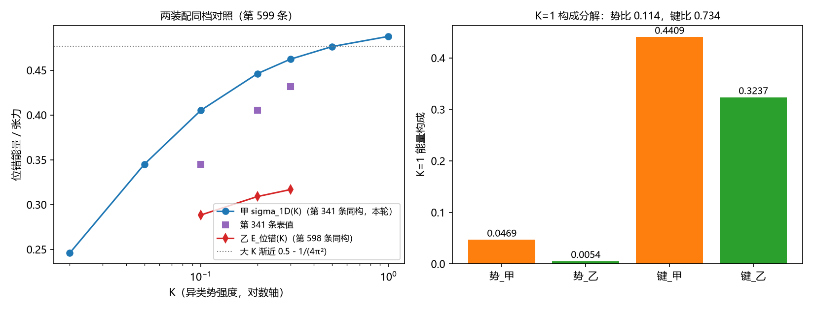

# 注记-张力对表交叉核对：第598条台阶位错对第341条壁张力闭式（第599条）

- **日期**：2026-10-11 11:07:21
- **脚本**：`minimal_verification_tension_reconciliation.py`
- **图**：见 §三 图 1
- **严格程度**：判据级（对表读数为条件性，条件见 §四）
- **可逆性**：判据敏感（两装配、K 网格、破对称扰动、弛豫协议绑定）

## 一、定位

第 598 条发现 FK 口径位错（单格点整数台阶）能量 $+0.3270$（$J=1$），而第 341 条台阶面壁张力线的大刚度档 $\sigma_{1D}$ 外推 $K=1$ 约 $0.477$，差约 $31\%$。本轮是作者认可的交叉核对判据：把两条线的能量对表，并分解差值的机制。两条线同族（一维链、键刚度 1、异类势强度同位），装配不同：甲装配（按第 341 条术语表公式反推）单通道 $E = \frac{1}{2}\sum(\Delta v)^2 + 2K\sum(1-\cos 2\pi v)$；乙装配（第 598 条同构）三分量 FK 扣 $Q=(1,0,0)$。乙的自由度包含甲的嵌入（$v^2=v^3=0$ 时与甲逐位同构），同 $K$ 下 $E_乙 \le \sigma_{1D}$ 为结构不等式。

## 二、判据与结果

判据 R1 至 R4：R2、R3、R4 通过，R1 判否（装配复原未达，见 §三）。

| 判据 | 读数 | 判定 |
| --- | --- | --- |
| R4a 纯函数同构 | 同一 $v$ 上 $E_甲(v)$ 对 $E_乙([v,0,0])$：随机场 20 例最大差 $0.0$（机器零） | PASS |
| R1 甲装配复现 | 反推装配全局极小 $K=0.1/0.2/0.3$ 给 $0.4053/0.4462/0.4623$，对第 341 条表值 $0.3451/0.4053/0.4314$ 偏差 $17.4\%/10.1\%/7.2\%$ | FAIL |
| R2 结构不等式 | 乙 $0.2884/0.3090/0.3167/0.3290$（$K=0.1$ 至 $1$），同档全 $\le$ 甲 | PASS |
| R3 K=1 构成分解 | 甲 $0.4878$ = 键 $0.4409$ + 势 $0.0469$；乙 $0.3290$ = 键 $0.3237$ + 势 $0.0054$；势比 $0.114$，键比 $0.734$，差 $+0.1588$ | PASS |
| R4b 弛豫一致 | 破对称同扰动下甲弛豫与乙冻结弛豫终态差 $0.0$（逐位） | PASS |

## 三、R1 判否的归因：反推装配未复原第 341 条模型

R1 的 FAIL 经三步诊断坐实为装配级差异，非数值协议问题。其一，对称初值把台阶中心格点钉死在 $v=0.5$（势极大点加对称键力平衡，梯度 $1.5\times10^{-14}$ 机器零的鞍点），表观能量 $4.2469$；破对称微扰后收敛真极小 $0.4878$（近整数平台加快跳形态）。其二，粗网格两格种子全部坍缩：$K=1$ 的快跳平衡内点极贴近整数（尾闭式超越方程解 $\varepsilon^* \approx 0.024$），种子 $\varepsilon \ge 0.05$ 都滑出一格跳或光滑支。其三，按第 341 条尾闭式超越方程逐位构造的 $\varepsilon^*$ 平衡种子在本装配下同样滑走（$K=0.1$ 档终态 $0.4053$ 与光滑支逐位相同）：**反推装配中不存在快跳支极小**。第 341 条的快跳支在其自身装配下是全局极小，故两者模型装配不同，候选差异（Dirichlet 条带边界、势宗量定义、$N=257$ 端点处理）须回源第 337/341 条注记核对，本轮不闭。

## 四、条件性对表读数与机制分解

在反推装配下，K=1 的对表为：甲全局极小 $0.4878$，乙 $0.3290$（逐位复现第 598 条 $+0.32900$，实现互译确认），差 $+0.1588$。构成分解给出两个独立机制：**势比 $0.114$**（乙的三股分工把格点内相位差推到整数，$\delta$ 整数化使异类势罚降到甲的十分之一）与**键比 $0.734$**（错排的键应变由多股分摊，单股台阶键能被跟随结构摊薄）。乙的位错比甲的台阶便宜，靠的正是三分量跟随自由度：这是第 598 条台阶形态判否交叉项供货的能量学根源的定量版。**对表条件**：甲为反推装配的全局极小，非第 341 条自身装配的 $\sigma_{1D}$；341 装配复原后的重对表列为待办（R1 重做）。

## 五、过程教训四条

其一，对称初值的鞍点钉死：tanh 台阶关于中心反射对称时，中心格点恰在 $v=0.5$（势力零、对称键力平衡），梯度机器零但那是鞍点，能量判据会把它当收敛。破对称微扰（固定种子正弦 $10^{-3}$）入协议。其二，wrap 键必须逐股整化 $Q$：首版乙装配统一 $Q=1$，给平股 $v^2,v^3$ 强加一圈伪扇区（终态虚高 $0.333$），修复为 $(1,0,0)$ 后乙逐位复现第 598 条。其三，能量分解设计的"竞争剖面合法性"前置核：首版把乙终态的 $v^1$ 单独喂甲装配，得 $165$ 的无意义读数（乙的能量结构靠 $v^2$ 跟随把 $\delta$ 阶跃化，$v^1$ 单独不是甲的合法竞争剖面）；改为键/势构成分解。其四，装配级 FAIL 不靠种子修复：$\varepsilon^*$ 解析平衡种子也救不了装配错，FAIL 触发的是回源核对任务而非继续调种子。
