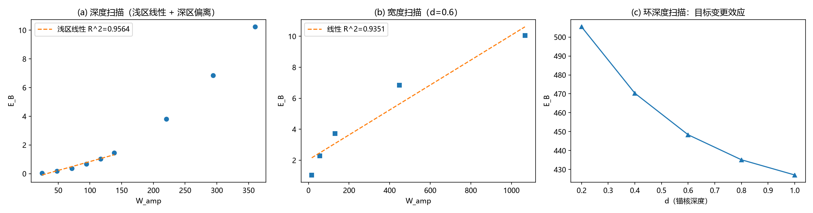

# 注记-张量桥d的W4通路：静质量密度与振幅亏损的标度关系

- **日期**：2026-09-16 05:35:12
- **对应脚本**：`验证脚本/w4_mass_density.py`（判据 L0、L1a/L1b、L2a/L2b、L3a/L3b，确定性，无随机数，运行约 25 秒；图存 `images/w4_mass_density.png`，见 §一 图 1）
- **依据**：[[注记-载体层裁决：纯相位的失败边界与振幅通道的实现路径]] §七（张量桥 (d) 的静质量密度通路与判据 W4）；[[验证脚本/amplitude_channel_ring.py]] 与 [[注记-振幅通道下涡旋环径向曲线的最小验证：钉扎井存在但无稳定半径]]（W1/W2 的「同向」读数）
- **定位**：张量桥分段 (d) 的静质量密度通路（作者 2026-09-16 指示执行）第一轮。把判据 W4「int(1-A^2) 与束缚能线性」做成判据级检验：线性假设被否（判负记录），真实的标度关系被测定（深度方向平方、宽度方向混合），并给出静质量密度场侧形式的修正建议（二次型）。
- **状态**：判据 5/7（两个判负格为原假设的记录）。核心读数：E_B ∝ W_amp^2.04（深度方向，同几何族）；E_B ∝ W_amp^0.54（宽度方向，变几何）；锚核目标变更效应（环深度扫描反向）入过程记录。**2026-09-16 作者核定：采纳第二节的 ρ_m 形式建议（二次型），核定落地。**

---

## 一、判据与结果

| 判据 | 内容 | 通过条件 | 实测 |
|---|---|---|---|
| L0 | 构造自检（凹陷亏损随深度单调） | min\|psi\| 单调降且末值 < 0.6 | 0.959 至 0.492，单调 |
| L1a | 原线性判据（浅区 E_B 对 W_amp） | R^2 >= 0.99 | R^2 = 0.9564，**判负** |
| L1b | 修正判据（深度方向幂律指数） | p ∈ [1.8, 2.2] | p = 2.0373 |
| L2a | 原线性判据（宽度扫描） | R^2 >= 0.99 | R^2 = 0.9351，**判负** |
| L2b | 修正判据（宽度方向指数，读数） | 报告 | p_w = 0.5382 |
| L3a | 深区比值递增（读数） | 无（读数） | 0.0172 至 0.0284 |
| L3b | 环深度扫描反向（锚核目标变更，读数） | 无（读数） | E_B 505 至 427 而降、W 707 至 983 而增 |

## 二、模型与扫描约定

GL 复标量（$E = \sum|\nabla\psi|^2 + \lambda\sum(|\psi|^2-A_0^2)^2$，$\lambda = 0.5$，$N = 32$，边界钉 $\psi = 1$，背景能量 $0$ 故 $E_B = E(构型)$）。W_amp = $\sum(1-|\psi|^2)$。

凹陷构型：$A_0 = 1 - d\exp(-r^2/2w^2)$，最速下降弛豫 1200 步。深度扫描 $d$ = 0.05 至 0.9（9 档）；宽度扫描固定 $d = 0.6$、$w$ = 1 至 4（5 档）。涡旋环取锁定扇区（相位固定为环剖面、只弛豫振幅，与 W1/W2 同族）。

## 三、主要读数解读

**线性假设被否。** 两个方向都未过线性判据（R^2 = 0.956 与 0.935）。判据 W4 原文的「线性」表述在最小模型内不成立，原假设以判负记录保留。

**正确的标度关系：深度方向平方。** 同几何族、变幅度时 $E_B \propto W_{amp}^{2.04}$：能量是二次型（势能密度 $\lambda(A_0^2-|\psi|^2)^2$ 主导时，$E \propto \int(1-|\psi|^2)^2$），而亏损积分 $W_{amp}$ 是一次型。等价表述：$\sqrt{E_B} \propto W_{amp}$，即「振幅型量对振幅型量」的线性在平方根层面成立。

**宽度方向为混合律（路径依赖）。** 变几何时 $E_B \propto W_{amp}^{0.54}$：凹陷加宽后深度自动变浅，梯度与势能两项按不同幂次竞争，单一幂律不能覆盖。含义：单靠「亏损的某个固定函数」无法在所有构型族上记账能量，完整的 $T^{00}$ 分解需要保持三项结构（静质量、动能流、应力），「振幅亏损项」应在同几何族内定义。

**对 (d) 通路的修正建议（2026-09-16 作者核定通过）。** 「静质量密度取振幅亏损形式」的一次型（$\rho_m \propto 1-A^2$）宜作幅度指标；作为能量（质量）记账的场侧形式，建议取二次型（势能密度 $\lambda(A_0^2-|\psi|^2)^2$ 型）：同几何族内它与束缚能成正比（本判据级），且与「质量 = 绑定能」的二次结构一致。核定记录：2026-09-16 作者核定通过，采纳二次型（势能密度型）作为静质量密度的场侧形式，一次型降为幅度指标。

## 四、严格程度声明

全部读数为格点最小模型的确定性数值（GL 复标量、实数相位、锁定扇区对照）。幂律指数为 log-log 拟合（9 档与 5 档）；$\rho_m$ 形式建议为判据级推断。

## 五、边界声明

本注记验证：$E_B$ 与 $W_{amp}$ 的标度关系（两个方向）与线性假设的否证。本注记不验证：连续极限外推；相位动力学（环取锁定扇区，动能按固定剖面计入）；体系的真实 $\lambda$ 与标度换算；$\rho_m$ 二次型建议在张量桥 (d) 完整分解内的相容性（下一轮）。

## 六、过程记录（两处修正）

**其一，判据修正（线性到平方）。** v1 按 W4 原文的「线性」写判据，实测浅区 R^2 = 0.956 判负。核查后确认平方标度是模型的结构性后果（能量二次型对亏损一次型），修正判据为幂律指数并保留判负记录。

**其二，自变量修正（锚核深度到同几何族）。** v1 把「锚核深度 d」当自变量，读到 E_B 与 W_amp 反向（深度加大会把偏好目标值调低，能量账整体平移）。修正：线性与幂律检验在「同几何族、变幅度」与「固定深度、变宽度」两个干净方向进行；原「反向」读数作为「锚核目标变更效应」保留，供后续区分「偏好变更」与「缺陷程度」时引用。
