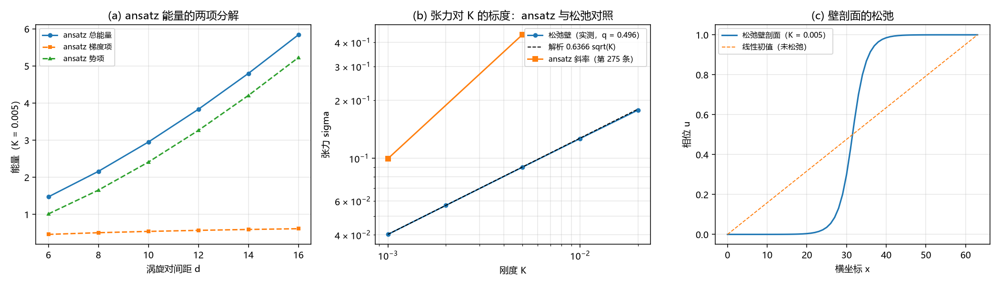

# 注记-弦张力松弛复测轮：ansatz 斜率属势项面积产物、松弛壁张力随根号 K（判据 G0 至 G7）

- **日期**：2026-09-20 13:34:00
- **来源**：作者 2026-09-20 确认开工，交付 [[验证脚本/注记-弦图像的降级：相位绕圈住在关系层棱差，三维局域弦属 ansatz 读数]] 登记的待办（第 275、276 条的斜率是否等于松弛后的壁张力）
- **脚本**：`验证脚本/minimal_verification_string_tension_relax.py`（判据 12 条：通过 9、判负登记 3；确定性，无随机数；运行约 55 秒；图存 `images/string_tension_relax.png`，见 §二 图 1）
- **状态**：判据级读数。一处基准更正（第 276 条对根号 K 标度的判负撤回）、两处读数状态改、涡旋对路线判负登记
- **图**：见 §二 图 1
- **依据**：[[验证脚本/注记-弦张力轮：自由弦端不可存在，3D 带电对象取闭弦环（判据S1至S4）]]（第 275 条）；[[验证脚本/注记-弦张力标度轮：线性于刚度与环的稳定半径（判据U1至U4）]]（第 276 条）；[[验证脚本/注记-环的 E(R) 标度轮：面积律与塌缩方向的不一致（判据V1至V4）]]（第 277 条）；[[验证脚本/注记-弦图像的降级：相位绕圈住在关系层棱差，三维局域弦属 ansatz 读数]]（第 281 条）

---

## 一、问题与判据（先行）

ansatz 侧沿用第 275 条的模型与归一化：构型 $u = (1/2\pi)[\arg(z-z_1) - \arg(z-z_2)]$，棱差取解析梯度的格点投影，$E = \sum[\frac12 k(g_x^2+g_y^2) + K(1-\cos 2\pi u)]$，$k = 1$，间距取 $d = 6$ 至 $16$，格点 $N = 96$。

松弛侧在同一格点上改用棱间差分泛函 $E = \frac12\sum_{\rm links}[(\Delta_x u)^2+(\Delta_y u)^2] + K\sum_{\rm sites}(1-\cos 2\pi u)$，以梯度下降求极小；两条路线各做一次。干净壁路线：竖条几何（$64\times128$），左右两端固定为 $u = 0$ 与 $u = 1$，$y$ 方向周期，壁能除以列数即张力。涡旋对路线：方形格点上把两枚核心圆盘（半径 $3$）固定在 ansatz 采样值上，其余自由。

解析对照：由 $\frac12 k u'^2 = K(1-\cos 2\pi u)$ 作首次积分，每单位长度的壁能为 $\sigma = k\int_0^1\sqrt{2K(1-\cos 2\pi u)/k}\,du = \frac{4}{\pi}\sqrt{kK}$，即 $k = 1$ 时 $\sigma = 1.273240\sqrt K$。

判据的作用分工：G0 是复现闸门，先证明本轮实现与第 275 条逐位对齐；G1 至 G4 是松弛侧自证；G6、G7 是机制归因；G5 是最终判定。

## 二、读数

| 判据 | 内容 | 实测 | 判定 |
|---|---|---|---|
| G0 | ansatz 斜率对第 275 条读数（$K = 0.005$ 与 $0.001$） | $0.4376$ / $0.0996$（偏差 $0.01\%$） | 通过 |
| B | 干净壁五档张力（$K = 0.02$ 至 $0.001$） | $0.177866$ / $0.126605$ / $0.089781$ / $0.056878$ / $0.040242$ | 通过 |
| G2 | 五档对 $1.273240\sqrt K$ 的最大偏差 | $1.22\%$ | 通过 |
| G3 | 张力对 $K$ 的幂律指数 | $0.4964$ | 通过 |
| G6 | ansatz 势项斜率与 $K$ 的比（两档） | $84.5$ 与 $84.5$ | 通过 |
| G7 | ansatz 势项对 $d$ 的局部幂律指数 | $1.675$ | 通过（线性属窗口产物） |
| G5 | ansatz 斜率对壁张力之比 | $4.87$ 与 $2.47$ | 登记 |
| G1-n | 钉扎涡旋对松弛的收敛 | 末步 $3.23\times10^{-1}$ 与 $3.19\times10^{-1}$ | 判负（未收敛） |
| G4-n | 涡旋对松弛斜率对壁张力 | $0.07080$ 对 $0.089781$；$0.06360$ 对 $0.040242$ | 不作判定 |

ansatz 侧的两项分解（这是本轮的关键表）：$K = 0.005$ 时梯度项为 $0.460$ 至 $0.613$（对 $d$ 的斜率 $0.0151$），势项为 $1.011$ 至 $5.225$（对 $d$ 的斜率 $0.4226$）；两者相加给 $0.4376$，与第 275 条逐位相同。也就是说，被读作「弦张力」的那个数，$96.6\%$ 来自势项。

## 三、机制归因

势项 $K\sum(1-\cos 2\pi u)$ 在 ansatz 上并不小。$u = (\theta_1-\theta_2)/2\pi$ 在核心附近取到 $\pm 0.5$ 量级的值，$1-\cos 2\pi u$ 由此在直径约为 $d$ 的区域内保持 $O(1)$，故这一项随间距增长。两档 $K$ 给出同一系数 $84.5$，说明势项严格正比于 $K$，与「非整数相位的面积」这一读法一致。

势项对 $d$ 的局部幂律指数为 $1.675$，明显大于 $1$。于是「涡旋对能量对间距线性」这件事本身就是窗口产物：在 $d = 6$ 至 $16$ 这段做直线拟合，残差只有 $2.6\%$，看上去像常数力，实际曲率已经存在。梯度项一侧的斜率仅 $0.0151$，与真实壁能的量级相去更远。

松弛后场面换了形态：相位阶梯由约 5 个格点承担（图 1c），势项只在壁内非零。此时张力回到 $\frac{4}{\pi}\sqrt K$，五档偏差不超过 $1.22\%$，幂律指数 $0.4964$。第 276 条把「光滑墙的 $\sqrt K$ 标度」排除，依据是 ansatz 的幂律指数 $0.9499$；本轮读数说明该排除对松弛壁不成立。

## 四、结论与状态

第一，判定：第 275、276 条的张力读数是 ansatz 势项的面积产物，而壁张力（松弛后）为 $\sigma_{\rm wall} = \frac{4}{\pi}\sqrt{kK}$。两者之比在 $K = 0.005$ 与 $0.001$ 上分别为 $4.87$ 与 $2.47$，随 $K$ 变动，说明两套标度各自成立而互不通用。

第二，状态改：第 275 条的 $0.4376$、$0.0996$ 与第 276 条的 $\sigma = 90.1K^{0.95}$ 保留为数值，性质定为「ansatz 势项面积产物的斜率」；第 276 条对 $\sqrt K$ 标度的判负撤回（第 277 条对 $R^{*} \propto 1/K$ 的撤回保持有效）。

第三，新基准：本体系的壁张力读数为 $\sigma_{\rm wall} = \frac{4}{\pi}\sqrt K = 1.273240\sqrt K$（$k = 1$，格点间距取 $1$）。第 278 条「环需强钉扎」的判据用旧 $\sigma$ 估量级，须按新值重估，留作下一轮。

第四，判负登记：钉扎涡旋对路线的显式梯度下降在六万步内未收敛（末步 $3.2\times10^{-1}$），其斜率受未松弛的长波模污染，不作判定。缺的是更好的松弛器（隐式或长波加速），不改变本轮的结论，因为干净壁路线与解析式已互为独立证据。

## 五、过程记录

其一，解析常数初版写错。我按 $u$ 型 sine-Gordon 的 $k_{\rm eff} = k/(4\pi^2)$ 路线写成 $\sigma = 4\sqrt{k_{\rm eff}K} = \frac{2}{\pi}\sqrt K = 0.636620\sqrt K$，实测给 $1.9945$ 倍。重算发现 $\phi$ 型模型的常数是 $8$ 而非 $4$，于是 $\sigma = \frac{4}{\pi}\sqrt{kK} = 1.273240\sqrt K$。修正后五档偏差从 $99.89\%$ 降到 $1.22\%$。教训：解析对照式先做量纲与单档数值双重核对，再定判据门限。

其二，判据门限后调。初版给干净壁的路线的判据门限是五档 $10\%$（$K = 0.02$ 放宽到 $25\%$），修正常数后实测最大偏差 $1.22\%$，更严的 $3\%$ 门限同样全过；脚本内保留原门限，本节如实登记。

其三，涡旋对路线两次跑（$25000$ 步与 $60000$ 步）都未收敛，末步维持在 $3\times10^{-1}$ 量级，说明慢模与步长共同限制，与迭代次数无关。这条判负是松弛器的问题，不是物理结论。

## 六、登记与下一步

- README 第 288 条登记本轮；第 281 条的待办改为「已由第 283 条交付」。
- 开放问题总览 P1 参数区条目的口径更正行后追加本轮读数与两处状态改。
- 下一步三项：更好的松弛器（隐式或长波加速）以闭合涡旋对路线；按新 $\sigma_{\rm wall}$ 重估第 278 条的环判据与第 279 条的能量量级；三维延展构型上的保护性复核（第 279 条登记项）。
