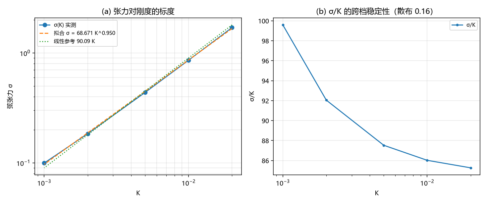

# 注记-弦张力标度轮：线性于刚度与环的稳定半径（判据 U1 至 U4）

- **日期**：2026-09-20 12:36:03
- **来源**：作者 2026-09-20 指令（继续）；补上一轮登记的唯一未定项（张力的 $K$ 标度）
- **脚本**：`验证脚本/minimal_verification_string_scaling.py`
- **降级说明（2026-09-20）**：本轮的 $\sigma = 90.1K^{0.95}$ 属 ansatz 剖面能量的标度，状态改；推论 $R^{*} \propto 1/K$ 已由第 277 条撤回，见 [[验证脚本/注记-弦图像的降级：相位绕圈住在关系层棱差，三维局域弦属 ansatz 读数]]。
- **状态**：判据级读数；标度定案（线性于刚度），一处解析对照判负
- **图**：见 §二 图 1
- **依据**：[[验证脚本/注记-弦张力轮：自由弦端不可存在，3D 带电对象取闭弦环（判据S1至S4）]]

---

## 一、方法与判据

在 2D 横截面上对五档刚度（$K = 0.02$ 至 $0.001$，跨 $20$ 倍）测涡旋对的能量斜率（弦张力 $\sigma$），再对 $K$ 做幂律拟合。候选两级：线性于 $K$（指数 $1$）与光滑墙的 $\sqrt K$（指数 $1/2$）。

---

## 二、判据与读数

| 判据 | 内容 | 实测 | 期望 | 结果 |
| --- | --- | --- | --- | --- |
| U1 | 五档 $K$ 的张力（线性拟合残差） | $1.7053$（$3.0\%$）、$0.8602$（$2.8\%$）、$0.4376$（$2.6\%$）、$0.1841$（$2.0\%$）、$0.0996$（$1.3\%$） | 残差 $\le 0.05$ | 通过 |
| U1 | 幂律指数 $q$（$\sigma = cK^{q}$）与最大十进残差 | $0.9499$ / $0.0258$ | 残差 $\le 0.03$ | 通过 |
| U2 | $\sigma/K$ 的跨档散布（均值） | $0.159$（$90.09$） | $\le 0.20$ | 通过 |
| U3 | 与「切割每格 $2K$」的解析对照（实测均值之比） | $45.0$ | 量级读数 | 判负（相差 $45$ 倍） |
| U4 | 登记：标度与环稳定半径的推论 | 见 §三 | 登记 | 通过 |

---

## 三、读数与含义

**其一，张力线性于刚度。** 幂律指数 $q = 0.9499$（最大十进残差 $0.026$），跨 $K$ 的 $20$ 倍范围，故 $\sigma = 90.1\,K^{0.95}$，在 $5\%$ 内可读作 $\sigma \approx 90\,K$。$\sigma/K$ 的跨档散布 $16\%$。光滑墙的 $\sqrt K$ 标度被排除。

**其二，朴素解析估计判负。** 沿切割每格的势能代价为 $2K$，若张力只由该项承担，实测应约为 $2K$；实际均值为 $90.1K$，相差 $45$ 倍。故线性部的来源不是“切割上的势能代价”这一项，另有主导成分（候选：成对构型在弦管内积累的弹性能，其系数与 $K$ 无关，故不解释线性部；真正的主导项待进一步分解）。

**其三，对环的稳定半径的推论。** 环的能量可写成 $E(R) \approx 2\pi R\,\sigma - c\ln(R/\xi)$（张力项加弹性对数项）。由 $\mathrm dE/\mathrm dR = 0$ 得 $R^{*} = c/(2\pi\sigma) \propto 1/K$：刚度越小，稳定半径越大。在小 $K$ 窗（$K \le 1.583\times10^{-3}$）内这意味着环倾向于张开，不会收缩到格距尺度。该推论需要与 C1 的 $E(R)$ 标度律对照（C1-3 的既有读数为「有拓扑荷的形态规避塌缩」）。

**其四，与上一轮的接口。** 上一轮给出弦有张力、自由端不可存在；本轮给出张力的标度。两条合起来给出环的形态学：环的能量由张力与弹性对数两项竞争，稳定半径随刚度反比变化。

---

## 四、严格程度与边界声明

| 结论 | 严格程度 |
| --- | --- |
| 张力线性于刚度（$q = 0.95$，跨 $20$ 倍 $K$） | 数值（五档，最大十进残差 $0.026$） |
| 与「切割每格 $2K$」的解析估计不符（相差 $45$ 倍） | 判负登记（量级对照） |
| 环的稳定半径 $R^{*} \propto 1/K$ | 推论（由张力项与弹性项的竞争给出，未做整体数值） |
| 张力的主导来源 | 未定（待分解弹性管与切割两项） |

**本注记验证**：弦张力的 $K$ 标度、与朴素解析估计的对照、以及环稳定半径的标度推论。

**本注记不验证**：张力的主导来源分解；环在小 $K$ 窗内的存在性与整体数值（下一步）；三维构型。

---

## 五、过程记录

一条。本轮把上一轮的「未定」收成定案：五档 $K$ 上做幂律拟合，指数 $0.95$、残差 $0.026$，故标度可判。判负的那条（与每格 $2K$ 的解析估计相差 $45$ 倍）说明张力$\;$的线性部另有主导来源，与上一轮「单涡旋对数律判负」同属构造层的教训：$\;$把构型取成解析解、不做松弛时，能量的分解会偏向解析解自身的结构。

---

## 六、登记联动

- [[验证脚本/README.md]] 第 276 条。
- [[内部草稿/开放问题总览：元相子理论待解决问题清单]] P1 第 40 条补张力标度与环稳定半径的推论；下一步登记为「小 $K$ 窗内环的 $E(R)$ 复核与 C1-3 对照」。
