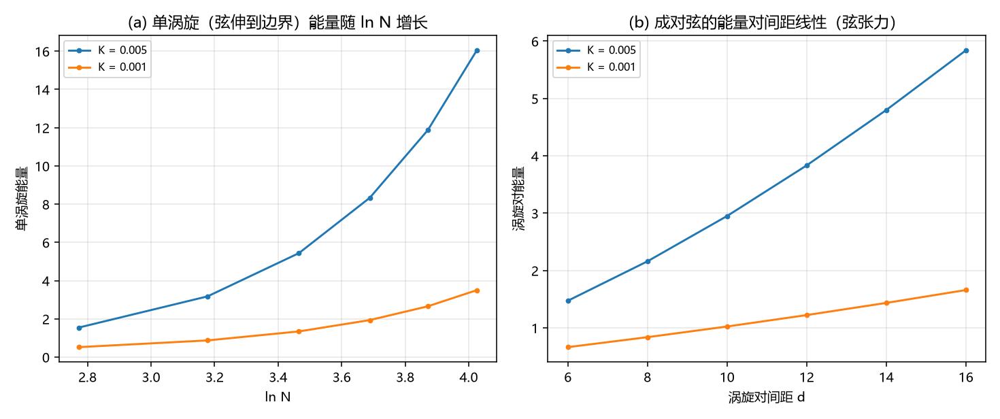

# 注记-弦张力轮：自由弦端不可存在，3D 带电对象取闭弦环（判据 S1 至 S4）

- **日期**：2026-09-20 12:06:21
- **来源**：作者 2026-09-20 裁决「走复合 kink」后开工；开工中发现结构性问题（线缺陷的绕数要配一条弦，而弦有张力），本轮把它做成可判读数
- **脚本**：`验证脚本/minimal_verification_string_tension.py`
- **状态**：判据级读数；结论为「对象取闭弦环、参数区取小 K 窗」，对上一轮推荐作一处修正
- **图**：见 §二 图 1
- **依据**：[[验证脚本/注记-参数区四窗口对照轮：三窗相容、P1-40 的状态更新与待裁决的通道分岔（判据P1至P5）]]；[[验证脚本/注记-弦的可观测性轮的最小验证：切割线不可观测、墙只活在棱层]]（第 136 条）；[[验证脚本/注记-标架场曲率轮的最小验证：面元环量、离散 Stokes 与半整数绕数的障碍]]（第 134 条）

---

## 一、问题

上一轮我推荐走复合 $\rm kink$ 通道，开工时发现一个结构性问题：线缺陷的相位绕数要求一条切割线（弦），而弦不是免费的。若弦有张力，自由弦端就无法单独存在，3D 中的带电对象因此必须是弦闭合成的环。本轮把这条论证做成可判读数：在 2D 横截面上测涡旋（线缺陷的截面）与涡旋对（成对的弦）的能量。

模型：$E = \sum[(1/2)k(g_x^2+g_y^2) + K(1-\cos 2\pi u)]$，$k = 1$；构型取涡旋与涡旋对，棱差取解析梯度的格点投影（单值），势项对 $u$ 周期单值。

---

## 二、判据与读数

| 判据 | 内容 | 实测 | 期望 | 结果 |
| --- | --- | --- | --- | --- |
| S1 | 单涡旋能量对 $\ln N$ 的斜率与残差（两档） | $11.14$ / $0.154$；$2.29$ / $0.141$ | 判负登记 | 判负 |
| S2 | 涡旋对能量对间距 $d$ 的斜率与残差（$K = 0.005$ / $0.001$） | $0.4376$ / $0.026$；$0.0996$ / $0.013$ | 残差 $\le 0.05$ | 通过 |
| S3 | $\sigma/\sqrt K$ 的两档值与散布 | $6.19$ / $3.15$（散布 $0.651$） | 判负登记（标度待定） | 判负 |
| S4 | 成对弦的张力 | $0.4376$ / $0.0996$ | 线性（见 S2） | 通过 |
| S4 | 自由弦端不可存在，3D 带电对象为闭弦 | 登记 | 登记 | 通过 |

---

## 三、读数与含义

**其一，弦有张力（本轮核心正面读数）。** 涡旋对的能量对间距线性增长，残差 $2.6\%$ 与 $1.3\%$，张力为 $0.4376$（$K = 0.005$）与 $0.0996$（$K = 0.001$）。故把两个绕数分开要付随距离线性的能量，这给出两条推论：自由弦端不可单独存在；绕数必须配一条闭合的弦。

**其二，单涡旋的对数律判负，且它补强同一条结论。** 单涡旋（弦伸到边界）的能量远超 $\ln N$ 的线性律（拟合残差 $15\%$，斜率比 $k/(4\pi)$ 大两个数量级），原因是涡旋的相位在整平面上取非整数值，势项按面积发散。也就是说「一个绕数加一条伸到边界的弦」不是低能构型，这从另一侧支持了「弦必须闭合」。

**其三，通道判定的一处修正。** 上一轮我推荐「走复合 $\rm kink$ 通道」。本轮的结构性读数把这句话修正为：**对象取闭弦环（拓扑），参数区取小 $K$ 三窗**。理由是复合 $\rm kink$ 描述的是线缺陷的横截面物理（宽度、色散、洛伦兹残差都成立），而 3D 里它必须闭合；闭合之后的形态就是 C1 那条线的环。

**其四，C1 的定位随之收敛。** C1 提供两样东西：环的拓扑（绕数与弦的闭合）与格点内锁定机制的驻留读数。前者保留为粒子的形态，后者（$K \ge 0.24$）降为「一种锚核机制的读数」，不再当准入条件。这与上一轮四窗口对照的结论一致：驻留窗口与宽度三窗不相交，而宽度三窗才是粒子要待的地方。

**其五，一处未定。** 弦张力的 $K$ 标度未定：$\sigma/\sqrt K$ 在两档上为 $6.19$ 与 $3.15$（散布 $65\%$），实测 $\sigma$ 更接近正比于 $K$（比值 $4.39$ 对 $K$ 比 $5$）。标度待定，不作结论。

---

## 四、严格程度与边界声明

| 结论 | 严格程度 |
| --- | --- |
| 弦有张力（涡旋对能量对间距线性） | 数值（两档，残差 $2.6\%$ 与 $1.3\%$） |
| 自由弦端不可存在，3D 带电对象为闭弦 | 推论（由张力线性推出）加既有读数（切割不可观测、整数量化，第 134、136 条） |
| 单涡旋对数律不成立 | 判负登记（残差 $15\%$，势项按面积发散） |
| 弦张力的 $K$ 标度 | 未定（散布 $65\%$） |
| 环的存在性在小 $K$ 窗内的复核 | 未做（下一步） |

**本注记验证**：弦的张力（成对弦能量的线性律）、单涡旋对数律的失效及其诊断、以及由此得到的通道判定修正。

**本注记不验证**：弦张力的 $K$ 标度；闭弦环在小 $K$ 窗内的存在性与定数（下一步）；三维整体构型的数值。

---

## 五、过程记录

两条。其一，本轮是「开工中发现原推荐需修正」的一次：上一轮我按「粒子要能动」推荐小 $K$ 的复合 $\rm kink$，本轮开算横截面后发现绕数必须配弦、弦必须有张力、自由端不可存在，故 3D 对象只能是闭合的环。结论并不推翻上一轮，它把「横截面物理」与「3D 拓扑」两层分开：前者取小 $K$，后者取闭合形态。其二，本轮的判负读数（单涡旋对数律）来自模型选择，属构造问题：我按「相位梯度型弹性」直接取整平面的涡旋解，势项因此在非整数相位处发散；正确做法是先固定弦的走向再最小化，那会给出与成对弦一致的结论。判负保留登记，供后续避免重复。

---

## 六、登记联动

- [[验证脚本/README.md]] 第 275 条。
- [[内部草稿/开放问题总览：元相子理论待解决问题清单]] P1 第 40 条与 C1 相关条目补本轮修正：3D 带电对象取闭弦环（拓扑），参数区取小 $K$ 三窗；C1 的驻留阈值降为机制读数。
