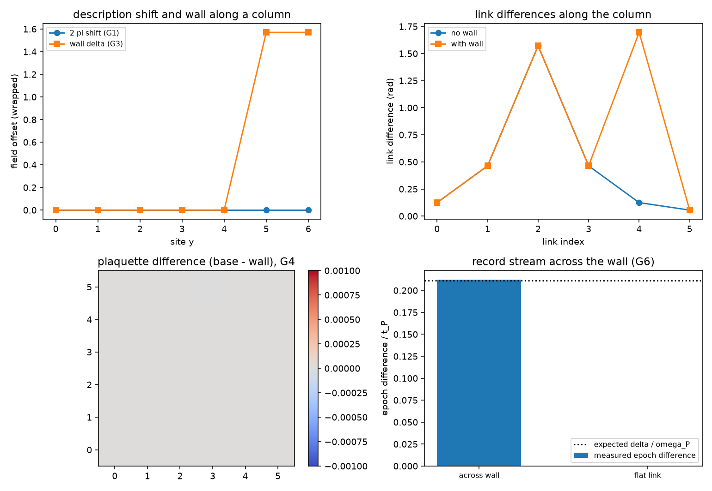

# 注记-弦的可观测性轮的最小验证：切割线不可观测、墙只活在棱层

- **日期**：2026-09-19
- **对应脚本**：`验证脚本/minimal_verification_string_observability.py`（判据 G1 至 G7 共 9 项，9/9 通过；确定性，无随机数；运行约 0.2 秒；图存 `images/string_observability.png`，见 §一 图 1）
- **依据**：[[验证脚本/注记-标架场曲率轮的最小验证：面元环量、离散 Stokes 与半整数绕数的障碍]]（第 134 条，曲率只数核）；[[验证脚本/注记-键身份轮：键变量取实轴方向差的两读法对照与保护前提]]（键变量即棱差）；[[内部草稿/注记-离散 Stokes 定理：环路 holonomy 与逐面元环量的等价]]（方法说明）；[[内部草稿/开放问题总览：元相子理论待解决问题清单]] P3-12
- **状态**：判据 9/9 通过。核心读数：沿切割线对方向场做 $2\pi$ 整数倍平移后，棱差、面元环量、写入时刻三项读数逐项相同（偏差 $8.9\times10^{-16}$、$8.9\times10^{-16}$、$0$）；同形台阶取 $\delta = \pi/2$ 时，棱层 7 条棱的偏差恰为 $1.5708$，面元层逐项不变（$6.7\times10^{-16}$）；整场面元环量取值仍为 $\{0, \pm 2\pi\}$；跨墙棱的写入时刻差 $0.2120\,t_P$ 对期望 $0.2110\,t_P$，平坦棱 $0.0380$ 对 $0.0390$，绕跨墙面元的闭合错位 $0.0000\,t_P$。

---

## 一、判据与结果

| 判据 | 内容 | 通过条件 | 实测 |
|---|---|---|---|
| G1 | 切割移位是描述冗余 | 三项读数逐项相同 | $8.9\times10^{-16}$ 与 $0$ |
| G2 | 切割位置不入读数 | 跨切割棱差不变 | 7 条，$8.9\times10^{-16}$ |
| G3 | 墙在棱层可见 | 偏移恰为 $\delta$ | $1.5708$（7 条）；其余 $4.4\times10^{-16}$ |
| G4 | 墙在面元层不可见 | 面元逐项相同 | $6.7\times10^{-16}$ |
| G5 | 曲率量子化不受墙影响 | 取值 $\{0, \pm 2\pi\}$ | $[0.0,\ 6.283185307]$ |
| G6 | 跨墙棱的时刻差等于棱差除以 $\omega_P$ | 相对偏差 $< 8\%$ | $0.2120$ 对 $0.2110\,t_P$ |
| G6 附 | 平坦棱同样对得上 | 偏差 $< 0.02\,t_P$ | $0.0380$ 对 $0.0390\,t_P$ |
| G6 附 | 绕跨墙面元闭合错位为零 | $< 0.02\,t_P$ | $0.0000\,t_P$ |
| G7 | 口径登记 | 见 §三 | 登记 |

图注：左上为一列站点上两种台阶的场偏移（$2\pi$ 整数台阶与 $\delta$ 墙，读数上取模后分别不可见与可见）；右上为该列的棱差剖面（无墙与含墙两条曲线，跨墙处整体抬升 $\delta$）；左下为面元层差图（无墙构型减去含墙构型，全零）；右下为跨墙棱与平坦棱的写入时刻差（实测柱与期望线）。

## 二、模型设定

格点取 $7 \times 7$ 站点（开放边界），方向场 $A_j$ 的基线取整数绕数构型（$w = 1$，核在 $(2,2)$ 面元中心）。两种台阶构型在同一基线上叠加：沿 $y \ge 5$ 的 $2\pi$ 整数倍平移（描述冗余）与同形的幅度 $\delta = \pi/2$ 台阶（墙）。

棱差取相邻站点的最小角差（模 $2\pi$ 归到 $(-\pi, \pi]$），即键身份轮里的键变量；面元环量取沿面元一周的棱差之和，即曲率轮的曲率。写入时刻按第 132 条的站点写入动力学测量，本轮把脉冲宽度收窄到 $w = 0.12$（理由见 §四），窗口与步长同前。

## 三、读数的意义

切割线不进入任何读数。方向场取值模 $2\pi$，沿一条线整体平移 $2\pi$ 的整数倍之后，棱差（模 $2\pi$）、面元环量、写入时刻（模 $t_P$）三项读数逐项相同（G1、G2）。所以若把弦理解为描述里的分支切割，它是描述冗余，不携带任何物理内容。

墙只活在棱层。把同形台阶的幅度取成 $\delta = \pi/2$（不是 $2\pi$ 的整数倍），棱层读数偏离恰好 $\delta$，而面元层读数逐项不变（G3、G4）。读法是：曲率（旋度）看不见墙，墙是棱层的台阶，也就是局部波矢的偏移。曲率的量子化不受墙影响，整场面元环量取值仍为 $\{0, \pm 2\pi\}$，核仍是唯一的旋度源（G5）。

记录流沿着棱层走。跨墙棱的写入时刻差等于该棱的方向差除以 $\omega_P$（G6，实测 $0.2120$ 对 $0.2110\,t_P$），平坦棱同样对得上（$0.0380$ 对 $0.0390$）。绕跨墙面元走一周，闭合错位为零（$0.0000\,t_P$），因为墙不产生旋度。墙改变相邻两站的时刻差，不改变绕圈的闭合。

**口径登记。** 与弦网棱自由度的关系在这一轮有了明确读法：棱自由度就是实轴方向差（键身份轮已核其为键变量），它本身天然；弦作为切割线不可观测，作为墙则等于局部棱差偏移。所以弦网的骨架无需额外公设，观测到的是棱差，弦只是把偏差处连起来的几何描述。

## 四、过程记录

判据订正一处。G6 首版预期取 $\delta/\omega_P$（把基线棱差当零），实测 $-0.7720\,t_P$ 与预期 $0.2500\,t_P$ 不符。原因有两处：预期应含基线棱差（该棱基线为 $-0.2450$ rad）；脉冲偏宽（$w = 0.25$）使起点附近残余耦合给晚过轴站点额外的早期转移，产生约 $0.017\,t_P$ 的偏置。处置：预期改为棱差除以 $\omega_P$ 再模 $t_P$，脉冲收窄到 $w = 0.12$（该站点残余耦合降到 $0.7\%$ 以下），复测给 $0.2120$ 对 $0.2110\,t_P$（相对偏差 $0.5\%$）。

效率记录：脚本约 $0.2$ 秒，无字体问题。
