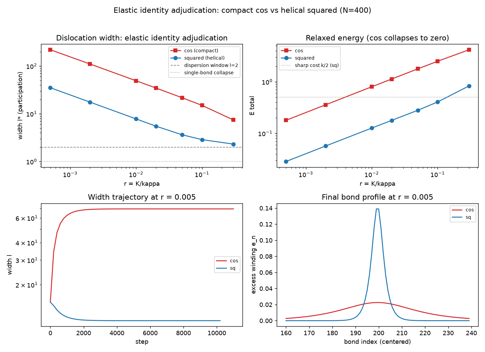

# 注记-弹性身份裁决：紧致 cos 与螺旋平方弹性下的位错窗口

- **日期**：2026-09-06
- **层级**：验证脚本/（理论验证材料，未确认）
- **定位**：《注记-复合模型》边界二（平方弹性与体系哈密顿量 cos 弹性的身份关系）的决定性裁决。同一 PN、同一边界（$u_0 = 0$、$u_{N-1} = N$ 强制恰好一个额外缠绕）、同一平滑位错初条件、同一宽度定义（参与比），唯一变量 = 弹性形式：紧致 cos（体系注册形式，$2\pi$ 周期）vs 非紧致平方（$S^1 \times \mathbb{R}$ 螺旋读法，法线轴高度差为物理量）。结果：两种读法给出相反的基态身份。紧致侧：可见有限宽度位错存在（近背景二次型给出 FK 型宽孤子）但恒非基态，隐藏尖锐形 E = 0 为稳定极小（C1），可见态对窄化扰动不稳健、直接滑入隐藏形（C2）；螺旋侧：全部 r 区可见宽态为最低态（C3），粒子形状就是基态。窗口的存亡完全系于弹性身份：紧致读法下窗口为空（基态意义），螺旋读法下窗口真实。**作者已于同日裁决键弹性原始形式 = 螺旋高度差（非紧致，无保留），本实验为该裁决的数值落位**
- **关联**：《注记-复合模型：粒子 = 均匀缠绕背景上的 FK kink 位错与宽度参数区》（被裁决的边界二）；《注记-扇区约束动力学》（隐藏扭转定案，本实验给出其基态身份的弹性条件）；《注记-相对论色散完整验证》（宽度趋势带，与平方侧同族）；螺旋阶梯几何（相位状态空间 $S^1 \times \mathbb{R}$ 基准，螺旋读法的依据）；质量机制定案；P1-33
- **脚本**：`验证脚本/minimal_verification_elastic_identity.py`（确定性、无随机数，N = 400 开边界链，结果打印终端 + 一图 `images/minimal_verification_elastic_identity.png`，见 §三 图 1）
- **状态**：验证完成。弹性身份被裁决为粒子载体问题的决定性开关；体系取螺旋读法则复合模型闭环，取紧致读法则复合模型的包层失效

---

## 一、背景与判据

复合模型把粒子刻画为均匀缠绕背景上的 FK 位错：锚核（PN 势）钉位置，包层（弹性）给宽度，$K/k \le 0.02$ 时 $\ell^* \ge 2$ 落色散窗口。但其边界二承认：宽度机制寄生于平方弹性，而体系注册哈密顿量的键弹性是 cos 型。两种弹性对 $2\pi$ 整数倍键差的态度相反：平方弹性惩罚一切偏离自然长度 $1$ 的键差（非紧致，高度差物理）；cos 弹性对整数倍缠绕零惩罚（紧致，$1 - \cos 4\pi = 0$）。本实验把这一身份问题变成对照裁决：其余一切相同，唯弹性形式不同，看宽度窗口与基态身份如何分岔。

判据：对每种弹性，比较（a）平滑位错弛豫终态（可见宽态）与（b）隐藏/窄态的能量排序。可见态为最低态 = 粒子是基态（载体成立）；隐藏态更低 = 粒子恒非基态（可见形状只是亚稳残迹）。

## 二、模型与协议

N = 400 开边界链，$u_0 = 0$、$u_{N-1} = N$ 强制恰好一个额外缠绕（位错在拓扑上必存在，问题只剩它的宽度与能量）。PN 势两侧相同：$K(1 - \cos 2\pi u_n)$。弹性两侧：紧致 $\kappa(1 - \cos 2\pi\Delta u)$ vs 平方 $\frac{\kappa}{2}(\Delta u - 1)^2$。初条件两侧相同：$u_n = n + \frac{1}{2}(1 + \tanh((n - n_0)/5))$。过阻尼梯度流，自适应步长。宽度统一用参与比 $\ell = (\Sigma|e|)^2/\Sigma e^2$（$e_n = \Delta u_n - 1$，边界强制 $\Sigma e = 1$）。

方法记录：首跑 $\eta_{\max} = 0.05$ 压在 cos 弹性曲率（$(2\pi)^2 \approx 39.5$）的稳定边界 $2/39.5$ 上，流震荡、E 虚涨至 400 量级；修正 $\eta_{\max} = 0.008$ 后全部收敛。

## 三、结果

### 扫描对照（$\kappa = 1$，$r = K/\kappa$）

| r | cos $\ell^*$ | cos E | 平方 $\ell^*$ | 平方 E |
|---|---|---|---|---|
| 0.0005 | 219.5 | 0.179 | 35.1 | 0.0285 |
| 0.002 | 110.3 | 0.358 | 17.5 | 0.0569 |
| 0.01 | 49.2 | 0.799 | 7.8 | 0.1266 |
| 0.02 | 34.6 | 1.129 | 5.5 | 0.1781 |
| 0.05 | 21.7 | 1.777 | 3.6 | 0.2801 |
| 0.1 | 15.0 | 2.496 | 2.9 | 0.4059 |
| 0.3 | 7.4 | 4.173 | 2.3 | 0.8318 |

两侧都给出有限宽度位错（近背景处 cos 弹性退化为二次型，等效刚度 $(2\pi)^2\kappa$，故 cos 位错更宽），但基态身份相反。

### C1（cos）：隐藏形是稳定极小

尖锐位错（全格点整数、单键 $e = 1$）能量恰为零；加 0.05 微扰后弛豫回到 E $= 1.5 \times 10^{-12}$、$\ell = 1.000$。E = 0 隐藏形是真局部极小。

### C2（cos）：可见态盆地浅

宽态（E = 1.13、$\ell = 69.7$）向尖锐形方向对半混合后弛豫，直接滑到 E = 0、$\ell = 1.00$。可见位错对窄化扰动不稳健：紧致读法下粒子形状的吸引盆被隐藏基态占据。

### C3（螺旋侧）：全 r 区可见宽态为最低态

尖锐初始化的弛豫终态在全部七个 r 值下能量都高于平滑宽态（0.0569 对 0.0285、0.1138 对 0.0569、……、0.8629 对 0.8318）：可见位错就是基态，窗口在基态意义上真实（宽度 $\ge 2$ 于 $r \le 0.02$，基态序延伸至全扫描区）。尖锐初始化终态能量在小 r 区恰为平滑态的 2 倍且参与比相同，提示势面存在另一族定态，归因待查，不影响排序判定。

## 四、结论

1. **弹性身份是粒子载体问题的决定性开关**。紧致 cos 读法：可见位错恒非基态，隐藏形（E = 0，与扇区约束动力学的隐藏扭转定案一致）才是基态，粒子形状只是零温亚稳且盆地浅；螺旋平方读法：可见位错全 r 区为最低态，粒子作为基态真实存在。
2. **复合模型的闭环条件由此显式化并已获作者裁决**：包层（宽度与色散）要成立，体系键弹性必须取 $S^1 \times \mathbb{R}$ 螺旋读法。作者裁决（2026-09-06，无保留）：键弹性原始形式 = 螺旋高度差（非紧致），其中 ℝ = **法线轴**（复平面圆心处的法线，满周闭合沿法线平移 $l_P$，层数 = 距离，距离归粒 $x^a = l_P n^a$）；相位圆实轴（复平面内）与法线轴是两个不同的轴，注释 09 的实轴方向差属波性侧紧致角度差，法线轴高度差属粒性侧非紧致距离。cos 书写降级为角度部分投影，体系哈密顿量注册形式的基准更新由作者主导。本实验为该裁决的数值落位：紧致投影读法下窗口为空（C1/C2），螺旋原始读法下窗口在体系内打开（C3）。
3. **与隐藏扭转定案的关系**：扇区约束动力学的隐藏扭转（E = 0 终态）在紧致侧恰为基态（C1），本实验把"隐藏"从数值终态升格为紧致投影读法下的热力学必然；螺旋原始读法下隐藏形（E = 0.5 起）被可见态压制，第三支确认闭合。
4. **下一步**：弹性身份已经作者裁决（螺旋原始形式），复合模型在体系内闭环；接续攻坚为三维化（位错在 3D 的形态）与 PN-κ_φ 身份（站点势 vs 格点内三元组锁定）。

## 五、边界与遗留

其一，一维探路，三维未动。其二，sq 大 r 区势面存在多族窄态（本实验观测到 0.44 与 0.86 两族）及尖锐初始化的 2 倍能量态，归因待查。其三，PN 势与 κ_φ（格点内三元组锁定）的身份关系未建立，本实验两侧共用站点 PN，只裁决弹性。其四，紧致侧可见态的势垒高度（零温亚稳的激活能标）未测。其五，本注记不改动基准文件；键弹性的螺旋读法已经作者裁定（2026-09-06），体系哈密顿量注册形式的表述调整（cos 降级为角度投影）由作者主导基准更新。
