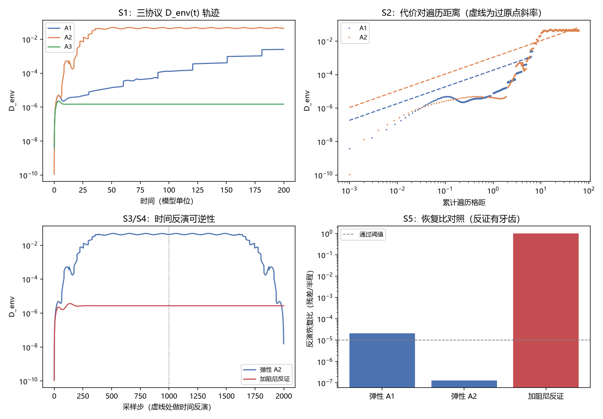

# 注记-弹性通道代价归属的最小验证：M2 缓增的轨迹分解与时间反演可逆性

- **日期**：2026-09-24 03:18:19
- **层级**：验证注记（对应 `验证脚本/minimal_verification_elastic_reversibility.py`，`验证脚本/README.md` 第 375 条）
- **图**：见 §三 图 1
- **定位**：执行 [[研究方向-弹性遍历通道的相干代价：M2 缓降读数的解释约束与可逆性判别（判据草案）]] 的 R6 项，即该草案与 [[注记-弹性遍历通道相干代价的最小验证：M2 缓降读数的换算、宏观约束与可逆性判别]] 明确登记为未做的两件事：$D_{\text{env}}(t)$ 轨迹（分离一次性激发与逐格累积）与真实模型上的可逆性判别。
- **依据**：[[验证脚本/注记-相互作用分层判据的最小验证：两协议可见度与生死闸门]]（模型参数与协议定义、甲-1 与甲-2 与甲-3 的发表值）；[[注记-弹性遍历通道相干代价的最小验证：M2 缓降读数的换算、宏观约束与可逆性判别]]（两比特模型上的二分与代价律）；[[研究方向-弹性遍历通道的相干代价：M2 缓降读数的解释约束与可逆性判别（判据草案）]]（判据 R1 至 R6）
- **关联**：[[开放问题总览：元相子理论待解决问题清单]]（退相干独立几何推导）；[[理论攻坚/测量问题攻坚纲领：三条承重墙的闭合]]（§9 实验约束清单）
- **状态**：模型内判据级。上一注记的未定项（M2 缓增读数的归属）在本注记内裁定为从属读数，裁定范围限于 FK 链与 M2 协议。

---

## 一、模型与协议

模型与协议沿用 M2，参数一并照抄：FK 链 $k=1$、$K=0.005$、$N=1000$、$\Delta t = 0.01$、kink 半宽 $\ell \approx 2.25$ 格距、环境区半径 $10$；甲-1 为零模踢、甲-2 为宽脉冲（$0.03\exp(-(j-500.5)^2/1250)$，两支同款）、甲-3 为甲-1 加阻尼 $\gamma = 0.5$。$D_{\text{env}}$ 取环境区（跟随两支质心中点、半径 $10$ 格距以外）的支间相空间距离，可见度 $\mathcal{V} = e^{-D_{\text{env}}/2}$。

本脚本只做两件 M2 未做的事。其一，把 $D_{\text{env}}$ 的采样轨迹取出，检验其与累计遍历格距的关系。其二，加时间反演协议：前向 $100$ 时间单位后取 $v \to -v$、$a \to -a$，用同一 velocity-Verlet 算法回推同样长度。该算法无阻尼时严格可逆，故反演后的残差给出不可逆成分的量级。另设反证档为同一协议加阻尼，检验该判别是否有牙齿。

## 二、判据结果

| 判据 | 判据量 | 实测 | 期望 | 结论 |
| --- | --- | --- | --- | --- |
| S1 复现校验 | 三协议 $D_{\text{env}}$ 末值对 M2 发表值的最大相对偏差 | $0.74\%$ | $< 5\%$ | 通过 |
| S2 轨迹律 | 甲-2 每格距代价（过原点斜率） | $1.08\times10^{-3}$ | 读数 | 读数 |
| S2 单调性 | 甲-2 $D_{\text{env}}$ 单调采样步占比 | $0.523$ | 读数 | 读数 |
| S2 对照 | 甲-1 每格距代价 / 单调步占比 | $1.85\times10^{-4}$ / $0.921$ | 读数 | 读数 |
| S3 可逆性 | 弹性甲-2 反演恢复比（残差/半程） | $1.32\times10^{-7}$ | $< 10^{-5}$ | 通过 |
| S3 可见度 | 弹性甲-2 反演后 $\mathcal{V}$ 的不可恢复部分 | $2.81\times10^{-9}$ | $< 10^{-8}$ | 通过 |
| S4 反证 | 加阻尼档反演恢复比 | $0.99998$ | 读数 | 读数 |
| S5 判别力 | 两通道恢复比之比（反证/弹性） | $7.58\times10^{6}$ | 读数 | 读数 |

复现三档逐项：甲-1 $2.5186\times10^{-3}$ 对发表 $2.5\times10^{-3}$；甲-2 $4.3302\times10^{-2}$ 对 $4.3\times10^{-2}$；甲-3 $1.4932\times10^{-6}$ 对 $1.5\times10^{-6}$。

## 三、图 1

四面板与脚本绘图面板逐条对应：左上为 S1 的三协议轨迹，右上为 S2 的轨迹律，左下为 S3 与 S4 的反演全轨迹，右下为 S5 的恢复比对照。

## 四、读数分解

复现校验先立住口径。三协议末值对本线发表值的最大相对偏差为 $0.74\%$，故本脚本与 M2 是同一个模型，后续读数可直接与 M2 的结论并置。

轨迹分解给出两个事实。甲-2 的 $D_{\text{env}}$ 与累计遍历格距近似线性，过原点斜率 $1.08\times10^{-3}$ 每格距（端点比值 $7.04\times10^{-4}$，两者同量级）；但单调采样步只占 $0.523$，故线性的累积之上叠着大幅振荡。甲-1 对照档的斜率 $1.85\times10^{-4}$、单调步占比 $0.921$，振荡成分明显较小。

另有一项读数：甲-2 在半程（$t = 100$）已达 $4.2616\times10^{-2}$，全程（$t = 200$）为 $4.3302\times10^{-2}$，即代价的 $98.4\%$ 在脉冲加速段完成，后段近饱和。

反演判别给出裁定。弹性甲-2 在半程处 $D_{\text{env}} = 4.2616\times10^{-2}$，反演回推后降到 $5.6224\times10^{-9}$，降幅七个数量级，恢复比 $1.32\times10^{-7}$，可见度由 $0.9789$ 回到 $0.9999999972$。该模型的起点本底为 $1.1\times10^{-10}$（两支松弛位形在有限链与固定端下并非严格平移），故残差比本底高约 $50$ 倍，属数值与弱混沌地板。

反证档确认判别有牙齿。同一协议加阻尼 $\gamma = 0.5$ 后，半程 $2.7237\times10^{-6}$、反演后 $2.7236\times10^{-6}$，恢复比 $0.99998$，即基本不还原；两通道的恢复比相差 $7.58\times10^{6}$ 倍。阻尼档的半程代价本就极小，原因是阻尼把 kink 钉住、遍历停止，与 M2 甲-3 的"占据层不变"一致。

## 五、结论与对未定项的裁定

[[注记-弹性遍历通道相干代价的最小验证：M2 缓降读数的换算、宏观约束与可逆性判别]] 把 M2 缓增读数的归属留为未定项，本注记在模型内裁定为从属读数。理由两条。其一，代价随遍历累积、随运动停止而饱和（半程即完成 $98.4\%$，阻尼档遍历停止故代价近零），与"分支可区分度"的行为一致。其二，它在时间反演下完全还原，恢复比 $1.32\times10^{-7}$，而真退相干会留下不随反演缩小的残差（阻尼反证档的 $0.99998$ 即该形态）。

由此，上一注记给出的宏观约束不构成冲突：$1$ nm 路径所需的每格距代价上限 $3.4\times10^{-27}$ 与 M2 推断的 $5.6\times10^{-4}$ 之间的落差，属于把诊断量误读为退相干率所致，而该诊断量是严格可逆的。

三条限定须随结论一并引用。其一，判据性质：时间反演可逆性是"不存在不可逆通道"的必要条件检查，不构成完整证明；它的含义是模型内没有信息丢失，与"环境区属同一条链、其状态由分支构型决定"这一结构判断相容。其二，判别力已用反证档验证，故该检查不是空测。其三，外推边界：结论限于 FK 链与 M2 协议；真实晶格上是否存在独立的记录自由度仍是 [[理论攻坚/测量问题攻坚纲领：三条承重墙的闭合]] 限制三与 P4-10 的剩余项。

## 六、严格程度声明

| 结论 | 档位 |
| --- | --- |
| 复现校验（三协议末值） | 数值验证级（最大偏差 $0.74\%$） |
| 轨迹律与饱和读数 | 数值验证级（判据稳健） |
| 反演可逆性与恢复比 | 模型内判据级 |
| 反证档（阻尼不还原） | 模型内判据级 |
| M2 缓增读数的从属归属 | 模型内裁定，限于 FK 链与 M2 协议 |

## 七、边界声明

**验证什么**：FK 链 M2 协议内，$D_{\text{env}}$ 的轨迹形态（累积对一次性）、代价与遍历距离的关系、时间反演可逆性及其判别力。

**不验证什么**：真实晶格的不可逆通道；滚动记录在真实晶格上是否存在不由源构型决定的独立分量（仍是 P4-10 剩余）；$D_{\text{env}}$ 与物理退相干率的换算关系；复合体上遍历格距的定义；三维与缺陷构型。本注记不改动 [[理论总纲/子理论索引]] 与任何基准文档。

## 八、过程记录

首轮有两处错并已纠正。其一，甲-3 档漏传阻尼参数，读数与甲-1 完全相同（$2.5186\times10^{-3}$ 对发表 $1.5\times10^{-6}$，偏差 $167805\%$），复现校验判未过；补上 $\gamma = 0.5$ 后偏差降到 $0.45\%$。教训：复现校验必须逐档对照，漏参数只会在被漏的那一档暴露，取最大值才能抓住。

其二，反演判据首版把残差阈值设为 $10^{-10}$，低于该模型自身的起点本底（甲-2 为 $1.1\times10^{-10}$、甲-1 为 $3.9\times10^{-9}$），故判未过；改为恢复比（残差对半程之比）后读 $1.32\times10^{-7}$。教训：阈值须相对被测量自身的本底设定，绝对阈值在小本底问题里会变成空判据。
