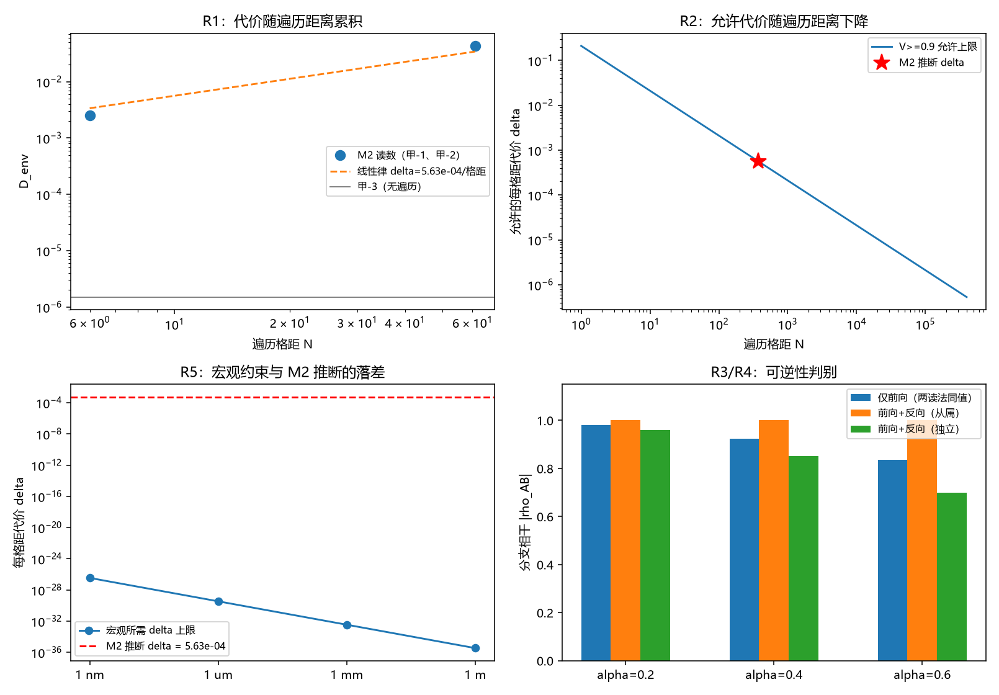

# 注记-弹性遍历通道相干代价的最小验证：M2 缓降读数的换算、宏观约束与可逆性判别

- **日期**：2026-09-24 03:11:12
- **层级**：验证注记（对应 `验证脚本/traversal_decoherence_cost.py`，`验证脚本/README.md` 第 374 条）
- **图**：见 §三 图 1
- **定位**：执行 [[研究方向-弹性遍历通道的相干代价：M2 缓降读数的解释约束与可逆性判别（判据草案）]] 的首轮读数，判据 R1 至 R6。把 M2 的缓降读数换算成代价律与宏观约束，并给出区分从属代价与真退相干的判别实验。
- **依据**：[[验证脚本/注记-相互作用分层判据的最小验证：两协议可见度与生死闸门]]（甲-1、甲-2、甲-3 的 $D_{\text{env}}$ 与占据层数值）；[[测量的三层判据：从相互作用分层到单次测量机器]]（§3.1 模型与协议、§6.3 实验约束清单、§6.4 其三）；[[注记-滚动记录与持久记录可分性的最小验证：无独立因子条件、两种累积律与重写实现的影响]]（$\kappa$ 条件式）
- **关联**：[[开放问题总览：元相子理论待解决问题清单]]（退相干独立几何推导）；[[理论攻坚/测量问题攻坚纲领：三条承重墙的闭合]]（§9 实验约束清单）；[[验证脚本/注记-相互作用分层判据的最小验证：两协议可见度与生死闸门]]
- **状态**：模型内判据级加读数换算；本注记不裁定 M2 缓降读数的归属，只给约束与判别协议。

---

## 一、两部分的协议

第一部分为读数换算，输入取 M2 结果表三行：甲-1（零模踢）遍历 $6$ 格距、$D_{\text{env}} = 0.0025$；甲-2（宽脉冲散射）遍历 $61$ 格距、$D_{\text{env}} = 0.0433$；甲-3（踢加阻尼）占据层不变、$D_{\text{env}} = 1.5\times10^{-6}$。每格距代价取 $\delta = D_{\text{env}}/N_{\text{格距}}$，可见度取 $\mathcal{V} = e^{-D/2}$。

第二部分为判别实验，取分支 $\{|A\rangle, |B\rangle\}$ 加一个散射模式（截断 Fock，$N_F = 26$）。前向脉冲为分支 $B$ 侧位移 $D(\alpha)$，反向脉冲为 $D(-\alpha)$。从属读法保留模式，独立读法在每次脉冲后把模式丢弃并重挂真空。

## 二、判据结果

| 判据 | 判据量 | 实测 | 期望 | 结论 |
| --- | --- | --- | --- | --- |
| R1 代价律 | 两支每格距代价 | $4.17\times10^{-4}$ 与 $7.10\times10^{-4}$，均值 $5.63\times10^{-4}$ | 同量级 | 读数 |
| R2 允许遍历距离 | $\mathcal{V} \ge 0.9$ 的遍历格距 | $374.1$ | 由 $D \le 0.2107$ 反解 | 读数 |
| R5 宏观约束 | $1$ m 路径允许的每格距代价 | $3.405\times10^{-36}$ | 对照 M2 推断的 $5.63\times10^{-4}$ | 读数 |
| R3 从属读法 | 反向脉冲后可见度对 $1$ 的偏差 | $0$ | $10^{-8}$ | 通过 |
| R3 独立读法 | 反向脉冲后可见度对 $e^{-\alpha^2}$ 的偏差 | $3.33\times10^{-16}$ | $10^{-10}$ | 通过 |
| R4 瞬时可见度 | 前向可见度对 $e^{-\alpha^2/2}$ 的偏差 | $2.22\times10^{-16}$ | $10^{-10}$ | 通过 |

宏观约束全表：$1$ nm 路径给 $\delta \le 3.405\times10^{-27}$；$1$ $\mu$m 给 $3.405\times10^{-30}$；$1$ mm 给 $3.405\times10^{-33}$；$1$ m 给 $3.405\times10^{-36}$。

## 三、图 1

四面板与脚本绘图面板逐条对应：左上为 R1 的代价律，右上为 R2 的允许上限，左下为 R5 的宏观落差，右下为 R3 与 R4 的判别。

## 四、读数分解

代价律成形。甲-1 的每格距代价 $4.17\times10^{-4}$ 与甲-2 的 $7.10\times10^{-4}$ 同量级，均值 $5.63\times10^{-4}$，对应 $\kappa \approx 2.82\times10^{-4}$；甲-3 占据层不变、$D_{\text{env}}$ 停在 $1.5\times10^{-6}$，与"代价随遍历累积"相容。甲-2 偏高可能与宽脉冲引入的激发有关（能量相对漂移 $4.9\times10^{-7}$）。

宏观落差是本轮最重的一条。若代价为真，$\mathcal{V} \ge 0.9$ 只允许遍历 $374$ 格距，相当于 $374\,l_P$。反解宏观尺度所需的代价上限，$1$ nm 路径已经要求 $\delta \le 3.4\times10^{-27}$，比 M2 推断值低 $23$ 个数量级；$1$ m 路径要求 $3.4\times10^{-36}$，低 $32$ 个数量级。这个落差不能用"可忽略"覆盖，只能由"它不参与退相干"覆盖。

判别实验给出二分。仅前向脉冲后的可见度对两种读法完全相同（对 $e^{-\alpha^2/2}$ 偏差 $2.2\times10^{-16}$），故瞬时可见度不能判别。加上反向脉冲后从属读法精确回到 $1$（偏差 $0$），独立读法停在 $e^{-\alpha^2}$（偏差 $3.3\times10^{-16}$）。反向脉冲的可恢复性因此是"从属代价"的操作定义。

## 五、结论与对 P4-10 的答复

本轮把 M2 缓降读数的解释约束定量化，结论两条。其一，$D_{\text{env}}$ 随遍历距离的累积若按字面读作退相干，则宏观干涉不可能存在，落差达 $23$ 至 $32$ 个数量级，故该读数只能按从属读法解释。其二，"是否为从属"有可执行判别：前后向脉冲对，从属回到 $1$、独立停在 $e^{-\alpha^2}$。

与限制三的衔接由此闭合：上一轮给出的 $\kappa$ 条件式中"可忽略"这一支在宏观尺度上是空的，$\kappa$ 只能是零。两轮合起来给出一句可用的话：滚动记录的相干代价必须在机器精度上为零，判别手段是反向脉冲恢复。

未做两项，如实登记。其一，$D_{\text{env}}(t)$ 轨迹未取，本轮的代价律由两个端点加一个对照外推，一次性激发与逐格累积尚未分离（判据草案列为 R6）。其二，$D_{\text{env}}$ 与物理退相干率之间的对应关系未建立，故本轮的宏观约束以"若代价为真"为条件。因此本注记不裁定 M2 缓降读数的归属，只给约束与判别协议。

## 六、严格程度声明

| 结论 | 档位 |
| --- | --- |
| 代价律的两点提取（R1） | 读数换算，两点加一对照外推 |
| 宏观约束表（R2、R5） | 条件性（以代价为真为前提），算术精确 |
| 可逆性二分（R3） | 代数结论（模型内），实测 $10^{-16}$ |
| 瞬时可见度不可判别（R4） | 代数结论（模型内） |
| M2 缓降读数的从属归属 | 未裁定，本轮只给判别协议 |

## 七、边界声明

**验证什么**：M2 三行读数换算出的代价律与宏观约束；从属代价与真退相干的二分及其可逆性判别。

**不验证什么**：$D_{\text{env}}$ 与物理退相干率的对应；M2 缓降读数的归属；复合体上遍历格距的定义（本轮的 $N = L/l_P$ 适用于质心或缺陷模式，推广待定）；三维与缺陷构型。本注记不改动 [[理论总纲/子理论索引]] 与任何基准文档。

## 八、过程记录

首版把分支相干 $|\rho_{AB}|$ 直接当可见度上报，故从属档读数恒为 $0.5$，与期望 $1$ 不符，R3 与 R4 判为未过；改为可见度定义 $V = 2|\rho_{AB}|/(\rho_{AA}+\rho_{BB})$ 后三项全过（偏差 $0$、$3.3\times10^{-16}$、$2.2\times10^{-16}$）。教训：分支振幅不相等或未归一化时，$|\rho_{AB}|$ 与可见度不可混用，判据量须写明归一化口径。
