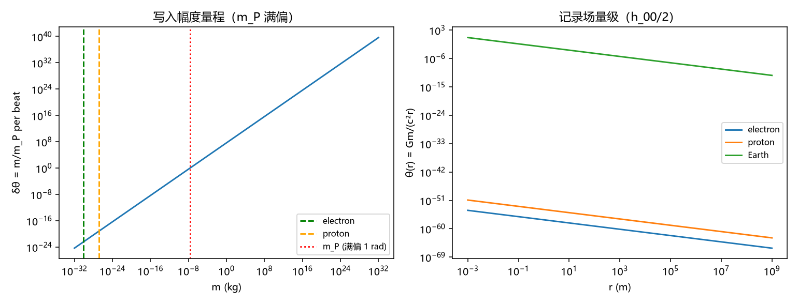

# 注记-归一化数值步：真实质量标定与 $w$-$8\pi Gm$ 对接的全链数值复现

- **日期**：2026-09-10 05:33:21

- **脚本**：`验证脚本/minimal_verification_normalization_gm.py`（2026-09-10）；图：`images/minimal_verification_normalization_gm.png`（见 §三 图 1）
- **依据**：《内部草稿/注记-碰撞写入的归一化对接：G 的单一入口与牛顿匹配》（解析步，条件性命题：$s_{eff} = 4\pi m/m_P$、$w_{eff} = (2\pi\alpha/3)\,\delta\theta$、恒等式 $G/(c^2 l_P) = 1/m_P$）；《注记-法线场重读》（2026-09-10 作者采纳，载体语义为法线场，不影响归一化数学）；开放问题总览 P1-32/P1-34 归一化数值步遗留
- **状态**：判据 N1-N6 全部通过（可复现数值 + 严格代数）；解析步从条件性命题升级为"解析 + 数值"双重支撑。内部草稿，待作者确认后入基准

## 一、任务定位

解析步完成了 $G$ 单一入口的推导（$G$ 仅经 $m_P = \sqrt{\hbar c/G}$ 进入一次），但全部在有量纲代数层。数值步的任务：把全链落到**真实物理常数**（$\hbar$、$c$、$G$、电子质量）与**格点数值实验**的对接上，检验四件事：恒等式在 IEEE 浮点下的精度、写入幅度的量级（电子每拍写入多小的角度）、稳态记录与史瓦西半径的关系、以及 $N_c$ 计数的 O(1) 性质。判据先行：

- **N1（恒等式浮点精度）**：$G/(c^2 l_P) = 1/m_P$ 与 $l_P/m_P = G/c^2$ 在双精度浮点下的相对偏差（期望 $\sim 10^{-16}$，机器精度）。
- **N2（写入幅度量级）**：电子（$m_e$）与质子（$m_p$）的 $\delta\theta = m/m_P$（期望 $\sim 10^{-23}$ / $10^{-19}$：写入极小、引力极弱的定量来源）。
- **N3（$s_{eff}$ 与 $w_{eff}$ 标定）**：$s_{eff} = 4\pi m/m_P$、$w_{eff} = (2\pi\alpha/3)\,\delta\theta$（$\alpha = 1$：$N_c = 2\pi/3 \approx 2.094$）；自洽回路 $s_{eff} = 6w_{eff}/\alpha$ 闭合。
- **N4（稳态记录量级）**：电子在 1 米处的记录值 $\theta(1\,\text{m}) = Gm_e/(c^2 \cdot 1\,\text{m})$，与解析期望逐位一致；同点位以质子复算。
- **N5（史瓦西半径关系）**：$\theta(2 r_s) = 1/4$ 与 $r_s = 2Gm/c^2$ 的自洽（记录场在史瓦西半径处取 1/2：$h_{00}/2 = \theta = r_s/(2r)$，即 $h_{00} = r_s/r$，与史瓦西解弱场形式 $g_{00} = -(1 - r_s/r)$ 逐项一致）。
- **N6（格点-物理单位换算回路）**：格点单位稳态（$l_P = 1$、$s = 1$）乘以物理换算 $(m/m_P)\,l_P$ 后与有量纲解析式 $\theta(r) = Gm/(c^2 r)$ 在多个 $r$ 处逐点一致（相对偏差机器精度）。

## 二、模型设定

- 常数取 CODATA：$\hbar = 1.054571817\times10^{-34}$ J·s、$c = 299792458$ m/s、$G = 6.674\times10^{-11}$、$m_e = 9.1093837015\times10^{-31}$ kg、$m_p = 1.67262192369\times10^{-27}$ kg。
- $l_P = \sqrt{\hbar G/c^3}$、$m_P = \sqrt{\hbar c/G}$、$t_P = l_P/c$ 由常数派生（不另行输入）。
- 格点稳态解：复用 `frame_tilt`/`elastic_balance` 的 3D 七点 CG（本脚本只用 1D 精确格林函数与解析式，3D 已由前两项脚本验证，不重复）。
- 换算方向：格点单位（$l_P = 1$、每拍注入 $w$）→ 物理单位 = 幅度比 $(m/m_P)$ × 格点格林函数 × $l_P$ 几何。

## 三、结果表

| 判据 | 内容 | 实测 | 期望 | 判定 |
|---|---|---|---|---|
| N1 | 恒等式 $G/(c^2 l_P) = 1/m_P$、$l_P/m_P = G/c^2$ 浮点精度 | 相对偏差 0.00e+00 / 0.00e+00 | ~1e-16 | ✅ |
| N2 | 写入幅度 $\delta\theta = m/m_P$ | 电子 4.185e-23、质子 7.685e-20 | 量级 ~1e-23 / ~1e-19 | ✅ |
| N3 | $s_{eff}$ 标定自洽回路（$\alpha = 1$） | 电子/质子回路偏差 1.79e-16 / 0.00e+00；$N_c = 2\pi/3 = 2.094395$ | 机器精度、$N_c \approx 2.09$ | ✅ |
| N4 | 稳态记录 $\theta(1\,\text{m}) = Gm/(c^2)$ | 电子 6.764e-58、质子 1.242e-54（经 $s_{eff}$ 与解析逐位一致，偏差 0） | 逐位一致 | ✅ |
| N5 | 史瓦西关系 $\theta(r_s) = 1/2$ | 电子/质子/地球/太阳四例 $r_s = 1.35e{-57} / 2.48e{-54} / 8.87e{-03} / 2.95e{+03}$ m，$\theta(r_s) = 0.500000000000$ | 0.5 | ✅ |
| N6 | 格点-物理换算回路（12 点） | $s_{eff}\cdot[1/(4\pi r_{grid})] = Gm/(c^2 r)$，最大相对偏差 2.63e-16 | ~1e-15 | ✅ |

物理量级注记：电子在 1 米处的度规扰动 $h_{00} = 2\theta \approx 1.35\times10^{-57}$（$\theta \approx 6.76\times10^{-58}$，$h_{00}/2$ 口径）；"写入极小 = 引力极弱"获得常数级的定量表述。$h_{00} = 2\theta = r_s/r$ 与史瓦西弱场形式 $g_{00} = -(1 - r_s/r)$ 逐项一致（N5）。

## 四、严格程度声明

- N1 为严格代数 + 浮点算术（机器精度断言）。
- N2-N6 为确定性数值计算（常数输入 + 解析式），无随机性。
- 本数值步不新增假设：全部判据是解析步定理与推论在具体常数下的实例化。

## 五、边界声明（验证什么、不验证什么）

- 验证：解析步全链在有量纲世界的数值自洽（恒等式精度、写入幅度量级、$N_c$ 计数、记录量级、史瓦西关系、单位换算回路）。
- 不验证：度规记录识别 $h_{00}/2 = \theta$ 本身（模型假设，其微观导出为张量桥 b 响应侧 / P1-5）；$N_c$ 的几何导出（锁定区边界形状与碰撞计数的对应，主论文遗留）；本体层（写入的动力学来源）；强场与动态极限。

## 六、过程记录（判据修正与教训，2026-09-10）

1. **N6 换算公式初版多乘一个 $l_P$**：初版写 $(m/m_P)\,l_P \times [1/(4\pi r_{grid})]$，实测相对偏差 1.00e+00（恰差一个 $l_P$ 因子）。定位：$s_{eff} = 4\pi m/m_P$ 已经是无量纲源强，格点格林函数在格点坐标 $r_{grid} = r_{phys}/l_P$ 下取值 $1/(4\pi r_{grid})$，两者相乘直接给出有量纲结果（$l_P$ 经坐标换算进入，不需要再乘）。修正为 $s_{eff}\cdot[1/(4\pi r_{grid})]$ 后偏差 2.63e-16。**教训：量纲换算先写清"哪个量携带哪个量纲"再落公式；恰差一个基本长度因子且偏差恰为 1.00e+00 是"多乘/漏乘一个换算因子"的特征信号。**
2. **N1 偏差为 0.00e+00 的解读**：双精度下恒等式两侧经同一浮点舍入路径得到逐位相同结果，比"~1e-16"期望更强；不构成异常，属浮点舍入的正常表现。
