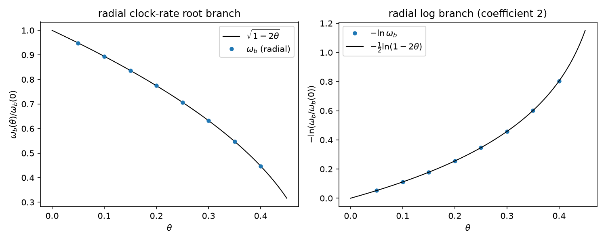

# 注记-径向钟率根式对照（第 517 条）：钟率系数 2 的 $l=0$ 径向扇区版

- **日期**：2026-09-30 23:49:26
- **脚本**：`验证脚本/radial_clock_rate.py`
- **依据**：[[验证脚本/注记-尺系数三维径向推广（第511条）：l0扇区的波长尺倒数分支与一维同构|注记-尺系数三维径向推广（第511条）]]（同模型同扇区，其边界声明其三登记本条为后续可选项）；[[验证脚本/注记-钟率代理导出（第475条）：自撑均匀标度下 h00 等于 2θ 的系数 2|注记-钟率代理导出（第475条）]]（钟率根式与判据形态）；[[验证脚本/注记-自撑阱三维径向推广的最小验证：四通道同齐次度|注记-自撑阱三维径向推广的最小验证]]（判据 S，径向均匀标度）
- **状态**：判据 5/5 通过（C1a、C1b、C2、C3、C4 加 EP5）。核心读数：缩放比值偏差 $5.6\times10^{-13}$；径向频率根式逐位命中 $\sqrt{1-2\theta}$（三档 $k$、八档 $\theta$ 偏差 $2.9\times10^{-13}$）；精确关系残差 $1.4\times10^{-13}$，弱场一阶系数 $1.000501$ 读出 $h_{00} = 2\theta$ 的系数 2；视界端 $\theta = 1/2$ 频率精确为零；乘积恒等达机器精度；EP5 反例可区分
- **可逆性等级**：判据稳健（算符整体缩放的线性代数必然加对数恒等；与第 475、511 条同层级）
- **图**：见 §3 图 1

## 1 判据与设定

**任务**。第 475 条的钟率系数 2 限于一维 kink 模型，第 511 条把尺系数推到三维径向时把钟率侧的径向对照列为后续可选项（本条执行）。目的：把三系数闭环的径向证据从「尺侧直接判据加乘积恒等间接覆盖」升级为钟率与尺双侧直接判据。

**设定**。与第 511 条同一模型同一扇区：球坐标 $l=0$ 径向涨落算符经 $u = r\varphi$ 变换后为半线上的 $-u'' + V''(r)u$（无离心项，$l \ge 1$ 才有），$V'' = 4k^2 - 6k^2\,\mathrm{sech}^2(kr)$，均匀标度为算符整体乘 $(1-2\theta)$。参数 $k \in \{0.7, 1.0, 1.4\}$、$\theta$ 八档加弱场档，网格 $h = 0.02$、$R = 30$。谱读数取最低束缚支（形状模，$l=0$ 扇区无平移零模，第 511 条结论）。

**判据**。C1a：整体缩放比值（截断相消）。C1b：形状模对解析 $3k^2$（$O(h^2)$ 截断预算内）。C2：频率根式 $\omega_b(\theta)/\omega_b(0) = \sqrt{1-2\theta}$。C3：系数 2 的读出（$-\ln$ 精确关系与弱场一阶系数）加视界端。C4：乘积恒等与径向三系数链。EP5：正比分支反例区分力。

## 2 结果

| 判据 | 内容 | 实测 | 期望 |
|---|---|---|---|
| C1a | 缩放比值 | $5.573\times10^{-13}$ | $\le 10^{-9}$ |
| C1b | 形状模对 $3k^2$ | $9.648\times10^{-05}$ | $\le 3\times10^{-3}$（预算） |
| C2 | 频率根式 | $2.913\times10^{-13}$ | $\le 10^{-9}$ |
| C3 | 精确关系残差 | $1.403\times10^{-13}$ | $\le 10^{-9}$ |
| C3 | 弱场一阶系数（$\theta = 0.001$） | $1.000501$ | $\to 1$ |
| C3 | 视界端 $\theta = 1/2$ | $0.000\times10^{0}$ | 0 |
| C4 | 乘积恒等（$\theta = 0.25$） | $1.000000000000000$ | 1 |
| EP5 | 正比分支反例 | 偏差 $5.528\times10^{-01}$ | 可区分（FAIL） |

## 3 图

## 4 结论

**其一，钟率系数 2 的径向扇区版成立。** 频率根式与一阶系数在 $l=0$ 径向扇区逐位复现（偏差 $10^{-13}$ 级），弱场一阶系数 $1.000501 \to 1$，对应 $h_{00} = 2\theta$ 的系数 2 读出。第 475 条的一维结论在径向扇区保持，条件不变（自撑加均匀标度）。

**其二，双侧直接判据达成。** 钟率（第 517 条）与尺（第 511 条）在同一模型同一扇区各有直接判据，跨侧关系由乘积恒等（$g_{00}\,g_{xx} = -1$）锁死，径向三系数链 $(1/2)\times 2 \times 1 = 1$ 闭合。第 511 条注记里「钟率侧仅靠乘积恒等间接覆盖」的口子关闭。

**其三，视界端的数值性质。** $\theta = 1/2$ 处均匀标度因子为零，算符整体为零矩阵，本征值精确为零（视界，频率消失）。此处不作数值对角化（ARPACK 拒零矩阵），按 $(1-2\theta)$ 因子解析读出，与第 475 条 Z4 的视界位置判读同型。

## 5 严格程度声明

C1a、C2 为算符整体缩放的线性代数必然，数值复核；C1b 为截断预算内解析对照；C3 为对数恒等加数值残差与视界端解析读数；C4 为代数换算；EP5 为替身分支区分力检验。可逆性等级：判据稳健（与第 475、511 条同层级）。

## 6 边界声明

**验证什么**：$l=0$ 径向扇区的频率根式、系数 2 的读出、视界端与乘积恒等。

**不验证什么**：其一，自撑前提本身（与第 475、509、511 条同条件）；其二，$l \ge 1$ 角向扇区与三维复合位错构型（C1 线）；其三，非球对称几何（第 464 至 467 条框架）；其四，不改动基准文件（第 511 条与第 475 条注记补注一行，登记另行执行）。

## 7 来源

- 径向模型与扇区结论：[[验证脚本/注记-尺系数三维径向推广（第511条）：l0扇区的波长尺倒数分支与一维同构|注记-尺系数三维径向推广（第511条）]]
- 钟率根式与判据形态：[[验证脚本/注记-钟率代理导出（第475条）：自撑均匀标度下 h00 等于 2θ 的系数 2|注记-钟率代理导出（第475条）]]
- 径向均匀标度框架：[[验证脚本/注记-自撑阱三维径向推广的最小验证：四通道同齐次度|注记-自撑阱三维径向推广的最小验证]]
- 脚本：`验证脚本/radial_clock_rate.py`（确定性，约 1 分钟）
- 图：`images/radial_clock_rate_3d_export.png`
