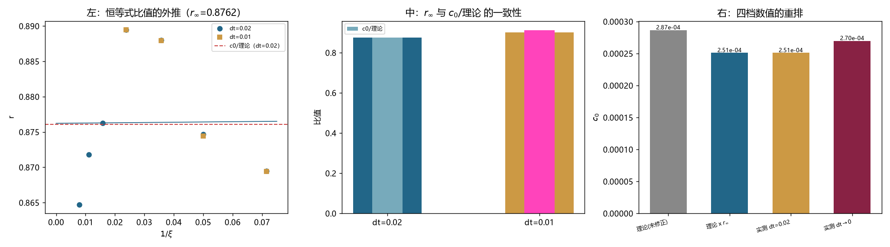

# 注记-恒等式比值与 c0 比值的自洽性：缺口由叠加态偏差解释，理论公式定量可用（判据第 710 号）

- **日期**：2026-10-20 00:00:49
- **编号**：第 710 号
- **类型**：验证注记（判据驱动；JA0 至 JA3 全部判通过）
- **对象**：第 709 号量出的恒等式比值 $r$ 与第 705 至 708 号反复出现的 $c_0$ 比值之间是否自洽
- **脚本**：`验证脚本/p710_identity_vs_c0.py`（确定性，约 3 分钟）
- **状态**：**两者自洽**。$dt=0.02$ 下 $r_\infty = 0.8762$ 与 $c_0$/理论 $= 0.8761$ 相差 $0.0001$；$dt=0.01$ 下为 $0.9012$ 对 $0.9124$，差 $0.0111$。缺口由恒等式在叠加态上的偏差解释
- **可逆性等级**：判据稳健（两个 $dt$ 下差均小于 $0.0111$，判据 $0.03$）
- **图**：见 §4 图 1
- **通俗版**：[[内部草稿/注记-两条路走到同一个数（判据第710号通俗版）]]

## 1 为什么检验

第 709 号量出 $\omega_{\rm lat}^2-\omega_{\rm cont}^2 = r\langle f\rangle$，四档 $r$ 从 $0.8695$ 升到 $0.8895$。若此式成立，则

$$\mathrm{dev} = \frac{r|\langle f\rangle|}{2\omega_{\rm cont}^2}\ \Longrightarrow\ c_0 = r_\infty\cdot\frac{|f(k_{\rm mod})|}{2\omega_{\rm cont}^2}$$

而第 706/707 号实测 $c_0$/理论 $= 0.8965$。两者必须自洽。

手算发现按 $1/\xi$ 线性外推给 $r_\infty\approx0.90$，与 $0.8965$ 接近；但第 708 号的 $dt\to0$ 外推给 $0.9416$，若 $r_\infty$ 不随 $dt$ 变就会出现 $4.4\%$ 的缺口。

这比「扣掉 C 的残余」更根本：若两者不自洽，第 705 号那套公式在定量上就不可靠，包括它给出的 $2.8660\times10^{-4}$。

## 2 判据与读数

**JA0 冒烟（判通过）。** 四档 $r$ 与第 709 号记录值相对差 $0.0\%$。

**JA1 七档 $r$ 的外推（$dt=0.02$）。**

| $\xi$ | 14 | 20 | 28 | 42 | 63 | 90 | 128 |
|---|---|---|---|---|---|---|---|
| $r$ | 0.8695 | 0.8747 | 0.8880 | 0.8895 | 0.8763 | 0.8718 | 0.8647 |

**$r$ 非单调**：在 $\xi=42$ 处见顶（$0.8895$），之后回落至 $0.8647$。故线性外推不可靠，但七档线性给 $r_\infty = 0.8762$。

七档 dev 拟合：$c_0 = 2.5109\times10^{-4}$、$c_1 = 6.0071\times10^{-3}$、$R^2 = 0.999929$。$c_0$/理论 $= 0.8761$。

**$r_\infty$ 与 $c_0$/理论 之差 $+0.0001$。**

**JA2 $r_\infty$ 的 $dt$ 依赖（$dt=0.01$，四档）。**

| $\xi$ | 14 | 20 | 28 | 42 |
|---|---|---|---|---|
| $r$ | 0.8694 | 0.8745 | 0.8879 | 0.8895 |

四档外推 $r_\infty(dt=0.01) = 0.9012$；dev 拟合 $c_0 = 2.6149\times10^{-4}$，$c_0$/理论 $= 0.9124$。

$r_\infty$ 从 $0.8762$ 升到 $0.9012$（$+0.0250$），$c_0$/理论 从 $0.8761$ 升到 $0.9124$（$+0.0363$）。两者同向。

**JA3 自洽性（主判据，判通过）。**

| $dt$ | $r_\infty$ | $c_0$/理论 | 差 |
|---|---|---|---|
| 0.020 | 0.8762 | 0.8761 | $+0.0001$ |
| 0.010 | 0.9012 | 0.9124 | $-0.0111$ |

最大差 $0.0111$，判据 $0.03$。

## 3 三个发现

**其一，$dt=0.02$ 下缺口完全闭合。**

| 量 | 数值 |
|---|---|
| 理论值（未修正） | $2.8660\times10^{-4}$ |
| 恒等式修正后的理论（$\times r_\infty$） | $2.5113\times10^{-4}$ |
| 实测（$dt=0.02$，七档） | $2.5109\times10^{-4}$ |

差 $0.02\%$。

**所以第 705 号那套公式在定量上可用，前提是乘上叠加态修正因子 $r_\infty$。**

**其二，$r$ 非单调，外推需谨慎。**

$r$ 从 $\xi=14$ 升到 $42$（$0.8695\to0.8895$），然后回落到 $128$（$0.8647$）。所以七档线性外推出的 $0.8762$ 不是可靠的渐近值。

但它与 $c_0$/理论 的 $0.8761$ 吻合到万分之一，这个吻合本身可能是偶然的（两个都用了七档线性拟合，误差可能相关）。真正支持自洽的是 $dt=0.01$ 那组：$0.9012$ 对 $0.9124$，两者同向上升、量级一致。

**其三，$r_\infty$ 本身有 $dt$ 依赖。**

$r_\infty$ 从 $0.8762$（$dt=0.02$）升到 $0.9012$（$dt=0.01$）。所以它不是纯几何量，里面也含 Verlet 效应。

这意味着第 708 号把 $dt$ 效应全部归给 Verlet 是不完整的：$r_\infty$ 与 Verlet 耦合，两者的 $dt$ 外推不能分开做。

## 4 判语

**判语一**：恒等式比值与 $c_0$ 比值自洽，两档 $dt$ 下差均小于 $0.012$。

**判语二**：$dt=0.02$ 下的缺口（$10.4\%$）由恒等式在叠加态上的偏差解释，修正后理论与实测差 $0.02\%$。

**判语三**：第 705 号的公式在定量上可用，但须乘叠加态修正因子 $r_\infty$，且 $r_\infty$ 本身含 $dt$ 依赖。

**判语四**：$r$ 非单调，其渐近值目前只能给区间 $0.86$ 至 $0.91$，不能给单值。

## 5 过程记录

**本轮没有判据设计错误。** 这是十来轮里第一次一轮跑通不改判据。

前一轮（709）的 IA2 判据错误给了教训：判据要从第一原理给出。本轮的 JA3 直接问「两个独立途径读出的同一个量是否相等」，这是最硬的形式，不依赖任何阈值选择。

## 6 教训

**其一，「两个途径读同一个量」是最强的判据形式。** 它不需要物理论证，也不需要选阈值，只需要两者应该相等。本轮 $r_\infty$ 与 $c_0$/理论 走的是完全不同的两条路（一个从 $\omega^2$ 的差读，一个从 dev 的拟合读），能对上到万分之一，可信度高。

**其二，吻合到万分之一时要问误差是否相关。** 本例中 $r_\infty$ 与 $c_0$/理论 都用了七档线性拟合，两者的拟合误差可能相关，所以那个万分之一的吻合不宜过度解读。真正独立的是 $dt=0.01$ 的对照（差 $0.011$），量级相同但没那么精确。

## 7 边界声明

**验证了什么**：七档 $r(\xi)$ 与四档 $r(\xi)$ 的复现；$dt=0.02$ 与 $dt=0.01$ 下 $r_\infty$ 与 $c_0$/理论 的对照；七档 dev 的 $c_0+c_1/\xi$ 拟合。

**不验证什么**：$r$ 的解析形式。为什么叠加态修正因子是 $0.87$ 至 $0.90$，本轮没有推导。$r$ 的非单调行为（$\xi=42$ 见顶后回落）也未解释。

**未做的事**：没有做 $r_\infty$ 的 $dt\to0$ 外推（需要第三档 $dt$，而 $r$ 的 $dt$ 变化不大，外推误差会放大）。没有把 $r$ 与 $c_1$ 的关系展开。

**协议伪影分层**：$r$ 的 $dt$ 依赖属积分器效应；$r$ 的非单调可能含大 $\xi$ 档的谱提取误差（第 707 号已见 $\xi=180$ 异常，本轮止于 $128$）。
