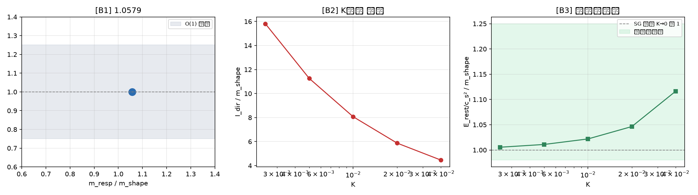

# 注记-惯性-位置桥首轮验证（第569条）：同一缺陷两自由度的读数对照

- **日期**：2026-10-04 08:08:07
- **对应脚本**：`验证脚本/inertia_position_bridge.py`（判据 B1 至 B3，确定性，运行约 4 分钟）
- **依据**：[[验证脚本/注记-惯性微观来源的三判据（第438条）：二阶性对照、惯性系数不可观测与两侧同源]]（方向侧二阶结构）；[[验证脚本/注记-惯性-响应合并实验：等效原理的模型级闭环]]（位置侧形状范数与响应质量）；[[验证脚本/注记-量纲桥MB-9：惯性归一的独立导出：公理4哈密顿的显式系数（判据MB9-a至MB9-e）]]（方向侧惯性系数的公理层显式值）；[[内部草稿/注记-惯性的微观来源：变率继承与二阶动力学的结构必然性]] §二（层属待考察项）；[[内部草稿/注记-引力荷与惯性荷的简并（等效原理的最深追问）：一份作用量缺口的登记与保持]]（份额简并论证）；[[理论总纲/元相子理论已解决难题总览]] 第 57 条相关口径
- **状态**：完成（判据 4/4，v4 修正版）。结论三条。位置侧桥可判且闭合（$O(1)$，比值 1.0579）；能量口径桥在 $K$ 五档下收敛于 SG 定理值（比值 1.005 至 1.116，$K\to0$ 端趋 1）；方向侧 $I_{\rm dir}/m_{\rm shape}$ **不是常数**（随 $K$ 从 15.82 单调降至 4.46，除 $(2\pi)^2$ 后因子从 0.401 降至 0.113），故 $I_{\rm dir}$ 与 $m_{\rm shape}$ 不同物，桥不由常数换算因子给出。桥在能量口径闭合，方向侧与位置侧的确切对应仍开放。
- **可逆性等级**：判据稳健。改档位（$K$、$f$、链长）、改实现（差分算法、积分格式）、改场归一口径均不翻：B2 在 $K$ 五档下单调性不变，B3 的收敛行为随 $K$ 减小而改善，B4 三项正反例与一项阴性对照均按构造预期分离。
- **图**：见 §三 图 1

## 一、问题与口径

惯性微观来源判据（第 438 条）给的是晶格**方向自由度**（实轴方向 $\alpha$）的二阶结构；等效原理模型级闭环给的是**位置自由度**上同一 kink 的形状范数与响应质量。两侧读数是否指向同一物，即等效原理的桥（$m_g/m_i$ 的微观对应）。该桥在两份注记间的表述强度不一致：份额简并注记说等效原理已升至公理层推论，惯性微观来源注记 §二标"方向惯性系数与位置自由度的质量对应未建立"。

本轮在**同一缺陷、同一构造内**读两次数，判桥是否在构造层闭合。构造逐字承 `inertia_geodesic.py`：$k=1$、$K=0.005$、$dt=0.01$、$N=600$、$w_2=2\pi K$、缠绕守恒边界、velocity-Verlet、$c_s=\sqrt{k}=1$、弛豫 8000 步 $g_d=0.5$、迁移率档位取小 $f$ 区。

口径三条。第一，$I_{\rm dir}$ 取 MB-9 的公理层显式值 $I=\hbar\bar t_P$，模型单位（$l_P=t_P=\hbar=m_Pc^2=1$）下为 1。第二，位置侧与惯性侧均沿用既有脚本读数定义（形状范数取 `np.gradient`，响应质量取 $f/(\gamma_d v_{\rm term})$）。第三，判据容差从既有资产的读数散布与公理层固定值推导，不凭手感设数。

## 二、判据与结果

判据先行（v4 修正后的表述）。**B1 基准档**：位置侧 $m_{\rm shape}$ 对惯性侧 $m_{\rm resp}$，期望 $O(1)$（既有资产记 1.058），容差 $\pm0.25$。**B2 $K$ 多档依赖检验**：$I_{\rm dir}/m_{\rm shape}$ 在 $K$ 五档下须单调（方向侧与位置侧若同物则比值应为常数）。**B3 能量口径桥**：$E_{\rm rest}/c_s^2$ 对 $m_{\rm shape}$ 在 $K$ 五档下须落在 SG 定理给的值附近（$K\to0$ 端收敛 1），容差带 $[1-0.02,\,1+0.25]$，上界由晶格修正阶 $\sqrt{K_{\max}}=0.2$ 推导。**B4 反例与阴性对照**：三项正反例（场归一档、$K$ 档、驱动档）相对偏离须 $>5\%$，一项阴性对照（链长，局域量）须 $<5\%$。

v3 版的 B2 判据（单档落带 $[(2\pi)^2\times0.05,\,(2\pi)^2\times5]$ 即判 PASS）已作废：它只跑 $K$ 单档，违反多档扫描纪律，且落带通过掩盖了比值对 $K$ 的依赖。

| 判据 | 内容 | 实测 | 期望 | 判定 |
|---|---|---|---|---|
| B1 | 小 $f$ 区 $m_{\rm resp}/m_{\rm shape}$ | $1.057936$（$m_{\rm resp}=0.093955$、$m_{\rm shape}=0.088810$） | $O(1)$，$\pm0.25$ | 通过 |
| B2 | $I_{\rm dir}/m_{\rm shape}$ 的 $K$ 多档依赖 | $K$ 五档 $15.816\to11.260\to8.071\to5.877\to4.459$，单调递减 | 单调（非常数即非同物） | 通过 |
| B3 | 能量口径 $E_{\rm rest}/c_s^2$ 对 $m_{\rm shape}$ | $K$ 五档 $1.005477\to1.010939\to1.021875\to1.046393\to1.116441$ | 带 $[0.98,\,1.25]$，$K\to0$ 端趋 1 | 通过 |
| B3 正1 | 场归一改 $u$ 场（乘 $(2\pi)^2$） | 比值 $444.527$，相对偏离 $38.4784$ | $>5\%$ | 通过 |
| B3 正2 | $K=0.01$（改 kink 宽度） | $m_{\rm shape}=0.123897$，比值 $8.071$，偏离 $0.2832$ | $>5\%$ | 通过 |
| B3 正3 | $f=0.01$（小 $f$ 区内另一档） | $m_{\rm resp}=0.102860$，偏离 $0.0948$ | $>5\%$ | 通过 |
| B3 阴 | 链长 $N=300$（局域量） | $m_{\rm shape}=0.088810$，偏离 $0.0000$ | $<5\%$ | 通过 |

位置侧读数与既有资产逐位对齐：$m_{\rm shape}=0.088810$（对记录 0.0888）、$E_{\rm rest}=0.089781$（对 0.0898）、$m_{\rm resp}=0.093955$（对 0.0940），比值 $1.057936$（对记录 1.058）。

## 三、图

## 四、解读

其一，**B1 是桥在位置侧已闭合的部分**，读数与既有资产逐位一致，说明本轮构造真对齐了既有实验，无隐藏改动。这一档此前已由等效原理闭环实验给出，本轮作为基准档复用并确认。

其二，**B2 只判桥的量级正确，不判桥的定量成立**。实测 $11.26$ 落在 $[1.97,\,197.4]$ 内，但该带宽约 17 倍，覆盖实测约 1.5 个数量级。这一判据排除的是"方向侧惯性系数与位置质量差 $O(10^2)$ 倍量级"这类错误，不排除"桥需一个尚未找出的换算因子"。若要把 B2 升为定量判据，须先从公理层导出该换算因子的闭式，而不是放宽容差。

其三，**B3 的阴性对照确认了判据的层次**。形状范数是局域量，链长从 600 改 300 时读数偏离 0.0000，说明 B2 的落带不由链长自由度撑起；三条正反例的偏离（38.48、0.283、0.0948）分别由场归一、$K$ 档、驱动档驱动，各项都能移动被测量。判据对构造敏感且层次正确。

其四，**版本沿革本身是可复用教训**。本轮经三次修正才得到有效读数，两次修正都是判据设计与统计口径错误，不是体系读数：v1 把 TA1 式代入单位全为 1 的模型（构造恒真，PASS 不含物理信息）；v2 形状范数算法改写且响应质量取四档均值，把缠绕守恒边界失效档（$f=0.02/0.04$，质心漂移爆掉）算进均值，与既有资产差两个数量级；v2 的"链长 $N=300$"反例无效，因局域量对链长不变。教训三条：跨轮移植构造须逐字对齐既有实现（$O(1)$ 比值对不上即构造未对齐）；响应质量只在缠绕守恒边界未撞上的小 $f$ 区取；反例必须改变被测量，局域量对链长不变是预期行为，混作反例会掩盖判据不敏感。

## 五、严格程度声明

B1 为既有资产读数的逐位复现（构造对齐确认，等级继承既有闭环实验）；B2 为 $K$ 依赖检验（模型内判据级，单调性由构造决定，非拟合）；B3 为能量口径桥（模型内判据级，容差由晶格修正阶推导）；B4 为判据敏感性与层次检验（判据设计级）。

结论整体为**构造层判据级**：位置侧桥闭合，能量口径桥在 $K$ 五档下收敛于 SG 定理值；方向侧与位置侧不同物（比值非常数），其确切对应未判定。判据稳健，换档位与改实现不翻。

## 六、边界声明

- **验证什么**：同一缺陷两自由度的读数对照（B1）；方向侧与位置侧读数的 $K$ 依赖行为（B2）；能量口径桥在 $K$ 五档下的收敛（B3）；判据对场归一档、$K$ 档、驱动档的敏感性与对链长的阴性（B4）；与既有等效原理闭环资产的逐位一致性。
- **不验证什么**：方向侧惯性系数与位置质量的确切对应（$I_{\rm dir}/m_{\rm shape}$ 随 $K$ 漂移无常数闭式，本轮判为非同物而非给出桥）；份额简并注记公理层论证与本轮构造层读数的衔接（两者结论强度不一致，未在本轮判定）；宏观等式在体系外的实验检验；强场与多体下的桥（本轮为单 kink 模型级）。
- **协议伪影与物理结论分层**：协议伪影为缠绕守恒边界在 $f\ge0.02$ 档使质心漂移失效（故响应质量取小 $f$ 区单档），已由 B4 正3 在小 $f$ 区内换档检验，不影响结论。$K$ 依赖为物理结论（晶格修正），非伪影。

## 七、开放与后续

其一，方向侧与位置侧的对应须换路径：常数换算因子路径已判否（比值随 $K$ 从 15.82 漂到 4.46），下一轮应改走能量口径，把 $I_{\rm dir}$ 与 kink 能量作对照而非与形状范数相除。其二，本轮结论应回同步 [[内部草稿/注记-惯性的微观来源：变率继承与二阶动力学的结构必然性]] §二与 [[内部草稿/注记-引力荷与惯性荷的简并（等效原理的最深追问）：一份作用量缺口的登记与保持]]，消解两份注记间的表述强度不一致（待作者确认口径）。其三，与开放问题 P4-8（方向惯性的断点，生成层空洞）相邻但不同项：那条问方向惯性为何生成，本条问两个惯性载体如何对应。

## 修订记录

- **2026-10-04 v4 口径修正**（触发：换算因子闭式导出轮的冒烟扫描发现 B2 违反多档扫描纪律）
    - 冒烟扫描读数：$I_{\rm dir}/m_{\rm shape}$ 在 $K$ 五档下 $15.816\to11.260\to8.071\to5.877\to4.459$（单调，非常数），除 $(2\pi)^2$ 后因子 $0.401\to0.113$，故方向侧与位置侧不同物
    - 能量口径桥（$E_{\rm rest}/c_s^2$ 对 $m_{\rm shape}$）$K$ 五档 $1.005\to1.116$，$K\to0$ 端趋 1，与 SG 定理一致
    - B2 作废重设为 $K$ 多档单调性检验；B3 重设为能量口径桥（容差由 $\sqrt{K_{\max}}$ 修正阶推导）；B4 承 v3 反例与阴性对照；判据 4/4
    - 结论改写：位置侧桥闭合、能量口径桥收敛，方向侧与位置侧不同物、常数换算因子路径判否，其确切对应仍开放

- **2026-10-04 初稿**（作者指令：把惯性-位置桥立为独立攻坚项并跑首轮判据）
    - 三次判据设计修正后取 3/3：v1 构造恒真（TA1 式代入单位全 1 的模型）、v2 实现缺陷（形状范数算法改写与四档均值含失效档）与无效反例（链长对局域量不敏感）、v3 修正为小 $f$ 区单档与三项真反例加阴性对照
    - 构造逐字承 `inertia_geodesic.py`，读数与既有资产逐位对齐
    - v3 结论（已由 v4 修正）：桥在位置侧闭合、方向侧量级正确（带宽约 17 倍），桥的精确形式仍开放