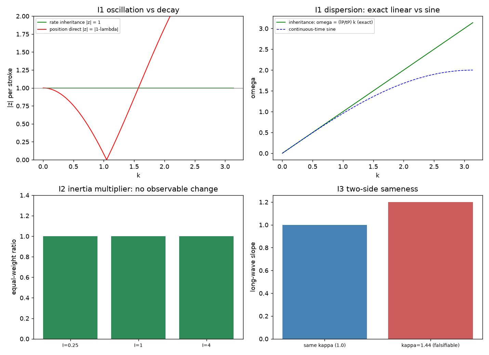

# 注记-惯性微观来源的三判据（第438条）：二阶性对照、惯性系数不可观测与两侧同源

- **日期**：2026-09-26 10:58:10
- **脚本**：`minimal_verification_inertia_rate_inheritance.py`（工作区根目录执行）
- **主题**：变率继承机制的三条判据。二阶性对照（继承规则给振荡、位置直改给衰减）、常数分辨（惯性倍数不可观测、折叠系数可观测且由"每拍抄写一次"裁决固定为 1）、两侧同源（实轴方向链与基准取向场横向模给同一长波斜率，偏离可证伪）
- **判据结果**：3/3（I1、I2、I3）
- **可逆性等级**：判据敏感（换更新规则或换算折叠系数即翻）
- **图**：见 §3 图 1
- **修订记录**：
  - **2026-09-26 层级关系精确化与裁决落盘**（触发：作者追问两条色散哪一层更基础）
    - §5 改为精确登记（三维首阶方向比 $6{:}3{:}2$ 对 $0{:}3{:}4$，含 $F$ 因子的两式），并记录作者裁决：短波以连续时间方程为准；变率继承的价值保留于二阶来源与折叠系数 1 两处，均不依赖时间层取舍

## 1 模型设定

变率继承规则：每个摆程把方向变率继承到下一拍，实轴方向由方向变率累加给出。

$$v^{(s+1)} = v^{(s)} + \kappa\,\delta^{(s)},\qquad \alpha^{(s+1)} = \alpha^{(s)} + v^{(s+1)},\qquad \delta^{(s)}_n = \alpha^{(s)}_{n+1} + \alpha^{(s)}_{n-1} - 2\alpha^{(s)}_n$$

消去 $v$ 得二阶摆程差分方程 $\alpha^{(s+1)} - 2\alpha^{(s)} + \alpha^{(s-1)} = \kappa\,\delta^{(s)}$。代入平面波给特征方程

$$z^2 - (2 - \kappa\lambda)z + 1 = 0,\qquad \lambda = 4\sin^2\frac{k l_P}{2}.$$

$\kappa = 1$ 且 $0 < \lambda < 4$ 时两根共轭且模为 1，相位 $\theta = \arccos(1-\lambda/2) = k l_P$，给出精确线性色散 $\omega = (l_P/t_P)k$，这是 Courant 数 1 的格点波动方程性质。对照的位置直改规则 $\alpha^{(s+1)} = \alpha^{(s)} + \delta^{(s)}$ 给 $z = 1-\lambda$，实根，无振荡。

## 2 判据与结果

I1 二阶性对照：变率继承的 $\vert z\vert - 1$ 与 $\vert\theta - k l_P\vert$ 在 $k \in [0.05, 2.0]$ 上均为舍入地板量级；位置直改的 $\vert z\vert$ 与 1 的距离在 $10^{-3}$ 以上。纯模式初值代入递推的核对残差 $7.4\times10^{-14}$。

I2 常数分辨：惯性倍数 $I$ 取 $0.25$、$1$、$4$ 时等幅比值恒为 $1$（惯性不可观测，与第 434 条一致）；折叠系数 $\kappa$ 取 $0.5$、$1$、$2$ 时长波斜率为 $0.7071$、$1.0$、$1.4142$（即 $\sqrt{\kappa}$，可观测）。$\kappa$ 由"每拍抄写一次、瞬时无损"的裁决固定为 1，不是自由参数。

I3 两侧同源：实轴方向链与基准取向场横向模在 $\kappa = 1$ 时的长波斜率相对差 $4.2\times10^{-12}$；给基准侧 $\kappa = 1.44$ 时斜率比为 $1.200000$（判据对偏离敏感，同源因此可证伪）。

| 判据 | 实测 | 期望 | 结果 |
|---|---|---|---|
| I1 继承 $\vert z\vert - 1$（全 $k$） | $0$ | $0$ | 通过（舍入地板） |
| I1 继承 $\vert\theta - k l_P\vert$ | $\le 7.3\times10^{-16}$ | $0$ | 通过 |
| I1 递推核对 $\max\vert\alpha^{(s)} - z^s\vert$ | $7.4\times10^{-14}$ | $< 10^{-10}$ | 通过 |
| I1 位置直改 $\vert z\vert$ 与 1 的距离 | $\ge 2.5\times10^{-3}$ | $> 10^{-3}$ | 通过（衰减） |
| I2 等幅比值（$I$ 扫描） | $1.000000000000$ | 不变 | 通过 |
| I2 长波斜率比 $\kappa = 2$ 对 $\kappa = 1$ | $1.414213562373$ | $\sqrt{2}$ | 通过 |
| I3 两侧斜率相对差 | $4.2\times10^{-12}$ | $< 10^{-10}$ | 通过 |
| I3 偏离检验（$\kappa_{\text{规范}} = 1.44$） | $1.200000$ | $1.2$ | 通过 |

## 3 图

## 4 过程记录

其一，模态提取初值错。首版用 $\alpha^{(0)} = 1$、$v^{(0)} = 0$ 的初值递推后取末态比值，混入两个模态，读数 $\vert z\vert = 0.669$ 与解析值 1 冲突。改为纯模式初值（$\alpha^{(0)} = 1$、$\alpha^{(1)} = z$）后残差 $7.4\times10^{-14}$。教训：模态提取必须用纯模式初值或投影，不能用任意初值的末态比值。

其二，斜率漏除模长。规范侧长波斜率首版写成 $\sqrt{\kappa s}/t_P$，漏除 $\vert k\vert$，I3 相对差 0.998。修正后为 $4.2\times10^{-12}$。

其三，格点截断的预算处理。同一条判据在 $k = 10^{-3}$ 下残差 $4.2\times10^{-8}$，等于正弦展开的高阶项 $k^2l_P^2/24$，属预期离散项。按误差预算把 $k$ 取到 $10^{-5}$（预算 $4\times10^{-12}$），未放宽容差。

## 5 严格程度与边界声明

严格：I1 的特征方程与相位结果、I2 的比值不变性、I3 的同源等式均为代数恒等式（舍入地板量级）。

判据敏感：换更新规则（位置直改、或其他动量更新）或给折叠系数其他取值，三条判据的结论即翻。

验证什么：两种更新规则的振荡与衰减对照、继承规则的精确线性色散、惯性倍数不可观测与折叠系数可观测的分辨、两侧同源及其可证伪性。

不验证什么：折叠系数为何恰为 1 的更深依据（本轮引用"每拍抄写一次、瞬时无损"的既有裁决）、惯性的定量来源与质量谱、量子层。

一处层级关系需精确登记，因为它比"短波不同"更细。本轮继承规则在时间方向取二阶摆程差分，与第 430 条判据四的连续时间描述（$\ddot\alpha = (1/t_P^2)\Delta^2\alpha$）在长波一致、在短波不同。三维长波展开后两者的首阶方向依赖修正并不相同：

$$\text{连续时间}: \omega = ck\left[1 - \frac{F\,l_P^2k^2}{24}\right],\qquad \text{继承规则}: \omega = ck\left[1 + \frac{(1-F)l_P^2k^2}{24}\right],\qquad F = \frac{\sum_a k_a^4}{k^4}.$$

$F$ 取轴向 1、面对角 $1/2$、体对角 $1/3$。连续时间的方向比为 $6{:}3{:}2$（既有洛伦兹破坏预言的形态），继承规则为 $0{:}3{:}4$（轴向无修正）。

按 [[时间的三层生成结构：原初连续、内生离散与次级连续的被采样]] 的次序命题（连续为原型、离散为采样；先有连续旋转、后有离散跃迁），实轴取向的连续推进属原型层，采样层的离散递推为有效描述。**作者 2026-09-26 裁决（连续为演化层、离散为采样层）**：定义 4 的措辞是实轴取向场"连续性保留，刻度烙印在内"，故演化层连续，$6{:}3{:}2$ 为演化层结论；离散递推是采样点上的二阶差分形式。紫外完备性另行排除离散递推作本层：其色散要求 $\sqrt S \le 1$，而斜向布里渊附近 $S = 1.61$ 与 $1.86$ 时无实数频率解（连续时间给 $\omega = 2.53/t_P$）。本机制的价值保留在二阶结构与系数 1 的来源。

变率继承的价值保留在两处，二者均不依赖时间层的取舍：二阶结构的来源（无耗散则禁一次时间导数，见机制注记）与折叠系数 1 的来源（每摆程抄写一次）。

## 6 关联

- 机制注记：[[内部草稿/注记-惯性的微观来源：变率继承与二阶动力学的结构必然性]]
- 惰性系数与符号结构：[[内部草稿/注记-洛伦兹符号定理：作用量的动能势能分解与光速的无参数重现]]；[[验证脚本/注记-洛伦兹符号的规范侧转写（第434条）：E 型双归属、等幅条件与无参数光速|第434条]]
- 约束与惯性的分工：[[验证脚本/注记-规范侧纵向模的高斯约束消去（第435条）：约束守恒、模式计数与纵向零代价|第435条]]
- 正稿：[[规范作用量的审计必然性：从净值审计到电磁场作用量的推导与数值验证]]
- 术语：[[内部草稿/术语提案]]
