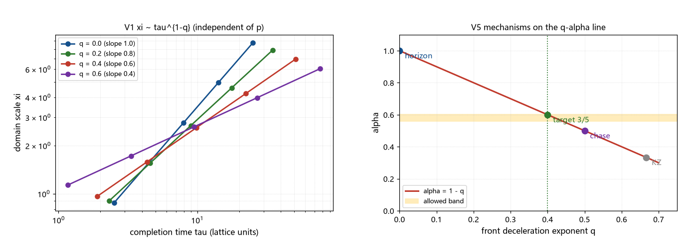

# 注记-成核-接缝几何的最小模型（第416条）：alpha = 1 - q 标度定理与三分之五的几何靶

- **日期**：2026-09-26 01:45:56
- **类型**：建模轮（P0-5 候选机制四轮；成核-接缝几何首轮）
- **脚本**：`验证脚本/minimal_verification_nucleation_seam_model.py`（第 416 条）
- **图**：见 §3 图 1（`images/nucleation_seam_model.png`）
- **依据**：[[验证脚本/注记-结晶扩张相变的标度清点（第415条）：标准临界标度全判负与三分之五的机制域]]（机制域两条与几何入口）；[[验证脚本/注记-KZ 适用性判定（第381条）：临界冻结不适用、注入-接缝机制与畴尺度候选]]（追赶变体与畴尺度分离）；[[验证脚本/注记-ξ 生长律族的联立判定（第413条）：从单参数曲线到三分之五候选]]（允许带与交点条件）；[[内部草稿/注记-P8a修订：局域成核与结晶扩张相变]]（多核相继成核）；[[粒子与时空的同生：凝固波前的缺陷形成机制]] §3.3（接缝必然性）
- **状态**：判定完成。标度定理 $\alpha = 1 - q$ 成立（与成核率幂次无关）；几何靶 $q = 2/5$（对应 $3/5$）；$q$ 的物理来源未建立（移交下一轮）
- **可逆性等级**：判据稳健（标度关系为解析结果并被数值逐位复现；靶条件为代数；换实现或档位不翻）

## 1 判据与设定

第 415 条把剩余机制域压到两条，本轮把第二条做成最小模型：持续成核、波前覆盖、接缝凝固。模型族设定：成核率 $J(t) = J_0 t^{p}$（单位体积率，幂次 $p$ 自由）；波前半径 $R(t) = v_0 t^{1-q}/(1-q)$（$q$ 为速度衰减指数 $v \propto t^{-q}$，$q = 0$ 为常速）；完成判据取 Avrami 覆盖积分（单位体积的凝固体积分数到一，$\int J R^3\,dt = 1$）；畴尺度取核密度的 Voronoi 口径 $\xi = c_{\rm v} N^{-1/3}$。

判据 V1 至 V5：标度验证（扫 $J_0$ 拟合 $\ln\xi$ 对 $\ln\tau$ 斜率）、与成核幂次无关（$p$ 档对照）、几何靶（带内 $\alpha$ 对应 $q$ 窗口）、蒙特卡洛系数（$\xi$ 口径核对）、机制对照表。

## 2 结果

V1（标度）：固定 $p = 0$、扫 $J_0$ 五个数量级，$\ln\xi$ 对 $\ln\tau$ 的拟合斜率为 $1.000000$、$0.800000$、$0.600000$、$0.400000$（$q = 0$、$0.2$、$0.4$、$0.6$），与 $1-q$ 逐位吻合。解析路径：完成时标 $\tau = [(p+4-3q)(1-q)^3/(J_0 v_0^3)]^{1/(p+4-3q)}$，核密度 $N = J_0\tau^{p+1}/(p+1)$，消去 $J_0$ 后 $\xi \propto v_0\,\tau^{1-q}$，与 $p$ 无关。

V2（与幂次无关）：$q = 0.4$ 时 $p = 0$、$1$、$2$ 的斜率同为 $0.600000$。成核率的幂次只移动 $\tau$ 与 $N$ 的绝对位置，不改变标度。

V3（几何靶）：带内 $\alpha \in [0.5598, 0.6015]$ 对应 $q \in [0.3985, 0.4402]$；$3/5$ 对应 $q = 2/5$。交点条件（$\alpha > 1/2$，与链条曲线相交）翻译为 $q < 1/2$；第 381 条的追赶变体（$\alpha = 1/2$）落在 $q = 1/2$ 的边界（与曲线重合、无定点）。

V4（蒙特卡洛）：3D 泊松点集平均近邻系数三档为 $0.548$、$0.549$、$0.553$（$N = 500$、$2000$、$8000$，固定种子），与采用值 $0.554$ 一致；$\xi \propto N^{-1/3}$ 的几何口径核对通过。

V5（对照表）：视界线性（$q = 0$）给 $1.0$，判负；几何靶（$q = 2/5$）给 $0.6$，带内；追赶变体（$q = 1/2$）给 $0.5$，判负；KZ 幂律（$q = 2/3$）给 $1/3$，判负（其前提另已判负）。

## 3 图

## 4 结论与移交

结论一（标度定理）：在「持续成核 + 波前覆盖 + 接缝」的最小模型族里，畴尺度对完成时标的幂律指数为 $\alpha = 1 - q$，$q$ 是波前速度的衰减指数；成核率的幂次 $p$ 不进入标度（消参后消失）。常数波前速度（$q = 0$）恒给 $\alpha = 1$，这解释了均匀成核类为何总落回视界线性（第 415 条的对照读数在此获得机制解释）。

结论二（几何靶）：要进带必须波前减速，且 $q \in [0.3985, 0.4402]$；$3/5$ 对应 $q = 2/5$（$v \propto t^{-2/5}$）。与第 413 条的接口为 $q < 1/2 \Longleftrightarrow \alpha > 1/2$（交点存在性）；第 381 条追赶变体（$q = 1/2$）恰在边界，无定点。

结论三（两路对偶）：几何路线（$q = 2/5$）与输运路线（超扩散 $z = 5/3$，第 415 条）描述同一个 $\alpha$，换算关系 $q = 1 - 1/z$。两者互为机制入口，不构成独立验证；两条路线的物理实现分别指向「波前减速」与「输运增长」。

移交三条。其一，$q = 2/5$ 的物理来源：波前速度按 $t^{-2/5}$ 衰减的机制（候选：校准强度衰减、膨胀追赶、过渡区动力学的有效速度），这是几何路线的闭合点。其二，成核率 $J(t)$ 的框架内形式（多核裁决子项 ① 的正面建模；本轮已证其对 $\alpha$ 无关，价值在绝对档位）。其三，膨胀背景的修正（凝固区域半径方程 $\dot R = RH_0 + c$ 侧的衔接，检查是否改变有效 $q$）。

## 5 严格程度与边界声明

严格程度：V1 与 V2 为解析结果的数值复现（定理级）；V3 为代数（判据级）；V4 为蒙特卡洛统计（系数核对）；V5 为对照表。标度定理的适用范围限于模型族假设之内。

边界（本脚本不验证的内容）：其一，模型族假设（幂律成核率、幂律波前速度、Avrami 覆盖判据、Voronoi 核密度口径）为设定，不在此论证；其二，不建立 $q = 2/5$ 的动力学来源；其三，不代入体系的具体 $J_0$、$v_0$（档位留给下游）；其四，不含膨胀背景修正；其五，平均近邻系数只作口径核对。

## 6 过程记录

其一，模型族分两步设计：先核对均匀成核 + 常速波前类（含瞬时与持续、任意 $p$）恒给 $\alpha = 1$；再把波前减速（$q$）作为唯一新自由度，得 $\alpha = 1 - q$。成核率幂次 $p$ 在消去 $J_0$ 后不进入标度这一点与直觉相反，V2 专设验证（$p = 0$、$1$、$2$ 斜率同为 $0.6$）。

其二，V1 的斜率用解析路径计算（拟合输出逐位复现 $1-q$），蒙特卡洛（V4）只用于 $\xi$ 口径系数核对，未承担标度断言。

其三，接口句「$\alpha > 1/2 \Longleftrightarrow q < 1/2$」与第 381 条追赶变体的边界地位互证，已并入结论。
