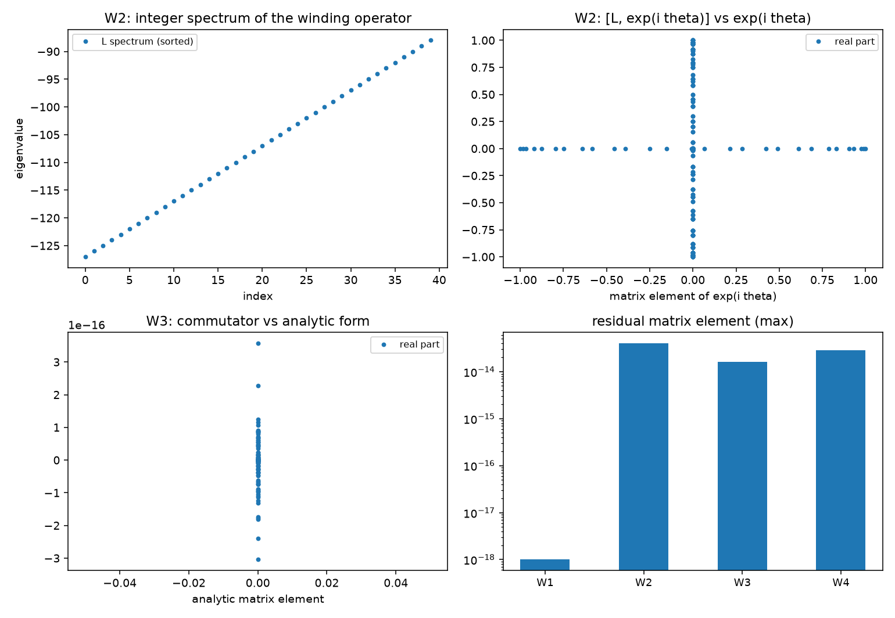

# 注记-扇区标签算符轮的最小验证：与写对易、整数谱与提升关系、对易子的选择定则

- **日期**：2026-09-19
- **对应脚本**：`验证脚本/sector_label_operator.py`（判据 W1 至 W6 共 7 项，7/7 通过；确定性，无随机数；运行约 1.3 秒；图存 `images/sector_label_operator.png`，见 §一 图 1）
- **依据**：[[验证脚本/注记-写入算符与绕数扇区相容性轮的最小验证：扇区封闭、标签可加、单体模固定、相位住关系层]]（第 139 条，P3-13 第一步）；[[验证脚本/注记-写入算符轮的最小验证：过轴即写、写即转移、反作用落在被采样对象]]（第 127 条）；[[内部草稿/开放问题总览：元相子理论待解决问题清单]] P3-13
- **状态**：判据 7/7 通过。核心读数：激发数标签与写算符的对易子严格为零；$\hat L$ 的谱为整数（偏离 $1.6\times10^{-13}$），提升关系在模空间内部成立（$4.0\times10^{-14}$，全空间偏差 $1.000$ 归因于最高模截断）；对易子在带限脉冲下等于解析式（$1.6\times10^{-14}$），反射奇性偏差 $2.8\times10^{-14}$，偶态一阶期望严格为零；写入时刻 $0.5000$ 对解析 $0.5000\,t_P$，相位宽度不变。

---

## 一、判据与结果

| 判据 | 内容 | 通过条件 | 实测 |
|---|---|---|---|
| W1 | 激发数标签与写对易 | 偏差 $< 10^{-14}$ | $0$（严格） |
| W2 | 提升关系（模空间内部） | 偏差 $< 10^{-12}$ | $4.0\times10^{-14}$ |
| W2 附 | 谱为整数 | 偏离 $< 10^{-12}$ | $1.6\times10^{-13}$ |
| W3 | 对易子等于解析式（带限脉冲） | 偏差 $< 10^{-12}$ | $1.6\times10^{-14}$ |
| W3 附 | 窄脉冲残差为分辨率效应 | 随点数下降 | $0.3207$ 降到 $0.2102$ |
| W4 | 对易子为奇且偶态一阶期望为零 | 偏差 $< 10^{-12}$ | $2.8\times10^{-14}$；期望 $0$ |
| W5 | 净绕数不变 | 偏差 $< 5\%$，宽度不变 | $0.5000$ 对 $0.5000\,t_P$；宽度同值 |
| W6 | 口径登记 | 见 §三 | 登记 |

图注：左上为 $\hat L$ 的谱（排序后为整数阶梯）；右上为 $[\hat L, e^{i\hat\theta}]$ 与 $e^{i\hat\theta}$ 的矩阵元对照（落在对角线上）；左下为对易子与解析式 ${\rm i} g f'(\hat\theta)\otimes$ 对换的矩阵元对照；右下为四条判据的残差量级（对数纵轴）。

## 二、模型设定

相位环取 $255$ 点（奇数，无奈奎斯特模），$\hat L = F^{\dagger}{\rm diag}(k)F$（$k$ 为整数角动量，$F$ 为归一化 DFT），激发数算符 $\hat N = {\rm diag}(0,1,1,2)$ 张量到相位环，写入取 $H_{\rm int} = g f(\hat\theta)\otimes(a^\dagger c + ac^\dagger)$，脉冲 $f(\hat\theta) = \exp[-(1-\cos\hat\theta)/(2w^2)]$，导数取 $f' = -\sin\hat\theta/(2w^2)\,f$。

对易子恒等式在带限脉冲 $f = 1 + 0.2\cos\theta - 0.05\cos 2\theta$ 上核；偶数环的奈奎斯特模、最高模截断与窄脉冲分辨率三处按 §四 处置。

## 三、读数的意义

**超选择成为算符陈述。** 激发数标签与写入算符的对易子严格为零（$0$），故写入不移动扇区标签。第 139 条把这条读作守恒量，本轮把它读作代数结构：标签算符与写在同一个空间里对易，超选择因此不再依赖口径。

**量子化与提升关系。** $\hat L$ 的谱为整数（偏离 $1.6\times10^{-13}$），提升关系 $[\hat L, e^{i\hat\theta}] = e^{i\hat\theta}$ 在模空间内部成立（$4.0\times10^{-14}$）。全空间偏差 $1.000$ 落在最高模上，那是格点截断的边界（该模在环上没有更高的伙伴），属实现细节。

**时钟受扰带选择定则。** 对易子取解析形式 $-{\rm i} g f'(\hat\theta)\otimes(a^\dagger c + ac^\dagger)$（带限脉冲下偏差 $1.6\times10^{-14}$），并在实轴反射下为奇（$2.8\times10^{-14}$），故偶态中的一阶期望严格为零。这条解释了此前几轮指针相位宽度变化 $+0.00\%$ 的来历：写入对时钟的作用是奇算子，对称波包的一阶受扰为零。

**净绕数不变。** 写入时刻等于折返时刻（$0.5000$ 对 $0.5000\,t_P$），相位宽度前后同值，与 W1 的对易子零合起来给出扇区标签的稳定。

**与 P3-13 的接口。** 扇区标签现有算符实现，其代数结构（整数谱、提升关系、与写对易、偶态一阶零受扰）就是 $S^1$ 约化时必须保留的四条。下一步是把这四条写成显式的约化构造，本条机制本身仍在。

## 四、过程记录

实现订正三处，都属格点效应。其一，环点首版取 $256$（偶数），奈奎斯特模使提升关系的全空间偏差为 $1.000$，改奇数点 $255$ 后该模消失。其二，提升关系与对易子恒等式在全空间都受最高模截断影响，判据限定在距顶三模以内的模空间内部。其三，物理窄脉冲（$w = 0.12$）的谱导数与点值导数相对残差 $0.3207$，随环点数加倍降到 $0.2102$，判为分辨率效应，恒等式的判定改用带限脉冲。

教训一条：格点上的算符恒等式先排除被截断的边界模，再谈物理内容；否则会把实现细节读成结构破坏。

效率记录：脚本约 $1.3$ 秒，无字体问题。
