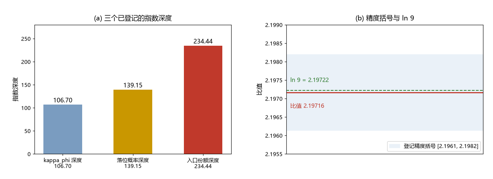

# 注记-指数深度比 2.197 的登记观察（第366条）：234.44、106.70 与 ln 9

- **日期**：2026-09-22 11:18:31
- **类型**：登记观察（数值核对 + 口径分析）
- **脚本**：`验证脚本/minimal_verification_depth_ratio_ln9.py`（第 366 条）
- **图**：见 §2 图 1（`images/depth_ratio_ln9.png`）
- **依据**：[[wiki/入口份额]]（$f$ 的深度 234.44）；[[验证脚本/注记-A 路前沿侧侦察（第362条）：前沿速度已知、宽度缺失]]（三深度登记处）；[[验证脚本/注记-κ_φ 必要性（第359条）：N1 极限清单与 N2 替代机制的读数复现要求]]（$S$ 的链）；[[验证脚本/注记-S 的机制候选（第360条）：四种指数抑制的参数量级与判句]]（$S$ 的机制目标）
- **状态**：观察成立；结构解释留待相变动力学给出 $f$ 后判定

## 1 观察对象与判据

对象：两个指数深度之比，即 $\ln(1/f)/\ln(1/S)$，与 $\ln 9$ 的关系。判据：其一，比值与 $\ln 9$ 的差；其二，两深度各自的输入分解；其三，精度括号；其四，与其余深度对的比较。

## 2 读数

$\ln(1/f) = 234.4375$，$\ln(1/S) = 106.7002$（$S$ 取 $\kappa_\phi^{(0)}t_P = 2.030$），比值 $2.19716$；$\ln 9 = 2.19722$，相对差 $2.9\times10^{-5}$。分解：

| 深度 | 分解 | 数值 |
| --- | --- | --- |
| $\ln(1/f)$ | $\ln[1/(n_bl_P^3)] - \ln(m_p/M)$ | $241.711 - 7.274 = 234.437$ |
| $\ln(1/S)$ | $2\ln(m_P/m_e) + \ln 6\pi + \ln(\kappa_\phi^{(0)}t_P)$ | $103.056 + 2.936 + 0.708 = 106.700$ |

## 3 精度括号

$2.9\times10^{-5}$ 这一数字用了重构出的指数 $106.7002$，而登记值是四位有效数字的 $106.7$。按 $[106.65,\ 106.75]$ 的括号，比值为 $2.1961$ 至 $2.1982$，$\ln 9$ 落在区间之内。诚实结论：属 $10^{-4}$ 级相容，不属 $10^{-5}$ 级命中；精度受指数本身的有效位数与裸耦合取值（$2.030$ 由 $S = e^{-106.7}$ 反解）限制。

## 4 两深度的输入分解：为什么现在接不上

$f$ 的深度主项是重子数密度与普朗克体积之比（$241.7$ 个自然对数单位），再减去质量比 $\ln(m_p/M)$；这一侧由宇宙学观测量（$\rho_b$ 与 $M$）主导。$S$ 的深度由电子与普朗克的质量层级 $2\ln(m_P/m_e)$ 加体系常数（$6\pi$、$\kappa_\phi^{(0)}$）主导。两侧共享普朗克标度，其余输入分属两个扇区，框架里没有任何机制把 $\rho_b$ 与 $\kappa_\phi$ 联系起来。这条联系正是缺失的 Kibble 缺陷密度计算（相变动力学 P8a 的未交付部分）。

## 5 两种读法与 9 的可能身份

读法一：多个独立输入之间的数值巧合。读法二：提示重子密度并不独立。若相变动力学算出 $f$ 且比值仍为 $\ln 9$，则该关系升级为结构陈述，等于把观测重子密度一并解释。若 $\ln 9$ 有结构来源，候选是 $9 = 3^2$ 与三元组轴数 $3$（$K = 3\kappa_\phi t_P$ 中的系数）的联系，可读作缺陷产额里带两重「三选一」条件。此读法目前为猜测，无推导。

## 6 纪律核对

现有三个深度之间的另外两对都不成形：$139.15/106.70 = 1.3041$，$234.44/139.15 = 1.6848$。同一批数字里只此一对干净，故值得登记；同时提醒，深度类数字增多后比值搜索本身会制造假阳性，本条按单对登记处理。

## 7 可执行检验

待相变动力学给出 $f$ 的预言值后执行：计算 $\ln(1/f)/\ln(1/S)$ 并与 $\ln 9$ 对表。检验是单向的：比值偏离即提示消散，比值保持则升级为结构关系。

## 8 严格程度与边界声明

严格程度：分解、比值与精度括号为算术（判据级）；结构解释为纲领级、未建立。边界：不改动任何定稿值，不裁 $S$ 的机制，不声称巧合已获解释。

## 9 过程记录

触发：作者要求把「234.4 与 106.7 之比等于 $\ln 9$」的观察写成独立注记。核对中发现两件事：其一，配比精度应按登记有效位数降级为 $10^{-4}$ 级相容；其二，两个深度的输入分解显示该关系跨越宇宙学与粒子两个扇区，须由 Kibble 计算判定。
