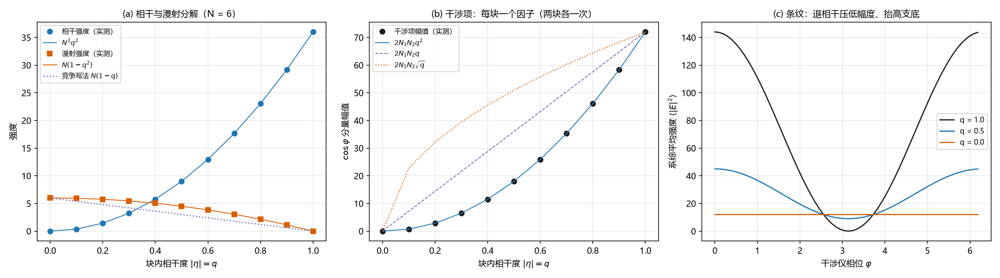

# 注记-振幅合成轮：宏观振幅 = 份额开方乘块内相干度

- **日期**：2026-09-17 04:11:03
- **对应脚本**：`验证脚本/amplitude_composition.py`（判据 AMP-1 至 AMP-6（含 AMP-5b），确定性，穷举系综精确求和，运行约 2 秒；图存 `images/amplitude_composition.png`，见 §一 图 1）
- **依据**：[[注记-振幅的集体起源：单体模固定与涌现振幅的分工]]（待做工作 1 与自标遗留 (g)）；[[序参量份额定理：Born规则、归一化与幺正性的系综推导]] §2.1 与 §4.1（$\eta_a$、$w_a$、$c_a$ 三个量的定义）；[[审查报告-D2XR论述审查：维数归属、面积-作用量子对应与半径自由度]] §10.6（半径自由度口径）
- **定位**：判定宏观振幅的集体载体取份额、取相干度还是取合成，并给出合成形式。判据把三种竞争写法并排对照：本脚本主张"宏观相干振幅 $= \sqrt{N_a/N}\,\eta_a$"，竞争写法 S1 取"相干度一次方进强度"（对应遗留 (g) 的 $|c_a|^2 = (N_a/N)|\eta_a|$ 写法）。本注记不改动基准文件。
- **状态**：判据 7/7 通过。核心读数：相干强度按 $|\eta|^2$ 走、漫射强度按 $1-|\eta|^2$ 走、总强度按二次律 $N + N(N-1)|\eta|^2$、干涉项每块贡献一个 $|\eta|$ 因子（两块退相干给 $|\eta|^2$、一块退相干给 $|\eta|$）、完全退相干时人数不变而相干增益归零。竞争写法 S1 的两条读数（漫射线性律、干涉幅值 $\sqrt{q}$ 型）被否。

---

## 一、判据与结果

| 判据 | 内容 | 通过条件 | 实测 |
|---|---|---|---|
| AMP-1 | 相干强度 $= N^2 q^2$ | 逐点（$q = 0$ 到 $1$ 共十一档） | 最大偏差 $8.5\times10^{-14}$ |
| AMP-2 | 漫射强度 $= N(1-q^2)$，对照 S1 的 $N(1-q)$ | 逐点 | 偏差 $1.2\times10^{-13}$；S1 偏差 $1.500$ 被否 |
| AMP-3 | 相干加漫射 $=$ 总强度 | 精确 | 偏差 $0$ |
| AMP-4 | 总强度 $= N + N(N-1)q^2$（二次律，对照 S1 线性律） | 逐点 | 最大偏差 $5.0\times10^{-14}$ |
| AMP-5 | 两块退相干时干涉幅值 $= 2N_1N_2 q^2$（对照 $\sqrt q$ 写法） | 逐点 | 偏差 $3.3\times10^{-12}$；$\sqrt q$ 偏差 $18.000$ 被否 |
| AMP-5b | 一块退相干一块相干时干涉幅值 $= 2N_1N_2 q$（每块一个因子） | 逐点 | 偏差 $8.9\times10^{-16}$ |
| AMP-6 | $q = 0$ 时每块强度 $=$ 人数，份额不变 | 精确 | $6.000$ 与 $6.000$；份额 $0.500$ |

## 二、模型与口径

$N = N_1 + N_2$ 个元相子分入两块；块内每个元相子的内相位取 $\pm\delta$（$\delta = \pi/2$），概率分别为 $(1+q_a)/2$ 与 $(1-q_a)/2$，于是块内相干因子 $\eta_a = i q_a$ 精确可算（$|\eta_a| = q_a$）。两块的共同相位差即干涉仪相位 $\varphi$。

物理场取每元相子一份单位振幅并按构型求和，全部 $2^N$ 个构型按其概率精确求和，无抽样、无近似。相干强度定义为系综平均场的模方 $|\langle E_a\rangle|^2$，漫射强度定义为方差 $\langle|E_a|^2\rangle - |\langle E_a\rangle|^2$（即相干加漫射的常规分解）。

## 三、主要读数

相干部分按相干度的平方走，漫射部分按 $1-|\eta|^2$ 走。两者之和精确复原总强度，且总强度对相干度是二次律 $N + N(N-1)|\eta|^2$，其中 $N$ 是"人手一份"的底、$N(N-1)|\eta|^2$ 是相干增益。

干涉项按"每块贡献一个 $|\eta|$ 因子"走：两块都退相干给 $q^2$，一块退相干一块相干给 $q$。这条读数决定了振幅的正确幂次：相干度以一次方进入振幅、以二次方进入强度。

完全退相干时，每块的强度仍等于它的人数（"人还在，只是站不齐"），份额不变；相干增益项归零。

与竞争写法的对照集中为两条：把相干度写成一次方进强度（遗留 (g) 的写法），会给出漫射的线性律 $N(1-q)$ 与干涉幅值的 $\sqrt q$ 型，两条都与实测差得远（偏差 $1.500$ 与 $18.000$）。

## 四、结论

宏观振幅取合成，形式为相干振幅
$$A_a = \sqrt{N_a/N}\,\eta_a,$$
其模方等于相干份额 $(N_a/N)|\eta_a|^2$。统计幅度 $c_a = \sqrt{N_a/N}\,e^{i\tilde\Phi_a}$ 保持原义，其模方为份额且与相干度无关，这是 Born 层的读数（AMP-4 与 AMP-6 的"人数底"）。

由此对 [[注记-振幅的集体起源：单体模固定与涌现振幅的分工]] 的两项内容给出答复。待做工作 1（载体取其一还是取合成）：取合成，且形式为"统计幅度乘块内相干因子"，两个候选各有其层，不相争。自标遗留 (g)（部分相干形态的桥梁）：建议把写法 $c_a = \sqrt{|w_a|}\,e^{i\arg w_a}$（模方 $(N_a/N)|\eta_a|$）改为"相干振幅 $= c_a\,\eta_a$"，因为前者的模方把相干度放进了概率权重，与本轮两条被否读数一致。该更正属作者名下文本，已于 2026-09-17 按作者指令执行（[[序参量份额定理：Born规则、归一化与幺正性的系综推导]] §4.1、修订记录与 §10 (g)，以及《研究方向-振幅开方映射的严格化》更正执行稿）。

## 五、严格程度声明

穷举系综、精确求和，无随机数、无抽样；判据为逐点相等。两值相位模型只是使读数可枚举的代表：相干强度等于平均场模方、漫射强度等于方差、干涉项每块一个相干因子，这三条对独立同分布的相位分布形状不敏感（相干因子只以其模与相位进入）；$N(1-|\eta|^2)$ 的闭式依赖块内独立同分布。

## 六、边界声明

本注记验证模型层（两值内相位、两块、单位每粒子振幅）的相干与漫射分解、总强度幂次、干涉项因子数与退相干极限。

不验证：具体物理场量（电磁场、波函数）的绝对标定；非阿贝尔模式与多块推广；连续谱极限（份额稠密化）；与实验可见度数据的对照；机制层的涌现推导（从固定模单体集合与相位分布导出局部振幅场，即该注记待做工作 2）。

## 七、过程记录

判据一次通过，无预期修正。一处文本修正：脚本文档串残留草稿字样（"hmm 不作近似"）已改为正式表述，读数未变。

## 八、登记衔接

本轮登记：`验证脚本/README.md` 第 82 条；[[开放问题总览：元相子理论待解决问题清单]] P4-39（单体模与集体振幅的定位）补一轮；[[注记-振幅的集体起源：单体模固定与涌现振幅的分工]] 补 2026-09-17 更新行。

注记、脚本、登记三者一致；本注记不改动 `理论总纲/` 基准，方案定案由作者裁决。
