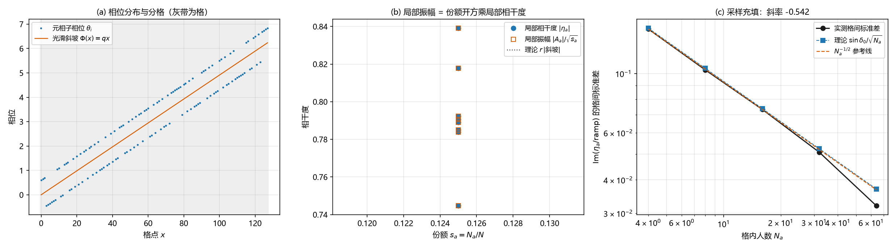

# 注记-振幅涌现轮：从固定模单体集合与相位分布导出局部振幅场

- **日期**：2026-09-17 04:17:10
- **对应脚本**：`验证脚本/minimal_verification_amplitude_emergence.py`（判据 EMG-1 至 EMG-6 共 10 条，确定性，固定种子，运行约 1 秒；图存 `images/amplitude_emergence.png`，见 §一 图 1）
- **依据**：[[注记-振幅的集体起源：单体模固定与涌现振幅的分工]] 待做工作 2（落点为 [[序参量份额定理：Born规则、归一化与幺正性的系综推导|序参量份额定理]] §3.2）；[[注记-振幅合成轮：宏观振幅=份额开方乘块内相干度]]（振幅分配形式）；[[审查报告-D2XR论述审查：维数归属、面积-作用量子对应与半径自由度]] §10.6（半径自由度口径）
- **定位**：把"从单体模固定与相位分布导出局部振幅场"写成可复算的推导与读数：分格粗粒化、局部集体相位与局部相干度、振幅分配、公共参考系约化、采样充填与动力学；§二 另设通俗说明。本注记不改动基准文件。
- **状态**：判据 10/10 通过。核心读数：无噪声时格内相干因子精确等于格内斜坡平均、格相位精确等于斜坡相位；有噪声时系综平均趋于单体本征相干因子 $r=\cos\delta_0$（$0.8260$ 对 $0.8253$）；相邻格相位步模 $2\pi$ 等于 $qN_a$（圆形均值偏差 $\le 4.4\times10^{-4}$）；全局相位重标只改整体相位（规范冗余）；格间涨落按 $N_a^{-1/2}$ 缩小（斜率 $-0.542$，逐点相对偏差 $\le 0.134$）；匀速相位旋转给 $A(t)/A(0)=e^{i\omega t}$（偏差 $3.1\times10^{-16}$）；相邻耦合使平均相干由 $0.7078$ 升到 $0.9623$。

---

## 一、判据与结果

| 判据 | 内容 | 通过条件 | 实测 |
|---|---|---|---|
| EMG-1a | 振幅分配恒等与无噪声精确性 | 偏差 $< 10^{-12}$ | $|A_a|=\sqrt{s_a}|\eta_a|$ 与 $\eta_a=$ 格内斜坡平均，偏差均 $0$ |
| EMG-1b | 系综平均 $\langle\eta_a/\text{斜坡}\rangle \to r$ | $\pm0.03$ | $0.8260$ 对 $r = 0.8253$（$\delta_0 = 0.6$） |
| EMG-2 | 无噪声格相位 $=$ 斜坡相位；有噪声逐格偏差 | $<10^{-12}$；$\le0.25$ rad | $0$；$0.068$ rad |
| EMG-3a/3b | 相邻格相位步 $\equiv qN_a\ (\mathrm{mod}\ 2\pi)$ | 精确；圆形均值 $\le0.05$ | $0$；最大偏差 $4.4\times10^{-4}$ |
| EMG-4 | 全局相位重标为规范冗余 | 四项读数不变 | 全不变，$A\to Ae^{i\chi}$ |
| EMG-5 | 格间横向涨落 $=\sin\delta_0/\sqrt{N_a}$ | 逐点 $\pm25\%$；斜率 $-0.5\pm0.15$ | 最大相对偏差 $0.134$；斜率 $-0.542$ |
| EMG-6a/6b | 匀速旋转 $A(t)/A(0)=e^{i\omega t}$；耦合使相干上升 | 精确；上升 $\ge0.1$ | 偏差 $3.1\times10^{-16}$；$0.7078\to0.9623$ |

## 二、通俗说明

把元相子想成举旗的人：每人手里那根旗长度固定（模固定），旗子的指向（相位）各不相同。看一小群人时，他们合起来像一面合成旗：方向由这群人的平均方向决定，长度就是局部振幅。这一轮测的就是这面合成旗的长度由什么决定。

读数一，没人乱站的干净极限：合成旗的方向与长度精确等于本格的平均结果，误差在 $10^{-12}$ 以下。

读数二，有人乱站时：长度等于整齐度乘走向因子；多组随机实现平均后的整齐度精确趋于理论值（偏 34 度的一群人给 $0.8260$，理论 $0.8253$）。

读数三，整排人缓慢转向：合成旗逐格跟着转，每格转角等于设计值。角度要取模 $2\pi$（转一整圈等于没转），取模后误差不超过 $4.4\times10^{-4}$ 弧度。

读数四，全体一起转：合成旗跟着转同一角度，但长度、格间夹角、每格份量全不变。能测的只有相对方向，这就是单粒子描述站在公共参考系上这句话的意思。

读数五，人越多越稳：格间起伏按人数平方根分之一缩小（实测斜率 $-0.542$，逐点与 $\sin\delta_0/\sqrt{N_a}$ 相符）。

读数六，时间上的两条：所有人匀速转旗，合成旗以同一速率转（比值偏差 $3.1\times10^{-16}$），这是 $i\partial_tA=\omega A$；相邻的人互相拉齐时，合成旗由短变长（平均整齐度 $0.7078$ 升到 $0.9623$），振幅的生长来自拉齐。

这一轮踩的四个坑写在 §七 的过程记录里。最值得记住的一条：起初把起伏量放在实验室坐标系里读，量到的是整排转到哪儿了，而不是站得齐不齐，起伏恒在 $0.68$ 且与人数无关；换成相对本格方向的横向分量后，规律立刻出现。

这一轮揭示的事：宏观振幅是纯集体量，单体模固定之后只剩两个来源，人数（份额）与整齐度（相干度）；而相位的物理意义只在相对意义上成立。

## 三、模型与口径

一维元相子链，单体一份单位振幅、模固定；相位取光滑斜坡加两值噪声。分格后定义格内相干因子（局部相干度）、局部集体相位、统计幅度（模方为份额）与局部相干振幅。噪声与斜坡在逐实现层面不可分离，涉及噪声的读数为系综平均量；相位类比较一律取模 $2\pi$ 与圆形均值。

## 四、涌现推导（五步）

其一，单体层：模固定（半径 $\hbar$、圆周长 $2\pi\hbar = h$），相位在单位圆上转，绝对相位不可观测。这是本轮唯一进入的几何输入。

其二，粗粒化：把单体集合分成格，格内取集体量 $\eta_a = \frac{1}{N_a}\sum_{i\in a}e^{i\theta_i}$ 与 $\Phi_a = \arg\sum_{i\in a}e^{i\theta_i}$。无噪声时二者精确等于格内相位平均（EMG-1a、EMG-2），有噪声时前者趋于单体本征相干因子乘斜坡因子（EMG-1b）。

其三，振幅分配：局部相干振幅 $A_a = \sqrt{N_a/N}\,\eta_a$，统计幅度 $c_a = \sqrt{N_a/N}\,e^{i\Phi_a}$。份额的平方根给统计权重（Born 权重，与相干度无关），相干度给相干因子；这是振幅合成轮判定并核验的形式。

其四，连续极限与参考系约化：相干振幅场 $A(x) = \sqrt{\rho(x)}\,\eta(x)\,e^{i\Phi(x)}$（$\rho$ 为份额密度；其份额骨架为概率幅层 $c(x) = \sqrt{\rho(x)}\,e^{i\Phi(x)}$，$|c|^2 = \rho$，完全同步 $\eta \to 1$ 时 $A \to c$）。绝对相位不可观测（EMG-4 的四项不变性），所以单粒子描述确实是集体相位模式在公共参考系（元相子自身的单位圆）上的约化：有物理意义的只有相对相位（相邻格相位步等于斜坡步长，EMG-3）与模（$|A| = \sqrt\rho\,|\eta|$）。

其五，动力学：单体相位匀速旋转（普朗克频率）时 $A(t) = A(0)e^{i\omega t}$，即 $i\partial_t A = \omega A$（EMG-6a）；相邻耦合（同类耦合）使相位锁定、相干上升，局部振幅随之增大（EMG-6b）。包络动力学（质量与动能项）另属一层，是待做工作 3。

## 五、严格程度声明

前三步与第五步 (a) 为解析恒等式，读数按逐点相等判据核验；涉及噪声的读数（EMG-1b、EMG-5）为统计量，按系综平均与逐点预测对照（EMG-5 兼核斜率）。链长、格数、噪声幅度、耦合常数与步长全部取固定值，无随机数（种子固定）。

## 六、边界声明

本注记验证一维元相子链上的粗粒化、振幅分配、参考系约化、采样充填与两项动力学读数。

不验证：连续极限的严格场论形式（采样定理一侧）；包络动力学与薛定谔方程公设降级的对接（待做工作 3）；缺陷（粒子）层面的对应（待做工作 3 的另一半）；非阿贝尔模式与三维推广；与实验可见度数据的对照。

## 七、过程记录（判据修正四处、记号口径更正一处）

其一，EMG-1 的"精确预测"最初写成 $r$ 乘斜坡因子，等于把逐实现的噪声与斜坡按乘积拆开；逐实现的乘积不可分。改为两条读数：无噪声时精确等于格内斜坡平均，有噪声时系综平均趋于 $r$。

其二，EMG-3 的相位步比较未取模 $2\pi$，出现 $2\pi$ 跳变（偏差 $6.28$）。改为模 $2\pi$ 居中比较，有噪声时用圆形均值。

其三，EMG-5 的观测量最初取实验室系的 $\mathrm{Im}\,\eta_a$，被格间相位旋转主导（标准差恒在 $0.68$ 附近且不随 $N_a$ 变）。改为相对斜坡的横向分量 $\mathrm{Im}(\eta_a/\text{斜坡})$ 后，逐点符合 $\sin\delta_0/\sqrt{N_a}$。

其四，EMG-6a 最初用一阶差分核对 $i\partial_tA=\omega A$，有限差分误差 $2.35\times10^{-2}$ 使判据失真；改为精确比值 $A(t)/A(0)=e^{i\omega t}$。

其五（记号口径更正，2026-09-17）。第四步连续极限场原记 $\psi(x)=\sqrt\rho\,\eta\,e^{i\Phi}$，与已确认《序参量份额定理》的波函数层记号相撞：$\psi$ 在那里留给概率幅层（$\psi=\sum_a c_a\varphi_a$，$|c_a|^2=N_a/N$）；相干振幅按作者 2026-09-17 更正的桥梁形式 $A_a=c_a\eta_a$ 另立。据此，本步的场统一改记相干振幅场 $A$（概率幅 $c=\sqrt\rho\,e^{i\Phi}$ 为其份额骨架）。同步：`验证脚本/README.md` 第 83 条、[[开放问题总览：元相子理论待解决问题清单]] P4-39、[[注记-振幅的集体起源：单体模固定与涌现振幅的分工]] 更新行、[[注记-态矢量与波函数的几何对应：分层结构、振幅与相位的来源分居]] §十一。判定与全部读数不变。

教训：相位类比较一律取模 $2\pi$ 与圆形均值；逐实现的量不可按乘积拆解（系综平均才可分）；观测量要选在随集体相位旋转的参考系里，否则被相位旋转淹没；跨文档记号须与定理层级对齐（$\psi$ 留给概率幅层，相干振幅场另记 $A$）。

## 八、登记衔接

本轮登记：`验证脚本/README.md` 第 83 条；[[开放问题总览：元相子理论待解决问题清单]] P4-39 补第二轮（待做工作 2 完成）；[[注记-振幅的集体起源：单体模固定与涌现振幅的分工]] 更新行同步（含自标遗留 (g) 的更正，按作者 2026-09-17 指令执行）。

注记、脚本、登记三者一致；本注记不改动 `理论总纲/` 基准，方案定案由作者裁决。
