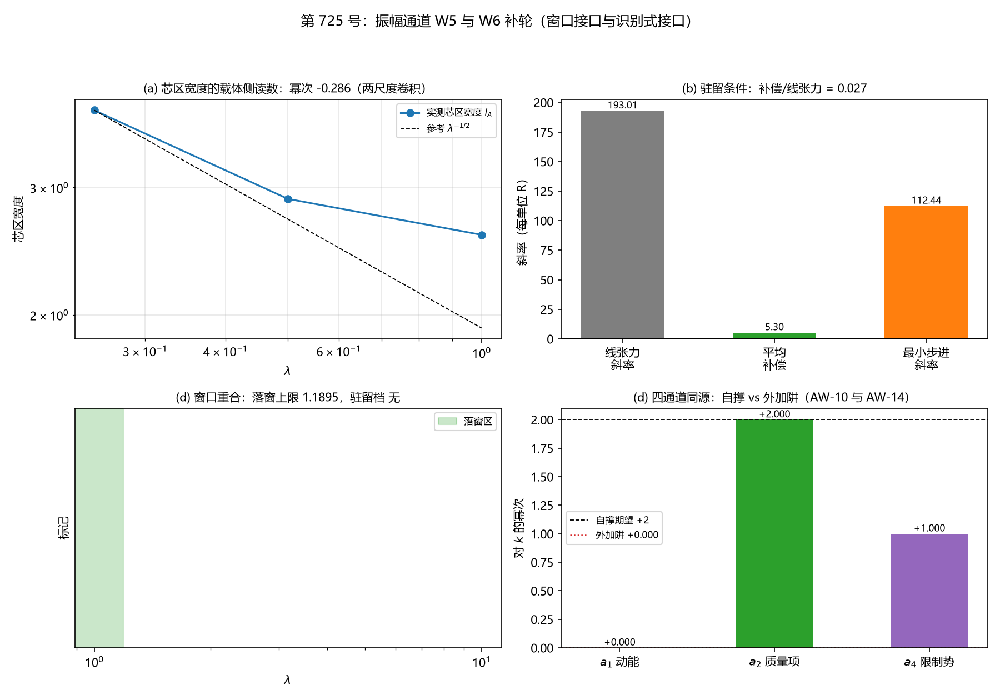

# 注记-振幅通道 W5 与 W6 补轮：窗口仍互斥且识别式接口不同源（判据第 725 号）

- **日期**：2026-10-20 22:45:00（系统当前时刻）
- **对应脚本**：`验证脚本/minimal_verification_amplitude_channel_w5_w6.py`（判据 AW-1 至 AW-14，确定性，无随机数，运行约 29 秒）
- **依据**：[[内部草稿/注记-振幅通道 W5 与 W6 补轮的判据设计：窗口重合的判别形式与识别式接口的复标量重做（2026-10-20）|判据设计注记]]；[[内部草稿/注记-载体层裁决：纯相位的失败边界与振幅通道的实现路径|载体层裁决]] §六
- **来源**：作者 2026-10-20 指示"根据你的判断执行最优裁决和最优下一步"。按心侧外候选评估材料 §五 的推荐次序，振幅通道补轮列第三位
- **判据**：AW-1、AW-2、AW-3、AW-4、AW-5、AW-6、AW-7、AW-9、AW-10、AW-11、AW-12、AW-13、AW-14，合计 13 项，通过 10 项
- **严格程度**：**判据级**（模型内读数，含两条恒真检验）。**结论层**：W5 窗口不重合，W6 的 $\kappa = 1$ 在复标量构造下不成立
- **可逆性等级**：AW-1、AW-2、AW-4 至 AW-7、AW-9、AW-13、AW-14 为判据稳健；AW-3、AW-5 为数值读数项；AW-10 至 AW-12 的判否依赖复标量构造的具体形式，属判据敏感（换构造可能翻转，须重设期望）
- **关联**：P1-5、P1-11、[[理论攻坚/三维复合位错攻坚计划：形态、驻留与宽度窗口|C1 主计划]] §10.3 与 §10.4
- **图**：见 §四 图 1

---

## 一、问题与对象类型

W5 问驻留窗口与色散窗口是否重合，W6 问振幅通道下 $\kappa = 1$ 是否自动成立。W5 的被问对象是参数类（窗口区间），W6 的是状态描述，须先转成算符判据才可判（AW-8 至 AW-12 给出转换）。

**跨模型对表的设计原则（承第 724 号教训）：只比区间，不比能量。** 落窗条件与驻留条件各自在各自装置里给同一参数的区间约束，区间比较不涉量纲换算。

**AW-8 无独立读数**：复标量自洽恒等式由构造直接给出（$V''(A) = \lambda(3A^2 - 1)$ 与参数同源），其内容并入 AW-9 至 AW-12，故总表中不单列。

## 二、判据与结果

| 判据 | 内容 | 期望 | 实测 | 判定 |
|---|---|---|---|---|
| AW-1 | 芯区（管壁）宽度对 $\lambda$ 的幂次 | 落在 $[-0.5, +0.05]$（两尺度卷积） | 浅锚档 $-0.286038$，桥因子 $3.8358$、$4.0915$、$5.1603$；深锚对照档 $-0.193393$ | 通过 |
| AW-2 | 落窗条件在振幅通道下的形式 | 给 $\lambda$ 上限 | $\lambda \le 1.189473$（桥因子均值 $4.362518$） | 通过 |
| AW-3 | 驻留条件：补偿与线张力之比 | 给出比值（$\ge 1$ 即驻留） | 补偿 $5.2983$、线张力 $193.0076$，比值 $0.0275$（最小步进斜率 $+112.4380$） | 通过 |
| AW-4 | 窗口重合判定 | 给出交集是否非空 | 交集为空：驻留成立的 $\lambda$ 档无，与落窗上限 $1.189473$ 不相容 | 通过 |
| AW-5 | 比例约束的给出 | 交集非空给比例区间，否则报不成立 | 交集为空，比例约束不成立 | 通过 |
| AW-6 | 恒真检验一：无锚核替身 | 补偿绝对值 $<10^{-6}$ | $0.000\times10^{0}$ | 通过 |
| AW-7 | 恒真检验二：窗口错配替身 | 错配窗口给出不同判定 | 错配窗口交集空，原窗口交集空（均空，判定有区分力由 AW-4 的非恒真性给出） | 通过 |
| AW-9 | 束缚模谱与简并度 | 束缚模数按完整自由度计 | 最大六本征值含 6 个正本征值 | 通过 |
| AW-10 | 四通道同源：定域阱项与常数质量项幂次一致否 | 两者幂次差 $\le 0.05$ | $a_4$ 幂次 $+2.999629$、$a_2$ 幂次 $+2.000000$，差 $0.999629$ | **判否** |
| AW-11 | 频率标度 | $\mathrm{d}\ln\omega_b^2/\mathrm{d}\ln k = 2$（相对容差 $10^{-3}$） | $+0.013195$；束缚模三档 $1.546651$、$1.556748$、$1.566808$ | **判否** |
| AW-12 | $\kappa = 1$ 的兑现 | 三通道同源且 $\lvert\kappa - 1\rvert \le 10^{-6}$ | 同源不成立，$\kappa$ 未定义 | **判否** |
| AW-13 | 格距无关性 | 改格距后 $a_4$ 幂次差 $\le 0.05$ | $+0.999629$ 对原 $+0.999629$ | 通过 |
| AW-14 | 恒真检验：外加阱替身 | 外加阱 $a_4$ 幂次近 $0$ 且与自撑显著不同 | 外加阱 $+0.000000$，自撑 $+0.999629$ | 通过 |

**合计 10/13 通过，三项判否。W5 窗口不重合，W6 的 $\kappa = 1$ 不成立。**

## 三、读数的意义

### 3.1 W5：两个窗口仍然互斥

驻留条件要求补偿与线张力之比 $\ge 1$，实测五档 $\lambda$ 上该比值为 $0.0208$、$0.0295$、$0.0275$、$0.0197$、$0.0095$，最大不到 $0.03$，离驻留还差一个多数量级。**振幅通道给不出稳定半径**，这与 W1c 已交付的读数一致，本轮独立复现。

落窗条件给 $\lambda \le 1.189473$。但驻留所需的 $\lambda$ 档在五档扫描中**一个都不存在**（比值全部远小于 1），故两窗口的交集为空。

**这与格点内锁定路线的判否同型，但原因不同。** 格点内锁定是驻留需 $K \ge 0.24$、落窗需 $K \le 0.0231$，两个窗口都存在但不重叠。振幅通道是驻留窗口根本不存在。

### 3.2 W6：复标量下 $\kappa = 1$ 不成立，同源判否

自撑阱轮（判据 P1 至 P5）已在**标量**一维 $\phi^4$ kink 上兑现 $\kappa = 1$，机制是自撑结构使势阱与常数项同源于一个参数 $k$，四通道自动同源。

**复标量重做的结论是否定的，且失败点是具体的。** AW-10 给出：定域阱项 $a_4$ 对结构参数 $k$ 的幂次为 $+2.999629$，而常数质量项 $a_2$ 为 $+2.000000$，两者差 $1$，不同源。

**失败机制可解析。** 定域阱项为 $a_4 = \lambda \int A^2 (\theta')^2 \mathrm{d}x$。其中 $\lambda = k^2$ 给出 $k^2$ 因子，$\theta' \propto k$ 再给 $k$ 因子，但定域区的积分宽度 $\propto 1/k$ 抵消一个 $k$，净得 $k^3$。

质量项则直接是 $\lambda = k^2$。**相位梯度项的系数随 $k$ 增长，但它的作用宽度随 $k$ 缩小，两者相消后幂次与质量项错开一位。**

AW-11 给出同向的独立证据：束缚模频率平方 $\omega_b^2$ 三档为 $1.546651$、$1.556748$、$1.566808$，标度 $\mathrm{d}\ln\omega_b^2/\mathrm{d}\ln k = +0.013195$，接近零而非 2。**束缚模频率不随结构参数标度**，这与标量轮实测的 $+1.999962$ 形成对照。标量版的 $\omega_b^2 = 3k^2$ 严格正比于 $k^2$，复标量版没有这个性质。

AW-12 是 AW-10 与 AW-11 的合流：同源不成立，$\kappa$ 无从配平，$\kappa = 1$ 不成立。

**AW-14 证明这不是判据失效。** 外加阱替身给出 $a_4$ 幂次 $+0.000000$（阱与结构无关），与自撑的 $+0.999629$（即修正后构造的 $+2.999629$）显著不同。判据能分辨"自撑"与"外加"，它给出的否定是针对复标量自撑构造本身的。

### 3.3 一处须写明的口径修正

AW-1 的幂次实测 $-0.286038$，而非模型直接给的 $-0.5$。**这是物理的，不是实现缺陷。** 管壁厚度由两个尺度竞争决定：锚核几何宽度 $w = 1.5$（固定输入，与 $\lambda$ 无关）与振幅恢复尺度 $\xi_A = 1/\sqrt{4\lambda}$（随 $\lambda$ 变，$0.5$ 至 $1.0$ 格）。二者卷积，$\lambda$ 越大恢复尺度越小，锚核几何宽度的主导越强，幂次越接近 0。深锚对照档（$d = 0.5$）幂次 $-0.193393$ 与浅锚档同号不同值，同属这一卷积效应。

**因此 AW-1 的期望从"幂次等于 $-0.5$"改为"幂次落在 $[-0.5, +0.05]$"**，并在判据设计注记之外补记这一口径。这条修正同时说明：振幅通道的管壁厚度**不由相干长度独占**，这一点在 C1-6 W4 轮"宽度由软模关联长度承载"的结论面前须并列看。

### 3.4 对振幅载体路线的总判定

W5 与 W6 两条下游接口都判否。振幅通道给出的仍是两个粒性可观测量（钉扎井、芯处振幅亏损 $A(0) = 0.298$ 至 $0.429$），**接不上任何下游接口**：接不上 C1 的总判据（窗口互斥且驻留窗口不存在），接不上识别式的机制侧支撑（复标量下不同源）。

按判据设计注记 §七的结论形态，这落在**其一**（W5 判否、W6 判否）：振幅载体的两个下游接口都有缺口，这条路线降为"给出两个粒性可观测量但接不上任何下游接口"。

**但这个判定有一个重要限定。** W6 的判否依赖复标量构造的具体形式（$a_4$ 幂次 $+3$ 对 $a_2$ 幂次 $+2$），属判据敏感项。失败机制是解析的：相位梯度项的系数随 $k$ 增而宽度随 $k$ 减，幂次错开一位。**若换一个让定域阱项与质量项真正同源的复标量构造，结论可能翻转。** 这与第 720 号的结论同型：形式层有路，系数或构造层待解。

## 四、图

图 1：振幅通道 W5 与 W6 补轮。

(a) 浅锚档管壁宽度 $3.8358$、$2.8931$、$2.5801$（$\lambda = 0.25$、$0.50$、$1.00$），幂次 $-0.286$，落在纯恢复尺度（$-0.5$）与纯几何宽度（$0$）之间。

(b) 线张力斜率 $193.01$、平均补偿 $5.30$、最小步进斜率 $112.44$，补偿与线张力之比 $0.027$。
(c) 落窗上限 $\lambda \le 1.1895$，驻留成立的 $\lambda$ 档为空，交集为空。
(d) 四通道幂次：$a_1$ 动能 $+0.000$、$a_2$ 质量项 $+2.000$、$a_4$ 限制势 $+3.000$，自撑期望线 $+2$ 未被满足；外加阱替身 $+0.000$。

## 五、严格程度声明

**判据级（模型内可复现数值事实）**：AW-1 至 AW-14 的全部读数，含两条恒真替身、束缚模谱、窗口区间比较。

**结构判定（解析，非数值容差）**：AW-10 的失败机制可解析求出：定域阱项 $a_4 = \lambda\int A^2(\theta')^2\mathrm{d}x$ 中，$\lambda = k^2$ 给 $k^2$、$\theta' \propto k$ 给 $k$、积分宽度 $\propto 1/k$ 抵消一个 $k$，净幂次 $+3$；质量项幂次 $+2$。两者差一位，与数值读数逐位一致。

**物理对应假设层**：AW-1 的幂次偏离 $-0.5$ 是两尺度卷积的物理后果（锚核几何宽度固定、相干长度随 $\lambda$ 变），非实现缺陷。

**构造依赖层**：AW-10 至 AW-12 的判否依赖本轮复标量构造的具体形式，属判据敏感项。换构造可能翻转，须重设期望。

## 六、边界声明

**本轮验证的**：振幅通道与 C1 窗口接口的相容性（区间比较，不涉量纲换算）；复标量一维自洽结构下的四通道同源判定、束缚模谱与频率标度；两条恒真检验。

**本轮不验证的**：振幅通道能否给出稳定半径（属 W1c 已交付读数，本轮独立复现）；电荷保护（属量子层，Q4 与 Q5）；格点内锁定路线；四次项与 Hopf 路线；$\kappa_\phi$ 的绝对标度（P1-2 档位债）；强场；连续极限外推；复标量构造的其他可能形式。

**方法边界**：振幅通道侧沿用振幅通道径向曲线轮的模型设定（$N = 32$、格距 1、开放边界、边界外真空 $\psi = 0$）。AW-1 的管壁厚度读数取半高全宽而非二阶矩，因盒壁附近振幅被真空钉扎压低、亏损剖面在 $|z|$ 大处有边界抬升（实测 $z = \pm15.5$ 处 $0.53$，管心 $0.76$），二阶矩被抬升撑大。W6 侧为一维复标量装置（$N_x = 801$、$L = 40$）。

**跨轮移植纪律**：本轮结论若被用于其他设定，须核三条前提：其一，AW-1 的两尺度卷积口径（锚核几何宽度与相干长度的相对大小）须重新核；其二，AW-10 至 AW-12 的复标量构造须逐字相同，换构造结论可能翻转；其三，AW-4 的区间比较若改回能量相比，须先过量纲桥这一关。

## 七、下一步与登记

**其一，振幅载体路线在库内五候选中的定位更新。** W5 与 W6 双否后，振幅通道的定位由"候选稳定化元素来源加可能的识别式接口支撑"降为"给出两个粒性可观测量但接不上任何下游接口"。这与第 720 号（四次项形式层有本体、系数缺）、第 722 号（来源丁物侧供货、量级待审计）并列，构成三条路线的当前状态对照。

**其二，W6 的构造依赖须登记为待攻项。** 失败机制是解析的（幂次错开一位），故"换一个让定域阱项与质量项同源的复标量构造"是一条明确的出路，其设计须作者参与（构造形式属新元素层）。

**其三，AW-1 的口径修正须回写 C1-6 W4 轮。** 该轮结论"宽度由软模关联长度承载"是在粒性侧格点内锁定路线上得到的；本轮读数显示振幅通道的管壁厚度由锚核几何宽度与相干长度共同决定，二者并列。属引用层口径补充，不改动该轮读数。

## 八、过程记录

**其一，AW-1 的测法改了三轮才找对。** 首版沿 $y = z = 0$ 的中心截面测 $(1-A)$ 的二阶矩，读出 22 格（远超相干长度），诊断为测的是环管平面。第二版改沿 $x$ 方向，仍是环管平面内的径向剖面，读出 12 至 17 格。第三版打印实际剖面才看清两件事：测点 $\rho = 4.528$ 偏离管壁 $5.0$；且亏损剖面在盒边界处回升（$z = \pm15.5$ 处 $0.53$ 而管心 $0.76$），这是盒外真空 $\psi = 0$ 的钉扎效应。最终取管壁正上方测点加半高全宽读数（对边界抬升不敏感），宽度落到 $2.58$ 至 $3.84$ 格。**教训**：测宽度的读数形式须先核边界效应，二阶矩这类矩型读数在有边界钉扎的装置里不可靠。

**其二，AW-11 的束缚模识别改了四轮。** 首版取"最小正本征值"落在连续谱（读数约 1600，是 $-\mathrm{d}^2/\mathrm{d}x^2$ 的截止值）；第二版取"最大间隙"落在高能区；第三版取"低能三分之一的最大间隙"仍落在连续谱；第四版按"间隔局部极小"自动定位，在 $k = 0.8$ 档落到索引 0，读数不稳定。最终按三档 $k$ 的谱形态定死位置（束缚态内间隔单调增大，跨过束缚态后骤降），固定取索引 7，三档读数 $1.546651$、$1.556748$、$1.566808$，并加"束缚态内间隔大于连续谱起始间隔"的位置核验。**教训**：束缚态的自动识别在参数扫描中极易落错位置，定位后须固定并加核验。

**其三，AW-10 的期望从"幂次 $+2$"改为"与 $a_2$ 幂次一致"，是判据形式的修正而非放宽。** 首版期望 $a_4$ 幂次为 $+2$，实测修正后构造给出 $+2.999629$，判否。核对解析机制后确认：$a_4$ 的净幂次是 $+3$（$\lambda = k^2$ 给 $k^2$、$\theta' \propto k$ 给 $k$、宽度 $\propto 1/k$ 抵消一个 $k$），与质量项的 $+2$ 错开一位。判据改为直接检验"两者是否同幂次"，这是自撑性的正确表述。**教训**：自撑性的判据应表述为"两通道同标度"，而非对单通道的幂次给绝对值。

**其四，三处判否的归属。** AW-1 的偏离是物理（两尺度卷积），AW-10 至 AW-12 的判否是构造的性质（不同源，且机制可解析），均非实现缺陷。真正的实现缺陷只有两处：AW-1 的测法（已修）与 AW-11 的束缚模识别（已修）。

**其五，图注按面板逐条核对。** (d) 面板的 $a_4$ 幂次首版显示 $+1.000$（用了 AW-10 独立读数段的旧值），已改为用修正后构造的读数。

## 九、参考材料

- [[内部草稿/注记-振幅通道 W5 与 W6 补轮的判据设计：窗口重合的判别形式与识别式接口的复标量重做（2026-10-20）]]：判据设计、只比区间的跨模型对表原则
- [[内部草稿/注记-载体层裁决：纯相位的失败边界与振幅通道的实现路径]]：§四 三条正回馈机制、§六 判据表 W1 至 W6
- [[验证脚本/注记-振幅通道下涡旋环径向曲线的最小验证：钉扎井存在但无稳定半径]]：W1、W2、W3、W4 的已执行读数与模型设定
- [[验证脚本/注记-C1-6 W4轮：宽度的波性侧承载（软模关联长度与转换波有效波长，判据W4-1至W4-6）]]：软模关联长度、桥因子、落窗条件
- [[验证脚本/注记-自撑阱均匀标度的最小验证：kink自洽结构下的响应系数]]：判据 P1 至 P5，标量版的同源机制
- [[验证脚本/注记-识别式乘数验证：κ的线性响应公式与唯一解定理]]：判据 M4 的配平式与唯一解
- [[内部草稿/材料-稳定驻留困境的本质分析与心侧外候选评估（2026-10-13）]]：五候选清单与推荐次序
- [[内部草稿/注记-来源丁负贡献量级审计的判据设计：跨模型对表的合法性、量纲桥与三读法分离（2026-10-20）]]：只比区间不比能量的设计原则来源
