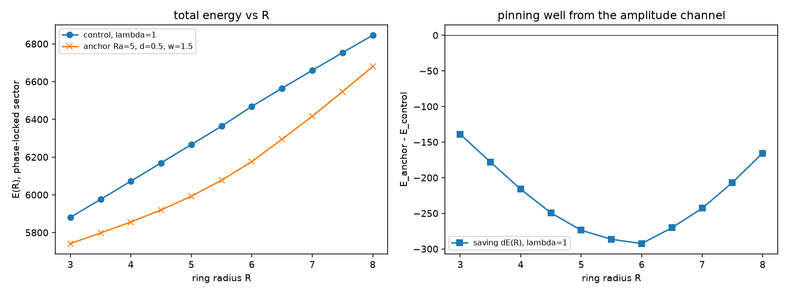

# 注记-振幅通道下涡旋环径向曲线的最小验证：钉扎井存在但无稳定半径

- **日期**：2026-09-12
- **对应脚本**：`验证脚本/minimal_verification_amplitude_channel_ring.py`（判据 W1a 至 W4，确定性无随机数，运行约 1 分钟；图存 `images/amplitude_channel_ring.png`，见 §一 图 1）
- **依据**：[[注记-载体层裁决：纯相位的失败边界与振幅通道的实现路径]]（判据 W1 至 W6 的来源）；[[三维复合位错攻坚计划：形态、驻留与宽度窗口]] §八；[[注记-涡旋初始化与横截面绕数测量装置的最小验证：切平面零读数的根因]]（绕数读数装置）
- **定位**：作者主张「粒性侧对应振幅」之后的第一条判据执行。在最小复标量载体上测 $E(R)$ 是否存在稳定点、锚核是否给出驻留半径。本注记不改动基准文件。
- **状态**：W1a、W1b、W2、W4 通过；W1c 与 W3 给出否定读数（无稳定半径、自由弛豫绕数卸载）。否定是结构性的，原因已定位到线张力与钉扎能的量级竞争。

---

## 一、判据与读数

| 判据 | 内容 | 通过条件 | 实测 |
|---|---|---|---|
| W1a | 对照（无锚核）$E(R)$ 形状 | 严格单调递增，无稳定点 | 三档 $\lambda$ 全过；线张力斜率 $129.0$、$193.0$、$239.7$ 每格 |
| W1b | 锚核节省 $\Delta E(R)$ | 存在内部极小（钉扎井） | 极小在 $R = 6.0$，井深 $6.0$（细网格）；钉扎斜率上界 $41.3$ 每半步 |
| W1c | 网格（$\lambda$、$d$、$w$）内总能量 $E_{\text{锚}}(R)$ | 存在内部极小（稳定半径） | **无**。$\lambda$ 扫至 $16$、$d$ 扫至 $0.9$（另测 $d = 1$）、$w$ 扫至 $3.0$ 全部无稳定半径 |
| W2 | $\Delta E(R)$ 极小位置随 $R_a$ | 单调不减 | 通过；位置偏移 $+0.5$ 至 $+1.0$ 格 |
| W3 | 自由复场弛豫下绕数与芯位 | 绕数保持 $\lvert W \rvert = 1$ | **未过**。九组（三档 $\lambda$ × 三个初始半径 × 两种锚核）全部读出 $\lvert W \rvert = 0$ |
| W4 | 芯处振幅与芯区振幅亏损 | $A(0) < 1$ | 通过。$A(0) = 0.298$ 至 $0.429$，芯区亏损随 $\Delta E$ 同向变化 |

## 二、模型与径向扇区

格点复标量 $\psi = A e^{i\theta}$，开放边界（边界外取真空 $\psi = 0$）：

$$H = \sum_{\text{bonds}} |\psi_i - \psi_j|^2 + \lambda \sum_{\text{sites}} (A_i^2 - A_0(x_i)^2)^2$$

$N = 32$，格距 $1$，相干长度 $\xi = 1/\sqrt{4\lambda}$。锚核取管状，把管内偏好振幅下调：$A_0 = 1 - d\exp(-d_c(R_a)^2/2w^2)$，$d_c$ 是到半径 $R_a$、位于 $z = 0$ 平面的圆的距离。

自由弛豫复场会让绕数经相位滑移卸载，径向曲线测不出来。故先固定相位为环剖面 $\theta = \operatorname{arctan2}(z, \rho - R)$，只弛豫振幅 $A$，此时绕数恒为 $1$、芯圆半径恒为 $R$。该扇区能量是 $A$ 的二次型加四次项，耦合固定为 $J_{ij} = \cos(\theta_i - \theta_j)$。

**判据方向性**：锁定扇区的 $E(R)$ 是同一半径下真实极小值的上界。锁相无稳定半径时，放开相位只会让能量更低，故真实极小也无稳定半径。反向推理不成立，因此出现极小仍需 W3 复验。

## 三、结果

**钉扎井存在。** $\Delta E(R) = E_{\text{锚}}(R) - E_{\text{对照}}(R)$ 在 $\lambda = 1$、$R_a = 5$、$d = 0.5$、$w = 1.5$ 

下取值为 $-139.0$、$-178.1$、$-216.2$、$-249.5$、$-273.8$、$-286.5$、$-292.5$、$-270.4$、$-243.0$、$-206.8$、$-165.5$（$R$ 从 $3$ 到 $8$ 步长 $0.5$），内部极小在 $R = 6.0$；井深按相邻点口径读数：步长 $1$ 的粗网格给 $18.7$，步长 $0.5$ 的细网格给 $6.0$。两个口径不可混用，正文一律用细网格值。

位置随 $R_a$ 移动：$R_a = 3, 4, 5, 6, 7$ 对应极小 $4.0, 5.0, 6.0, 6.5, 7.5$，偏移 $+0.5$ 至 $+1.0$ 格。

这与「锚核 = 振幅锁定」的预期一致：芯坐在偏好振幅被压低处可省下凝聚能。

**井深不够翻转单调性。** 线张力斜率（对照）为 $129.0$ 至 $251.8$ 每单位 $R$；钉扎带来的局部斜率补偿最多把总斜率压到 $+12.2$（$\lambda = 16$、$d = 0.9$、$w = 1.5$ 的最小步进斜率），缺口约为线张力的 $10\%$。硬锚核边界（$d = 1$，管内偏好振幅为零，即环状空腔）同样无稳定半径：$\lambda = 1$ 给最小步进斜率 $+42.3$，$\lambda = 8$ 给 $+17.2$。

**自由弛豫下绕数卸载。** W3 的九组自由复场弛豫全部把绕数从 $1$ 赶到 $0$，终态能量落到无涡旋真空值（$\lambda = 1$ 为 $4987$，$\lambda = 4$ 为 $5887$，$\lambda = 8$ 为 $6080$），芯位停在锚核低振幅环上。这一条与 [[绕数超选择：先验纠缠作为电荷保护层]] 与 [[注记-纠缠侧承载：绕数 = 非定域关系通量的量子保护探路]] 的经典层结论独立一致：经典层没有保护。

## 四、物理读数

其一，振幅通道确实是粒性侧的通道。它给出两个粒性可观测量：钉扎井（能量地貌上的阱）与芯处振幅亏损（$A(0) \approx 0.3$，芯区亏损随阱深变化）。前者对应「锚核可节约芯能」，后者对应「质量 = 振幅亏损」。判据 W4 已把后者变成可测数字。

其二，振幅通道不足以单独给出稳定半径。在中性复标量模型里，环的线张力由相位梯度的对数项主导（量级 $2\pi\ln(L/\xi)$，与 $\lambda$ 弱相关），而锚核能节约的只有芯的凝聚能（量级 $\lambda$ 乘截面）。两者量级差在 $10$ 倍以内但方向固定，最小模型里翻不过来，且加强锚核（$d$ 到 $1$）与加强刚度（$\lambda$ 到 $16$）都只把缺口从约 $90\%$ 压到约 $10\%$。

其三，稳定半径需要另外的机制。可选的只有三条：四次项逃逸 Derrick（Hopf 路线，使标度成为 $tE_2 + t^{-1}E_4$ 的形式，给出极小）；硬约束把半径交给格距离散性（格点内锁定，半径取格距的整数倍而非连续变分）；或者有限尺寸效应（盒决定的半径，对粒子无意义）。

其四，电荷与质量的分挂再获一次独立确认。W3 的九组读数说明，无论锚核多深、振幅通道多强，经典动力学都不会守住绕数。电荷必须由超选择层承担，这与论文与探路注记的分工一致。

## 五、对载体层裁决的修正

[[注记-载体层裁决：纯相位的失败边界与振幅通道的实现路径]] §四 的三条机制中，第一条（振幅缺陷钉扎）在最小模型下判为**不足**：它给出钉扎井，给不出稳定半径，也给不出电荷保护。第三条（四次项与 Hopf 保护）与「格点内锁定」因此从候选升为必需，前者给稳定半径与拓扑保护，后者给半径的离散取值。

判据 W1 与 W2 的结论据此改写为：载体判据在「管状软锚核」这一实现下不成立；W3 至 W6 未受影响。计划 §八 的 C1-4a 任务保留，但「振幅锁定」的实现形式需要由作者在「四次项」与「格点内锁定」之间裁决。

## 六、严格程度声明

数值为格点最小模型的确定性读数（L-BFGS-B，无随机数；$N = 32$，格距 $1$，开放边界）。锁定扇区给的是上界式判据，方向性已在第二节声明。模型类限制：中性复标量、无四次项、无规范场、无热噪声、无量子相干。判据 W1 至 W4 只覆盖径向能量地貌与经典自由弛豫，不覆盖量子层。

## 七、过程记录（两处判据错误与一处设计错误）

其一，最初用「芯位零振幅惩罚」钉住芯位，弛豫后绕数经相位滑移卸载：惩罚只钉振幅为零的位置，不钉绕数，构型可以满足惩罚而无绕数。修正为相位锁定的径向扇区。

其二，判据 W1c 最初把「节省量的内部极小」当成「总能量的内部极小」，于是所有参数组都被判为出现稳定半径。修正为对总能量 $E_{\text{锚}}(R)$ 做判断，并把局部步进斜率作为诊断量打印。

其三，判据 W2 最初要求极小位置严格单调递增，而 $R$ 网格取 $1$ 格步长、极小位置本身按网格量化，出现 $5.0$ 到 $6.0$ 的重复。修正为单调不减并把网格加密到 $0.5$ 格。

教训：判据里出现「单调」「极小」这类词时，必须写清是对哪条曲线、在什么网格上，且诊断量要与判据量分开打印。

## 八、边界（本注记不验证的内容）

其一，四次项（Faddeev-Skyrme 型）路线未测，Hopf 保护的数值实现属后续。其二，格点内锁定作为硬约束的形态未构造。其三，量子层的电荷保护（判据 Q4、Q5）属超选择线。其四，连续极限、格距与物理单位不涉及。其五，锚核半径与色散窗口的重合（判据 W5）未测，因为稳定半径尚未出现。

## 九、相关文件

| 文档 | 位置 |
|---|---|
| 本判据脚本 | `验证脚本/minimal_verification_amplitude_channel_ring.py` |
| 载体层裁决注记 | `内部草稿/注记-载体层裁决：纯相位的失败边界与振幅通道的实现路径.md` |
| C1 计划 | `理论攻坚/三维复合位错攻坚计划：形态、驻留与宽度窗口.md` §八 |
| 绕数读数装置 | `验证脚本/minimal_verification_vortex_init_apparatus.py` |
| 超选择层两篇 | `绕数超选择：先验纠缠作为电荷保护层.md`、`验证脚本/注记-纠缠侧承载：绕数 = 非定域关系通量的量子保护探路.md` |
| 开放问题登记 | `内部草稿/开放问题总览：元相子理论待解决问题清单.md`（P1-33） |
