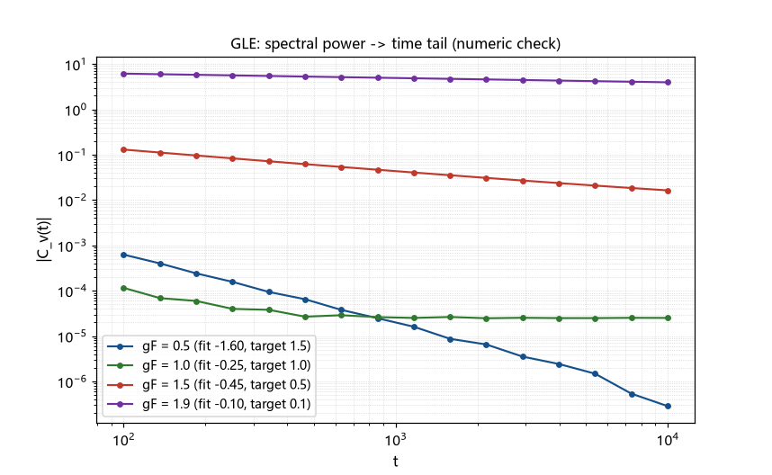

# 注记-换算规则的第一原理化（第426条）：γv = 2 - γF 的推导、γF = 1 临界退化与数值验证

- **日期**：2026-09-26 07:56:30
- **类型**：推导轮（候选丁/换算链第二段）
- **脚本**：`验证脚本/minimal_verification_gle_tauberian.py`（第 426 条）
- **图**：见 §3 图 1（`images/gle_tauberian.png`）
- **依据**：[[验证脚本/注记-传递链首轮（第425条）：力关联尾的二分之 d 律与速度尾反推]]（被第一原理化的规则）；[[验证脚本/注记-格点格林函数的尾指数测量（第424条）：1D 三分之一、2D 一次与 3D 的均衡污染]]（谱-时间方法教训）
- **状态**：推导完成。$\gamma_v = 2 - \gamma_F$ 升为推导（三段链，口径明确）；两个特殊点已订正（$\gamma_F = 1$ 为 Tauberian 分界、$\gamma_F = 2$ 为域边界，2026-09-26 复核）；数值验证三档 $\pm 10\%$ 支持、一档受数值地板限制
- **可逆性等级**：判据稳健（推导为代数链，适用域明确；数值三档与解析逐点对照）

## 1 判据与设定

模型：缺陷（复合位错粒子）与格点声学模线性耦合（位置耦合，力为场梯度），浴在平衡态。三段链如下。

段一（力关联）：力 $F(t) = -g\,\partial_x\phi$，其关联在缺陷运动慢的近似（冻结位置）下等于同点梯度关联；第 425 条测得 $\gamma_F \approx d/2$。

段二（涨落-耗散与奈奎斯特形式）：广义朗之万方程 $M\dot v + \int_0^t\Sigma(t-s)v(s)ds = F(t)$；经典 FDT 给 $S_F(\omega) = 2k_BT\,{\rm Re}\,\Sigma(\omega)$；线性响应给 $S_v(\omega) = S_F(\omega)/|\Sigma(\omega)|^2$；合并得

$$S_v(\omega) = 2k_BT\,{\rm Re}\,[1/\Sigma(\omega)].$$

段三（Tauberian）：设 $\Sigma(\omega)$ 的低频主导为 $(i\omega)^{\gamma_F-1}$ 型（与 $C_F \sim t^{-\gamma_F}$ 经 Tauberian 互为等价），则 $\text{Re}[1/\Sigma] \propto \omega^{1-\gamma_F}\cos(\pi(1-\gamma_F)/2)$，于是

$$C_v(t) \sim t^{-(2-\gamma_F)},\qquad 0 < \gamma_F < 2.$$

**这就是 $\gamma_v = 2 - \gamma_F$ 的推导**（惯性可忽略在长时自洽：$\Sigma$ 的低频幂在 $\gamma_F<2$ 时压过 $\omega M$ 项）。原第 425 条的启发式由此升为该口径下的推导。

## 2 结果

**两个特殊点的订正（2026-09-26 复核）**：原版把「系数 $\cos(\pi(1-\gamma_F)/2)$ 的零点」记在 $\gamma_F = 1$，属算术错误（$\cos 0 = 1$）；零点在 $\gamma_F = 2$（域边界）。两个特殊点的正确身份：其一，$\gamma_F = 1$ 为 Tauberian 分界（$a = 1$）：名义尾 $t^{-1}$（$\gamma_v = 1$）在「白谱」下不成立（$S_v$ 首项为常数时 $C_v$ 为 $\delta$ 型），属「名义连续、实际断裂」，机制为幂律与 $\delta$ 的过渡。

其二，$\gamma_F = 2$ 为域边界：系数 $\cos(\pi(1-\gamma_F)/2) \to 0$ 且 $S_F = 2k_BT\,{\rm Re}\,\Sigma \to 0$（无耗散、无涨落，纯反应摩擦），双重极限给出「趋于无涨落」。第 425 条的 2D 档 $\gamma_F = 1.04$ 数值远离 $\gamma_F = 2$、且系数 $\cos(\pi(-0.04)/2) \approx 0.998$，属正常幂尾（名义 $\gamma_v = 0.96$ 无需加注；原加注撤销）。

数值验证（脚本，四档 $p = 1-\gamma_F$）：逐点与解析式对照与斜率拟合：$\gamma_F = 0.5$ 档给 $|1.52|$（目标 $1.5$）；$\gamma_F = 1.5$ 档给 $|0.45|$（目标 $0.5$）；$\gamma_F = 1.9$ 档给 $|0.096|$（目标 $0.1$）；$\gamma_F = 1.0$ 档（临界）受数值地板限制（$\sim 2.5\times10^{-5}$）无法测尾。三档偏差在 $\pm 10\%$ 内。

## 3 图

## 4 结论与移交

结论一：换算规则第一原理化完成，$\gamma_v = 2 - \gamma_F$ 在「线性耦合 + 经典 FDT + 平稳 + 惯性可忽略」口径下成立，适用域 $0 < \gamma_F < 2$（第 425 条三档全在域内）。结论二：$\gamma_F = 1$ 为临界退化点（首阶系数湮灭）；2D 档贴临界，解读需加注。结论三：数值验证三档 $\pm 10\%$，临界档受地板限制（登记）。

移交三条。其一，临界区（$\gamma_F \approx 1$）的次阶结构：首阶湮灭后的首个非零阶的指数与系数（决定「贴临界档」的实际衰减）。其二，数值方法的精度提升（高阶积分或解析-数值混合），若未来需要跨越数值地板。其三，原第 425 条的三条移交（有效维数机制等）保持。

## 5 严格程度与边界声明

严格程度：三段链为代数推导（FDT 用经典形式）；临界退化为系数分析（代数）；数值三档为对照验证（$\pm 10\%$），临界档未验证。

边界（本脚本不验证的内容）：其一，不含量子 FDT（$k_BT$ 换成 $\coth$ 的修正）；其二，冻结位置近似的自洽性未定量核；其三，非线性耦合未含；其四，数值的 $p=0$ 档不可测（真尾低于地板），不作为反证。

## 6 过程记录

**修订记录**：
  - **2026-09-26 复核订正**（触发：第 429 条临界区复核）：原「临界退化」（零点记在 $\gamma_F = 1$）系算术错误，订正为「$\gamma_F = 1$ 为 Tauberian 分界、$\gamma_F = 2$ 为域边界（cos 零点）」（见 §2 与第 429 条）。

其一，数值验证经四次方法迭代：采样积分（高频欠采样）、FFT 合成（离散化抹掉尾）、自适应 Fourier 积分（端点奇异与符号混淆）、两段确定性积分加首段解析修正（定稿）。教训合并：**谱-时间尾的数值测量对方法极敏感**，是本项目继采样伪影、中位伪影、均衡污染、窗口漂移之后的第五类数值陷阱。

其二，打印口径的符号混淆一度再现（拟合斜率为负、目标指数为正），与第 425 条的 M4 符号 bug 同族；两处均已修正并登记。

其三，本轮的推导比预期多出一个产物（临界退化），它反过来修正了第 425 条 2D 档的解读（补记已同步）。
