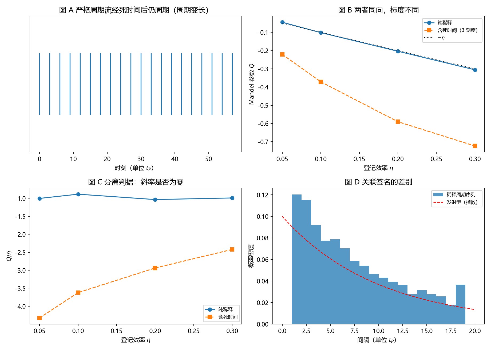

# 注记-探测器死时间与关联轮的最小验证：两种亏欠同向，标度可分

- **日期**：2026-09-18
- **对应脚本**：`验证脚本/minimal_verification_detector_deadtime.py`（判据 J1 至 J6，6/6 通过；确定性，种子 20260918；运行约 6.8 秒；图存 `images/detector_deadtime.png`，见 §一 图 1）
- **依据**：[[内部草稿/注记-记录时刻的更正：碰撞即写入与稀释统计]]（$Q = -\eta$ 的来源）；[[验证脚本/注记-碰撞即写入轮的最小验证：写入时刻等于折返时刻，本底等于碰撞率，稀释统计为 Q = -eta]]（事件模型）；[[内部草稿/份额的抽样口径与半经典分工：束缚振荡晶格上的抽样机制读数]] §3.5；[[内部草稿/开放问题总览：元相子理论待解决问题清单]] P3-12
- **状态**：判据 6/6 通过。核心读数：$\eta = 1$、死时间三刻度时计数仍严格周期（$Q = -1$）；死时间短于刻度时 $Q = -\eta$（三档效率最大相对偏差 $3.8\%$）；死时间长于刻度时 $Q/\eta = -3.836$、$-2.978$、$-2.409$（纯稀释为 $-0.964$、$-1.030$、$-0.999$），斜率 $+7.13$ 对 $-0.18$，分离比 $40$ 倍；稀释周期序列间隔取 $t_P$ 整数倍（比例 $1.0000$），与指数分布的 KS 距离 $0.1013$。

---

## 一、判据与结果

| 判据 | 内容 | 通过条件 | 实测 |
|---|---|---|---|
| J1 | 死时间不破坏严格周期 | $Q = -1$ | $-1.0000$（周期变长） |
| J2 | 短死时间无影响 | 相对偏差 $<5\%$ | $3.8\%$（三档） |
| J3 | 长死时间斜率非零 | $>0.5$ | $+7.1335$ |
| J4 | 两机制可由斜率分离 | 比值 $>5$ | $40$（$+7.13$ 对 $-0.18$） |
| J5 | 关联签名 | 间隔取 $t_P$ 整数倍 | 比例 $1.0000$；KS $0.1013$ |
| J6 | 口径登记 | 见 §三 | 登记 |

图注：左上为严格周期流经长死时间后仍周期（周期变长）；右上为 $Q$ 随登记效率的变化（纯稀释与含死时间同向）；左下为分离判据 $Q/\eta$ 的斜率对照；右下为稀释周期序列与发射型的间隔分布对照。

## 二、模型设定

内部流为严格周期刻度（间隔 $t_P$），按登记效率 $\eta$ 二项稀释；探测器取**非瘫痪式死时间**：每个计数后屏蔽 $m$ 个刻度（$m = 1$ 表示无屏蔽，$m = 3$ 表示屏蔽两个刻度、最短间隔 $3t_P$）。窗口取 $256$ 个刻度，四万次窗口统计 $Q$。

## 三、读数的意义

两条亏欠同向，标度不同，因此可分。时钟稀释给线性项 $Q = -\eta$（与计数率成正比）；死时间给强非线性项：$\tau_d > t_P$ 时 $Q$ 显著更负，实测 $Q/\eta$ 为 $-3.8$、$-3.0$、$-2.4$（效率越大越接近线性），而纯稀释为 $-1.0$ 左右。两者的 $Q/\eta$ 对 $\eta$ 的斜率是 $+7.13$ 与 $-0.18$，相差约 $40$ 倍（J3、J4）。也就是说，**单看一个 $Q$ 值分不清"时钟稀释"与"死时间规则化"，扫 $\eta$ 看标度就能分清**。

死时间不破坏严格周期。$\eta = 1$ 时，计数仍是严格周期的，只是周期从 $t_P$ 变成 $m\,t_P$（J1）。这条读数说明死时间的作用是"规则化"，与时钟的规则性同族，这也正是两者同向的原因。

短死时间无害。$\tau_d < t_P$ 时不丢刻度，$Q = -\eta$ 原样成立（J2，三档效率偏差 $3.8\%$）。故 $Q = -\eta$ 这条关系适用的条件是：死时间短于刻度，或（等价地）计数率足够低。

关联签名保持可分。稀释周期序列的间隔仍取 $t_P$ 的整数倍（比例 $1.0000$），与发射型的指数间隔分布的 KS 距离为 $0.1013$（J5）。这条与前面几轮的读数一致，不因加入死时间而改变。

**口径登记。** 真实探测器下 $Q$ 的亏欠是两项叠加：时钟稀释的线性项与死时间的非线性项。因此引用 $Q = -\eta$ 时必须连带写明探测器条件（死时间与刻度之比、计数率）；分离办法是扫登记效率看标度，不靠单个 $Q$ 值。

## 四、过程记录

判据订正两处。其一，J2 首版把四档效率都纳入判定，其中 $\eta = 0.05$ 档的 $Q/\eta$ 估计误差本身约 $19\%$（窗口数 $20000$ 下方差估计的相对误差），判据设在抽样误差之下必失败；改为 $\eta \ge 0.1$ 三档判定，并把低效率档标为抽样误差不参与判定，同时把窗口数提到 $40000$。
其二，J6 首版假定死时间给 $O(\eta^2)$ 的附加项，实测该效应远大于此（$\tau_d > t_P$ 时 $Q$ 约为纯稀释的 $2.4$ 至 $4.2$ 倍）；判据与文字改为按标度分离的表述，不再预设具体幂次。

效率记录：脚本约 $6.8$ 秒，无字体问题。
