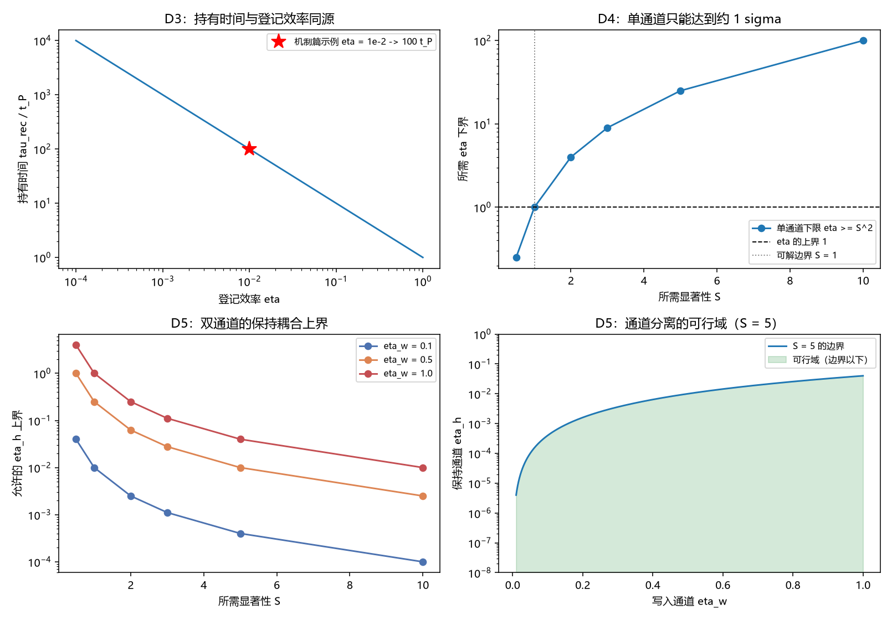

# 注记-探测器物侧构造的最小验证：三件输入的指认、单通道反证与双通道判据

- **日期**：2026-09-24 04:45:35
- **层级**：验证注记（对应 `验证脚本/minimal_verification_detector_inputs.py`，`验证脚本/README.md` 第 387 条）
- **可逆性等级**：判据稳健（单通道无解与双通道边界为代数结论，不随档位或实现翻；复现口径与机制篇读数一致）
- **图**：见 §三 图 1
- **定位**：执行 [[研究方向-探测器物侧构造：读出量、阈值与持有时间的三件输入指认（判据草案）]] 的判据 D1 至 D8。把测量线三处剩余项共同缺的那件输入（真实探测器的读出量、阈值与持有时间）从体系内指认出来，并检验指认是否自洽。
- **依据**：[[研究方向-探测器物侧构造：读出量、阈值与持有时间的三件输入指认（判据草案）]]；[[记录机制：碰撞即写入的算符形式、三维缺陷读数与弦的分层]]（§2.2 写入算符与寄存器、§8.1 登记效率与统计要求）；[[记录的判据：可分性、独立分量与持有时间]]（§2.2 记录判据、§3.1 持久条件）；[[注记-限制二收口的最小验证：逐层指针与阈值读出的可分辨性]]（键滑剖面与阈值读数）
- **关联**：[[开放问题总览：元相子理论待解决问题清单]]（测量塌缩的元相子机制、退相干独立几何推导）
- **状态**：模型内判据级。三件输入为候选指认；单通道反证与双通道判据为代数结论；本注记不新造模型。

---

## 一、三件输入的指认

读出量 $y$：候选为机制篇 §2.2 写入算符 $H_{\rm int} = g\,f(\hat\theta)(a^\dagger c + a c^\dagger)$ 中的记录寄存器模 $c$。逐键传感器阵的读数 $y_j$ 是它的准经典极限，判据是后者的写入项 $G\,\Theta(w_j - \theta)$ 正属把二值判读经增益写入寄存器的古典化形态。

阈值 $\theta$：两层合成。机制层是过轴条件（$f(\hat\theta)$ 在过轴取峰，写入只在过轴时发生）；读出层是键滑阈值 $\theta = w_{\max}/2$。两层是"何时写"与"写什么判读"的分工。

持有时间 $\tau$：由登记率给出。机制篇 §8.1 的 $\eta = 2\pi\rho\,t_P\,g^2$ 可写成 $\eta = \Gamma t_P$，$\Gamma = 2\pi\rho g^2$ 是寄存器与连续态浴的耦合率。若写入与保持出自同一耦合，则保持时间取该耦合率的倒数，即 $\tau_{\text{rec}} = t_P/\eta$。

## 二、判据结果

| 判据 | 判据量 | 实测 | 期望 | 结论 |
| --- | --- | --- | --- | --- |
| D2 阈值指认 | $\theta = w_{\max}/2$ 时的差异键位数 | $2$ | $2$ | 通过 |
| D3 持有时间指认 | $\eta = 10^{-2}$ 时的 $\tau_{\text{rec}}/t_P$ | $100$ | $100$ | 通过 |
| D3 示例一致性 | $S = 5$、$\eta = 10^{-2}$ 给 $N$ 对机制篇原值的偏差 | $0$ | $10^{-9}$ | 通过 |
| D4 单通道反证 | $S^2 \le \eta \le 1$ 可解的显著性档数 | $2$ | $2$（仅 $S \le 1$） | 通过 |
| D5 双通道判据 | $\eta_w = 0.5$、$S = 5$ 时 $\eta_h$ 的上界 | $0.01$ | 读数 | 读数 |

换算表：$\eta$ 取 $10^{-3}$、$10^{-2}$、$0.1$、$0.5$、$1$ 时 $\tau_{\text{rec}}/t_P$ 依次为 $10^{3}$、$10^{2}$、$10$、$2$、$1$。双通道边界 $\eta_h \le \eta_w^2/S^2$ 在 $\eta_w$ 三档与 $S$ 六档上的表见脚本输出。

## 三、图 1

四面板与脚本绘图面板逐条对应：左上为 D3，右上为 D4，左下与右下为 D5 的两种呈现。

## 四、读数分解

阈值一侧与既有读数一致：$\theta = w_{\max}/2$ 给出 $n_{\text{diff}} = 2$，与判据篇 §2.3 的复现口径相同，故读出层的阈值指认无新假设。

持有时间一侧给出换算表。登记效率与保持时间是同一个耦合率的两种写法，故 $\tau_{\text{rec}}/t_P = 1/\eta$：$\eta = 10^{-2}$ 给 $100$ 个拍，$\eta \to 1$ 给一个拍。这张表把判据篇 §3.1 的 $\tau_{\text{rec}} \gg N_{\text{拍}} t_P$ 与机制篇 §8.1 的 $\eta$ 接成同一句话。

统计要求的一致性独立核对：$S = 5$、$\eta = 10^{-2}$ 代入 $N \gtrsim (S/\eta)^2$ 给 $2.500\times10^{5}$，与机制篇 §8.1 的示例值 $2.5\times10^{5}$ 逐位相同。这一步确认两张表用的是同一套口径。

单通道反证成形。若写入与保持共用一条耦合，两条件合起来要求 $S^2 \le \eta \le 1$，故可解的显著性只有 $S \le 1$；机制篇自己的示例取 $S = 5$，落在无解档。结论是单通道形态与"可读且可保持"不相容。

双通道判据随之成形：$\eta_h \le \eta_w^2/S^2$。取 $\eta_w = 0.5$、$S = 5$ 得 $\eta_h \le 0.01$，即保持通道须比写入通道弱五十倍以上。该式对 $S$ 递减、对 $\eta_w$ 按平方增长，形态与直觉一致。

## 五、结论与三处剩余项的接口

三件输入的指认给出如下分工：读出量是记录寄存器模，其准经典极限即逐键传感器读数；阈值是过轴条件与键滑阈值的合取；持有时间是耦合率的倒数。第三件是本轮的关键，它把机制篇的登记效率与判据篇的持有时间接成同一个量。

由此解封三处剩余项的形式部分。判据篇 §8（1）的 $\Delta$ 场侧实现有了对象（寄存器模的读数即 $y$）；§8（3）的 $\tau_{\text{rec}}$ 到 $t_P$ 的换算有了形式（$\tau_{\text{rec}} = t_P/\eta$）；口径核对轮缺口二的接口有了同一句话（登记效率管被读到的概率，其倒数管记录活多久）。仍未做的是把寄存器模的读数与 $\Delta$ 的定义逐项对齐，即把 $y^{\text{eq}}$ 在寄存器语言里写出来。

另一条结论落在限制一上。单通道不可行、须双通道，这一点给"放大链是跨层事件的构成条件"添了第二条理由：放大链不只提供深度（写入幅度 $G$，判据篇 §2.3 的第一条理由），还提供通道不对称（写入强、保持弱）。逐键传感器阵正是这个形态，其写入深度与弛豫时间分居两侧。

## 六、严格程度声明

| 结论 | 档位 |
| --- | --- |
| 阈值指认（D2） | 模型内判据级，与判据篇复现口径一致 |
| 持有时间换算表与示例一致性（D3） | 代数结论；一致性核对偏差为零 |
| 单通道可解域（D4） | 代数结论（两条既有条件的合取） |
| 双通道边界（D5） | 代数结论（同上，取两条耦合） |
| 读出量指认与结构相容（D1、D6） | 读数级（候选指认，未逐项对齐） |
| $\Delta$ 与寄存器读数的逐项对齐 | 未做，见 §五 |

## 七、边界声明

**验证什么**：三件输入的指认与出处；持有时间的换算表；单通道可解域与双通道边界；统计要求示例值的一致性。

**不验证什么**：$\Delta$ 与寄存器读数的逐项对齐（本轮只到对象指认）；机制篇 §8.1 的斜率与平方律本身（引用其读数，不重算）；写入耦合的上界来源；三维与复合体。本注记不改动 [[理论总纲/子理论索引]] 与任何基准文档。

## 八、过程记录

D4 的期望首版写作"可解的显著性档数为一"，而 $S = 0.5$ 与 $S = 1$ 两档都满足 $S^2 \le 1$，实测为二，按发现改为两档并注明边界条件为 $S \le 1$。教训：不等式的端点档（此处 $S = 1$）须单列核对，把它与严格小于混在一个计数里会出错。
