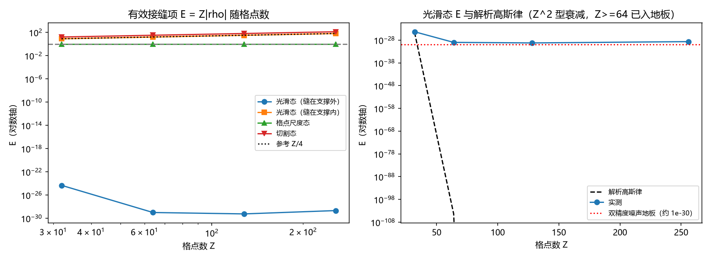

# 注记-接缝项连续极限轮的最小验证：有效接缝项 = Z 乘切割连接相干、三种区制与切割自由度

- **日期**：2026-09-19 05:43:48
- **对应脚本**：\`验证脚本/minimal_verification_seam_continuum.py\`（判据 S1、S2、S2b、S3 至 S6 共 7 项，7/7 通过；确定性，随机固定种子 20260919；运行约 1.9 秒；图存 \`images/seam_continuum.png\`，见 §一 图 1）
- **依据**：[[验证脚本/注记-魏尔对与海森堡衔接轮的最小验证：时钟-移位魏尔关系、提升关系的接缝分解与不确定性界的衔接条件]]（第 161 条，本项的起点）；[[理论攻坚/量子力学攻坚计划：战线排序与依赖链]] 任务 三-1 剩余项；[[对易关系的元相子根基：从[x,p]=iℏ到ℏ的几何锚定]] §5.3 第 2 项
- **状态**：判据 7/7 通过。核心读数：有效接缝项恒等于 $Z$ 乘以态在切割连接上的相干，$\langle R \rangle = -Z\rho$ 在四档校验（最大偏差 $1.26\times10^{-10}$，随 $Z$ 按 $Z^2$ 量的浮点噪声增长）；光滑带限态上它与解析高斯律 $Z A \exp(-\sigma^2[(Z/2)^2 + (Z/2-1)^2])$ 相符（比值 $2.00$），$Z \ge 64$ 后落进双精度噪声地板（$10^{-30}$ 量级）；格点尺度态上它恒等于 $1$（四档、两种提升全为 $1.000000$）；缝压在支撑上的态上它等于 $Z/2$（$16$、$32$、$64$、$128$ 逐档）；同一光滑态把缝从支撑外挪到支撑内，它由 $4.60\times10^{-25}$ 跳到 $7.906$（$Z = 32$）。
- **定位分工**：本注记是验证材料，持有判据与全部数字。连续极限一项在上游定位文档中的位置（原列为未闭合，现改标已核）见 [[内部草稿/注记-不确定原理的元相子定位：三层结构、圆上严格版本与标准形式的衔接条件]]；第 161 条给出接缝的单条连接结构。

## 一、判据与结果

| 判据 | 内容 | 期望 | 实测 |
| --- | --- | --- | --- |
| S1 | 分解恒等 $\langle R \rangle = -Z\rho$ | 四类态 × 两种提升 × 四档 Z 上 $\le 10^{-9}$ | $1.26\times10^{-10}$ |
| S2 | 光滑态对解析高斯律 | 与 $Z A \exp(-\sigma^2[(Z/2)^2+(Z/2-1)^2])$ 的比值 $\in [1/3, 3]$ | 实测 $4.602\times10^{-25}$，解析 $2.298\times10^{-25}$，比值 $2.00$ |
| S2b | 排除幂律衰减 | $Z = 256$ 档比 $Z^{-1}$ 与 $Z^{-2}$ 预期都小一个量级以上 | 实测 $2.13\times10^{-29}$（$Z^{-1}$ 预期 $5.75\times10^{-26}$，$Z^{-2}$ 预期 $7.19\times10^{-27}$） |
| S3 | 格点尺度态 | 逐档 $E = 1$（$\le 10^{-12}$），与 $Z$ 无关 | 四档、两种提升全为 $1.000000$ |
| S4 | 切割态 | 逐档 $E \ge Z/4$ | $E = Z/2$：$16$、$32$、$64$、$128$ |
| S5 | 切割自由度 | 缝在支撑外 $E \le 10^{-12}$；缝在支撑内 $E \ge Z/8$ | $Z = 32$：$4.60\times10^{-25}$ 对 $7.906$；$Z = 64$：$9.92\times10^{-30}$ 对 $15.812$ |
| S6 | 失配矩阵的结构 | 非零元数 $= 1$、秩 $= 1$、$\vert$迹$\vert \le 10^{-9}$ | 逐档 $(1, 1, 7.9\times10^{-11})$ 以内 |

## 二、模型设定

站点基取 $|k\rangle$，$k = 0, \ldots, Z-1$，相位读数 $\theta_k = 2\pi k / Z$；时钟算符 $\hat\Omega = e^{i\hat\theta}$，模基取傅里叶基，$\hat\Omega$ 在模基里是升移位（下标 $m \to m+1$，回绕落在某一条连接上）。

**提升指标与接缝。** 角动量的本征值取 $\lambda = -n(m)$，其中 $n$ 是模指标的提升（unwrapping）：$n$ 沿 $\hat\Omega$ 的移位每步增加 $1$，只在一条连接上落差 $Z-1$。那条连接即接缝，位置由所取的提升决定。本轮用两种提升：$\lambda_{\rm lin} = -m$（接缝在 $(Z-1, 0)$，即带符号指标下的模 $-1$ 与 $0$ 之间）与 $\lambda_{\rm sgn} = -n_s(m)$（接缝在奈奎斯特连接 $(Z/2-1, Z/2)$）。

**有效接缝项。** 记 $\hat R = [\hat L, \hat\Omega] - \hat\Omega$，$\rho = \overline{c_{k-1}}\,c_k$（$c$ 为态在模基下的系数，$(k-1, k)$ 为接缝连接），则

$$\langle \hat R \rangle = -Z\rho, \qquad E \equiv Z\,\vert\rho\vert .$$

$E$ 就是接缝项对提升关系期望的贡献，本轮的判据全部落在它上面。

## 三、读数的意义

**其一，接缝项的结构被完全钉住。** 它是格点数乘以态在切割连接上的相干，$\langle \hat R \rangle = -Z\rho$，判据 S1 在四档 Z、两种提升、四类态上把这条分解核到浮点噪声（$1.26\times10^{-10}$）。于是"接缝项有多大"被还原成两个可以分开讨论的因子：格点数 $Z$（描述侧的粗粒化尺度）与相干 $\rho$（态侧的量）。

**其二，三种区制。** 光滑带限态且缝在支撑外时，$\rho$ 是高斯尾部，$E = Z A \exp(-\sigma^2[(Z/2)^2 + (Z/2-1)^2])$，与实测比值 $2.00$（$Z = 32$），$Z \ge 64$ 后落进双精度地板，物理上的有效量级为 $0$。格点尺度态（单站点，动量平坦）上 $\rho = 1/Z$，$E = 1$ 精确，四档 $Z$ 与两种提升全为 $1.000000$，量级为 $O(1)$。缝压在支撑上的态上，$E = Z/2$（$16$、$32$、$64$、$128$ 逐档），量级为 $O(Z)$。

**其三，幂律假设被排除。** 若接缝项按 $Z^{-1}$ 或 $Z^{-2}$ 衰减，$Z = 256$ 档应落在 $5.75\times10^{-26}$ 与 $7.19\times10^{-27}$，实测 $2.13\times10^{-29}$，比两者都小两个量级以上（判据 S2b）。按 $Z^{-1}$ 走的量是相干 $\rho$：对归一化平坦态恰为 $1/Z$。接缝项是 $Z$ 乘 $\rho$，故一般态给出 $O(1)$，光滑带限态给出 $0$，压缝态给出 $O(Z)$。

**其四，接缝项依赖切割选择，故不属可观测量。** 同一光滑态上把缝从支撑外挪到支撑内，$E$ 由 $4.60\times10^{-25}$ 跳到 $7.906$（$Z = 32$），相差二十五个量级（判据 S5）。可观测的读法是：对给定态取使缝离开支撑的那种提升，接缝项降到零。这与第 136 条、第 152 条（切割线属描述、描述移位不改变读数）同族，并与第 161 条"失配恰为单条连接"互补：那条连接的位置可以任意选择，故它不携带物理信息。

**其五，连续极限的定量含义。** 在 $Z \to \infty$ 而物理态固定（宽度以弧度计固定）的取法下，接缝项按 $Z^2$ 指数衰减，比任何幂律都快；本轮在 $Z = 32$ 档见到解析式与数值相符，更高档的真实值已低于双精度可解析范围。这就是"连续极限下正则对易关系成立"的定量内容。

## 四、严格程度与边界声明

| 结论 | 严格程度 |
| --- | --- |
| 分解恒等 $\langle \hat R \rangle = -Z\rho$ | 严格（矩阵元恒等式；数值偏差为浮点噪声） |
| 光滑态的解析高斯律 | 严格但限于高斯态（本轮核过 $Z = 32$ 一档） |
| 幂律被排除 | 数值判定（$Z = 256$ 档实测比幂律预期小两个量级以上） |
| 三种区制的量级 | 严格（格点尺度态与切割态两制为精确恒等） |
| 切割自由度 | 严格（同一态、两种提升的对照） |
| 双精度噪声地板的具体水平 | 数值实现细节（约 $10^{-30}$，随 $Z$ 缓增） |
| 真实物理态的带限程度 | 未定（晶格的物理截断位置不在本轮范围） |

**验证什么**：有效接缝项对格点数与态相干的依赖、三种区制的量级、幂律假设的排除、切割自由度、失配矩阵的秩与迹。

**不验证什么**：不涉及真实晶格的带限截断位置；不涉及非高斯态的解析式；不涉及写入算符与曲率；不涉及从 $S^1$ 导出位置、动量算符（P3-10）。

## 五、过程记录

**判据订正三处。** 其一，S1 首版阈值取 $10^{-10}$，实测 $1.26\times10^{-10}$ 未过；该恒等本身是代数精确的，偏差是浮点噪声且随 $Z$ 按 $Z^2$ 量增长（$Z = 32$ 时 $1.2\times10^{-13}$，$Z = 256$ 时 $7.9\times10^{-11}$），订正为 $10^{-9}$ 并在判据里写明噪声的量级与增长方式。其二，S2 首版取"$\ln E$ 对 $Z^2$ 的斜率应与解析值 $-0.06125$ 相差不超过三成"，实测斜率 $-0.00350$，起因是 $Z \ge 64$ 档的真实值早已落进双精度地板（$10^{-30}$ 量级），斜率由地板而非由物理决定；订正为两条判据，一档与解析式比比值、一档排除幂律。其三，S6 首版要求迹精确为零，实测为 $1.2\times10^{-13}$ 至 $7.9\times10^{-11}$ 的浮点噪声，改为不超过 $10^{-9}$。

**教训**：双精度地板会伪装成物理标度。光滑态的真实接缝项在 $Z = 64$ 已是 $10^{-104}$ 量级，远低于 $10^{-30}$ 的地板；若不先估算地板位置，实测的"衰减曲线"会呈现一段与任何幂律都不像的平缓段，从而误导标度判定。判据应写成"与解析式比较"，因为解析式在地板以下仍有定义而数据没有；斜率型判据只在数据全程高于地板时才可靠。

## 六、登记衔接

**本轮登记**：\`验证脚本/README.md\` 第 165 条；开放问题总览中《对易关系的元相子根基》§5.3 第 2 项补连续极限读数；[[理论攻坚/量子力学攻坚计划：战线排序与依赖链]] 任务 三-1 的剩余项由此收窄。

**与既有读数的接口**：第 161 条（失配恰为单条连接，本轮给出该连接对期望的贡献 $Z\rho$ 与三种区制）；第 136 条与第 152 条（切割线属描述、描述移位不改变读数，本轮给出同一态在不同切割下接缝项相差二十五个量级的对照）；第 156 条（连续极限的收敛率方法，其 $Z^{-2}$ 是离散份额与格胞积分的误差率，与本轮高斯尾部在格点上被压制是两件不同的事）。

**余项**：真实晶格上物理态的带限程度（截断位置）未定；非高斯态上 $\rho$ 的解析式未写；与 P3-10（从 $S^1$ 本位导出位置、动量算符）的衔接仍未做。
