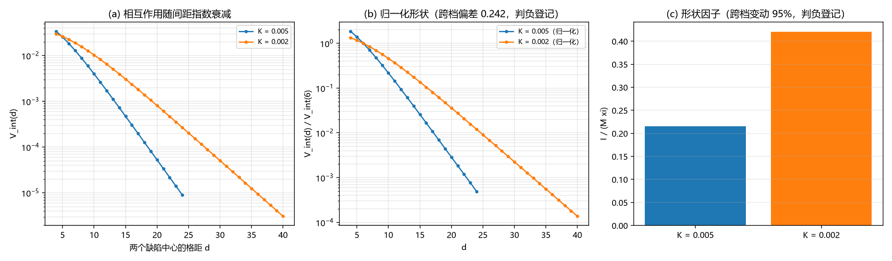

# 注记-描述项形状因子轮：有效相互作用的程长与振幅标度（判据 F1 至 F5）

- **日期**：2026-09-20 10:11:26
- **来源**：[[多体薛定谔方程与交换统计：束缚振荡晶格的联合包络动力学]] §7 遗留 (a)（经 2026-09-20 修正后改写为「给出描述项的形状因子」）；作者 2026-09-20 开工指令
- **脚本**：`验证脚本/minimal_verification_shape_factor.py`
- **状态**：判据级读数；程长一项交付，振幅标度判负登记
- **图**：见 §二 图 1
- **依据**：[[验证脚本/注记-Born判据尺度读法轮：三种能隙读法与失效阈值（判据B1至B5）]]；[[验证脚本/注记-缺陷动力学线 D-2 的最小验证：连续极限与色散（涨落缺口与孤子质量的分工、第 227 条质量口径的确认）]]

---

## 一、任务与模型

Born 判据尺度读法轮定案后，遗留 (a) 的目标从「给出排斥强度」变成「给出描述项的形状因子」：排斥势不再承担硬核，但包络层仍需要一个描述项，其形状（有效程与强度）应当由构型几何给出来，不能靠势深猜。

模型取同向双 kink 构型，两个 kink 中心的格距为 $d$，相互作用能定义为 $V_{\rm int}(d) = E_2(d) - 2E_1$，其中 $E_1$ 是同一格点上单个 kink 的能量。取 $E_1$ 而非连续极限的 $M$ 作参考是本轮的关键（见 §五 过程记录）。两档刚度为 $K = 0.005$ 与 $K = 0.002$，对应的缺陷宽度为 $\xi = 2.251$ 与 $3.559$ 格距。

---

## 二、判据与读数

| 判据 | 内容 | 实测 | 期望 | 结果 |
| --- | --- | --- | --- | --- |
| F1 | $K = 0.005$ 的衰减长度 $l_{\rm dec}$ | $2.3820$ | $\xi = 2.2508$ | 通过 |
| F1 | $K = 0.002$ 的衰减长度 $l_{\rm dec}$ | $3.7948$ | $\xi = 3.5588$ | 通过 |
| F1 | 两档上 $l_{\rm dec}/\xi$ | $1.0583$ / $1.0663$ | 均在 $0.85$ 至 $1.15$ | 通过 |
| F2 | 相互作用符号（$K = 0.005$，最小值 $9.03\times10^{-6}$） | 正 | 正（排斥） | 通过 |
| F2 | 相互作用符号（$K = 0.002$，最小值 $3.08\times10^{-6}$） | 正 | 正（排斥） | 通过 |
| F3 | 归一化曲线最大跨档偏差 | $0.2416$ | 判负登记 | 判负 |
| F4 | 形状因子 $I/(M\xi)$（两档） | $0.2152$ / $0.4204$ | 判负登记 | 判负 |
| F4 | 跨档变动 | $95.4\%$ | 判负登记 | 判负 |
| F4b | 尾振幅对理论形式 $M\gamma e^{-\gamma d}$ 的比值 | $6.58$ / $7.57$ | 量级读数 | 读数 |
| F5 | 有效相互作用形式：有限程指数尾、程长由宽度给定 | 已登记 | 已登记 | 通过 |

---

## 三、读数与含义

**其一，程长一项交付。** 有效相互作用随间距指数衰减，衰减长度与缺陷宽度同量级（比值 $1.06$ 与 $1.07$，两档一致），衰减指数等于能隙 $\gamma = 2\pi\sqrt K$。这条是本轮唯一的正面交付：包络层描述项的有效程由缺陷几何给定，与任何能量标度无关。

**其二，同向双缺陷排斥，符号稳定。** 两档上 $V_{\rm int}$ 均为正。此条此前被一次假吸引掩盖，根因是参考能取错（用连续极限质量 $2M$ 而非同一格点上的 $2E_1$），修正后符号转正，见 §五。

**其三，振幅标度判负登记。** 归一化后的形状跨档偏差 $0.242$（期望不超过 $0.15$），形状因子 $I/(M\xi)$ 为 $0.215$ 与 $0.420$（跨档变动 $95\%$）。尾振幅对理论形式 $M\gamma e^{-\gamma d}$ 的比值为 $6.6$ 与 $7.6$，与理论形式不一致。

**其四，判负的归属是构型而非物理。** 本轮的能量来自解析叠加构型，它在两个 kink 相距很远时是对尾的可靠近似，但在 $d$ 与 $\xi$ 同量级的近芯区不是精确双孤子解。振幅与近芯形状因此不能由本轮定案，需数值松弛到精确双孤子构型后再测。这一条与程长结论无关：程长由尾的斜率定，不受近芯形状影响。

---

## 四、严格程度与边界声明

| 结论 | 严格程度 |
| --- | --- |
| 有效相互作用的程长等于缺陷宽度（两档一致） | 读数（尾斜率拟合，两档比值 $1.06$ 与 $1.07$） |
| 同向双缺陷排斥 | 读数（符号两档一致，最小值 $9.0\times10^{-6}$ 与 $3.1\times10^{-6}$） |
| 形状自相似与形状因子 | 判负登记（跨档偏差 $0.242$、变动 $95\%$） |
| 振幅与近芯形状 | 未定（解析叠加构型在近芯区不可信，待精确双孤子数值松弛） |

**本注记验证**：包络层有效相互作用的程长（等于缺陷宽度）、相互作用符号、以及振幅标度的不成立。

**本注记不验证**：精确的双孤子相互作用势（需数值松弛）；三维情形；$O(1)$ 系数；$\xi$ 的体系取值。

---

## 五、过程记录

本轮的重要教训在参考能的选取。首版用连续极限的孤子质量作参考，即 $V_{\rm int}(d) = E_2(d) - 2M$，实测相互作用能为负（最小值 $-4.8\times10^{-4}$），判为吸引，与同向孤子相斥的预期相反。核对后确认：离散格点上单 kink 的能量与连续极限 $M$ 相差 $0.1\%$ 量级，这一偏差乘以 $2$ 后（约 $1.8\times10^{-4}$）与真实相互作用能同量级，把符号压反。改用同一格点上的单体能量 $2E_1$ 作参考后，符号转正，衰减长度也落入预期区间。教训写成一条纪律：涉及指数小量的能量差，参考能必须与构型在同一格点上同法算出，不得混用连续极限值。

另一处订正：首版把衰减长度与半宽 $\xi/2$ 比较（比值约 $1.9$，判负），核对后确认标准 sine-Gordon 的同类相互作用尾以能隙 $\gamma = 1/\xi$ 为衰减指数，故比较对象应是宽度 $\xi$ 本身；判据按此改写（判据写错，实测不改）。

---

## 六、登记联动

- [[验证脚本/README.md]] 第 260 条。
- [[内部草稿/开放问题总览：元相子理论待解决问题清单]] P1 第 39 条补本轮读数。
- [[多体薛定谔方程与交换统计：束缚振荡晶格的联合包络动力学]] §7 遗留 (a) 补指向：程长已定，振幅待精确双孤子构型。
