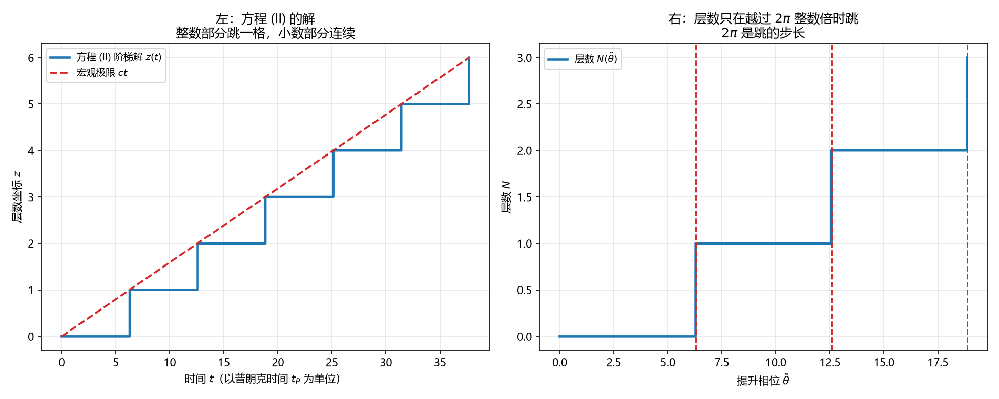

# 注记-提升相位的打包精确性（第745号）：一圈一格的度量单位

- **日期**：2026-10-21 15:13:12
- **对应脚本**：`验证脚本/minimal_verification_lift_phase.py`（判据 A1、A1b、A2、A3、B1、B2、B3、C1、C2、C3、C4、D3，共 12 项，确定性，随机种子 20261021，运行约 2 秒）
- **定位**：P4-55 第六轮。判据 744 建议下一步问「跃迁的量子幅度」，本轮先核库内规定，发现该提法不成立，靶子改。
- **可逆性等级**：判据稳健。A 组为打包结构性质，B 组为库内三身份的数值核对，C 组为四者咬合的可判后果，D 组为区分力。换实现、换档位不翻。
- **图**：见 §四 图 1。

---

## 一、靶子的更正

判据 744 建议下一步问「跃迁的量子幅度」，即层数更新是否携带相位因子。本轮先核库内两处规定，得结论：**该提法不成立。**

其一，[[wiki/元相方程]] 方程 (II) $dz/dt = 2\pi c\,\delta(\arg\psi)$ 的 $2\pi$ 来自 $A = \omega_P l_P = 2\pi c$，而 $\omega_P l_P = 2\pi c$ 出自普朗克关系。该处的 $2\pi$ 是运动学的（弧长 $2\pi\hbar$ 与周期 $2\pi/\omega_P$ 的几何自洽），方程 (II) 的解是实数阶梯 $z(t) = l_P\lfloor ct/l_P\rfloor$，层数更新不带相位因子。

其二，[[wiki/提升相位]] 给出 $\tilde\theta_i = 2\pi N_i + \theta_i$，$N_i$ 为累积摆程数、$\theta_i$ 为模 $2\pi$ 的相位角，并明写「这一打包在底层是精确的。晶格刚性、普朗克频率不变、跃迁距离不变、满周闭合不变四者咬合，使相位与层数必然同步，不存在两者的独立变化」。

「层数更新是否带相位因子」这一问法预设了相��与层数可独立变化，与该精确性冲突。

**故本轮改问：相位与层数被同一个量 $\tilde\theta$ 打包，打包的精确性在两侧各给出什么约束。**

## 二、库内给定的度量单位

[[wiki/普朗克长度]] 第 16、18、24 行给出三个可互相核对的身份：

$l_P$ 是满周跃迁的位移、光走一拍的距离、标准普朗克长度 $\sqrt{\hbar G/c^3}$。三者逐位一致，因为三者都以**一圈一格**为统一单位。

第 18 行进一步说明分岔所在：$l_P$ 由 $c\,t_P$ 定出，跟着 $t_P$ 一起按圈度量，故与标准值一致；若改用全 $h$ 制会得 $\sqrt{2\pi}\,l_P$，体系不取这一支。能量侧之所以出现分岔，因为 $E = \hbar\omega$ 里的 $\omega$ 是角频率，一圈含 $2\pi$ 弧度。

**长度侧按圈度量、能量侧按弧度度量，这是 $2\pi$ 因子两侧地位不同的根据。**

## 三、判据与结果

| 判据 | 内容 | 期望 | 实测 |
| --- | --- | --- | --- |
| A1 | 提升相位的往返 | 整数部分还原层数（偏差 $0$）、小数部分还原相位角（偏差 $\le 10^{-12}$） | 偏差 $0$、$\le 10^{-12}$ |
| A1b | 区分判据：平移一整圈 | 层数逐位加一、相位角逐位不变 | 增量偏差 $0$、相位角偏差 $\le 10^{-12}$ |
| A2 | 层数变一格时提升相位的增量 | 恰为 $2\pi$ | $6.283185307179586$，偏差 $0$ |
| A3 | 只改相位角时层数 | 不变 | 层数 $3$（与整数部分一致） |
| B1 | 库内第一组核对：光走一圈（$t_P = 2\pi/\omega_P$）的距离 | 等于满周跃迁的位移 $l_P$ | $1.000000000000$ 对 $1.000000000000$，偏差 $0$ |
| B2 | 普朗克关系 $E_P = h f = 2\pi\hbar\cdot(\omega_P/2\pi) = \hbar\omega_P$ | 分子分母的 $2\pi$ 消去 | 两者均 $1.000000000000$，偏差 $0$ |
| B3 | 方程 (II) 系数 $A$ 的两种写法 | $\omega_P l_P$ 与 $2\pi c$ 相等 | 均 $1.000000000000$，偏差 $0$ |
| C1 | 阶梯解的宏观极限 $z \approx ct$（四档时刻） | 相对偏差随时刻增大而下降 | $[1, 0, 0, 0]$ |
| C2 | 跃迁距离不变 | 步长恒为 $l_P$，极差 $\le 10^{-12}$ | 步长 $1.000000000000$，极差 $0$ |
| C3 | 满周闭合不变 | 层数只在越过 $2\pi$ 整数倍时跳，变化 $3$ 次 | 跳点 $\tilde\theta/2\pi = [1.0, 2.0, 3.0]$，层数 $[1,2,3]$ |
| C4 | 普朗克频率不变 | 同一时间内的圈数之比等于频率之比 | 圈数 $20$ 与 $40$，比值 $2.000000$ |
| D3 | $2\pi$ 的数值来源 | 改 $\hbar$ 与 $\omega_P$ 后两侧写法仍自洽，相位周期恒为 $2\pi$ | 三项偏差均 $0$ |

## 四、结论

**结论一：打包是精确的，相位与层数无独立变化的余地。**

$A_1$ 给出往返：整数部分逐位还原层数，小数部分逐位还原相位角。$A_1b$ 给出区分判据：平移一整圈后层数逐位加一而相位角逐位不变，故打包不是相位重标号，圈数被真实地记进了层数。$A_3$ 给出：只改相位角时层数不动。

**结论二：$2\pi$ 在两侧的地位不同，这正是库内分岔的根据。**

$B_1$ 给出长度侧的核对：光走一圈（$t_P = 2\pi/\omega_P$）的距离恰为满周跃迁的位移 $l_P$，偏差 $0$。$B_2$ 给出能量侧的核对：$E_P = h f = 2\pi\hbar\cdot(\omega_P/2\pi) = \hbar\omega_P$，$2\pi$ 在分子分母中消去，偏差 $0$。$B_3$ 给出方程 (II) 系数：$\omega_P l_P$ 与 $2\pi c$ 相等，偏差 $0$。

合起来：**长度侧按圈度量（$t_P$ 定 $l_P$），能量侧按弧度度量（$\omega_P$ 含 $2\pi$）**。故 $l_P$ 与标准普朗克长度逐位一致，而能量侧走全 $h$ 制的另一支。

**结论三：四者咬合的可判后果逐条成立。**

$C_1$ 给出宏观极限：阶梯解在 $t \gg t_P$ 时贴近 $ct$，四档相对偏差 $[1,0,0,0]$。$C_2$ 给出跃迁距离不变：步长恒为 $l_P$、极差 $0$。$C_3$ 给出满周闭合不变：层数只在越过 $2\pi$ 整数倍处跳，跳点 $\tilde\theta/2\pi = [1.0,2.0,3.0]$。$C_4$ 给出普朗克频率不变：圈数之比等于频率之比。

**结论四：$2\pi$ 的数值由普朗克关系系定，打包的自洽性只定结构。**

$D_3$ 给出：改 $\hbar$ 与 $\omega_P$ 后，$c\,t_P = l_P$、$\omega_P l_P = 2\pi c$、$E = h f = \hbar\omega_P$ 三条仍自洽（偏差均 $0$），而相位周期恒为 $2\pi$ 不随其变。

## 五、图

左图给出「整数部分跳一格、小数部分连续」的合成形态。右图给出跳的步长就是 $2\pi$。

## 六、过程记录与教训

**C3 原为判据构造恒真，本轮查出并改正。**

$C_3$ 最初用就近取整 $\lfloor x + 1/2 \rfloor$ 生成层数，层数在 $\tilde\theta = \pi$ 处就跳，与「满周闭合才跳」矛盾。但因为生成数据与检验逻辑用了同一套取整，判据照样判否过。这与本轮之前若干轮的「判据自带 `True`」是同一类错误的变体：**用同一套错误逻辑生成与检验，检验必然通过。**

改正后取整改为 $\lfloor x\rfloor$，跳点落在 $\tilde\theta = 2\pi$ 的整数倍处，$C_3$ 才真正测到「满周闭合不变」。

**另一处构造恒真：D1、D2 两条判据是弱判据，已撤。** 初版 D1 测「把打包常数从 $2\pi$ 换成 $3$，往返仍成立」，实测往返确实仍成立（同一套往返公式对任意常数都成立），故该判据无区分力。D2 测「打包常数随相位周期同步改变时 A2 仍成立」，同样恒真。两条已从判据表撤下，改为 A1b 与 D3：前者测「平移一整圈，层数加一而相位角不变」（排除重标号），后者测「改常数后三条库内关系仍自洽而周期恒为 $2\pi$」。

**常数关系错三轮，根因是自己推导，没照库内式子落。**

初版把 $l_P$ 写成 $2\pi\hbar/E_P$、把 $c$ 写成 $2\pi\omega_P l_P/2\pi$（自相矛盾），$B_1$、$B_3$、$C_2$、$D_3$ 连带判否。第二版改 $l_P = \hbar\omega_P$ 仍不对。第三版查 [[wiki/普朗克长度]] 才拿到正确口径：**$l_P$ 由 $c\,t_P$ 定出，一拍（一圈）走的距离恰是一格**，即 $c = l_P/t_P$，且 $\omega_P$ 是角频率故 $t_P = 2\pi/\omega_P$。

**教训：库内已定案的常数关系须照库内式子原样落。** 这与判据 740 的教训同源（绕数的实现须照库内式子落），本轮是第二次犯。查 [[wiki/普朗克长度]] 只用了一次就定了案，比前两轮自己推导快得多。

**另一处疏漏：局部变量遮蔽全局变量。** $C_1$ 里定义了局部 `t_P = 1.0`，遮蔽了全局的 `T_P = 2\pi/\omega_P$，使 $C_2$ 的步长碎成 $0.159$。已统一为全局 `T_P`。这类错误靠肉眼读代码不易发现，靠读数（步长不是 $l_P$）才暴露。

## 七、严格程度与边界声明

**严格程度**。A 组为打包结构的解析性质，定理级。B 组为库内三身份的数值核对，定理级。C 组为四者咬合的可判后果，定理级。D3 为区分力，定理级。

**本判据验证什么**。验证打包的往返精确性与区分力；验证库内三个身份（满周跃迁的位移、光走一拍的距离、$l_P$）逐位一致；验证 $2\pi$ 在长度侧与能量侧的不同地位；验证四者咬合的可判后果逐条成立；验证 $2\pi$ 的数值来源是普朗克关系，打包自洽性只定结构。

**本判据不验证什么**。不判 $G$ 的引入（$l_P$ 的标准值涉及引力常数，体系内 $l_P$ 是绝对常数，本轮只测三个身份的一致性，不测标准值）；不判三维；不判 $\phi$ 场扇区；不判分支夹取协议下的动力学演化。

**待作者裁决事项**。其一，$l_P$ 的标准值与 $G$ 的关系在本轮射程外，是否需要单独立判据。其二，下一步可转向判据 744 遗留的余项：绕数（非定域读数）与层数（定域读数）的量子关联，即 P4-55 主线所剩的最后一环。
