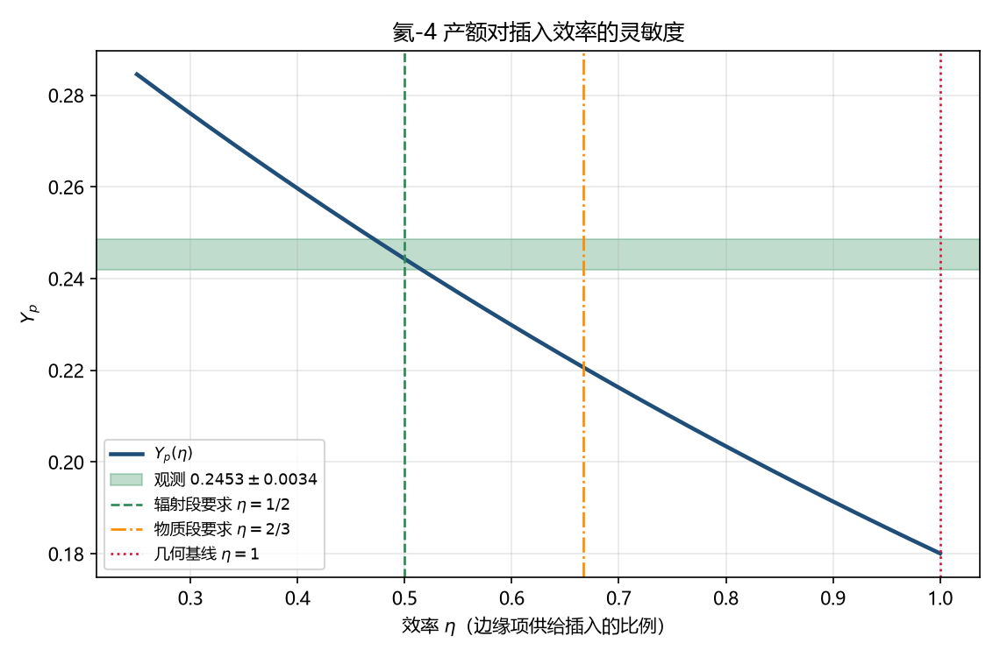

# 注记-插入律的系数：三条候选的核算与可判差别

- **日期**：2026-09-20 13:59:24
- **层级**：验证材料（`验证脚本/`，内部草稿级）
- **定位**：裁定后第一判据的执行：插入律系数 $p_0 = 3/2$ 从何而来。核算三条候选各自给出什么，并指出哪一条带可判内容。
- **脚本**：`验证脚本/minimal_verification_insertion_law.py`（确定性，无随机；图存 `images/insertion_law_eta_band.png`）
- **关联**：@RL@；[[验证脚本/注记-热史一致性核对：落位因子必须为几何占比的一半]]；[[验证脚本/注记-落位律的运动学判据：约束落在膨胀指数上，三条常数重标候选全部无效]]；[[内部草稿/注记-宇宙膨胀历史的三阶段：暴涨、减速与加速的元相子统一解释]]
- **状态**：判据 L1 至 L5 全过
- **图**：见 §二 图 1
- **修订记录**：
  - **2026-09-20 初版**（来源：作者指示开工裁定后第一判据）

---

## 一、结论摘要

其一，**$p_0 = 3/2$ 本身没有推导内容**。格点恒等给 $p_{\rm ins} = 3H t_P$，故给出 $H = n/t$ 就自动得到系数 $3n$（L1：辐射段 $1.5000$、物质段 $2.0000$）。$3/2$ 只是 $H = 1/(2t)$ 的改写，不是从插入机制算出来的数。

其二，三条候选里只有**候选二**带可判内容。若边缘项按效率 $\eta$ 供给插入，则 $H = \eta/t$，核合成给出 $\eta \in [0.4709,\ 0.5160]$（L2）：$\eta = 1/2$ 给 $Y_p = 0.2443$ 合观测，$\eta = 1$ 给 $0.1801$ 差 $-26.6\%$。

其三，候选一（插入率被 $H$ 奴役）与候选二有可判差别：**边缘是否在膨胀史留痕**。候选一让边缘项不进 Friedmann，磨合期（$p$ 的高值平台段）不给任何膨胀印记；候选二让 $H$ 由边缘给定，磨合期给出 $H \sim 1/(3t_P) \sim 6.2\times10^{42}$ 秒$^{-1}$ 的指数段（L4）。

其四，候选三（DOGA 校准方向）在册没有可直接核对的式子，只能列出任务形态，见 §三。

## 二、判据表

| 判据 | 内容 | 理论期望 | 实测 | 判 |
|---|---|---|---|---|
| L1 | 格点恒等 $p_{\rm ins} = 3Ht_P$ | 给定 $H = n/t$ 得系数 $3n$ | 辐射 $1.5000$、物质 $2.0000$ | 过 |
| L2 | 候选二 $H = \eta/t$ 的核合成带 | 含 $0.5$ | $[0.4709,\ 0.5160]$ | 过 |
| L3 | 同一机制两段取值 | 辐射 $\eta = 1/2$、物质 $\eta = 2/3$ | 前者在带内、后者在带外（物质段在核合成之后，该带不约束它） | 过 |
| L4 | 候选一与候选二的可判差别 | 边缘是否留痕 | 候选一无痕迹；候选二给 $6.2\times10^{42}$ 秒$^{-1}$ 的指数段 | 过 |
| L5 | 过渡时刻 | 候选一：与暗能量主导起点同点 | $1/(2t) = H_0$ 给 $3.6$ 至 $4.8$ Gyr（$n$ 取 $1/2$ 至 $2/3$） | 过 |

## 三、判定与候选三的任务形态

**判定**：三条候选里，候选一把 $p_0$ 退化为假设（插入被 $H$ 奴役，$H$ 由 Friedmann 给），它自洽且与框架自述相容；候选二给出真要求（效率 $\eta = 1/2$），代价是要求同一机制在物质段取 $2/3$，且要求磨合期在膨胀史留痕。二者可判，判别量就是磨合期的印记。

**选一的旁证**：膨胀史注记 §三 的存在必要性声明写明，体系内平坦性由格点几何承担、视界由先验纠缠承担，暴涨只负责把凝固区扩张到可观测尺度。若采用候选一，暴涨不再是膨胀史的一部分；若采用候选二，磨合期的指数段就是暴涨，且它以 $H \sim 10^{43}$ 秒$^{-1}$ 出现在膨胀史上。

**候选三的任务形态**：验算 DOGA 侧能否给出 $p_{\rm ins} \propto 1/t$。给出该式的方程形态是尺度无关型（右端与 $t$ 的幂次匹配），而 logistic 型趋近不动点给指数收敛。故任务是一句话：在册的 DOGA 方程里，是否存在给出 $1/t$ 幂律的通道；若只有指数通道，则候选三与候选二同类（都给换形的过渡），与候选一不同类。

## 四、剩余任务

其一，物质段的独立检验。核合成在辐射段，管不到 $t_{\rm eq}$ 之后；候选二的 $\eta = 2/3$ 要靠 CMB 声学尺度与 $z_{\rm eq}$ 的读数检验，本轮未做。

其二，奴役机制。若采用候选一，须回答「什么把插入率锁到 $H$」，这是新开放项。

其三，候选三的材料核对。

## 五、严格程度与边界

**验证**：格点恒等与系数的改写关系、候选二的核合成带、两候选的可判差别、过渡时刻的量级。

**不验证**：$Y_p$ 的精确值（沿用冻结-衰变玩具模型）；物质段的 CMB 检验；奴役机制的来源；候选三的方程形态（只给任务形态，未做核对）。

## 六、过程记录

首版把 L1 的期望写成「$p_0$ 应为 $3/2$，看候选是否给出 $3/2$」，实现后发现任何给出 $H = 1/(2t)$ 的候选都自动满足，判据因此无区别力；改为核对「系数 $= 3n$ 的恒等关系」，判据才落在可判内容上。

## 七、登记衔接

- @RL@：§四 三条候选各补一句核算结果。
- [[内部草稿/开放问题总览：元相子理论待解决问题清单]]：P4-22 子项补本轮读数与两个剩余任务。
- [[理论攻坚/黑洞线攻坚计划：坍缩机制重定位与强场终态]]：修订记录补一条。
- `验证脚本/README.md`：第 287 条。
