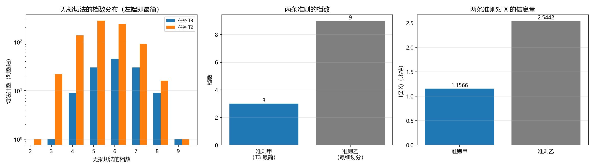

# 注记-整合的目标函数的最小验证：最简无损切法的档数最小性与跨任务变化（判据 L7a 与 L7d）

- **日期**：2026-09-25 04:10:24
- **层级**：验证材料（第 404 条）
- **定位**：执行 [[内部草稿/研究方向-整合的目标函数：任务对齐作准则与信息量作准则的可分辨判据（判据草案）]] 所立判据 L7a 与 L7d，并给出 L7c 的预备读数与两条准则的定量对照。
- **依据**：[[内部草稿/研究方向-整合的目标函数：任务对齐作准则与信息量作准则的可分辨判据（判据草案）]]（L7）；[[验证脚本/注记-对齐判据形式的独立复现：无平局模型上的穷举检验与判据表述修正（判据 L4）]]（第 403 条，同模型与穷举结构）；[[验证脚本/注记-切法与任务对齐的最小验证：装置响应类型、互信息与准确率的分歧（判据 L4）]]（第 402 条）；[[内部草稿/研究方向-心侧入场：主体抽样、整合功能与物侧搭档（判据草案）]]（K6 划界）
- **状态**：判据级。穷举验证，模型内结论。
- **修订记录**：
  - **2026-09-25 初版**（触发：作者批准执行 L7a 与 L7d）

---

## 一、判据（先立）

**L7a 档数最小性。** 对指定任务，最简无损切法的档数等于该任务的语义类个数。

**L7a+ 唯一性。** 达到最小档数的无损切法（不计档标号）唯一。这一条不在草案原表内，是执行中发现可一并给出的读数。

**L7d 与 L4 相容。** 全部无损切法都满足「不同语义类不共档」。

**L7c 预备读数。** 最简档数随任务改变。

**对照（非判据）。** 准则乙的档数与对 $X$ 的信息量，用以量化「简洁」的代价。

## 二、模型设定

与第 403 条同一模型：块长 $8$ 位，$Y$ 在 $0$ 至 $8$，穷举 $Bell(9)=21147$ 种切法。任务 $T_3$ 为三值语义分档（$3$ 类），$T_2$ 为二值（$2$ 类）。基准熵 $H(T_3)=1.156570$、$H(T_2)=0.945373$、$H(Y)=2.544198$ 比特。

## 三、结果

| 判据 | 实测 | 期望 | 判定 |
| --- | --- | --- | --- |
| L7d（$T_3$） | $125$ 种无损切法全部对齐 | 成立 | 过 |
| L7d（$T_2$） | $780$ 种全部对齐 | 成立 | 过 |
| L7a 最简档数（$T_3$） | $3$ | $3$ | 过 |
| L7a 最简档数（$T_2$） | $2$ | $2$ | 过 |
| L7a+ 最简切法计数（$T_3$） | $1$ | $1$ | 过 |
| L7a+ 最简切法计数（$T_2$） | $1$ | $1$ | 过 |
| L7c 跨任务（预备） | $3$ 与 $2$ 不同 | 随任务改变 | 过 |
| 对照：准则乙档数 | $9$ | $9$ | — |
| 对照：准则乙 $I(Z;X)$ | $2.544198$ 比特 | $2.544198$ | — |
| 对照：准则甲（$T_3$ 最简）$I(Z;X)$ | $1.156570$ 比特 | $1.156570$ | — |

七项判据全过，三项对照。

## 四、图

图注按脚本三个绘图面板逐条核对。左右两面板合起来给出本条的实质：准则甲用三分之一的档数、拿到不到一半的信息量，而对指定任务毫无损失。

## 五、实质读数

**其一，最简无损切法唯一。** 不计档标号，两个任务各只有一种最简无损切法（$T_3$ 为 $\{L\},\{M\},\{H\}$，$T_2$ 为 $\{0..4\},\{5..8\}$）。整合在「准则甲」之下没有选择余地，这一点比档数最小性更强：它意味着准则甲一旦被采纳，输出被任务唯一确定。

**其二，「最简洁最有用」获得成对数字。** 对任务 $T_3$，准则甲用 $3$ 档、对 $X$ 保留 $1.156570$ 比特，任务无损；准则乙用 $9$ 档、保留 $2.544198$ 比特，任务同样无损。简洁的代价是放弃 $1.387628$ 比特关于 $X$ 的信息，而任务性能不损失。这是体系既有表述「最简洁最有用」第一次有可算形态。

**其三，准则甲的产出随任务改变。** $T_3$ 最简 $3$ 档、$T_2$ 最简 $2$ 档，两者不同，故 L7c 的预备条件成立。若同一档划分适用于所有任务，两种准则不可分辨，L7c 的正式检验须另设。

## 六、过程记录（期望值第三次手算截断）

初版把 $H(Y)$ 的期望手算为 $2.544072$，实测 $2.544198$，差 $1.3\times10^{-4}$。这是本线连续第三次因手算二项熵而写错期望值（前两次见第 401、402 条）。

**教训升级为规则。** 凡期望值含二项熵或导数分档的熵，不得手算填入；应由脚本内的解析式给出，或在注记中标注容忍度。三次同因失误说明这属流程缺口，本条起按规则执行。

## 七、严格程度声明

**可逆性等级：判据稳健。** L7a、L7a+、L7d 由穷举结构直接给出，不随参数或实现翻；L7c 的正式检验（跨任务输出）尚未做，其稳健性待验后标。

**协议伪影与物理结论分层。** 全部读数为协议级（离散模型、穷举划分、两类任务），物理层结论零条。

## 八、边界声明

**验证什么。** 最简无损切法的档数与唯一性；无损切法与对齐条件的相容；两条准则在档数与信息量上的定量差别。

**不验证什么。** 心的整合是否真按准则甲运行（这是判据组 L7 的待验核心，本稿只验准则甲的数学性质）；档数代价函数的形式（L7e）；真实认知系统的任务选择；L7b 与 L7c 的正式检验。

## 九、登记衔接

本材料为 `验证脚本/README.md` 第 404 条，脚本 `minimal_verification_integration_target.py`，图 `images/integration_target.png`。与第 403 条共用模型与穷举结构，与第 402 条同属对齐判据线。开放问题总览的登记见该文档 P4-6 条目。
