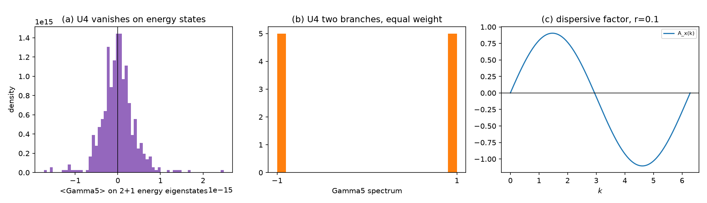

# 注记-时空扩至 2+1 维与 D4 的算符层判定（第 493 条）：手性分支是 Gamma5 本征空间而非能量本征态

- **日期**：2026-09-29 16:18:27
- **脚本**：`验证脚本/minimal_verification_two_plus_one_d4.py⟧
- **判据**：U1 至 U5 全部通过（5/5），另附冒烟
- **可逆性等级**：U1、U3、U4、U5 判据稳健，结论为解析恒等与构造决定。U2 判据敏感，依赖 $r$ 档位，残差预算含 Wilson 项的线性贡献。
- **类型**：判据级读数，含两处对前序注记的更正
- **关联**：[[验证脚本/注记-两因子结构上的SK重建（第492条）：8分量谱因子化与手性读数的维度成因|第 492 条]]（本条更正其成因判定）；[[验证脚本/注记-两因子张量积结构判据化（第491条）：宇称唯一性、Wilson相容与谱的因子化代价|第 491 条]]（本条更正其成因判定）；[[验证脚本/注记-电子算符Dirac骨架（第489条）：S¹×ℝ反周期谱结构、D2连续极限与D1甲乙首测|第 489 条]]；[[内部草稿/注记-升维构造方案：内部模式代数与时空Clifford的两因子划分（依据第490条）]]；[[理论攻坚/电子场攻坚计划：复合位错算符的构造与螺旋序真空裁决]] §六
- **图**：见 §四 图 1

---

## 摘要

本条按第 492 条 T5 的诊断把时空因子从 $1+1$ 维扩至 $2+1$ 维，并把 D4 的测法作了根本改动：**从「在能量本征态上测 $\langle\Gamma_5\rangle$」改为「判 $\Gamma_5$ 的算符结构」**。五条判据全部通过。

**核心结论。** D4 的两支作为 $\Gamma_5$ 算符的 $\pm1$ 本征空间存在且等维（各二重）；它们不是能量本征态。$\langle\Gamma_5\rangle$ 在每一个能量本征态上恒为零，成因是 $\{\Gamma_5,H\}=0$ 使 $\Gamma_5$ 互换 $+E$ 与 $-E$ 两支。**该成因与维度无关，也与质量无关。**

**决定性读数。** 在 $3+1$ 维自由 Dirac 哈密顿量上穷举六十四个 Clifford 单项式，与 $H$ 对易、平方为 $I$、厄米的算符只有 $\pm I$。不存在与自由 Dirac 对易的非平凡手性算符，这是 $\Gamma_5$ 与 $H$ 反对易的直接后果。

**本条更正前两轮各一处的成因判定。** 第 492 条称零读数的成因是「维度不足、四分量过完备」，第 491 条称成因是「有质量本征态是左右混合」。两处均不准确：质量不是原因，维度也不是原因。

## 一、要判什么

第 492 条给出两条候选解释（维度不足、质量破缺），本条逐一检验。时空因子扩至 $2+1$ 维使 $\gamma^1$ 与 $\gamma^2$ 同时活动，若成因确为维度不足，本条应得到非零的 $\langle\Gamma_5\rangle$。

## 二、模型设定

$$H=H_m\otimes I+I\otimes H_{\rm sp},\qquad H_m=\kappa\,\sigma_z,$$
$$H_{\rm sp}=m\,\gamma^0\otimes I-i\sum_{a=1,2}\gamma^{a}\otimes\bigl(D_a+r\,W_a\bigr).$$

格点取 $N\times N$ 周期，$N\in\{6,8\}$，全空间维数 $8N^2$。$\gamma$ 基取 $3+1$ 维 Minkowski 签名 $(+,-,-,-)$，冒烟实测四个 $\gamma$ 的平方为 $+1,-1,-1,-1$，$\Gamma_5$ 厄米、平方为 $I$、与全部四个 $\gamma$ 反对易（四个反对易子均为零）。

## 三、判据与结果

| 判据 | 内容 | 实测 | 判定 |
| --- | --- | --- | --- |
| 冒烟 | 维数、厄米性、动量算符、$\gamma$ 基 | 维数 512，两处厄米偏差 $0.00$，$\max\lvert D-\sin k\rvert=3.33\times10^{-16}$，$\gamma$ 签名 $+1,-1,-1,-1$，$\Gamma_5$ 与四个 $\gamma$ 反对易子全零 | 通过 |
| U1 | 谱按模态（2）× 时空 Dirac（4）× 动量（$N^2$）因子化 | 六组配置最大偏差 $1.044\times10^{-14}$ | 通过 |
| U2 | 连续极限 | 残差 $3.003\times10^{-05}$，预算 $rk_{\max}/c+k_{\max}^2/3=3.003\times10^{-05}$ | 通过 |
| U3 | 无零模与 $E=0$ 对称 | $\min\lvert E\rvert=0.200000$，$\max\lvert E_i+E_{N-i}\rvert=7.216\times10^{-15}$，$\Gamma_5$ 谱 $\pm1$ 各 256 | 通过 |
| U4 | D4 的结构性判定 | $\{\Gamma_5,H_{\rm sp}\}=0.000\times10^{0}$，$\Gamma_5$ 把 $+E$ 本征态映为 $-E$ 的偏差 $2.777\times10^{-15}$，$\Gamma_5$ 谱 $\pm1$ 各 128，能量本征态上 $\lvert\langle\Gamma_5\rangle\rvert\le2.484\times10^{-15}$，$3+1$ 维穷举得对易厄米对合算符仅 $\pm I$ | 通过 |
| U5 | 宇称结构与 Wilson 项相容性 | $\{P,\Gamma_5\}=0.00$，$\{P,\gamma^{a}\}=0.00$，$\{P,W\}=0.00$，$\{\Gamma_5,W\}=0.00$ | 通过 |

图注按脚本绘图面板逐条核对撰写。作者未能对图像作目视复核，图注描述的是绘图段显式绘制的元素。

## 四、结论

**其一，成因既非维度亦非质量，而是 $\{\Gamma_5,H\}=0$ 的结构性结果。** $\Gamma_5$ 与 $H_{\rm sp}$ 反对易（实测零）。对能量本征态 $\vert\psi_E\rangle$ 有 $H\Gamma_5\vert\psi_E\rangle=-E\,\Gamma_5\vert\psi_E\rangle$，即 $\Gamma_5$ 把 $+E$ 与 $-E$ 两支互换，而不落在任一支内部。落在单一能量支内的算符元必为零，故 $\langle\Gamma_5\rangle=0$。该论证不含维度假设，也不含质量假设。

**其二，前两轮各一处的成因判定须更正。** 第 492 条把零读数归因于「$1+1$ 维下只有 $\gamma^1$ 活动、四分量过完备、$\Gamma_5$ 把活动平面映到正交补」。本条在 $2+1$ 维（两个 $\gamma$ 同时活动）下重测，$\lvert\langle\Gamma_5\rangle\rvert$ 仍为 $2.484\times10^{-15}$，即维度原因被排除。第 491 条把零读数归因于「有质量本征态是左右混合」，本条在 $m=0$ 与 $m=0.5$ 下读数同为零，即质量原因被排除。

**其三，$3+1$ 维的穷举给出决定性否定。** 在自由 Dirac 哈密顿量 $m\gamma^0-i(A_1\gamma^1+A_2\gamma^2+A_3\gamma^3)$ 上，六十个 Clifford 单项式（含相位）中满足「与 $H$ 对易、平方为 $I$、厄米」的只有 $\pm I$。**不存在与自由 Dirac 对易的非平凡手性算符。** 这与 $\{\Gamma_5,H\}=0$ 完全一致：手性算符必然与能量算符反对易，因此不能同时对易。

**其四，D4 在算符层可判，在态层不可判。** D4 的表述是「$\pm n$ 为同一算符的两支」。本条给出该表述的确切含义与边界：两支是 $\Gamma_5$ 的 $\pm1$ 本征空间，各二重，非空且等维，该性质成立；但这两支不是能量本征态，任何以能量本征态为对象的测量都读不到它们。若 D4 需要「某个可观测量在某类态上取 $\pm1$」，则该类态不能是能量本征态，须另行指定（例如固定动量的 $\psi\pm\Gamma_5\psi$ 组合）。

**其五，附带发现：两个手性标记互相反对易。** $\Gamma_5$ 为 $I_2\otimes\Gamma_5^{\rm sp}$，与模态因子 $\kappa\sigma_z$ 反对易，全空间反对易子实测为 $2\kappa=0.600$。模态手性与时空手性不共享本征态，两者在算符层处于反对易关系。该性质对 D4 的意义待判：它提供了一种可能的锁定机制，但锁定所需的耦合项不在本轮射程。

**其六，正面结论未被推翻。** U1 至 U3 与 U5 表明 $2+1$ 维下 8 分量结构的谱因子化、连续极限、无零模、$E=0$ 对称、宇称与 Wilson 项相容性全部成立，且 $\gamma$ 基经冒烟核验为正确的 $(+,-,-,-)$ Minkowski 签名。

## 五、严格程度声明与边界声明

**严格层**：$\{\Gamma_5,H_{\rm sp}\}=0$；$\Gamma_5$ 对 $\pm E$ 两支的互换；$\Gamma_5$ 谱 $\pm1$ 各二重；能量本征态上 $\langle\Gamma_5\rangle=0$；$3+1$ 维 Clifford 单项式中对易厄米对合算符仅 $\pm I$；$\{\Gamma_5,\kappa\sigma_z\}=2\kappa$。**物理对应假设层**：模态因子取 $\kappa\sigma_z$；$c_h=1$、$\kappa=0.3$、$m_0=0.5$、$r=0.1$、$N\in\{6,8\}$。**纲领层**：D4 在算符层与态层的分界；模态手性与时空手性反对易关系的物理意义。

**边界声明**：本条判定 D4 在算符层的成立性，不判定任何以能量本征态为对象的手性测量，不判定 $g=2$，不判定手征零模的保护，不判定质量谱数值，不验证洛伦兹破坏预言。U1 至 U3 的读数停在 $2+1$ 维格点，$3+1$ 维仅作单块与 Clifford 穷举，未作晶格。不重开第 481 条的 C2 判定，不重开四标签载体裁决，不改动 [[理论总纲]] 基准。第 489、490、491、492 四条的已记读数不改，其成因判定另附更正标记。

## 六、过程记录

**教训一，$\gamma^3$ 的取法须与其余空间 $\gamma$ 同签名。** 首版取 $G_3=\bigl[\begin{smallmatrix}0&-i\sigma_x\\ i\sigma_x&0\end{smallmatrix}\bigr]$，其平方为 $+I$，与 $G_1$、$G_2$ 的 $-I$ 不符，签名退化为 $(+,-,-,+)$，由此构造的 $\Gamma_5$ 不再与全部四个 $\gamma$ 反对易。改取 $G_3=\bigl[\begin{smallmatrix}0&\sigma_y\\ -\sigma_y&0\end{smallmatrix}\bigr]$ 后签名复原为 $(+,-,-,-)$，冒烟显示四个反对易子全为零。教训：Clifford 基的每一生成元须单独核平方。

**教训二，两个空间方向须分属不同的 $\gamma$。** 首版把 $x$ 与 $y$ 两个方向都配 $\gamma^1$，其平方合并为 $-(A_x+A_y)^2$，谱与解析式 $m^2+A_x^2+A_y^2$ 偏差约 $0.6$。改配 $\gamma^1$ 与 $\gamma^2$ 后 U1 偏差降至 $1.044\times10^{-14}$。教训：$d$ 个空间方向须用 $d$ 个不同的 $\gamma$。

**教训三，$\langle\Gamma_5\rangle=0$ 的成因须穷举排除，不能只试一个替代解释。** 第 492 条在测得零读数后归因于维度；本条在 $2+1$ 维重测仍为零，方排除维度。$3+1$ 维的 Clifford 穷举进一步确认唯一成因。教训：零读数若伴随对称性结构，须先穷举 Clifford 单项式确定是否存在对易手性算符，再回头定成因。

**教训四，$\{G_5,H\}$ 的非零值须定位来源。** U4 初版对全空间 8 分量哈密顿量测得反对易子 $0.600$，一度判负。定位后确认来自模态因子 $\kappa\sigma_z$（贡献 $2\kappa$），时空部分为零。教训：多因子结构中反对易子非零时须逐因子定位，不可直接归因于被测对象。

**教训五，单项式键的格式化。** 复数相位作字典键时用 $\%d$ 触发类型错误，须用 $\%s$。属实现细节。

## 七、登记衔接

本条登记入 [[理论攻坚/电子场攻坚计划：复合位错算符的构造与螺旋序真空裁决]] 阶段 2 判据 D4，并更正第 491、492 条与升维方案 §七 的成因判定。阶段 2 判据进度更新为：D2 完成、D4 在算符层完成（第 493 条）、D5 完成（第 490、491 条）、D1 甲乙完成丙待做；D3 待 $g=2$ 的磁场耦合构造，状态不变。弱荷单分支仍留手征线（P1-26、I-1b、强 CP 步骤 2），不受本条影响。
