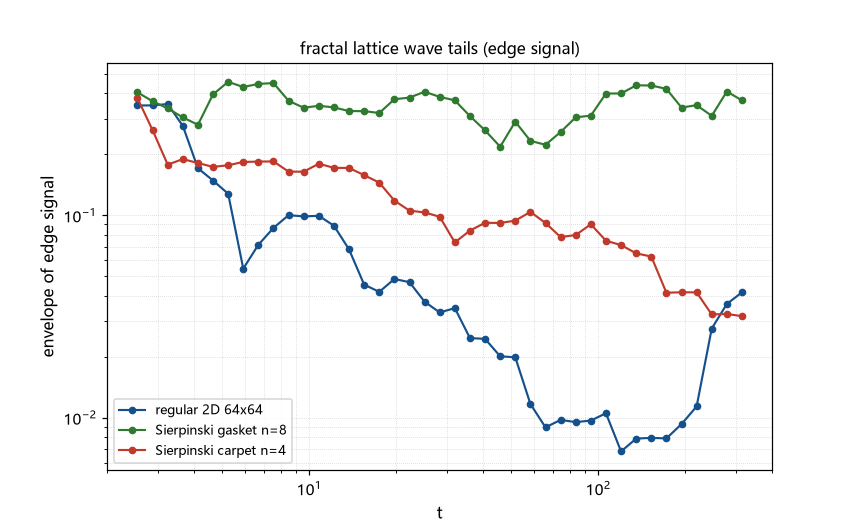

# 注记-有效维数 2.4 的几何实现（第428条）：候选几何清点与有限分形图的测量限制

- **日期**：2026-09-26 08:10:06
- **类型**：侦察轮（候选丁段三）
- **脚本**：`验证脚本/fractal_tail_scan.py`（第 428 条）
- **图**：见 §3 图 1（`images/fractal_tail_scan.png`）
- **依据**：[[验证脚本/注记-γF 等于 d 半的解析化（第427条）：BZ 角点半稳相求和、1D 闭式与噪声地板下的 2D-3D]]（d/2 律的解析结构）；[[内部草稿/总结报告-格点尾链条：从意外读数到解析化（2026-09-26）]]（链条与靶）
- **状态**：侦察完成。读数受有限分形图回归限制（不可用，登记）；候选几何定位到「分形网络/谱维数」一类；混合耦合与各向异性两条排除；靶与几何之间的理论接口已明确
- **可逆性等级**：判据敏感（数值读数跨窗漂移、不可用；排除两项为论证级）

## 1 判据与设定

问题：链条靶 $\gamma_v = 4/5$ 经 $\gamma_v = 2-\gamma_F$ 与 $\gamma_F = d_{\rm eff}/2$ 反推需 $d_{\rm eff} = 2.4$，「2.4 维」的几何从何而来。方法：在分形格点（Sierpinski 垫片 $d_f = \log 3/\log 2 \approx 1.585$、地毯 $d_f = \log 8/\log 3 \approx 1.893$、规则 2D 对照）上做图拉普拉斯脉冲响应，取相邻点响应差（力型信号），测包络尾指数（判据 Q1 至 Q4）。

## 2 结果

Q1 至 Q3（扫描读数）：三几何的尾指数跨窗漂移剧烈（规则 2D：$-1.065$ 与 $-0.019$；垫片：$0.004$ 与 $0.288$；地毯：$-0.175$ 与 $-0.601$），**读数不可用**。归因：有限图的离散谱密集（分形谱尤甚），准周期回归早于尾段（与第 424 条的均衡污染同族，合并为「有限格效应」）。

Q4（机制清点，本轮的实质产出）：其一，**分形网络路线（主线）**：分形上的振动有谱维数（fracton 图像，$d_s = 2d_f/d_w$）；若 427 的半稳相骨架可推广到「分形支撑的谱」，则尾指数猜想为 $d_f/2$ 型，「$d_{\rm eff} = 2.4$」即「某分形网络（如接缝网络）的维数 2.4」；定量测量受本方法限制，移交。

其二，**混合维度耦合路线（判负）**：2D 分量与 3D 分量共存时，「慢尾主导」（$t^{-1}$ 或临界压制的 $t^{-2}$ 对 $t^{-3/2}$）；不产生中间指数 2.4。其三，**各向异性权重路线（排除）**：427 已证方向权重只改系数不改指数。

## 3 图

## 4 结论与移交

结论：段三（靶到几何）从空白变为「有候选族与理论接口」：$d_{\rm eff} = 2.4$ 的候选几何定位到分形网络（谱维数）一类，理论接口为「分形支撑上半稳相」的 $d_f/2$ 猜想；混合耦合与各向异性两条路线排除（前者判负含论证）。数值定量受有限图回归限制。

移交三条。其一，分形尾指数的可靠测量：更大图的迭代本征求解、或「谱测度」半解析（按态密度 $\rho(\omega) \sim \omega^{d_s-1}$$ 直接做频谱积分，避开全图对角化）。其二，接缝网络的谱维数建模：框架的接缝/位错网络的几何与谱维数（是否可达 2.4）。其三，保留项：$\gamma_F = 1$ 临界区次阶（第 426 条移交）。

## 5 严格程度与边界声明

严格程度：Q1 至 Q3 为数值（受限、登记）；Q4 的路线清点中，「混合耦合判负」为论证级（尾的竞争），「分形猜想」为接口级（未证明）。

边界（本脚本不验证的内容）：其一，分形图仅到 $N \approx 7\times10^3$（稠密对角化上限），回归限制未通过更大图排除；其二，$d_f/2$ 猜想未做解析或半解析核验；其三，接缝网络的谱维数未建模。

## 6 过程记录

其一，拟合窗点数不足导致首轮全 nan（分段过粗），改滑动 RMS 后出读数；随后跨窗对照暴露回归限制。

其二，「有限格效应」由此合并了两次登记（均衡污染、本条的密集谱回归），统一为第七类数值陷阱的条目：**凡有限格上的长时尾测量，先核回归时间与窗的比**。

其三，本轮如实定格为「侦察加清点」：数值未达定量，但路线筛选（两排除一主线）与理论接口（分形半稳相猜想）是可用的产出。
