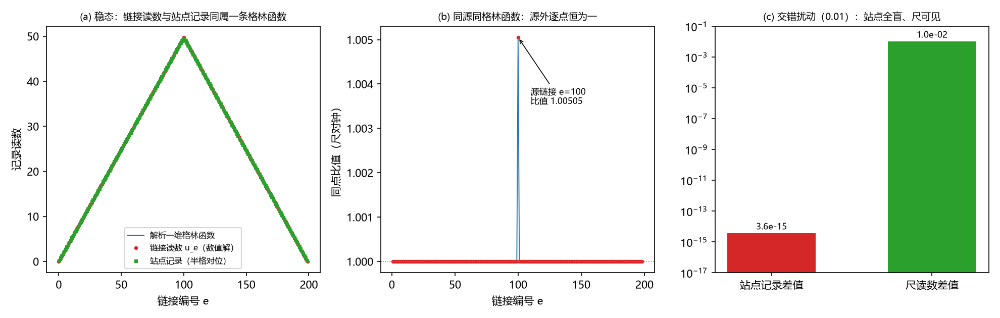

# 注记-本体层重建阶段 2：链接型写入的一维最小模型

- **日期**：2026-09-18 20:55:03
- **对应脚本**：`验证脚本/minimal_verification_rebuild_1d.py`（判据 T1 至 T4，4/4 通过；确定性，运行约 1 秒）
- **依据**：[[理论攻坚/本体层重建攻坚计划：写入作用于链接与空间度量的同源导出]]（阶段 2 与交付物 D3）；[[内部草稿/注记-本体层重建阶段1语义设计稿：一段一个读数]]（排布二与两读数语义）；[[内部草稿/注记-GV0前置清点：链接等于站点差的影响面、不可动清单与分段c判据草案]]（不可动清单与方向 6 规则）；[[内部草稿/注记-张量桥分段d的建造要求：同源同格林函数与空间扇区的最小改动清单]]（同源同格林函数要求）；[[内部草稿/开放问题总览：元相子理论待解决问题清单]] P1-5
- **定位**：本体层重建阶段 2 的判据执行。三条 D3 判据（稳态格林函数保持、构型不再纯规范、小扰动稳定）加一条附加读数（同源同格林函数与 $\lambda$ 读数）。本注记不改动基准文件。
- **状态**：判据 4/4 通过。核心读数三条：稳态仍是离散格林函数（残差 $7.1\times10^{-15}$、解析帐篷偏差 $6.6\times10^{-15}$、源链接通量跳变恰为源强）；站点合成映射的核维数为一（交错模对站点差 $3.6\times10^{-15}$，对尺差恰为扰动幅度）；生成元本征值全负（最慢模 $-1.246\times10^{-4}$，与解析式一致至 $5.2\times10^{-13}$）。附加读数：源外两读数逐点同比（$2.2\times10^{-16}$），$\lambda$ 读数 $1.000000$，属归一化读入。
- **图**：见 §三 图 1（`images/rebuild_1d.png`）

---

## 一、判据与结果

| 判据 | 内容 | 通过条件 | 实测 |
|---|---|---|---|
| T1 | 稳态格林函数保持 | 残差、形状、通量三项在机器精度内 | 残差 $7.1\times10^{-15}$；帐篷偏差 $6.6\times10^{-15}$；源外通量跳变 $3.6\times10^{-15}$；源链接跳变 $0.500000$ |
| T2 | 构型不再纯规范 | 站点对交错分量盲，尺可见，核维数为一 | 站点差 $3.6\times10^{-15}$；尺差 $1.0\times10^{-2}$；合成映射秩 $199$、核维数 $1$；核向量与交错模重合度 $1.000000000000$ |
| T3 | 小扰动稳定 | 本征值全负且合解析式；松弛单调 | 最大本征值 $-1.2461\times10^{-4}$（解析同值，偏差 $5.2\times10^{-13}$）；松弛 400 步单调性违反 $0$ |
| T4 | 同源同格林函数（附加） | 源外逐点同比；源链接偏离等于 $s/(2\alpha)$ | 源外偏差 $2.2\times10^{-16}$；源链接偏离 $0.250000$；$\lambda$ 中位 $1.000000$ |

## 二、设定与解析

一维链：站点 $0$ 至 $200$ 共 $201$ 个，链接 $0$ 至 $199$ 共 $200$ 条，链接 $e$ 连接站点 $e$ 与 $e+1$。基本自由度放在链接上（排布二）：每条链接带记录 $u_e$，两端固定为零。站点记录由链接读数合成，$\theta_s = (u_{s-1} + u_s)/2$。长度因子取 $\ell_e = 1 + u_e$，其语义（相对坐标格距的物理长度比例，背景格距不动）见 [[内部草稿/注记-倾角与它的下游读数：钟、物理尺与普朗克长度不变]]。

源写入作用于链接，单点源置于 $e = 100$，源强 $s = 0.5$。松弛规则取"邻居传导加源写入"，与方向 6 的"每拍写入幅度加邻居传导"同形：

$$\frac{du_e}{dt} = \frac{\alpha}{2}\left(u_{e-1} - 2u_e + u_{e+1}\right) + s_e, \qquad \alpha = 1$$

该式与 $-\alpha u_e + \frac{\alpha}{2}(u_{e-1} + u_{e+1}) + s_e$ 恒等。稳态方程 $\alpha u_e - \frac{\alpha}{2}(u_{e-1} + u_{e+1}) = s_e$ 即 $-\frac{\alpha}{2}\nabla^2 u = s$，本稿直接解线性方程组。

解析解为帐篷形：源左右各为线性段，峰值 $P = s \big/ \left(1 - \frac{1}{2}\left[\frac{E_0 - 1}{E_0} + \frac{N - 2 - E_0}{N - 1 - E_0}\right]\right)$，数值为 $P = 49.748744$。

## 三、读数的意义

**其一，链接型写入复现同一条格林函数。** 直接解与解析帐篷逐点一致（相对偏差 $6.6\times10^{-15}$），源外通量跳变停在 $3.6\times10^{-15}$，源链接处跳变恰等于源强。一维格林函数的形状为 $|x - x_0|$ 段，即 $r^{2-d}$ 在 $d = 1$ 的成员，与三维 $1/(4\pi r)$ 同族。三维系数 $1/(4\pi)$ 的核对属阶段 3，本判据只管形状与通量恒等式。

**其二，段携带站点读不出的数据。** 交错分量 $u_e \to u_e + \eta(-1)^e$ 对站点合成全盲（差 $3.6\times10^{-15}$，属浮点舍入量级），对尺读数可见（差恰为 $\eta = 10^{-2}$）。合成映射的秩为 $199$，核维数为一，核向量与交错模的重合度为一。含义是站点记录不能唯一决定链接内容，存在只有尺能读到的通道，这正是排布一没有的自由度。

**其三，稳定性与松弛时间。** 生成元（内点、Dirichlet 边界）本征值全负，最慢模 $-1.246\times10^{-4}$，与解析式 $-\alpha[1 - \cos(\pi/199)]$ 一致至 $5.2\times10^{-13}$；由任意初值出发的 400 步松弛对稳态的偏差单调不增。该读数附带一条工程信息：这类问题的迭代收敛由慢模决定，直接解线性方程组更快且精度更高。

**其四，同源同格林函数读数。** 把两读数按同点配对（链接中点取相邻两站点记录的平均），源外比值逐点恒为一（偏差 $2.2\times10^{-16}$），源链接处偏离恰为 $s/(2\alpha) = 0.25$，该点比值 $1.005051$。按 $\ell = 1 + \lambda h_{00}/2$、$h_{00} = 2\theta$ 的约定读出的 $\lambda$ 中位为 $1.000000$。该值由两条读数的代理约定直接给出，属归一化读入；本判据的实质是形状相同，一条格林函数同时供两个通道读出。

## 四、过程记录（订正四处）

**直接解替迭代。** 最慢模速率 $1.25\times10^{-4}$ 决定迭代收敛时间：机器精度收敛需约 $10^5$ 拍，早期版本的两万拍迭代连一半量级都没走到。初版残差公式还把 $-\frac{\alpha}{2}\nabla^2 u$ 写成了 $+\frac{\alpha}{2}\nabla^2 u$，读数无意义。改为直接解线性方程组后，T1 三项读数落在 $10^{-15}$ 量级。

**同点配对。** T4 初版把链接读数与站点读数按同一索引直接相除，链接与站点错位半格，比值在几何上不可能恒定，判据初版不可用。改为链接中点取相邻两站点记录的平均后，源外逐点恒等。

**核判据的写法。** 合成映射为 $199\times200$ 的满行矩阵，核维数为一。用满矩阵 SVD 时核向量位于 $V^H$ 的额外末行，不落在奇异值列表里；初版按"最小奇异值趋于零"判核导致误判，订正为"秩等于 $199$（奇异值全非零，最小 $7.85\times10^{-3}$）加额外末行核对"。

**阈值按舍入量级。** 站点合成差与核残差等阈值按浮点舍入量级定（读数幅值约 $50$，量级 $50\,\varepsilon \approx 10^{-14}$），判据取 $10^{-12}$ 以上留一个量级余量，未采用临时放宽。

## 五、严格程度声明

**数值部分**：四条判据为一维离散核对，读数在 $10^{-15}$ 至 $10^{-13}$ 量级，即机器精度；设定（单点源、Dirichlet 两端、最近邻连通）为最小选择。

**符号部分**：$\theta_s$ 与 $\ell_e$ 对 $u_e$ 的合成与读出方式为排布二的代理约定（线性系数取一），$\lambda$ 读数随之属归一化读入。

**未做**：三维健康性判据（多余模、TT 计数、$c_s = c$、弹性常数关系、各向同性封装）；矢量扇区是否被打开；受影响文档的回归复核。

**边界**：不改动 `理论总纲/` 基准；不主张排布二已被采纳（D2 语义选择属作者裁决）；本读数只作 D3 交付物。

## 六、边界声明

**验证什么**：链接型写入下一维稳态仍是离散格林函数；站点记录与尺读数的映射存在一维核，即段携带独立数据；松弛生成元无增长模式；两读数按同点配对后形状相同。

**不验证什么**：不验证三维 $1/(4\pi)$ 系数；不验证两读数微观耦合的来源与强度；不验证 $\lambda = 1$ 在三维的成立；不给矢量扇区结论。

## 后续（2026-09-27）

交错模（核维数一的"只有尺能读到的通道"）的身份已由第 462 条判定：合成零模加正刚度（体刚度读数 $-2\alpha$、二次型正定），稳态算子满秩、解唯一，且该钉住不涉及耗散（完美弹性公理级定理）。合成权重（算术平均）的确定性由第 463 条判定（各向同性加中心对称唯一钉住 $w = 1/6$）。见 [[注记-交错通道的双重身份（第462条）：合成零模、正刚度与lambda的钉住依赖]] 与 [[注记-合成权重唯一性（第463条）：算术平均被各向同性与中心对称唯一钉住]]。
