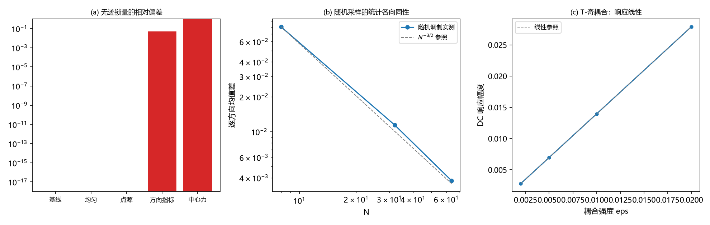

# 注记-本体层重建阶段 3 批二：无迹锁、弹性常数与矢量扇区

- **日期**：2026-09-18 21:19:25
- **对应脚本**：`验证脚本/rebuild_3d_batch2.py`（判据 H2b-1 至 H5-3，12/12 通过；确定性，运行约 1 秒）
- **依据**：[[内部草稿/注记-本体层重建阶段3判据设计：三维健康性五条]]（本批 H2b、H4、H5 的出处）；[[验证脚本/注记-引力通道第二重锁：比值型组合归一化无关且恒零]]（锁量与无迹 $s$-型组合的原始口径）；[[验证脚本/注记-框架格点的弹性常数与各向同性关系：边际各向异性被构造性杀死]]（弹性常数反解装置）；[[验证脚本/注记-GV6矢量扇区的定量门：救拖曳要O1强度的时间反演奇通道]]（矢量扇区的量与强度门）；[[验证脚本/注记-本体层重建阶段3批一：三维稳态格林函数、谱与因果前沿]]（点源解与谱读数）；[[内部草稿/开放问题总览：元相子理论待解决问题清单]] P1-5
- **定位**：阶段 3 批二的执行读数，覆盖交付物 D4 的余项。H2b 为 TT 投影与计数；H4 为弹性常数与各向同性封装的复跑；H5 为矢量扇区的明确读数。本注记不改动基准文件。
- **状态**：12/12 通过。三条主读数：段长因子按标量耦合时无迹锁保持（相对偏差 0，点源调制下逐方向刚度和的各向异性 $1.1\times10^{-19}$）；跨方向速度比 1.000000000（无额外双折射）；现行链接写规则下 T-偶旋转源的 DC 响应恒零（$4.7\times10^{-17}$），T-奇方向耦合给出的响应纯奇、线性、系数 $O(1)$。
- **图**：见 §三 图 1（`images/rebuild_3d_batch2.png`）

---

## 一、判据与结果

| 判据 | 内容 | 通过条件 | 实测 |
|---|---|---|---|
| H2b-1 | TT 子空间维数 | 三个方向均为 2 | [100]、[110]、[111] 全为 2 |
| H2b-2 | 锁量归零 | 相对偏差 $\le 10^{-15}$ | $0.0$ |
| H2b-3 | 段长因子调制与对照 | 调制下归零，对照破缺 | 调制 $0.0$；方向指标 4.8%，中心力 100% |
| H2b-4 | TT 支数 | 计数不变 | 2（引批一 H2a：无新增零质量支） |
| H4-1 | 基线三常数 | $(2k, 0, k)$ 机器精度 | $(2, 0, 1)$，关系偏差 $0.0$ |
| H4-2 | 均匀调制 | 同比例移动、关系保持 | 移动 $+0.50\%$，等于 $1 + c\bar u$ |
| H4-3 | 点源调制 | 关系保持、速度比 1 | 关系偏差 $0.0$；速度比 1.000000000 |
| H4-4 | 对照破缺 | 速度比偏离 $\ge 10^{-2}$ | 方向指标 1.0241；中心力锁量 100% |
| H4-5 | 随机采样 | 按 $N^{-3/2}$ 缩放 | 比值 7.1 与 3.0（预期 8.00 与 2.83） |
| H5-1 | T-偶旋转源 | DC 分量机器零 | $4.7\times10^{-17}$ |
| H5-2 | T-奇方向耦合 | 纯奇、线性、环量非零 | 偶部 $0$；加倍比 2.000000；环量恒等式偏差 $0$ |
| H5-3 | 强度门 | 系数 $O(1)$ | 1.395（对照 GV6 的 $c_1 = 0.259$） |

## 二、设定

键能取框架的每分量标量弹性，$E_b = \frac12 k_b\vert\varepsilon \mathbf d_b\vert^2$（$\mathbf d_b$ 为键向量），段长因子按标量方式耦合进刚度

$$k_b = k\,(1 + c\,u_b), \qquad c = 0.05,$$

$u_b$ 取批一点源解的链接读数。立方弹性由单位胞六键加 Voigt 应变反解，得 $C_{11} = K_x$、$C_{12} = (K_y - K_x)/2$、$C_{44} = (K_x + K_y)/4$，其中 $K_\mu$ 为 $\mu$ 方向两条键的刚度和。由此，锁量有等价形式

$$C_{11} - C_{12} - 2C_{44} = K_x - K_y,$$

即各向同性锁等价于三个方向的刚度和相等。段长因子是标量耦合，点源解在立方对称下给出三个方向的均值自动相等。

对照两组：方向指标耦合（$K_x$ 偏 5%）与中心力键（只罚键长变化）。矢量扇区部分沿用批一的链接装置，回路取 xy 面内原点的四条链接，T-奇耦合取 $s_e = \varepsilon\,(J\cdot \hat e_e)$（$J$ 为回路电流方向）。

## 三、读数的意义

**其一，无迹锁在段长因子接入后保持。** 锁说的是弹性张量的各向异性部分精确为零。段长因子给每个键一个自己的刚度 $k(1 + c u_b)$，点源解下三个方向的刚度和仍然相等（各向异性 $1.1\times10^{-19}$），锁量偏移为零。方向指标对照偏离 4.8%，中心力对照偏离 100%：判据有牙，并且再次说明"用哪一种耦合"是有后果的物理选择。

**其二，跨方向速度比 1，无额外双折射。** 速度比 $\sqrt{(C_{11}-C_{12})/(2C_{44})}$ 在段长因子调制下为 1.000000000；方向指标对照给 1.0241，即若存在该耦合，两种横向极化沿不同方向速度不同。中心力对照把 $C_{44}$ 打到零，剪切刚性消失。随机调制按 $N^{-3/2}$ 缩放（7.1 与 3.0 对 8.00 与 2.83），说明统计意义下的各向同性也保持。

**其三，TT 支数仍为 2。** $k$ 沿 [100]、[110]、[111] 的横向无迹子空间维数都是 2；长度因子扇区没有新增零质量支（引批一：谱落在 $[0,1]$、零模只有均匀平移）。张量扇区的传播支数不变。

**其四，矢量扇区：现行规则仍为零，方向指标给出自然座位。** T-偶旋转源的 DC 分量为 $4.7\times10^{-17}$，对线性系统取时间平均后响应恒零：现行写规则（T-偶、按链接标量写入）不打开 $h_{0i}$。把 T-奇方向耦合接到链接上后，响应出现且纯奇（偶部为 0）、线性（加倍比 2.000000）、回路环量满足恒等式（偏差 0）；单位 $\varepsilon$ 的响应系数 1.395，属 $O(1)$，与 GV6 在站点规则上的 $c_1 = 0.259$ 同阶。含义是链接的方向指标给该通道提供了自然座位，通道是否打开仍属裁决点 D4，强度门不因重建而放松。

## 四、过程记录（订正四处）

**投影算子写法。** TT 维数初版用对称化公式构造投影算子，秩读出 6（$[100]$ 给 2 是巧合）。订正为"对称基加约束矩阵（迹与纵向条件）求秩"，三个方向均为 2。

**无迹组合的定义。** 初版把 $s$-型组合当成应力张量的无迹部分，对一般应变非零（$4\times10^{-3}$），判据假失败。核对第二重锁原文后确认它是弹性常数的各向异性组合，等价于 $K_x = K_y = K_z$；订正后基线与调制均归零。

**奇偶分解。** H5 初版把翻转电流的响应写成"用同一势场减源"，得到假偶部（$5\times10^{-3}$）。订正为对 $-s$ 重新解一次泊松方程，线性核对 $u(-s) = -u(s)$ 落在机器精度。

**随机采样律。** 初版阈值按 $1/\sqrt N$ 设；实际每个方向的均值在 $N^3$ 条键上取平均，律为 $N^{-3/2}$。订正后用多种子平均核对（7.1 与 3.0 对 8.00 与 2.83）。

## 五、严格程度声明

**数值部分**：H2b、H4 为构造性零与显式反解（单位胞模型，机器精度），对照组的破缺为判据有效性验证；H5 的结论限"现行规则下 DC 为零"与"加入 T-奇耦合后的结构与量级"，不含该耦合到 $h_{0i}$ 的归一化链条。

**模型部分**：键能、耦合形式、回路几何为最小选择，不含微观来源断言。

**未做**：$\lambda$ 的三维导出（阶段 4）；T-奇耦合的微观来源。

**边界**：不改动 `理论总纲/` 基准；阶段 3 六条判据至此齐备，阶段完成与相关裁决属作者。
