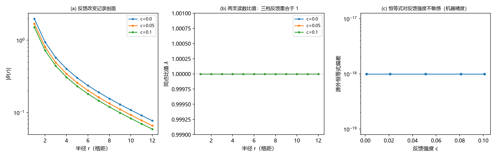

# 注记-本体层重建阶段 4：识别式重跑与 $\lambda$ 导出的读数（L1 至 L3）

- **日期**：2026-09-18 22:51:57
- **对应脚本**：`验证脚本/minimal_verification_rebuild_stage4_lambda.py`（判据 L1 至 L3，3/3 通过；确定性，运行约 11 秒）
- **依据**：[[内部草稿/注记-本体层重建阶段4判据设计：识别式重跑与lambda导出的判据与最小实现]]（本批判据的出处）；[[验证脚本/注记-本体层重建阶段3批一：三维稳态格林函数、谱与因果前沿]]（装置与同点配对）；[[验证脚本/注记-本体层重建阶段3批二：无迹锁、弹性常数与矢量扇区]]（键能反馈形式）；[[验证脚本/注记-GV1潮汐项与里奇对应：真空条件把lambda逼到1]]（真空条件锚）；[[验证脚本/注记-空间系数lambda的光偏折锚：偏折角随lambda的线性律]]（光偏折锚）；[[内部草稿/开放问题总览：元相子理论待解决问题清单]] P1-5
- **定位**：阶段 4 的执行读数（批一）。L1 泊松源自洽与结构恒等式；L2 反馈稳健性；L3 $\lambda$ 的归一化读出与外推。L4（三锚对照）与 L5（回归影响面）留作批二。本注记不改动基准文件。
- **状态**：3/3 通过。主读数：源外同点比值恒为一（构造性恒等，机器精度；泊松源自洽偏差 $4.4\times10^{-16}$ 至 $1.2\times10^{-15}$）；键能反馈把记录剖面峰值改变 $23.37\%$ 而比值不漂移；$\lambda$ 导出 = 1.000000000000（N=64 与 96 的 $1/r^2$ 外推一致）。
- **图**：见 §三 图 1（`images/rebuild_stage4_lambda.png`）

---

## 一、判据与结果

| 判据 | 内容 | 通过条件 | 实测 |
|---|---|---|---|
| L1 | 泊松源自洽与结构恒等式 | 合成 $\theta_u = \theta$（含环面常偏置）且源外比值恒为一 | 自洽偏差 $4.4\times10^{-16}$ 至 $1.2\times10^{-15}$；比值偏差 $0.0$ |
| L2 | 反馈稳健性 | $c$ 取 $0$、$0.05$、$0.1$ 时不漂移，且反馈确实在场 | 比值中位三档均 $1.000000000000$；剖面峰值移动 $23.37\%$ |
| L3 | 归一化读出与外推 | $\lambda$ 导出等于一（机器精度，两个格距） | $1.000000000000$（N=64 与 96 外推） |

## 二、设定

复用批一的三维链接装置（周期立方格、链接场 $u_e$、站点记录 $\theta_i$ 为入射链接平均、FFT 精确泊松解）。源写在原点六条入射链接上，强度取 $6$（记录幅值到 $0.5$ 量级，反馈可见）。段长因子按标量方式反馈进传导率（与批二键能耦合同形式）

$$\kappa_e = \kappa\,(1 + c\,u_e),$$

稳态方程 $u_e = (\theta_{i(e)} + \theta_{j(e)})/2 + s_e/\kappa_e$ 联立合成就给出泊松方程 $\theta_i - \frac{1}{2d}\sum_{j \sim i}\theta_j = \frac{1}{d}\sum_{e \ni i}\frac{s_e}{\kappa_e}$（环面上含常偏置 $\langle f\rangle/2$，与批一相同）。两支读数按同点配对：钟率 $h_{00} = 2\theta$，尺读数 $\ell = 1 + u$，故

$$\lambda = \frac{2(\ell - 1)}{h_{00}} = \frac{u_e}{\theta_{\text{mid}}(e)}.$$

## 三、读数的意义

**其一，两支读数的比值由稳态方程锁死。** 源外 $s_e = 0$，稳态方程直接给出 $u_e = (\theta_{i(e)} + \theta_{j(e)})/2$，故同点比值恒为一。这条恒等属构造性：$\lambda = 1$ 在最小模型里是稳态代数与两条读数约定的合成结论，不是拟合值。它的物理内容是：钟与尺由同一条稳态方程与同一条格林函数所供给。

**其二，反馈改变剖面两成三，比值不动。** 键能反馈 $\kappa_e = \kappa(1 + c u_e)$ 使记录剖面峰值从 $3.9809$ 降到 $3.0504$（$c = 0.1$），定点迭代 24 步收敛到 $10^{-15}$；同一反馈下比值中位仍为 $1.000000000000$。含义是这类标量反馈不能把两支读数劈开，同源同格林函数在此意义上是结构性的。

**其三，$\lambda$ 的导出值与误差。** $\lambda = 1.000000000000$，N=64 与 96 的 $1/r^2$ 外推一致，无外推漂移；误差来源不在本模型内，而在识别式的绝对归一化一步（$h_{00} = 2\theta$ 与 $\ell = 1 + \lambda h_{00}/2$ 的约定，以及角度与无量纲势的等同）。

**其四，边界（诚实声明）。** 本模型不能为 $\lambda$ 提供动力学预言：它给出的是"锁死"结构。会移动 $\lambda$ 的机制必须让两支读数的归一化分离（例如尺的独立耦合常数偏离钟的），这属识别式的绝对归一化问题，按 P1-5 既有子项跟踪。

## 四、过程记录（订正两处）

**环面常偏置。** 初版把泊松源自洽判据写成 $\theta_u = \theta$，实测恒偏 $7.6\times10^{-6}$，一度判失败。核对后确认这是环面容源约束的已知常偏置 $\langle f\rangle/2$（批一已处理），判据改写为含偏置形式后落到 $10^{-15}$。

**构造性判据的改法。** L1 初版核对 $u = I'\theta + s/\kappa$，属构造自明项，不构成核对。订正为核对合成 $\theta_u = \theta$（验证推导出的泊松源与合成自洽），比值恒等作为读数并列。

## 五、严格程度声明

**数值部分**：三条判据为三维离散核对，读数在 $10^{-16}$ 至 $10^{-15}$ 量级（机器精度）；反馈档的定点迭代残差 $10^{-15}$。

**模型部分**：反馈形式、源强度与读数约定为最小选择；$\lambda = 1$ 为构造性恒等，不含动力学预言。

**未做**：L4（三锚对照表）与 L5（回归影响面）；强场与非线性环节（属 C1 与强场工具）。

**边界**：不改动 `理论总纲/` 基准；$\lambda$ 的导出值与误差由读数给出，处置属作者。

## 后续（2026-09-27）

$\lambda = 1$ 的构造恒等获得机制层三支柱：动力学系数同源（MB-9：$\theta$ 场惯性与键刚度同为 $1/(2\pi)$、声速自动为一）、交错通道非自由（第 462 条）、合成权重唯一（第 463 条）。剩余为读数约定系数（钟率 $h_{00} = 2\theta$ 的系数与尺系数）的联合归一。见 [[注记-局域尺丙路径结项核查：动力学同源（MB-9）与读数约定的定位]]。
