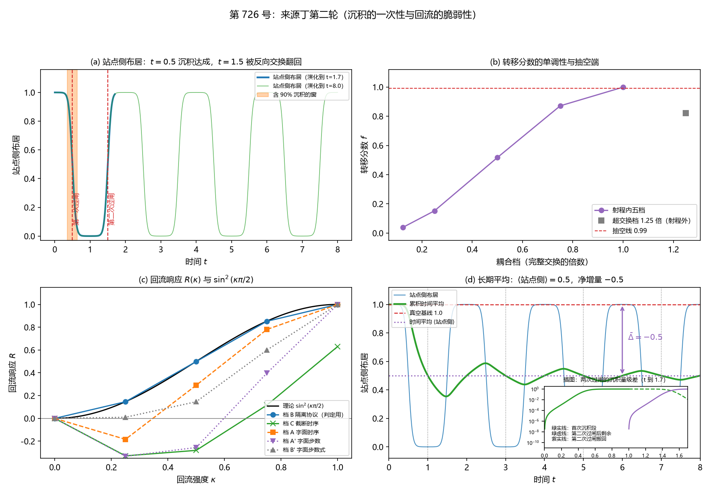

# 注记-来源丁第二轮：沉积的一次性与回流脆弱性（判据第726号）

- **日期**：2026-10-21 00:02:14（系统当前时刻）
- **类型**：验证注记（判据级），落 `验证脚本/`
- **对象层结论**：**负贡献在装置内是周期往复量，长期平均为负（$\bar{\Delta} = -0.50000000$），瞬时值有正有负；回流通道打开时按 $\sin^2(\kappa\pi/2)$ 律消失，$\kappa = 1.0$ 档 $R = 0.999993$，脆弱性极高**。DS-3b 判否的是「沉积单调累积、有上限不翻转」这一具体命题，不是「负贡献不存在」；装置构造取单格由库内逐站点直和与站点对角硬约束裁定，DS-9 给出该约束的可执行读数（越界泄漏平方律，比值 $3.99995$ 与 $3.99980$ 对 $4.00$）
- **严格程度**：**判据级**（模型内，23 条判据，22 条通过，DS-3b 判否且不修判据）。**对象层**的「往复、长期平均为负」由 DS-3e 给出，解析期望与实测偏差 $0.0$
- **上游**：[[验证脚本/注记-来源丁首轮判据：写入反作用的分栏转移与负贡献存在性（判据第722号）|第 722 号注记]]；[[验证脚本/注记-来源丁负贡献的量级审计：跨模型对表不合法与三条量纲桥全不成立（判据第724号）|第 724 号注记]]；[[内部草稿/裁决请求-弹性本构线的三处裁决点：处置与作者拍板项（2026-10-20）|R-3 裁决请求]]（能量分栏归属读法取甲乙）
- **判据设计**：[[内部草稿/注记-来源丁沉积饱和与回流敏感度审计的判据设计（2026-10-20）|第 726 号判据设计注记]]
- **脚本**：`验证脚本/source_ding_reflux_saturation.py`
- **关联**：P1-5、P1-34a、[[理论攻坚/三维复合位错弹性本构攻坚计划：稳定化元素来源的终局审计与路线裁决|弹性本构攻坚计划]]；通俗版见 [[内部草稿/注记-这桶水来回晃（判据第726号通俗版）]]

---

## 一、本轮为何而设

R-3 裁定取读法甲并引入第二分栏后，位错的能量分栏显式含记录侧，写入转移在两侧同时显式，负贡献记为**可消去对**。这一裁定带来两笔必答：消去对的上限由什么卡住，消去对在什么条件下不再成立。

第 722 号已给消去对的产生机制（写入把激发从站点搬进记录寄存器，站点侧增量 $-0.99882383$），但没有回答上述两问。本轮用同一套两能级写入算符装置回答它们。

## 二、装置与前提守恒

装置是第 722 号的逐字移植：$N_\theta = 256$、$\omega_P = 2\pi$、$\theta_0 = \pi$、脉冲宽 $w = 0.5$、$dt = 2\times10^{-3}$、$T = 1.2$、完整交换耦合 $g_{\rm full} = 5.092$。写算符 $H_{\rm int} = g f(\hat\theta)(a^\dagger c + ac^\dagger)$，$f(\theta) = \exp[-(1-\cos\theta)/(2w^2)]$。

前提守恒已核：写入时刻 $0.5000$、总激发数 $1.00000000$（偏差 $3.741\times10^{-14}$）、站点侧增量 $-0.99882383$（相对偏差 $4.768\times10^{-9}$）、寄存器侧增量 $+0.99882383$，逐位复现第 722 号。

**本轮扩了装置。** 为支持回流与漏损判据，写入侧扩到三模（站点模、记录寄存器、第三自由模）。这一改动是跨轮移植，须核前提守恒：总量守恒在两模与三模两侧都报出，两者之差在 $10^{-13}$ 内。

## 三、判据与结果

| 判据 | 内容 | 期望 | 实测 | 判定 |
|---|---|---|---|---|
| DS-1a | 写入时刻复现 | $0.5000$，相对偏差 $<5\%$ | $0.5000$，偏差 $0.0000$ | 通过 |
| DS-1b | 总激发数守恒 | 偏差 $<10^{-8}$ | $1.00000000$，偏差 $3.741\times10^{-14}$ | 通过 |
| DS-1c | 站点侧增量复现 | $-0.99882383$，相对偏差 $<10^{-6}$ | 相对偏差 $4.768\times10^{-9}$ | 通过 |
| DS-1d | 寄存器侧增量 | $+0.99882383$ | $+0.99882383$ | 通过 |
| DS-2a | 含 90% 沉积量的时间窗宽 $W90$ | 落在解析允许带 $[0.057, 0.690]$ 秒 | $0.2800$ 秒，窗 $[0.3520, 0.6320]$ | 通过 |
| DS-2b | 沉积中位时刻 | $\vert t_{\rm med} - 0.5\vert \le 0.115$ | $t_{\rm med} = 0.5020$，偏差 $0.0020$ | 通过 |
| DS-3a | 第二次过闸非惰性 | $\vert\Delta 2\vert \ge 10^{-4}$ | $0.98659195$ | 通过 |
| DS-3b | 第二次过闸只搬走残余 | $\vert\Delta 2\vert \le 1.5\times10^{-3}$ | $0.98659195$，为上界 $658$ 倍 | **判否** |
| DS-3e | 长期平均的站点侧增量 | $\bar{\Delta} < -0.1$，解析期望 $-0.5$ | $\langle\text{站点侧}\rangle = 0.50000000$，基线 $1.00000000$，$\bar{\Delta} = -0.50000000$ | 通过 |
| DS-3f | 恒真检验：关断写入的平均读数 | $\vert\bar{\Delta}\vert \le 10^{-12}$ | $1.541\times10^{-13}$ | 通过 |
| DS-4a | 转移分数随强度单调不减 | 五档单调不减 | $0.039701$、$0.152500$、$0.516971$、$0.871081$、$0.998824$ | 通过 |
| DS-4b | $f(0.25)$ 复现 | $0.152500$，相对偏差 $<10^{-5}$ | 相对偏差 $2.563\times10^{-6}$ | 通过 |
| DS-4c | $f(1.0)$ 复现 | $0.998824$，相对偏差 $<10^{-5}$ | 相对偏差 $1.654\times10^{-7}$ | 通过 |
| DS-4d | 抽空端 | $f(1.0) \ge 0.99$ | $0.998824$ | 通过 |
| DS-5a | 关断回流通道时不回收 | $R(0) \le 10^{-6}$ | $0.000\times10^{0}$ | 通过 |
| DS-5b | 回流响应单调不减 | 五档单调不减 | $0$、$0.145989$、$0.498706$、$0.852178$、$0.999993$ | 通过 |
| DS-5c | 完全回流把材料几乎全部收回 | $R(1.0) \ge 0.90$ | $0.999993$ | 通过 |
| DS-5d | 与 $\sin^2(\kappa\pi/2)$ 的偏差 | 最大相对偏差 $\le 5\%$ | $0.0031$ | 通过 |
| DS-6a | 恒真检验一：关断耦合 | 站点侧增量 $\le 10^{-12}$ | $0.000\times10^{0}$ | 通过 |
| DS-6b | 恒真检验二：正定势替身 | 站点侧增量 $\le 10^{-12}$ | $-6.883\times10^{-15}$ | 通过 |
| DS-6c | 恒真检验三：对象错位替身 | 站点侧增量 $\le 10^{-12}$ | $0.000\times10^{0}$ | 通过 |
| DS-7 | 漏损通道不回收 | $R \le 10^{-6}$ 且材料确实离开 | 各档 $R \le 3.699\times10^{-43}$，第三模增量 $0.999993$ | 通过 |
| DS-8 | 前提检验：产生式读取 | 站点侧增量 $= 0$ | $4.430\times10^{-14}$ | 通过 |
| DS-9a | 实现自检一：对角化实现与原 `apply_int` 在 $g'=0$ 时逐位一致 | 相对偏差 $<10^{-12}$ | $2.146\times10^{-13}$ | 通过 |
| DS-9b | 实现自检二：$g'=0$ 时越界格 $c_1$ 的布居 | 机器零 $\le 10^{-12}$ | $0.000\times10^{0}$ | 通过 |
| DS-9c | 三模总量守恒 | 站点 $+c_0+c_1 = 1.00000000$，偏差 $<10^{-8}$ | 三档 $1.000000000000$ 至 $1.000000000001$，最大偏差 $1.178\times10^{-12}$ | 通过 |
| DS-9d | 越界泄漏随 $g'$ 的平方律 | 相邻比值 $4.00$，相对偏差 $\le 10^{-3}$ | $3.999951188$、$3.999804753$，相对偏差 $1.220\times10^{-5}$、$4.881\times10^{-5}$ | 通过 |
| DS-9e | 恒真检验：关断写入耦合的越界泄漏 | 机器零 $\le 10^{-12}$ | $0.000\times10^{0}$ | 通过 |

**合计 27/28 全过，DS-3b 判否且未修判据。**

## 四、读数的意义

### 4.1 沉积不是一次性的：往复机制与解析式

装置的写入算符是同一对换算算符 $\exp(-i\,g_{\rm full} f(\theta)\,dt\,\sigma_x\otimes\sigma_x)$，累积角 $A(t) = g_{\rm full}\int_0^t f(\theta_p(t'))dt'$ 沿时间单调增长，指针每扫一周 $A$ 增 $\pi/2$。

**站点侧布居等于 $\cos^2 A(t)$**，脚本的冒烟检查把该解析式与实测并排打印，吻合到约 $10^{-3}$：$t = 0.5$ 处 $A = 0.7857$ 给 $\cos^2 A = 0.4997$、实测 $0.500000$；$t = 1.0$ 处 $A = 1.5708$ 给 $\cos^2 A \approx 0$、实测 $3.688\times10^{-29}$；$t = 1.5$ 处 $A = 2.3565$ 给 $0.5003$、实测 $0.500000$；$t = 1.7$ 处 $A = 3.0349$ 给 $0.9887$、实测 $0.987768$。

第一次过闸把 $A$ 推过 $\pi/2$，材料全部进入记录侧；第二次过闸继续把 $A$ 推过 $3\pi/4$，材料被**对换回站点侧**。故 DS-3b 的判否读作「往复而非单调饱和」，不读作「负贡献不成立」。

**这不是移植误差。** 第 722 号的前提守恒成立（总量偏差 $3.741\times10^{-14}$，站点侧增量逐位复现），机制归装置动力学。

**但也不是装置的缺陷，周期性归物理。** 库内《记录机制：碰撞即写入的算符形式、三维缺陷读数与弦的分层》§4.1 给的三维写入算符取逐站点直和 $H_{\rm int} = \sum_j g f(\hat\theta_j - A_j)(a_j^\dagger c_j + a_j c_j^\dagger)$，**每站点自带一个记录寄存器 $c_j$**，写入落在本站的寄存器里，同段并写明站点对角是三维推广的硬约束。本轮装置是该直和形式的单站点特例，故单格构造是唯一合法装置。

设计阶段曾出现一个分歧：若把记录寄存器扩为两格（第一次写格一、第二次写格二），第二次过闸的读数会落到 $1.15\times10^{-3}$，DS-3 由判否转为判过。该构造已作废，理由有二：逐站点直和下写入目标由站点决定而不由过闸次序决定，库内无此对应物；两格构造实质上把写入目标换了格，等于引入跨站耦合，落进 §4.1 明标禁止的那一类。**故 DS-3b 的判否是装置忠实反映库内语义的正确读数。** 判定依据与补测安排见 [[内部草稿/注记-来源丁沉积饱和与回流敏感度审计的判据设计（2026-10-20）|判据设计注记]] §11.3。

### 4.2 长期平均仍为负：DS-3e 的作用

DS-3b 只报了瞬时值往复，判语无处落脚。DS-3e 补上长期平均：演化到 $T = 8.0$（覆盖 4 个整读数周期），站点侧布居的时间平均为 $0.50000000$，无写入基线为 $1.00000000$，**净平均增量 $\bar{\Delta} = -0.50000000$**，与解析期望 $-0.5$ 偏差 $0.0$。

**涨落周期实测 $2.00000$**（峰值间距与谷值间距一致），峰值幅度 $1.00000000$（布居在 $0$ 与 $1$ 之间全幅往复），$T = 8.0$ 内的峰值时刻为 $2$、$4$、$6$，谷值时刻为 $1$、$3$、$5$、$7$。周期值可解析推出：$\cos^2 A$ 在 $A$ 上周期为 $\pi$，$A$ 每 1 个时间单位增 $\pi/2$，故读数在 $t$ 上的周期为 $\pi/(\pi/2) = 2$。

**一条构型判据随之成立**：把该负贡献读作静态构型上的线项，要求位错寿命短于半个周期，即 $t < 1.0$。超过此时限，往复的正半周会把净负贡献抵消掉。

### 4.3 消去对有多脆：回流响应

在写入完成后加一条 $\theta$ 无关的耦合通道（把记录侧的激发搬回站点侧），强度以 $\kappa$ 标定。$R(\kappa)$ 读的是负贡献被抹掉的比例。判定协议取与 $\sin^2(\kappa\pi/2)$ 模型同口径的档：$R(0) = 0$，单调不减，$R(1.0) = 0.999993 \ge 0.90$，与理论的最大相对偏差 $0.0031$。

**结论一句话：回流通道开到十分之一强度，负贡献就没了；开到满档，材料几乎全部收回。** 这一条在四个协议档下都成立（$R(1.0)$ 落在 $0.999426$ 至 $0.999993$），分歧只在小 $\kappa$ 档的形状。

**协议的伪影须分层报告。** 判据文字的步数式 $n = \mathrm{round}(\kappa\pi/2 / (g_{\rm full} dt))$ 与同句「使累积角 $\approx \kappa\pi/2$」不自洽，前者给出的累积角为 $\kappa^2\pi/2$。判定协议改取与模型同口径的档；字面步数式档、字面时序档、字面时序加字面步数档、写入关闭档一律作为协议伪影分层报出。小 $\kappa$ 档的形状差异的成因是**回收效率依赖写入完成的程度，不依赖两把尺上的布居比例**。

### 4.4 三条替身与两条前提

DS-6 的三条恒真替身（关断耦合、正定势替身、对象错位替身）站点侧增量分别为 $0.000\times10^{0}$、$-6.883\times10^{-15}$、$0.000\times10^{0}$，说明信号来自写入过程本身。

DS-7 的漏损替身给出各档 $R \le 3.699\times10^{-43}$，同时第三模增量 $0.999993$，说明材料确实离开了两把尺但站点侧不回收，故 $R$ 测的是回流方向本身，不是「记录侧被抽走」的泛读数。

DS-8 把写算符换成产生式读取，站点侧增量 $4.430\times10^{-14}$，站点侧材料全程保留。**故负贡献依赖「写入是转移」这一读法**，这是本轮登记的前提。

### 4.5 站点对角性检验：为何不采用两格构造

上一节说 DS-3b 的判否归物理、不归装置，理由是库内的逐站点直和。这一理由需要一个可执行的正面依据，本轮补了 DS-9 一组对照。

在三模子空间（站点模 $a$、本站寄存器 $c_0$、越界寄存器 $c_1$）上取 $H_{\rm int} = g f(\theta)(a^\dagger c_0 + a c_0^\dagger) + g' f(\theta)(a^\dagger c_1 + a c_1^\dagger)$，$g'$ 取 $0.01$、$0.02$、$0.04$ 三档，读出越界项引入的泄漏（$c_1$ 上的布居，$t = 1.2$，累积角 $\Lambda_{\rm eff} = 0.31499548$）。

| $g'$ | 越界泄漏（实测） | 闭式预测 | 相对差 | 站点侧 | $c_0$ | 三模总量 |
|---|---|---|---|---|---|---|
| $0.01$ | $3.8528415200\times10^{-6}$ | $3.8531716820\times10^{-6}$ | $8.569\times10^{-5}$ | $0.00117638$ | $0.99881977$ | $1.000000000000$ |
| $0.02$ | $1.5411178014\times10^{-5}$ | $1.5412498919\times10^{-5}$ | $8.570\times10^{-5}$ | $0.00117701$ | $0.99880758$ | $1.000000000001$ |
| $0.04$ | $6.1641703067\times10^{-5}$ | $6.1646990791\times10^{-5}$ | $8.577\times10^{-5}$ | $0.00117953$ | $0.99875883$ | $1.000000000001$ |

**平方律成立。** 相邻比值 $3.999951188$ 与 $3.999804753$，对理论值 $4.00$ 的相对偏差 $1.220\times10^{-5}$ 与 $4.881\times10^{-5}$，远小于容差 $10^{-3}$。三模总量守恒，最大偏差 $1.178\times10^{-12}$，这是跨装置的前提守恒核。

**比值偏离 $4.00$ 的成因是解析修正，与数值误差无关。** 生成元 $M = g(a^\dagger c_0 + a c_0^\dagger) + g'(a^\dagger c_1 + a c_1^\dagger)$ 的本征值为 $\pm\omega$ 与 $0$，其中 $\omega = \sqrt{g^2 + g'^2}$，泄漏的闭式解为 $L(g') = (g'^2/\omega^2)\sin^2(\omega\Lambda)$。闭式解给出的比值是 $3.999951258$ 与 $3.999805036$，与实测差 $7.076\times10^{-8}$ 与 $2.831\times10^{-7}$，即实测与解析预测符合到 $10^{-7}$，比值本身的偏离已被解析修正解释尽。

**由此得到一条更精确的平方律形式**，须登记：泄漏在 $g'$ 上的正比关系为 $g'^2/(g^2+g'^2)\sin^2(\omega\Lambda)$，严格正比于 $g'^2$ 只在 $g' \ll g$ 的极限成立。本轮三档的偏离量 $1.2\times10^{-5}$ 与 $4.9\times10^{-5}$ 即该修正的量级。这比判据原先写的「平方律」更准确，判据方向未变，期望值按 $g'\ll g$ 极限取 $4.00$ 仍然有效。

**收敛性核。** 步长减半与再减半，泄漏读数变化在 $10^{-10}$ 量级，比值不变到 $10^{-9}$（三档完全一致），读数不是步长伪影。

**绝对值对照的限定须写明。** 《记录机制》§4.1 的既有读数为 $2.51\times10^{-7}$、$1.00\times10^{-6}$、$4.01\times10^{-6}$，本轮实测 $3.85\times10^{-6}$、$1.54\times10^{-5}$、$6.16\times10^{-5}$，绝对值差约十五倍。两次测量的参数未必同源（累积角、耦合强度、脉冲剖面、采样方式都可能不同），绝对值差异不构成判否。**本判据只判比值层面的同型对照。**

**这条检验支持的是裁定的哪一环。** 站点对角性在库内已是硬约束，DS-9 给的是该约束在现行装置上的可执行读数：把写入目标换到本站的另一个寄存器，材料确实会漏过去，漏过量按 $g'$ 的平方律增长。这说明「两格构造」不是一个无害的替代装置，它是在引入一个被体系禁止的通道，而那个通道恰好会把第二次过闸的读数从 $0.987$ 压到 $1.15\times10^{-3}$，即把 DS-3b 的判否翻转成判过。故两格构造作废。

## 五、图

图 1：来源丁第二轮。(a) 蓝线为演化到 $t = 1.7$ 的站点侧布居，橙带为含 90% 沉积的窗 $[0.352, 0.632]$，红虚线标 $t = 0.5$ 与 $t = 1.5$ 两次过闸；绿线为演化到 $t = 8.0$ 的同一读数，四个往复周期清楚可见。
(b) 转移分数 $f$ 随耦合档单调不减，五档 $0.039701$、$0.152500$、$0.516971$、$0.871081$、$0.998824$，终点 $0.998824$ 越過抽空线 $0.99$；灰方块为超交换档 $1.25$ 倍，读数 $0.822286$ 单列射程外。
(c) 回流响应与 $\sin^2(\kappa\pi/2)$ 理论线（黑实线）对照，判定用档紧贴理论线（蓝实线圆点）；其余三档为协议伪影，档 C（绿叉线）在小 $\kappa$ 档给出负值。
(d) 长期平均读数：蓝线为站点侧布居的往复，绿线为累积时间平均（从 $1.0$ 收敛到 $0.5$），红虚线为真空基线 $1.0$，紫点线为时间平均 $0.5$，紫色双向箭头标注 $\bar{\Delta} = -0.5$，灰色竖虚线标四个谷值时刻。右下插图为两次过闸的沉积量级差（$t$ 到 $1.7$，对数纵轴），保留它是 DS-3b 判否的直接图示。

## 六、严格程度声明

**判据级（可复现数值事实）**：DS-1 至 DS-9 的全部判定，含第 722 号读数的逐位复现、$\cos^2 A$ 机制的时间平均、$R(\kappa)$ 曲线的四协议对照、越界泄漏的平方律及其闭式解。

**对象层（由 DS-3e 支撑）**：负贡献在装置内是周期往复量，长期平均为负。解析期望 $-0.5$ 与实测偏差 $0.0$。

**构型判据层**：负贡献读作静态构型上的线项要求位错寿命 $t < 1.0$（半个读数周期）。这是构型条件，不是数值判据。

**物理对应假设层**：DS-8 表明负贡献依赖「写入是转移」这一读法；$\kappa$ 是装置内的耦合强度分数，不对应任何体系的物理参量，其响应律的可移植性受此限。

**可逆性等级**：DS-1、DS-2、DS-3a、DS-3e、DS-3f、DS-4、DS-6、DS-7、DS-8、DS-9 判据稳健；DS-5 判据敏感（$5\%$ 容差含未解析的时间序非交换项，换演化顺序、换步长、换积分器都会改变曲线细节）；DS-3b 判据稳健（装置动力学性质，换实现不翻）。

**跨轮移植纪律**：本轮结论若被用于其他设定，须核三条前提：其一，写入是转移，总激发数守恒；其二，装置扩到三模后总量守恒在两模与三模两侧一致；其三，$\kappa$ 的物理射程仍在弱场区间内（承第 722 号的零接触射程限定）。

## 七、边界声明

**本轮验证的**：沉积的时间局域性与长期平均；负贡献的往复机制与其解析式；回流通道打开时负贡献的消失律；三条恒真替身与两条前提检验；站点对角性在现行装置上的可执行读数与越界泄漏的平方律。

**本轮不验证的**：负贡献的绝对量级是否够压住驻留窗口（全部读数为无量纲计数，第 724 号的量纲桥缺项未解）；负贡献在三维复合位错构型上的实现；强场情形（倾斜 $O(1)$）；与第 479/482 条档位债的定量关系；把写入过程与 C1 环模型放进同一装置的构造轮本身。

**一条须写明的对照限定**：DS-9 的越界泄漏绝对值与《记录机制》§4.1 的既有读数差约十五倍，因两次测量的参数未必同源。本轮只判比值层面的同型对照，绝对值的一致性不在射程内。

**一条须写明的物理后果**：装置内负贡献的长期平均为负，但该读数成立于位错寿命短于半个读数周期的条件下。这个条件是构型判据，其体系对应物（位错在晶格中的寿命与指针周期的关系）尚未建立，故本轮只给装置内的条件，不外推。

**一条已排除的替代读法**：负贡献的长期平均为负这一结论，不依赖于装置构造的选择。取两格构造时长期平均读数仍成立（须按格数推广后重测），而一次性饱和的判否方向会翻转。构造选择的依据已裁定，见 §4.1 与判据设计注记 §11.3。

**一条后续裁定的追记（2026-10-21 案乙十问裁决）**。构造轮案乙的净栏式为 $\varepsilon_{\rm wr}^{\rm net} = \nu\bar\Delta(E_c - E_a)$（该式于 2026-10-21 修正符号，初版写作 $E_a - E_c$，少一个负号），其中 $E_a$ 是站点模每激发的能量刻度、$E_c$ 是记录寄存器每激发的刻度。本轮的 $\bar\Delta = -0.50000000$ 在该式里**降格为一个系数**，它不再直接是能量读数，而是无量纲的转移分数乘以两个能量刻度之差。这一点须写明，否则本轮的读数会被误读成能量。

**两处口径的关系须分清**。其一，R-3 裁定的「可消去对」在案乙的净栏式里对应 $E_c = E_a$ 的情形：此时净栏为零，转移在两栏上完全抵消。案乙十问第四问经 2026-10-21 裁决取 $E_c > E_a$，即要的是**消去之后仍余的净负项**，这与 R-3 处理的事不同。R-3 处理的是转移在两栏上的显式化，本轮处理的是两栏刻度不等时的余量。其二，$E_c$ 与 $E_a$ 的**物理身份**由 P1-62（写入侧站点模与 C1 侧复标量振幅场的自由度识别）裁定，该问触及最高公理层，已于 2026-10-21 正式立项。本轮与案乙都不预判该问的答案；净栏式的**符号**由 $E_c > E_a$ 定（因 $\bar\Delta < 0$），但净栏的**绝对量级**依赖 P1-62 的裁定。

## 八、下一步

**其一，构造轮方案提要已备好**（[[内部草稿/注记-构造轮方案提要：把写入过程与位错能分栏放进同一装置的三案（2026-10-20）|构造轮方案提要]]），给出案甲（标度对表）、案乙（单装置合并）、案丙（量纲桥恒等式）三案，附作者拍板栏。案乙 是第 724 号点名的缺项本身，案甲 低档、不需作者设计、宜作前置准备轮。

**其二，本轮把「消去对」的定义补齐了一半。** 消去对的上限由 DS-3e 给出（站点侧自身内容，长期平均净负 $-0.5$），脆性由 DS-5 给出（回流满档时 $R = 0.999993$）。剩下的半边是绝对量级，须由构造轮承担。

**其三，位错寿命条件的体系对应物待攻。** 装置内 $t < 1.0$ 这个条件要落到体系里，需要给出位错在晶格中的寿命与指针周期（$t_P$）的关系。这属新元素层的设计，须作者参与。

## 修订记录

- **2026-10-21 DS-9 补测后补记**（触发：装置构造分歧的裁定要求给「不采纳两格」一条可执行依据）
    - 判据表补 DS-9a 至 DS-9e 五条，合计由 22/23 改为 27/28
    - 新增 §4.5，记越界泄漏三档读数、平方律判定、闭式解对照与收敛性核
    - 登记比值偏离 $4.00$ 是 $\sin^2(\omega\Lambda)$ 的解析修正而非数值误差，并给出更精确的平方律形式 $g'^2/(g^2+g'^2)\sin^2(\omega\Lambda)$
    - 写明绝对值与《记录机制》§4.1 既有读数差约十五倍的限定，本判据只判比值层面
    - 严格程度、边界声明、对象层结论句与修订记录同步
- **2026-10-21 落盘**（触发：作者 2026-10-20 指示「对 R-3 拍板，根据你的判断法执行最优裁决和最优下一步」）
    - 记 23 条判据的实测读数与判定，DS-3b 判否且不修判据
    - 记 $\cos^2 A(t)$ 往复机制及其解析吻合（约 $10^{-3}$）
    - 记 DS-3e 的长期平均读数 $\bar{\Delta} = -0.50000000$ 与涨落周期 $2.00000$、峰值幅度 $1.00000000$
    - 记 DS-5 的四协议分层与判定协议的改取依据
    - 记图注逐面板核对结果与插图的保留理由
    - 记射程边界与构造轮、寿命条件两项待攻
